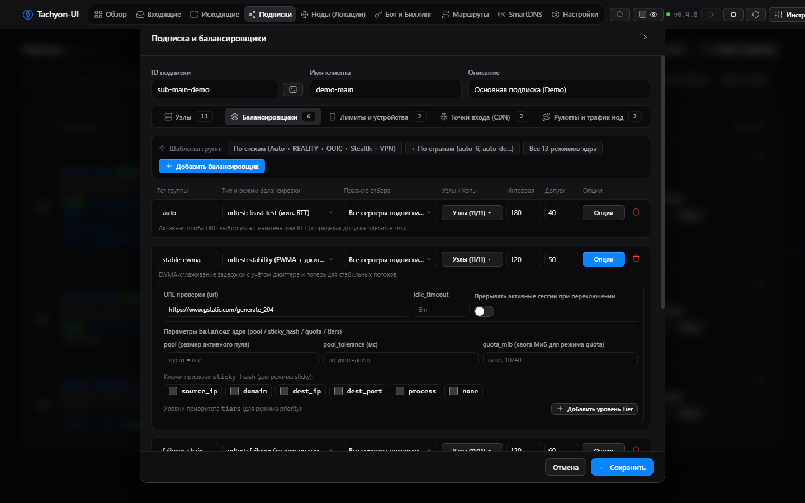
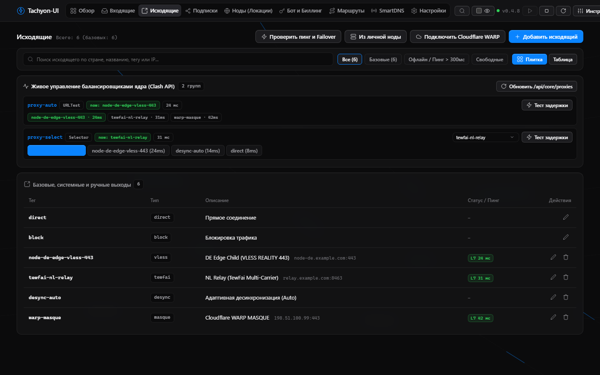
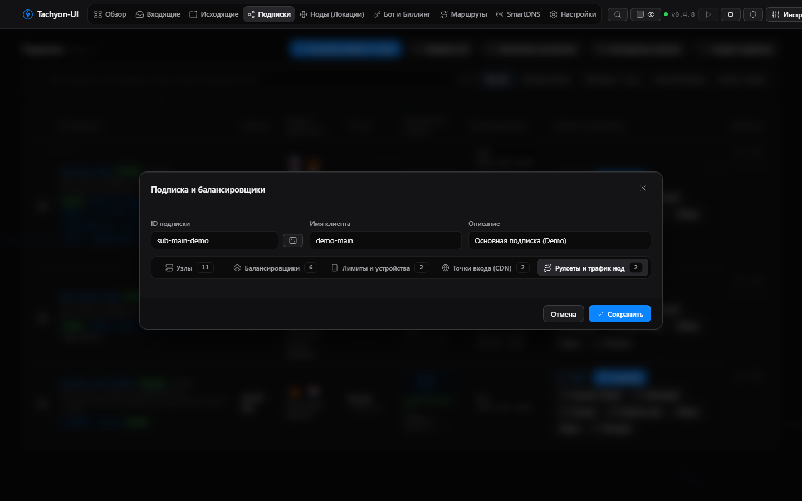
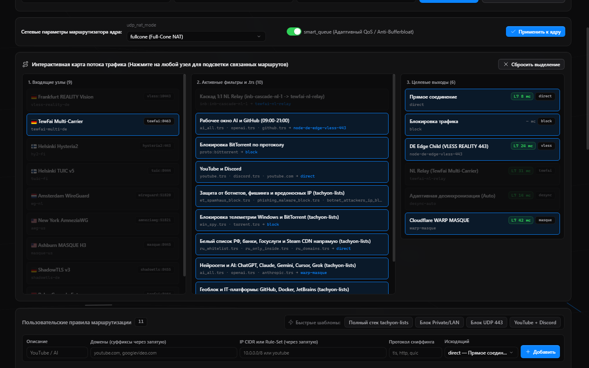
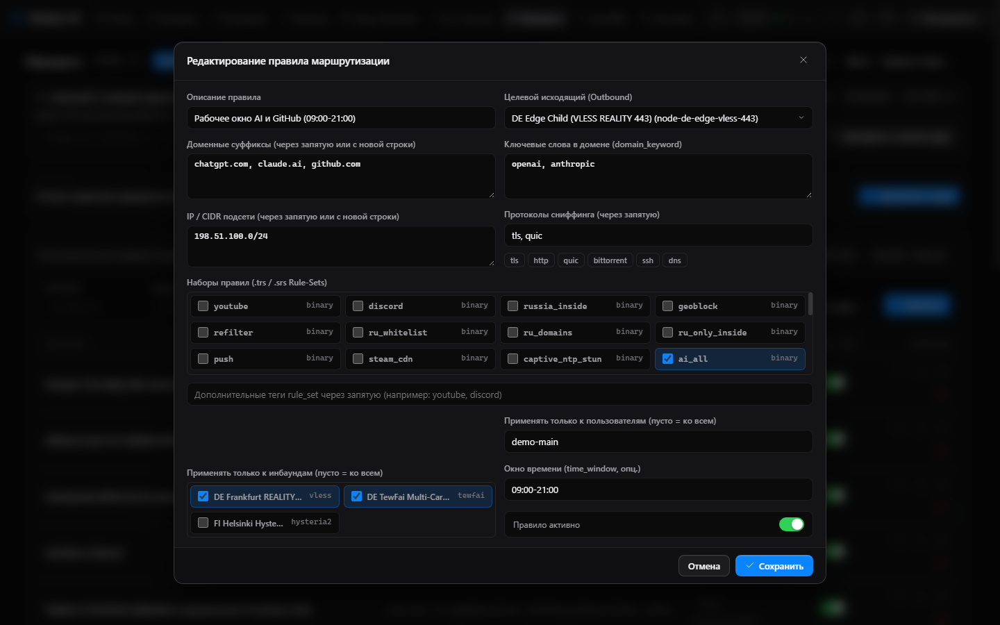
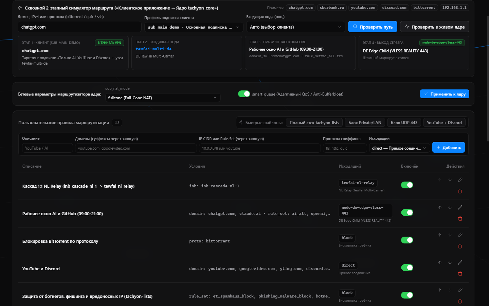

# 4. Балансировщики (12 режимов `urltest`), `chain` и маршрутизация

[English version](../en/04-balancers-chain-and-routes.md) | [Сводный путеводитель](00-complete-guide.md) | [К оглавлению](../../README.ru.md) | [Полный справочник UI](./11-ui-every-tab-and-button-guide.md) | [Балансировщики и Chain](./protocols/27-balancers-and-chain.md) | [Каталог протоколов](./protocols/README.md)

`tachyon-ui` обеспечивает полный паритет с конструктором групповых балансировщиков, многохоповых цепочек `chain` и правилами маршрутизации движка `tachyon-core`.

---

## Типы балансировщиков и 12 режимов `urltest`

Группы балансировки настраиваются в редакторе подписки (вкладка **Балансировщики**), при каскадировании (`POST /api/cascade`) и в исходящих подключениях (`#outbounds`).

### 1. Все 12 режимов `urltest`

| Режим (`mode`) | Алгоритм выбора узла | Ключевые параметры и когда применять |
| :--- | :--- | :--- |
| **`least_test`** | Активная периодическая проба `url` с выбором узла, показавшего минимальный RTT (с защитой от лишних переключений через `tolerance_ms`). | Базовый режим по умолчанию для универсального выбора самого быстрого узла. |
| **`stability`** | EWMA-сглаживание задержки с учётом джиттера и потери пакетов при пробах. | Для голосовой связи, стримов, удалённых рабочих столов и длительных TCP-сессий без скачков задержки. |
| **`failover`** | Строгий приоритет по порядку перечисления в `outbounds`: всегда используется первый рабочий узел, переход на резерв только при его сбое. | Основной + резервный канал (например, выделенный сервер + резервный релей). |
| **`sticky`** | Детерминированная привязка потока к одному и тому же узлу по выбранным ключам хеширования `sticky_hash`. | Банки, игровые сессии, SaaS-кабинеты и сервисы, чувствительные к смене выходного IP на лету. |
| **`least_load`** | Направляет каждое новое соединение на узел с наименьшим количеством текущих открытых соединений. | Равномерная разгрузка нескольких равнозначных серверов при большом числе параллельных клиентов. |
| **`weighted`** | Вероятностное распределение трафика с весом `1 / RTT`. Чем ниже задержка узла, тем выше его доля сессий. | Мультирегиональный пул, где основные потоки идут через ближайший узел, а часть распределяется по соседним. |
| **`round_robin`** | Последовательная циклическая ротация новых потоков по всем здоровым узлам пула. | Распределение большого числа коротких запросов (API, веб-сёрфинг). |
| **`passive`** | Пассивный Circuit-Breaker: не шлёт частых активных проб `url`, отсекает узел по реальным ошибкам соединений. | Экономия ресурсов и фонового трафика на мобильных устройствах и роутерах с ограниченным каналом. |
| **`priority`** | Многоуровневый каскад по массиву `tiers` (Tier 1 → Tier 2 → ...): работает в пределах верхнего здорового уровня, опускаясь ниже только при отказе всего уровня. | Когда есть «золотая» группа ближайших узлов и запасные резервные группы других регионов. |
| **`hedged`** | Спекулятивное дублирование: если первичный узел не отвечает за время ожидания, параллельно запускается попытка через резервный узел и побеждает первый ответ. | Критически низкая задержка открытия страниц на нестабильных беспроводных или мобильных сетях. |
| **`throughput`** | Измеряет и отбирает узел с максимальной подтверждённой пропускной способностью канала. | Загрузки крупных файлов, видео в высоком битрейте, резервное копирование. |
| **`quota`** | Отслеживает объём трафика на узлах (учитывает `quota_mib`) и переводит нагрузку на следующий узел при исчерпании лимита. | Использование нескольких VPS с жёсткими помесячными лимитами трафика. |

#### Страновые `urltest`-балансировщики (авто-регенерация и фильтрация по листьям)

- **Кнопка «+ По странам (auto-fi, auto-de...)»** в конструкторе балансировщиков группирует активные узлы подписки по 2-буквенному ISO-коду страны и создаёт страновые `urltest`-группы (с `interval_secs: 180`, `tolerance_ms: 40`).
- **Авто-регенерация и фильтрация по реальным листьям (`valid_leaf_tags`)**: при сборке клиентского JSON-профиля (`tachyon_json_profile` и `sing-box`) движок `sub_gen` проверяет участников каждого `urltest`-балансировщика по множеству реально присутствующих листовых `outbounds` и `endpoints` (`valid_leaf_tags`). Удалённые или отключённые ноды автоматически отфильтровываются, пустые группы не попадают в конфиг, а для стран, у которых есть узлы, но ещё не создана группа, страновой `urltest` достраивается автоматически (`interval: 180s`, `tolerance: 45`).

#### Вложенные параметры `urltest` и `balancer`

- **Общие поля `urltest`**:
  - `url` — URL проверки доступности (по умолчанию `https://www.gstatic.com/generate_204`);
  - `interval` (`interval_secs`) — период проб (по умолчанию `300s`, например `180s`);
  - `tolerance` (`tolerance_ms`) — порог разницы RTT в миллисекундах (по умолчанию `50`), ниже которого активный узел не меняется;
  - `idle_timeout` — время простоя перед приостановкой фоновых проб (например `5m`);
  - `interrupt_exist_connections` — принудительно закрывать старые соединения при переключении узла.
- **Объект `balancer`** (поддерживается в 10 режимах: `round_robin`, `stability`, `sticky`, `least_load`, `weighted`, `passive`, `priority`, `hedged`, `throughput`, `quota`; в режимах **`least_test`** и **`failover`** объект `balancer` не передаётся и автоматически очищается при генерации конфига):
  - `pool` — размер активного пула лучших узлов;
  - `pool_tolerance` — допуск разброса RTT (мс, `0..=15000`) внутри активного пула;
  - `sticky_hash` — набор ключей привязки для режима `sticky` (чекбоксы: `source_ip`, `domain`, `dest_ip`, `dest_port`, `process`, либо `none` в одиночку);
  - `quota_mib` — лимит трафика в МиБ на узел для режима `quota`;
  - `tiers` — упорядоченные уровни тегов для режима `priority` (визуальный редактор уровней с добавлением/удалением Tier и выбором чипов узлов).

---

### 2. Ручной переключатель (`selector`) и живое управление пулом (`#outbounds`)

- Поля `selector`: `outbounds` (список участников), `default` (узел по умолчанию), `interrupt_exist_connections`, `auto_failover` (автоматический временный переход на рабочий узел при сбое выбранного).
- На карточках балансировщиков, в пуле `#outbounds` (Clash API Live-панель) и в консоли диагностики доступно **живое управление** работающим ядром `tachyon-core` без перезагрузки конфига:
  - **Обновить задержки** — загрузка дерева активных селекторов и текущих RTT из ядра;
  - переключение активного узла в `selector` на лету без рестарта ядра;
  - **Проверить задержку группы** — принудительный L7-замер latency группы до `https://www.gstatic.com/generate_204` (`timeout 5000 мс`) или массовый **Run Health Check / Failover** с TCP fallback;
  - **Trigger / Restore Failover** — ручное включение резервного канала или возврат основного;
  - **Reset Circuit Breaker** — сброс блокировки конкретного outbound и принудительное закрытие залипших сессий.

---

### 3. Последовательные цепочки (`chain`)

Тип **`chain`** строит многохоповый каскад из **минимум 2 последовательных узлов** (в конструкторе порядок хопов настраивается стрелками вверх/вниз в порядке `входной → ... → выходной`):

- `outbounds` — упорядоченный список хопов (`len >= 2`), трафик последовательно проходит `Хоп 1 → Хоп 2 → ... → Цель`.
- `idle_timeout` и `interrupt_exist_connections` — общие тайм-ауты и политика сброса.
- `strip_evasion` — снятие дополнительных флагов маскировки между промежуточными хопами.
- `strip` — гранулярные чекбоксы отключения параметров на внутренних звеньях цепочки:
  - `multiplex.padding`
  - `tls.fragment`
  - `tls.utls`
  - `xhttp.padding`
- `rewrite` — опциональный JSON-объект перезаписи параметров заголовков/протокола.

> Примечание: для обхода DPI на прямых исходящих соединениях без промежуточного сервера также доступен outbound типа **`desync`** (подробнее — [24. Desync](./protocols/24-desync.md)), а все детали JSON-схемы `urltest` / `selector` / `chain` описаны в [27. Балансировщики и Chain](./protocols/27-balancers-and-chain.md).

---

## Персональные правила нод (`node_rules`) и политики трафика

Вкладка **Рулсеты и трафик нод** в `#subs` и боковой инспектор ноды в `#inbounds` (`POST /api/inbounds/traffic-policy`) позволяют задавать целевую специализацию нод:
- **Режимы привязки**: `only_this` (через ноду идёт только выбранный трафик) и `prefer_node` (нода приоритетна для указанных правил).
- **Условия отбора**: наборы `.trs` (`rule_sets`), категории `traffic_types`, собственные домены (`custom_domains`) и порты (`custom_ports`).
- **Серверная политика `server_unmatched`**: `block` (заблокировать на сервере, если клиент пошёл мимо правила), `direct` (выпустить напрямую) или `client_only` (применять только на стороне клиента).
- **Строгий режим подписки (`strict_routing_only`)**: переводит клиентский `final` в `direct`, разрешая проксировать только указанные правила и запрещая остальной трафик на уровне `tachyon-core`.

---

## Маршрутизация (`#routes`), интерактивная карта потока и симулятор

### Элементы управления вкладки «Маршруты» (`#routes`) и модалки правила

| Элемент управления | Что делает и на что обратить внимание |
| :--- | :--- |
| **Переключатель `Таблица` / `Flow-карта`** | Переключает отображение между упорядоченным списком правил (сверху вниз — первое совпадение выигрывает) и 3-колоночной граф-картой потоков **«Входящие → Правило / `.trs` → Выход»**, позволяющей сразу выявить «затенённые» правила. |
| **`udp_nat_mode` и `smart_queue`** | Глобальные флаги маршрутизации `tachyon-core`: `udp_nat_mode` (`fullcone`, `eim_eif`, `symmetric`) важен для игр, VoIP, WebRTC и QUIC; `smart_queue` снижает bufferbloat под нагрузкой. После изменения нажмите **Применить (`Apply`)** на дашборде. |
| **Поиск и `Конечный outbound` (`final`)** | Быстрый фильтр таблицы правил и выбор маршрута по умолчанию (`direct` при точечном обходе или зарубежный шлюз при схеме «всё в VPN, кроме РФ»). |
| **Спойлер авто-релеев 1:1** | Скрывает автоматически сгенерированные 1:1 правила для мостов и каскадов, чтобы не загромождать список ручных правил. |
| **Установить пакет `tachyon-lists`** | В 1 клик скачивает и подключает готовый пакет бинарных `.trs` баз (РФ-сервисы, заблокированные ресурсы, реклама, AI/стриминги). Потребует `Apply`. |
| **`+ Добавить правило`** | Открывает редактор правила маршрутизации: приоритет, теги `inbound`, `auth_user`, `domain`, `domain_suffix`, `domain_keyword`, `ip_cidr`, `port`, `protocol`, `network` (`tcp`/`udp`), `rule_set` (`.trs`), расписание `time_window` и целевой `outbound` (`direct`, `block`, любой шлюз или балансировщик). |
| **`+ Добавить список правил`** | Подключает локальный или удалённый `.trs`/`.srs`/`.json` список (`type: local \| remote`, `format: binary \| source`, `url` или путь, `download_detour` через прокси, `update_interval`). |
| **Кнопки строки правила** | Стрелки **Вверх / Вниз** (изменение приоритета), тумблер **Вкл / Выкл**, **Редактировать** и **Удалить**. |

### Правила, списки `.trs`, `udp_nat_mode` и `smart_queue`

- **Фильтры правил**: `inbound` (теги входящих), `auth_user` (логины/клиенты), `domain`, `domain_suffix`, `domain_keyword`, `ip_cidr`, `port`, `network` (`tcp`/`udp`), `rule_set` (наборы `.trs`/`.json` из `tachyon-lists` в памяти через `mmap`), `protocol` (`bittorrent`, `quic`, `tls`, `dns`, `ssh`).
- **Расписание по времени (`time_window`)**: активация правила строго по окну времени и дням недели (например `mon-fri 09:00-22:00 Europe/Berlin`). Поддерживаются интервалы с переходом через полночь.
- **Глобальные флаги секции `route`**:
  - **`udp_nat_mode`**: `""` (по умолчанию), `fullcone`, `eim_eif` или `symmetric` — тонкая настройка NAT для UDP-игр, WebRTC и голосовых звонков;
  - **`smart_queue`**: интеллектуальная приоритизация интерактивных пакетов и ограничение буферного разбухания (Bufferbloat) под нагрузкой.
- **1-Click стек `tachyon-lists`**: кнопка установки готовых бинарных списков `.trs` (YouTube, Discord, AI, потоковые сервисы, соцсети, региональные подсети) в `/api/routes/tachyon-lists-pack` — также вынесена на дашборд в карточку **Маршрутизация и списки** под блоком памяти.
- **Интерактивная карта потока трафика**: в режиме **Flow-карта** раздела `#routes` строится 3-колоночная топология **«1. Входящие узлы → 2. Активные фильтры и `.trs` → 3. Целевые выходы»**. Клик по любому узлу, правилу или выходу мгновенно подсвечивает всю связанную цепочку прохождения трафика; там же доступна оперативная блокировка домена (`POST /api/core/block-domain`).

### 2-уровневый Route Simulator и проверка в живом ядре

В верхней части раздела **Маршруты** доступны два режима трассировки цели (домен, IPv4 или протокол) с опциональным выбором `sub_id` и `inbound_tag`:
1. **Симуляция конфигурации** (`Симулировать`, `POST /api/routes/simulate`) — 2-уровневая проверка без обращения к сети: сначала оценивает клиентские правила конкретной подписки (`node_rules` / `happ_routing` / `strict_routing_only`), затем серверные правила `tachyon-core`, показывая индекс сработавшего правила и итоговый `outbound`.
2. **Проверить в живом ядре** (`POST /api/core/route-check` / `POST /api/core/route-domain`) — отправляет трассировку прямо в работающий процесс `tachyon-core` с учётом реально скомпилированных `.trs` баз и live-DNS, возвращает точный сработавший rule, выбранный `effective_outbound`, резолв IP / FakeIP и результаты параллельных проб (`Routed`, `Direct`, `Proxy`).

---

[Назад: Глава 3 — Подписки, 360°-инспектор, веб-портал и Covert Knock](03-subscriptions-and-covert-knock.md) | [Оглавление](../../README.ru.md) | [Полный справочник UI](./11-ui-every-tab-and-button-guide.md) | [Балансировщики и Chain](./protocols/27-balancers-and-chain.md) | [Далее: Глава 5 — Протоколы, кластер, каскады и Telegram-бот](05-protocols-nodes-and-tgbot.md)
