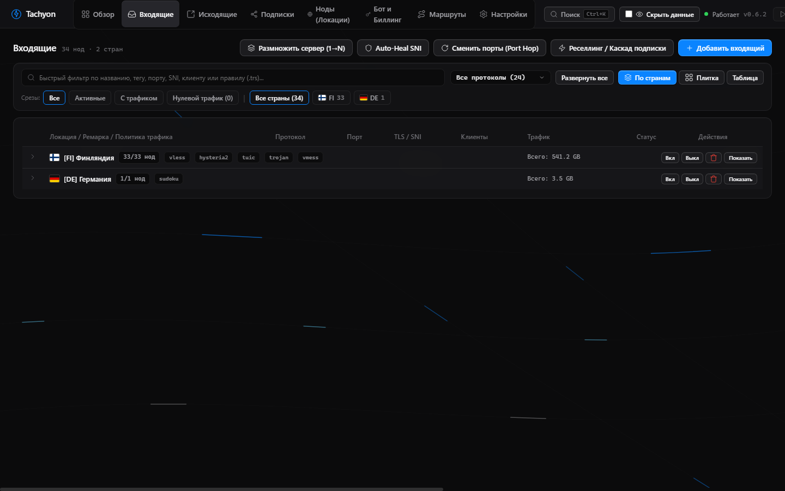
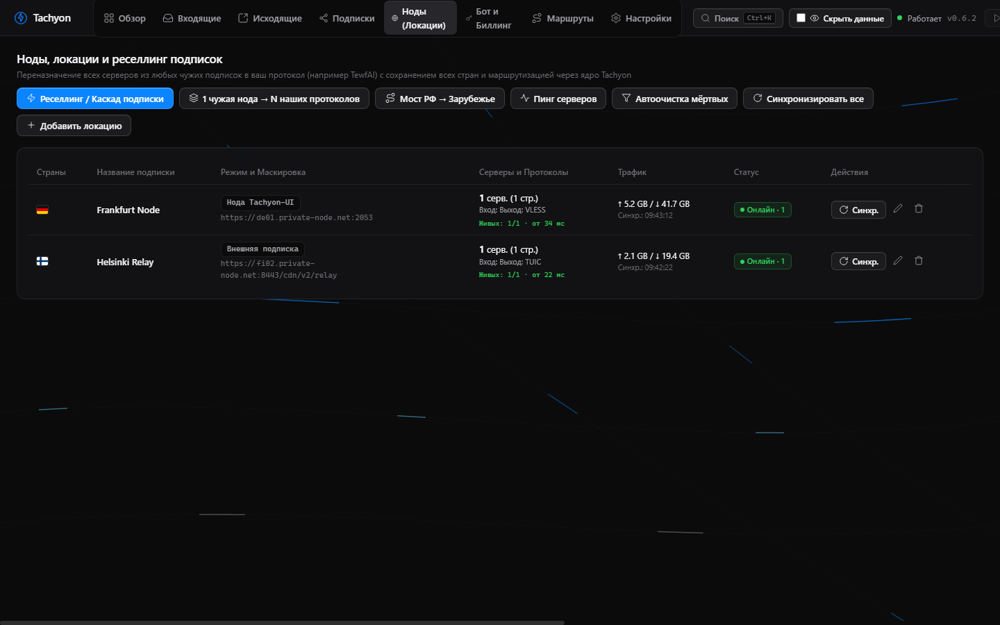
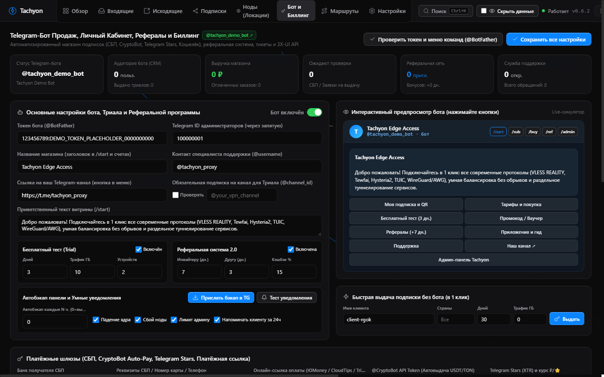

# 5. Протоколы, мультиноды, каскады и Telegram-бот

[English version](../en/05-protocols-nodes-and-tgbot.md) | [К оглавлению](../../README.ru.md)

## Входящие и исходящие протоколы

### Входящие (`#inbounds`)

| Протокол | Ключевые особенности в `tachyon-ui` |
| :--- | :--- |
| **VLESS** (TCP / XHTTP / gRPC / WS) | Поддержка `xtls-rprx-vision`, XHTTP режимов (`auto`, `packet-up`, `stream-up`, `stream-one`) с padding-диапазонами, REALITY (включая `Self-Steal` и опциональный постквантовый ключ `reality_pq_key`), TLS, встроенного сканера SNI (`POST /api/tools/sni-scan`). |
| **Hysteria2** | QUIC-транспорт с заданием `up_mbps`/`down_mbps`, обфускацией `salamander`/`gecko`, профилями BBR (`standard`/`conservative`/`aggressive`) и `masquerade`. |
| **TUIC v5** | Контроль перегрузок `bbr`/`cubic`/`new_reno`, `zero_rtt`, интервал `heartbeat`. |
| **AnyTLS / ShadowTLS v3 / Naive / Mieru / Snell** | Современные протоколы с padding-схемами (AnyTLS), маскирующим TLS handshake (ShadowTLS `strict_mode`), HTTP/3 QUIC (Naive), TCP/UDP мультиплексированием (Mieru) и версиями Snell 5/6. |
| **Tewfai / FPTN / TrustTunnel / OpenConnect** | Нативный Tewfai (QUIC, FEC, shaper/morph профили, шифр, PQC), нативный FPTN (пулы IPv4/DNS, обфускация), TrustTunnel QUIC и OpenConnect (`anyconnect`, `gp`, `pulse`, `fortinet`). |
| **WireGuard / AmneziaWG** | Генератор ключей X25519, настройка параметров мусорных пакетов (`jc`, `jmin`, `jmax`, `s1`, `s2`, `h1..h4`), экспорт `.conf`, ротация диапазона портов (**Port Hopping**: `wg_server_ports`, `wg_hop_interval`, `wg_hop_interval_max`). |
| **WDTT** | Режимы `wg`, `raw`, `csqtt`, `csqtt_v1`, маскировка под медиа (`audio`, `video`, `unified`) и режим SRTP (`auto`, `dtls`, `wrap`). |
| **Sudoku** | Ключ, AEAD (`chacha20-poly1305` и др.), выбор таблиц (`prefer_ascii`, кастомные таблицы), диапазон padding (`padding_min/max`), Pure Downlink и гибкая HTTP-маска (`http_mask_mode`, `host`, `path_root`, `multiplex`). |
| **Cloudflared** | Входящий туннель Cloudflare без открытия входящих портов (токен `cloudflared_token`, `ha_connections`, протокол QUIC/HTTP2, `post_quantum`, `edge_ip_version`, `region`). |
| **MTProto / Trojan / VMess / Shadowsocks 2022 / Mixed / SOCKS / HTTP** | Полная линейка классических прокси и MTProto-релеев для Telegram (автогенерация секрета `ee...` и ключей 2022-blake3). |

> Для любого протокола предусмотрены массовые действия (`/api/inbounds/batch-action`), автопилот ротации SNI (**Auto-Healer**), смена портов (**Port Hop**) и привязка политик трафика к клиентам.

### Исходящие (`#outbounds`)

Помимо стандартных `direct`, `block`, `vless`, `vmess`, `trojan`, `hysteria2`, `tuic`, `shadowsocks`, `anytls`, `shadowtls`, `wireguard`, `amneziawg`, `masque`, `socks`, `http`, доступны специализированные исходящие драйверы `tachyon-core`:

- **`hysteria` (v1)** — совместимость с серверами Hysteria v1 (`auth_str` / TLS).
- **`ssh`** — туннелирование через любой SSH-сервер по паролю или приватному ключу.
- **`tor`** — автоматическая маршрутизация выбранных правил или сайтов через сеть Tor.
- **`bridge`** — интеграция с локальными сетевыми мостами ОС (`interface`, `bridge_name`, `iproute2_table_index`, `iproute2_rule_index`).
- **`mtproto`** — исходящие режимы, включая `telegram-ws` и `kws` поверх TLS WebSocket.
- **`sudoku`**, **`wdtt`**, **`desync`** — нативные исходящие клиенты с автоматической проверкой ключевого материала (невалидные ключи `masque` безопасно отфильтровываются при генерации конфига без остановки ядра).
- **Регистрация Cloudflare WARP / MASQUE в 1 клик** (`/api/core/warp/register`).

---

## Мультиноды, внешние подписки и каскады (`#nodes`)

Раздел **Ноды (Локации)** поддерживает три источника узлов:
1. **`tachyon_node`** — синхронизация с удалённой панелью `tachyon-ui` по её URL и `remote_sub_id`.
2. **`sub_url`** — периодический импорт любой внешней подписки с заданием эмуляции клиента (`User-Agent`, `x-hwid`, `x-device-os`, `x-device-model`).
3. **`manual_uris`** — пакетный импорт списка URI (`vless://`, `hy2://`, `tuic://`, и др.) и массовое клонирование узлов (`/api/nodes/multi-clone`).

- **Автоматический Health-Check и Failover**: фоновая проверка релеев с автоматическим переключением правил маршрутизации внутри той же страны при сбое и возвратом при восстановлении (`relay_auto_failover`).
- **Конструктор каскадов (`/api/cascade/preview`, `/api/cascade`)**: объединяет локальный вход с удалёнными релеями через `urltest` (12 режимов), `selector` или `chain` с предпросмотром конфигурации.

---

## Встроенный Telegram-бот, Mini App и биллинг (`#tgbot`)

Панель включает встроенного long-polling Telegram-бота (без сторонних процессов на Python/Node):

- **Автоматическая выдача доступа и триал**: пробный доступ (`trial_days`, `trial_traffic_gb`, `trial_device_limit`), привязка обязательной подписки на канал (`require_channel_sub`), многоуровневая реферальная программа (бонусные дни + кэшбэк %).
- **Тарифы и приём платежей**: настройка тарифных планов, оплата через СБП/реквизиты, внешние платёжные ссылки, CryptoBot, Telegram Stars (с курсом в RUB) и внутренний баланс пользователя.
- **Промокоды и ваучеры**: создание промокодов на дни, трафик, бонусный баланс и процентную скидку на покупку.
- **Внешний Webhook биллинга**: `POST /api/billing/issue-sub` с проверкой заголовка `X-Webhook-Secret` в постоянном времени.
- **Telegram Mini App & Портал**: встроенный интерфейс выдачи ссылок; при включённом `sub_portal_guard = secret_key` Mini App автоматически авторизуется по криптографически проверенным данным `tgWebAppData`.
- **Оперативные алерты администраторам**: уведомления о падении/перезапуске ядра, сбоях нод, исчерпании квот, срабатывании Zero-Traffic Watchdog и автоматических бэкапах базы.

---

Далее: [Глава 6 — Диагностика ядра, скрытие приватных данных (`Alt+P`) и REST API](06-diagnostics-privacy-and-api.md).
