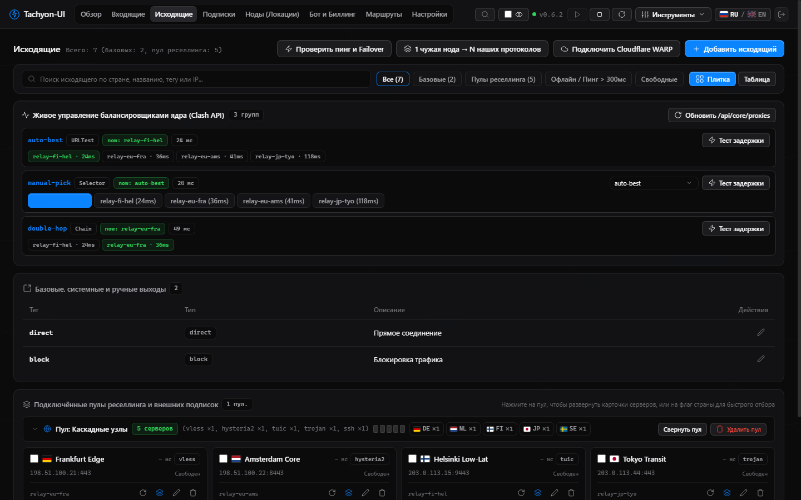

# 5. Протоколы, мультиноды, каскады и Telegram-бот

[English version](../en/05-protocols-nodes-and-tgbot.md) | [К оглавлению](../../README.ru.md)

## Входящие и исходящие протоколы

### Входящие (`#inbounds`)

| Протокол | Ключевые особенности в `tachyon-ui` |
| :--- | :--- |
| **VLESS** (TCP / XHTTP / gRPC / WS) | Поддержка `xtls-rprx-vision`, XHTTP режимов (`auto`, `packet-up`, `stream-up`, `stream-one`) с padding-диапазонами, REALITY (включая `Self-Steal` и опциональный постквантовый ключ `reality_pq_key`), TLS, встроенного сканера SNI (`POST /api/tools/sni-scan`). |
| **Hysteria2** | QUIC-транспорт с заданием `up_mbps`/`down_mbps`, обфускацией `salamander`/`gecko`, профилями BBR (`standard`/`conservative`/`aggressive`) и `masquerade`. |
| **TUIC v5** | Контроль перегрузок `bbr`/`cubic`/`new_reno`, `zero_rtt`, интервал `heartbeat`. |
| **AnyTLS / ShadowTLS v3 / Naive / Mieru / Snell** | Современные протоколы с padding-схемами (AnyTLS), маскирующим TLS handshake (ShadowTLS `strict_mode`), HTTP/3 QUIC (Naive), TCP/UDP мультиплексированием (Mieru) и версиями Snell 5/6. |
| **Tewfai / FPTN / TrustTunnel / OpenConnect** | Нативный Tewfai (QUIC, FEC, shaper/morph профили, шифр, PQC), нативный FPTN (пулы IPv4/DNS, обфускация), TrustTunnel QUIC и OpenConnect (`anyconnect`, `gp`, `pulse`, `fortinet`). |
| **MASQUE** | Современный HTTP/3 QUIC-туннель (`CONNECT-UDP` / `CONNECT-IP`) с ключевыми парами и профилями маскировки. В экспортируемых клиентских профилях автоматически задаются `keep_alive_period: "20s"`, `idle_timeout: "50s"` (ниже серверных `60s`) и `tls.alpn: ["h3"]`. |
| **WireGuard / AmneziaWG** | Генератор ключей X25519, настройка параметров служебных заголовков и пакетов (`jc`, `jmin`, `jmax`, `s1`, `s2`, `h1..h4`), экспорт `.conf`, автовыделение минимального свободного адреса `wg_client_ip` (`2..=254`, `10.10.0.<octet>/32`) при создании клиентов и подписок, ротация диапазона портов (**Port Hopping**: `wg_server_ports`, `wg_hop_interval`, `wg_hop_interval_max`). |
| **WDTT** | Режимы `wg`, `raw`, `csqtt`, `csqtt_v1`, маскировка под медиа (`audio`, `video`, `unified`) и режим SRTP (`auto`, `dtls`, `wrap`). |
| **Sudoku** | Ключ, AEAD (`chacha20-poly1305` и др.), выбор таблиц (`prefer_ascii`, кастомные таблицы), диапазон padding (`padding_min/max`), Pure Downlink и гибкая HTTP-маска (`http_mask_mode`, `host`, `path_root`, `multiplex`). |
| **Cloudflared** | Входящий туннель Cloudflare без открытия входящих портов (токен `cloudflared_token`, `ha_connections`, протокол QUIC/HTTP2, `post_quantum`, `edge_ip_version`, `region`). |
| **MTProto / Trojan / VMess / Shadowsocks 2022 / Mixed / SOCKS / HTTP** | Полная линейка классических прокси и MTProto-релеев для Telegram (автогенерация секрета `ee...` и ключей 2022-blake3). |

#### Группы стран, внешний фронт `:443` и массовые операции (`#inbounds`)

- **Мгновенное редактирование метаданных без перезапуска ядра**: изменение только `country`, `remark`, `external_port` или `external_tls` сохраняется мгновенно без горячей перезагрузки `tachyon-core` и без обрыва активных клиентских соединений (коалесинг записи на диск исключает гонки при быстрой серии правок).
- **Массовая смена страны и пакетные действия (`POST /api/inbounds/batch-action`)**: через `Shift+Click` (плавающая панель действий), кнопку в заголовке группы страны или боковой инспектор ноды можно включать, выключать, удалять и массово назначать 2-буквенный код страны для десятков инбаундов сразу.
- **Внешний фронт (`external_port` / `external_tls`)**: при работе за фронтендом вроде `Unified 443 Front` ноды слушают `127.0.0.1` без TLS, но в интерфейсе помечаются индикатором `-> :443 TLS` и экспортируются клиентам со строгим TLS на порту `443`.
- **Экспорт отдельной ноды и политики трафика**: быстрая выдача ссылки/конфига одной ноды (`GET /api/share/:id`) и привязка правил трафика клиента (`POST /api/inbounds/traffic-policy`).

### Исходящие (`#outbounds`)

Помимо стандартных `direct`, `block`, `vless`, `vmess`, `trojan`, `hysteria2`, `tuic`, `shadowsocks`, `anytls`, `shadowtls`, `wireguard`, `amneziawg`, `masque`, `socks`, `http`, доступны специализированные исходящие драйверы `tachyon-core`:

- **`hysteria` (v1)** — совместимость с серверами Hysteria v1 (`auth_str` / TLS).
- **`ssh`** — туннелирование через любой SSH-сервер по паролю или приватному ключу.
- **`tor`** — автоматическая маршрутизация выбранных правил или сайтов через сеть Tor.
- **`bridge`** — интеграция с локальными сетевыми мостами ОС (`interface`, `bridge_name`, `iproute2_table_index`, `iproute2_rule_index`).
- **`mtproto`** — исходящие режимы, включая `telegram-ws` и `kws` поверх TLS WebSocket.
- **`sudoku`**, **`wdtt`**, **`desync`** — нативные исходящие клиенты с автоматической проверкой ключевого материала (невалидные ключи `masque` безопасно отфильтровываются при генерации конфига, а висячие ссылки автоматически очищаются, чтобы ядро всегда запускалось чисто).
- **Регистрация Cloudflare WARP / MASQUE в 1 клик** (`/api/core/warp/register`) и **тепловая матрица задержек** с пакетным удалением (`/api/outbounds/health-check`, `/api/outbounds/batch-delete`).

---

## Мультиноды, каскады и встроенные сетевые инструменты (`#nodes`)

Раздел **Ноды (Локации)** поддерживает четыре режима источников узлов (подробная пошаговая инструкция по настройке кластера в единую подписку — в [главе 7](07-full-setup-and-cluster-guide.md)):
1. **`managed_tachyon_node` (`Личная управляемая нода Master → Child API`)** — подключение собственных серверов с `tachyon-ui` по кластерному Bearer-токену (`node_api_token`) без ключа доступа: переключение серверов прямо во вкладке `#inbounds`, синхронизация клиентов/квот в общих подписках и экспорт инбаундов ноды в `Outbounds` на `Master` для ролей `direct`, `hybrid` и `relay`.
2. **`tachyon_node`** — read-only синхронизация с конкретной подпиской на вашем удалённом сервере `tachyon-ui` (поддерживается вставка как базового URL + `remote_sub_id`, так и полной ссылки `/sub/<id>`, `/static/feed/<id>`, `/cdn/v2/<id>`, `/rss/updates/<id>`; в базовом режиме работает без ключа доступа, с честным `User-Agent: tachyon-ui/<версия>`).
3. **`sub_url`** — периодический импорт сторонних подписок по URL с настраиваемыми клиентскими заголовками (`User-Agent`, `x-hwid`, `x-device-os`, `x-device-model`) *(требуется ключ доступа по отпечатку хоста `TACHYON-GRANT-V1`)*.
4. **`manual_uris`** — пакетный импорт списка URI (`vless://`, `hy2://`, `tuic://`, и др.) и массовое клонирование узлов (`/api/nodes/multi-clone`) *(для импорта сторонних списков и каскадирования требуется ключ доступа по отпечатку хоста)*.

- **Проверка здоровья нод и автоочистка (`POST /api/nodes/health-check`)**: проверяет доступность конкретной ноды по `id` (или всех нод при `id: 0` / отсутствии поля) с опцией `auto_clean: true` для автоматического удаления недоступных узлов и пересборки затронутых каскадов.
- **Smart Relay Auto-Failover & Failback**: фоновая проверка релеев с автоматическим переключением правил маршрутизации на резервный узел внутри той же страны при сбое и возвратом при восстановлении (`relay_auto_failover`).
- **Конструктор каскадов (`/api/cascade/preview`, `/api/cascade`)**: объединяет локальный вход с удалёнными релеями через `urltest` (12 режимов), `selector` или `chain` с предпросмотром конфигурации.

### Встроенные инструменты автоматизации и проверки

- **SNI-сканер (`POST /api/tools/sni-scan`)**: подбирает устойчивые TLS 1.3 цели с поддержкой ALPN `h2` для REALITY.
- **Auto-Healer SNI (`auto_heal_enabled`, `POST /api/tools/auto-heal`)**: периодическая проверка SNI/TLS с автоматической ротацией целей при сетевой деградации.
- **Port Hopping (`POST /api/tools/port-hop`)**: ротация портов или диапазонов портов (с автоматическим обновлением правил файрвола при включённом `auto_firewall_enabled`).
- **Unlock Probe и региональная проверка (`POST /api/tools/unlock-probe`, `/api/tools/*`)**: диагностика доступности стриминговых/AI-сервисов и проверка связности узла по внешним направлениям.
- **Cloudflare DNS Failover (`POST /api/tools/cloudflare-dns`)**: автоматическое обновление A-записи (`cf_record_name`) и переключение на резервные IP (`cf_backup_ips`) через Cloudflare API.
- **Zero-Traffic Watchdog**: отслеживает аномальное обнуление входящего трафика при активных клиентах и отправляет срочный алерт администраторам.
- **Криптогенераторы (`GET /api/generate/*`)**: мгновенная генерация `GET /api/generate/uuid`, пар ключей `GET /api/generate/reality-keys` (X25519 + `short_id`), `GET /api/generate/wg-keys`, `GET /api/generate/ss-key` (Shadowsocks 2022) и стойких паролей `GET /api/generate/password`.

---

## Встроенный Telegram-бот, Mini App и биллинг (`#tgbot`)

Панель включает встроенного long-polling Telegram-бота (без сторонних процессов на Python/Node):

- **Команды бота**:
  - Для пользователей: `/start`, `/sub`, `/profile`, `/tariffs`, `/buy`, `/trial`, `/promo`, `/ref` (`/referral`), `/apps`, `/support`, `/help`.
  - Для администраторов (`admin_tg_ids`): `/admin`.
- **Автоматическая выдача доступа и триал**: пробный доступ (`trial_days`, `trial_traffic_gb`, `trial_device_limit`, шаблон `trial_template_sub_id`), привязка обязательной подписки на канал (`require_channel_sub`), многоуровневая реферальная программа (бонусные дни + кэшбэк %).
- **Тарифы и приём платежей**: настройка тарифных планов, оплата через СБП/реквизиты, внешние платёжные ссылки, CryptoBot, Telegram Stars (с курсом в RUB) и внутренний баланс пользователя.
- **Управление из веб-панели**: проверка бота (`/api/tg-bot/verify`), массовые рассылки (`/api/tg-bot/broadcast`), личные сообщения (`/api/tg-bot/send-message`), корректировка баланса/дней/трафика (`/api/tg-bot/users/adjust`), промокоды (`/api/tg-bot/promo`), модерация заказов (`/api/tg-bot/orders`), тикеты поддержки (`/api/tg-bot/tickets`), немедленный бэкап в Telegram (`/api/tg-bot/backup-now`) и тестовый алерт (`/api/tg-bot/test-alert`).
- **Внешний Webhook биллинга**: `POST /api/billing/issue-sub` с проверкой заголовка `X-Webhook-Secret` в постоянном времени.
- **Telegram Mini App & Портал**: встроенный интерфейс выдачи ссылок; при включённом `sub_portal_guard = secret_key` Mini App автоматически авторизуется по криптографически проверенным данным `tgWebAppData`.
- **Оперативные алерты администраторам**: уведомления о падении/перезапуске ядра, сбоях нод, исчерпании квот, приближении срока действия подписки (`notify_client_expiry_24h`), срабатывании Zero-Traffic Watchdog и автоматических бэкапах базы.

---

[Назад: Глава 4 — Балансировщики (12 режимов `urltest`), `chain` и маршрутизация](04-balancers-chain-and-routes.md) | [Оглавление](../../README.ru.md) | [Далее: Глава 6 — Диагностика ядра, скрытие приватных данных (`Alt+P`) и REST API](06-diagnostics-privacy-and-api.md)
