# 5. Протоколы (`TewFai Multi-Carrier`), кластер `Master → Child`, каскады и Telegram-бот

[English version](../en/05-protocols-nodes-and-tgbot.md) | [Сводный путеводитель](00-complete-guide.md) | [Полный справочник UI (все вкладки и кнопки)](./11-ui-every-tab-and-button-guide.md) | [Каталог протоколов (27 гайдов)](./protocols/README.md) | [К оглавлению](../../README.ru.md)

> Детальный разбор полей, JSON-схемы `tachyon-core 0.6.9`, пресетов, правил файрвола и форматов экспорта по каждому из 27 протоколов вынесен в [каталог протоколов](./protocols/README.md), а полный перечень всех элементов интерфейса — в [справочник UI](./11-ui-every-tab-and-button-guide.md).

## Входящие протоколы и конструктор инбаундов (`#inbounds`)

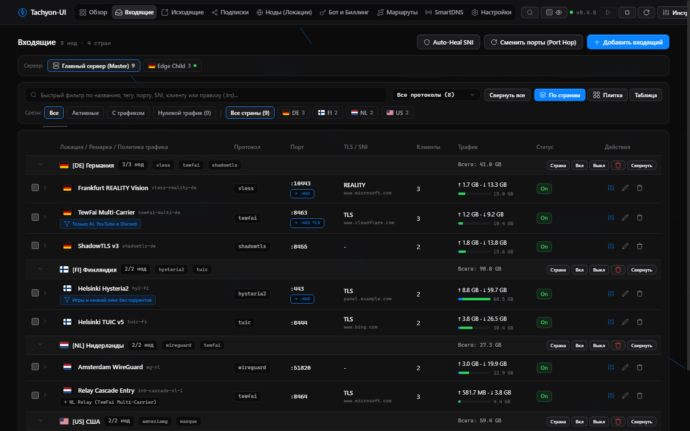

В разделе **Входящие** инбаунды сгруппированы по странам, а переключатель серверов сверху позволяет управлять как локальным сервером, так и любым подключённым дочерним узлом `Master → Child` из единого интерфейса.

### Кнопки, фильтры и действия вкладки `#inbounds`

| Элемент / кнопка | Где находится | Что делает | Когда использовать |
| :--- | :--- | :--- | :--- |
| **Переключатель ноды (`Master / Child`)** | Верхняя панель вкладки | Переключает контекст между локальным сервером и любой управляемой нодой (`managed_tachyon_node`); при выборе Child показывает баннер с кнопками **Обновить с ноды** и **Применить ядро ноды** | Управление инбаундами удалённых серверов кластера без отдельного входа по SSH/вебу |
| **Поиск, Сохранённые виды, Фильтр протокола и стран** | Тулбар фильтрации | Мгновенно отбирает инбаунды по `tag`, порту, протоколу, SNI, заметке, стране или готовому срезу (`REALITY`, `Без TLS` и т.д.); **Сбросить фильтры** возвращает полный список | Быстрая навигация при десятках входящих точек |
| **Дерево / Карточки / Таблица** | Переключатель вида | Переключает плотность отображения списка | Выбор удобного режима работы; во всех режимах поддерживается `Shift+Click` |
| **`Batch Country`** | Панель/шапка стран | Открывает диалог массового назначения 2-буквенного ISO-кода страны выбранным инбаундам | Перед генерацией страновых `urltest`-балансировщиков в подписках |
| **`Auto-Heal SNI`** | Тулбар `#inbounds` | Проверяет живую доступность SNI-целей REALITY/TLS и ротирует деградировавшие домены | При блокировке или просадке маскировочного SNI |
| **`Port Hop`** | Тулбар `#inbounds` | Ротирует рабочие порты настроенных инбаундов и обновляет правила файрвола | При блокировке конкретного UDP/TCP-порта |
| **`1→N Clone`** | Тулбар `#inbounds` | Клонирует эталонный инбаунд на 1..N нод или в серию портов | Масштабирование единого профиля по парку серверов |
| **`Cascade / Resell`** | Тулбар `#inbounds` | Открывает конструктор цепочек: входной узел → зарубежный outbound с шагом **Предпросмотр (`Preview`)** | Сборка мостов и изолированных каскадов |
| **`+ Добавить входящий` (`+ Add Inbound`)** | Правый край тулбара | Открывает 4-вкладочный мастер `#modal-inbound` (**Основное**, **TLS и REALITY**, **Транспорт и Сеть**, **Mux, Brutal и Лимиты**) | Создание новой точки входа по пресету или вручную |
| **Действия в строке / карточке** | Каждая строка инбаунда | Чекбокс (вызывает плавающий **Bulk-бар**), тумблер **Вкл/Выкл**, **`+ Add Client`**, **Редактировать / Удалить клиента**, **Поделиться (QR и URI)**, **Редактировать / Клонировать / Удалить инбаунд**, **Инспектор ноды** | Ежедневное управление пользователями и точками входа |

### Конструктор инбаунда, быстрые пресеты и SNI-сканер

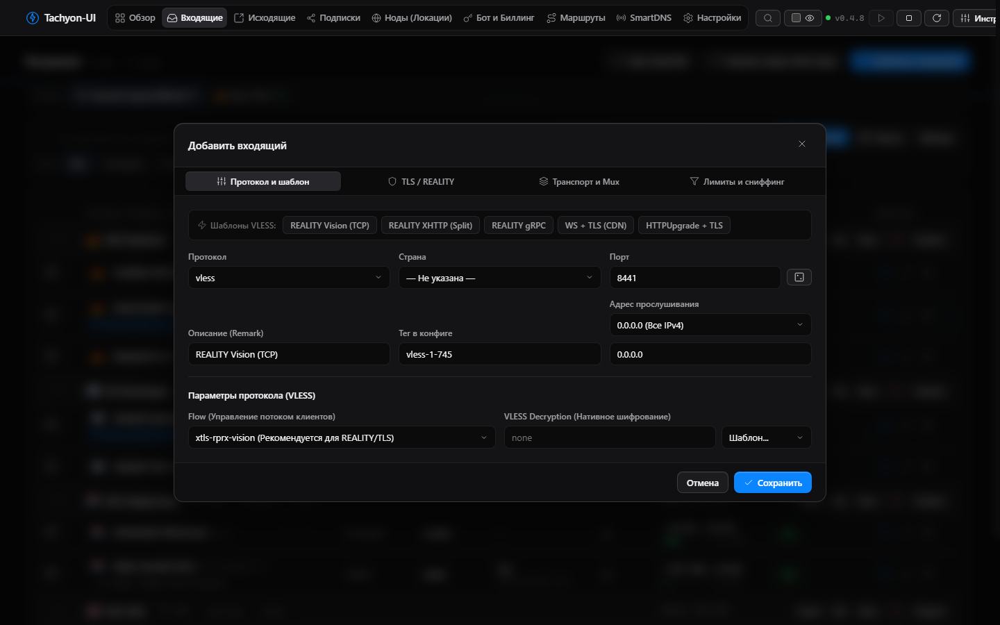

При создании инбаунда верхняя панель пресетов позволяет в 1 клик заполнить проверенную конфигурацию (включая `TewFai Multi-Carrier`, `VLESS XHTTP REALITY`, `MASQUE HTTP/3 CONNECT-IP`, `Hysteria2`, `TUIC v5`, `AmneziaWG`, `FPTN`, `WDTT`, `MTProto FakeTLS`, `Cloudflared`) и мгновенно сгенерировать ключи (`UUID`, X25519 для REALITY/WireGuard, секреты MTProto). Полные параметры каждого протокола см. в [каталоге протоколов](./protocols/README.md).

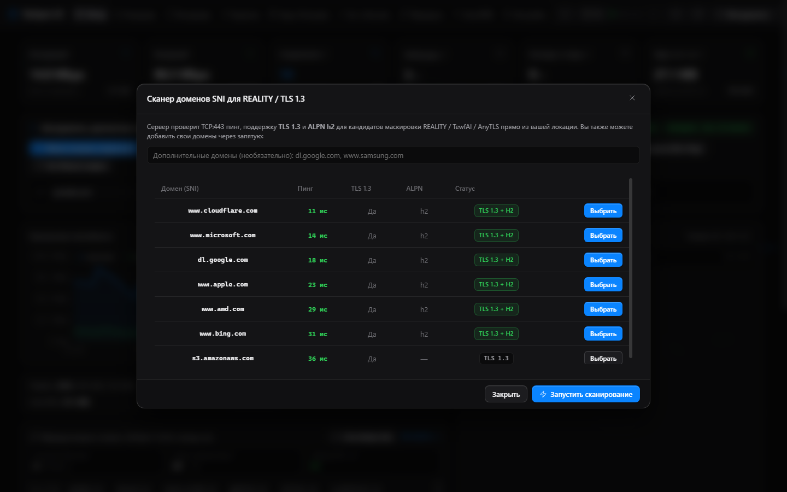

Прямо из вкладки **TLS и REALITY** конструктора инбаунда (а также с дашборда и из меню **Инструменты**) открывается **Сканер SNI**:
- Принимает список доменов-кандидатов (или использует встроенный набор проверенных целей);
- По кнопке **Сканировать SNI** (`POST /api/tools/sni-scan`) проверяет с самого сервера поддержку **TLS 1.3**, **ALPN `h2`**, отсутствие редиректов/заглушек и реальное время отклика (`tls_ms`), позволяя сразу подставить лучший донор в `server_name` / `handshake.server`.

| Протокол | Ключевые особенности в `tachyon-ui` |
| :--- | :--- |
| **TewFai (`Multi-Carrier`)** | Флагманский мульти-носитель `tachyon-core`: одновременный или резервный транспорт по `quic`, `tcp` и `http`, обфускация QUIC `salamander`/`gecko`, HTTP-транспорт `xhttp`/`ws`/`grpc`/`httpupgrade`/`http`, клиентский `desync`, `sni_pool`, ротация `server_ports`, `handover`, FEC и Post-Quantum (ML-KEM). |
| **VLESS** (TCP / XHTTP / gRPC / WS) | Поддержка `xtls-rprx-vision`, XHTTP режимов (`auto`, `packet-up`, `stream-up`, `stream-one`) с padding-диапазонами, REALITY (включая `Self-Steal` и постквантовый ключ `reality_pq_key`), TLS и встроенного сканера SNI (`POST /api/tools/sni-scan`). |
| **Hysteria2 / TUIC v5** | Hysteria2: QUIC-транспорт с `up_mbps`/`down_mbps`, обфускацией `salamander`/`gecko`, BBR-профилями и `masquerade` (при `Unified 443 Front` — `http://127.0.0.1:18080`). TUIC v5: контроль перегрузок `bbr`/`cubic`/`new_reno`, `zero_rtt`, `heartbeat`. |
| **AnyTLS / ShadowTLS v3 / Naive / Mieru / Snell** | Padding-схемы (AnyTLS), маскирующий TLS handshake (ShadowTLS `strict_mode`), HTTP/3 QUIC (Naive), TCP/UDP мультиплексирование (Mieru) и Snell v4/v5/v6. |
| **FPTN / TrustTunnel / OpenConnect** | Нативный FPTN (Chrome/Yandex mimicry, пулы IPv4/DNS), TrustTunnel HTTP/2 и HTTP/3 QUIC, OpenConnect (`anyconnect`, `gp`, `pulse`, `fortinet`). |
| **MASQUE** | HTTP/3 QUIC-туннель (`CONNECT-UDP` / `CONNECT-IP`) с пулом адресов и настраиваемым MTU. В экспортируемых клиентских профилях автоматически задаются `keep_alive_period: "20s"`, `idle_timeout: "50s"` и `tls.alpn: ["h3"]`. |
| **WireGuard / AmneziaWG** | Генератор ключей X25519, параметры обфускации (`jc`, `jmin`, `jmax`, `s1`, `s2`, `h1..h4`), экспорт `.conf`, автовыделение свободного `wg_client_ip` (`2..=254`, `10.10.0.<octet>/32`), ротация диапазона портов (**Port Hopping**: `wg_server_ports`, `wg_hop_interval`, `wg_hop_interval_max`). |
| **WDTT / Sudoku** | WDTT (`wg`, `raw`, `csqtt`, маскировка `audio`/`video`/`unified`, SRTP) и Sudoku (AEAD, таблицы `prefer_ascii`, `padding_min/max`, Pure Downlink, `http_mask_mode`). |
| **Cloudflared / MTProto / Trojan / VMess / SS-2022** | Cloudflared без открытых портов, MTProto (`FakeTLS ee...`, `telegram-ws`, `kws`) и полная линейка классических прокси. |

### `TewFai Multi-Carrier` в деталях

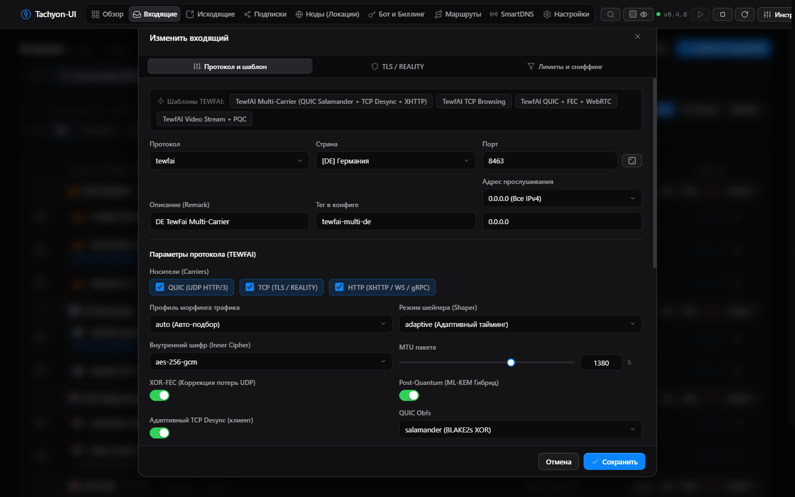

Пресет **TewFai Multi-Carrier** и редактор TewFai объединяют несколько независимых несущих каналов внутри одного подключения:
- **Носители (`Carriers`)**: чекбоксы `quic` (UDP HTTP/3), `tcp` (TLS / REALITY) и `http` (`xhttp`, `ws`, `grpc`, `httpupgrade`, `http`).
- **Обфускация и транспорт**:
  - Для QUIC: `salamander` (BLAKE2s XOR) или `gecko` (паддинг + обфускация с настраиваемым диапазоном `Gecko Packet Size`, например `512-1200`), плюс `QUIC HTTP/3 Fallback` (`http://127.0.0.1:18080`).
  - Для HTTP: выбор типа (`xhttp` с режимами `auto` / `stream-one` / `stream-up` / `packet-up`, `ws`, `grpc`, `httpupgrade`, `http`), `HTTP Path`, `HTTP Host / Authority` и `gRPC Service Name`.
  - Для TCP: адаптивный клиентский **`desync`** и `TCP/HTTP Fallback` (например `127.0.0.1:8443`, не используется для REALITY).
- **Устойчивость и анти-блокировка**:
  - **`sni_pool`**: список клиентских SNI через запятую для ротации TLS-рукопожатий;
  - **`server_ports`**: одиночные порты и диапазоны для Port Hopping (например `443, 20000:20020`);
  - **`handover`** (`Stall Timeout` / `Ping Timeout` в мс) и **`Race Delay`** (мс) — бесшовное переключение носителей при деградации канала без разрыва сессии;
  - **`Alt Endpoints`** (`front://`, `gateway://`, `quic://`, `tcp://`, `http://`), профиль морфинга (`auto`, `browsing`, `webrtc`, `video`, `adaptive`, `transformer`, `bulk`), шейпер (`adaptive`/`fixed`/`off`), `XOR-FEC` и `Post-Quantum (ML-KEM)`.

### Массовая разметка стран, внешний фронт `:443` и инспектор ноды

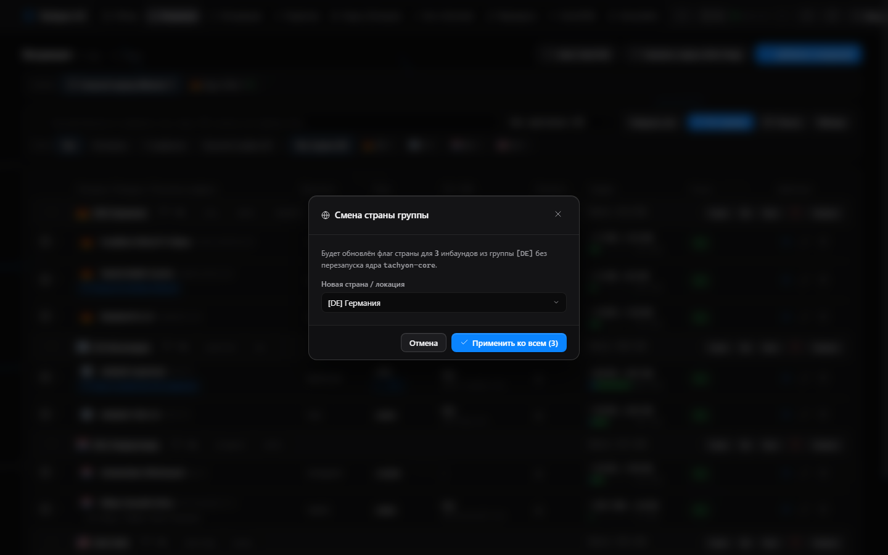

- **Мгновенное редактирование метаданных без перезапуска ядра**: изменение только `country`, `remark`, `external_port` или `external_tls` сохраняется без перезагрузки `tachyon-core` и без обрыва активных сессий (коалесинг записи на диск исключает гонки при серии правок).
- **Массовая смена страны и пакетные действия (`POST /api/inbounds/batch-action`)**: через `Shift+Click` (плавающая панель действий) или кнопку в заголовке группы можно включать, выключать, удалять и массово назначать 2-буквенный ISO-код страны для десятков инбаундов сразу — это критично для автогенерации страновых `urltest`-балансировщиков.
- **Внешний фронт (`external_port` / `external_tls`)**: при работе за `Unified 443 Front` локальные ноды слушают `127.0.0.1` без TLS, но в списке помечаются индикатором `-> :443 TLS` и экспортируются клиентам со строгим TLS на `:443`.

---

## Исходящие подключения (`#outbounds`) и L7-проверки

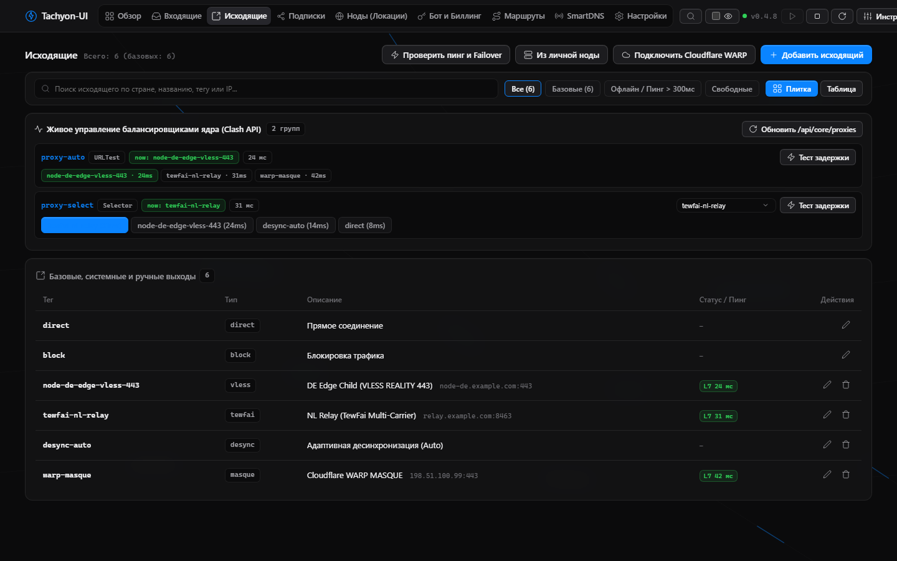

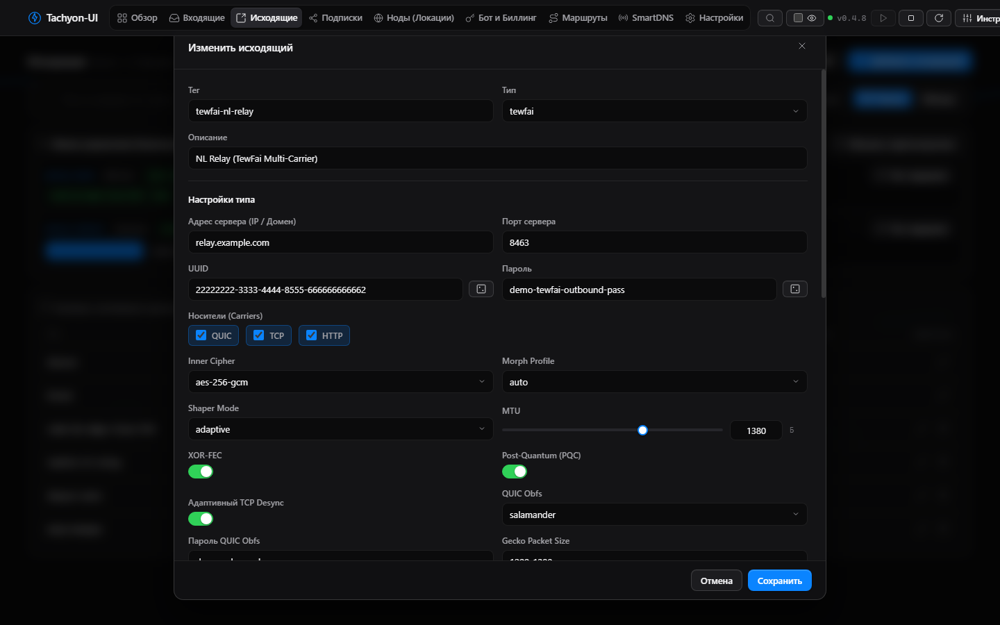

Помимо стандартных `direct`, `block`, `vless`, `vmess`, `trojan`, `hysteria2`, `tuic`, `shadowsocks`, `anytls`, `shadowtls`, `wireguard`, `amneziawg`, `masque`, `socks`, `http`, доступны специализированные исходящие драйверы `tachyon-core`:

- **`tewfai`** — полноценный клиентский редактор с выбором носителей (`quic`/`tcp`/`http`), `salamander`/`gecko`, `xhttp`, `desync`, `sni_pool`, `server_ports` и таймаутов `handover` ([подробнее](./protocols/01-tewfai.md)).
- **`hysteria` (v1)** — проверка схемы совместимости (в рантайме `tachyon-core 0.6.9` используйте [`hysteria2`](./protocols/03-hysteria2.md); детали — в [гайдах](./protocols/25-hysteria1.md)).
- **`ssh`**, **`tor`**, **`bridge`** — описание исходящих схем в конфиге ([подробнее](./protocols/26-ssh-tor-bridge.md)).
- **`mtproto`** — исходящие режимы, включая `telegram-ws` и `kws` поверх TLS WebSocket ([подробнее](./protocols/15-mtproto.md)).
- **`sudoku`**, **`wdtt`**, **`desync`** — нативные исходящие конфигурации и валидация ([подробнее о Desync](./protocols/24-desync.md)).

### Кнопки и Live-панель Clash API во вкладке `#outbounds`

| Элемент / кнопка | Где находится | API / действие | Что делает |
| :--- | :--- | :--- | :--- |
| **`Обновить задержки` (`Refresh`)** | Live-панель Clash API | `GET /api/core/proxies` | Загружает от работающего `tachyon-core` живое дерево `selector`/`urltest` групп и актуальный пинг |
| **Выбор узла в группе и тест пинга** | Карточка группы `selector` | `POST /api/core/proxies/select` / `delay` | Переключает активный выход на лету без рестарта ядра и замеряет RTT (URL `https://www.gstatic.com/generate_204`) |
| **Trigger / Restore Failover** | Live-панель Failover | `POST /api/core/failover` / `restore` | Принудительно активирует резервный канал или возвращает основной |
| **`Проверить и переключить` (`Run Health Check / Failover`)** | Тулбар `#outbounds` | `POST /api/outbounds/health-check` | Проверяет доступность всех исходящих с `apply_failover: true` и перестраивает резерв |
| **`Из управляемой ноды` (`From Managed Node`)** | Тулбар `#outbounds` | `POST /api/nodes/{id}/export-outbound` | Экспортирует выбранный инбаунд дочерней ноды прямо в пул исходящих `Master` |
| **`Multi-Clone 1→N`** | Тулбар `#outbounds` | `POST /api/nodes/multi-clone` | Размножает конфигурацию сразу на 1..N целей |
| **`Подключить Cloudflare WARP`** | Тулбар `#outbounds` | `POST /api/core/warp-register` | Автоматически регистрирует WARP, генерирует ключи WireGuard и создаёт `warp-out` |
| **`+ Добавить исходящий` (`+ Add Outbound`)** | Правый край тулбара | `#modal-outbound` (33 типа) | Открывает конструктор с вкладками настроек типа, TLS, Transport и Dialer (`detour`, `tcp_fast_open`, `udp_fragment`) |
| **`Reset Circuit Breaker` / `Delete Pool`** | Карточка пула/балансировщика | `POST /api/core/outbound/reset` / `DELETE` | Сбрасывает залипший breaker конкретного тега (с закрытием старых сессий) или удаляет группу |

---

## Кластер `Master → Child`, каскады и инструменты автоматизации (`#nodes`)

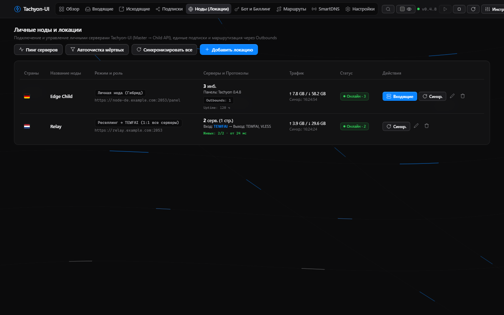

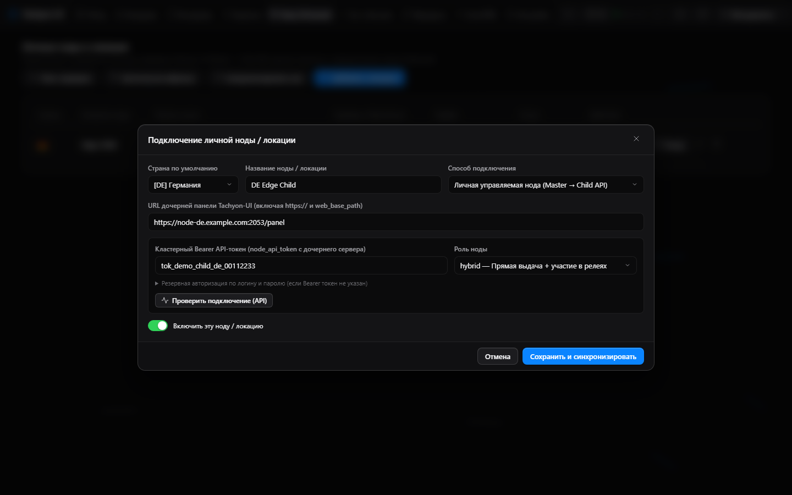

Раздел **Ноды (Локации)** поддерживает четыре режима подключения серверов (подробное пошаговое руководство по сборке кластера — в [главе 7](07-full-setup-and-cluster-guide.md)):
1. **`managed_tachyon_node` (Управляемая нода Tachyon `Master → Child API`)** — подключение собственных серверов (`node-de.example.com`, `relay.example.com`) по кластерному Bearer-токену (`node_api_token`) без ключа доступа:
   - **Роли ноды**: `direct` (прямая выдача клиентам + управление `#inbounds`), `hybrid` (прямая выдача + участие в релеях) и `relay` (только релей/каскад без прямых клиентских ссылок).
   - **`auto_export_outbounds`**: для ролей `relay` и `hybrid` автоматически экспортирует выбранные или все инбаунды Child-ноды в `#outbounds` на Master (а также позволяет создавать служебные связки **`cluster-link-*`**).
   - **Синхронизация `sub_configs` / лимитов / HWID**: Master автоматически зеркалирует на Child-панель конфигурацию подписок, `device_limit`, `strict_hwid` и список привязанных устройств.
2. **`tachyon_node`** — read-only синхронизация с конкретной подпиской на удалённом сервере `tachyon-ui` (работает без ключа доступа с честным `User-Agent`).
3. **`sub_url`** — периодический импорт сторонних подписок по URL с настраиваемыми клиентскими заголовками (`User-Agent`, `x-hwid`, `x-device-os`, `x-device-model`) *(для коммерческого реселлинга требуется ключ доступа от разработчика)*.
4. **`manual_uris`** — пакетный импорт списка URI и массовое клонирование `1→N` *(коммерческое использование требует ключ доступа)*.

### Кнопки и модальные окна вкладки `#nodes`

| Элемент / кнопка | Где находится | API / действие | Назначение |
| :--- | :--- | :--- | :--- |
| **`Синхронизировать все`** | Верхний тулбар `#nodes` | `POST /api/nodes/sync` (`id: 0`) | Обновляет узлы и подписки по всем добавленным нодам кластера |
| **`Health Check всех нод`** (+ **`Auto-Clean`**) | Верхний тулбар `#nodes` | `POST /api/nodes/health-check` | Замеряет доступность и задержку нод; при `auto_clean: true` удаляет мёртвые внешние узлы |
| **`+ Добавить ноду` (`+ Add Node`)** | Правый край тулбара | `#modal-node` → `POST /api/nodes` | Открывает форму добавления сервера (4 режима: `managed_tachyon_node`, `tachyon_node`, `sub_url`, `manual_uris`) |
| **`Тест API` (`Test Managed`)** | Внутри `#modal-node` | `POST /api/nodes/test-managed` | Проверяет соединение с дочерней панелью по `url` + `api_token` до сохранения |
| **`Входящие ноды` / `Синхронизировать клиентов` / `Экспорт в outbound`** | Карточка управляемой ноды | `#inbounds` / `sync-clients` / `export-outbound` | Переключает вкладку `#inbounds` на выбранный сервер, форсирует синхронизацию `sub_configs` или создаёт outbound-мост |
| **`Мост / Каскад` (`#modal-cascade`)** | Карточка ноды | `POST /api/cascade/preview` / `/api/cascade` | Конструктор связок «входной узел → зарубежный выход» с предпросмотром создаваемых инбаундов, выходов и 1:1 правил |
| **Контекстный баннер режима** | Шапка вкладки | Состояние доступа | Информирует о лимите базового режима (до 1 персональной агрегации без гранта) или о статусе кластерного доступа |

### Боковой инспектор ноды и каскад выходов

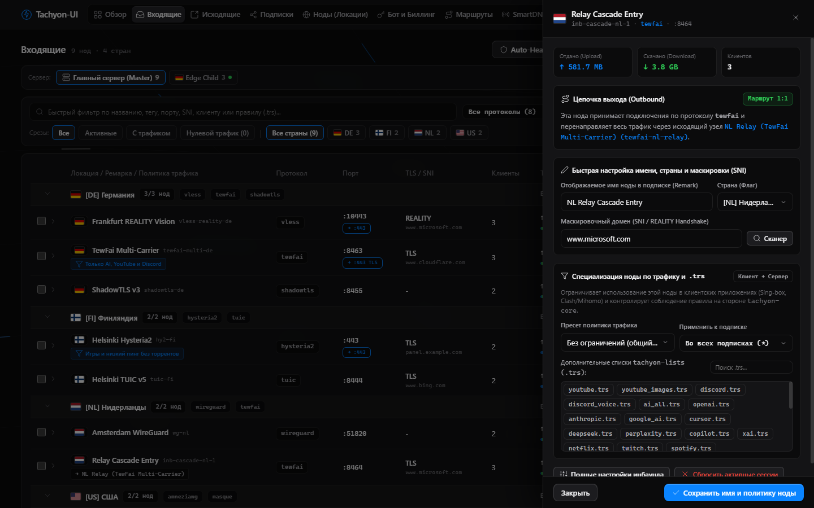

Клик по строке или иконке маршрута инбаунда в `#inbounds` открывает **Инспектор ноды**:
- Карточка трафика (`Upload`, `Download`, число клиентов);
- **Цепочка выхода (`Outbound`)**: отображает прямой выход или привязку 1:1 к релейному outbound (и кнопку клонирования `1→N`, если активирован грант);
- Быстрая смена имени, ISO-кода страны и маскировки `SNI`;
- Гранулярная привязка правил `.trs` и политик трафика к данной ноде.

### Инструменты автоматизации и безопасности

- **Health-Check + Автоочистка (`POST /api/nodes/health-check`)**: проверяет конкретную ноду или весь список (`id: 0`), с опцией `auto_clean: true` удаляет мёртвые узлы и пересобирает каскады.
- **Smart Relay Auto-Failover & Failback**: автоматический перебор резервных релеев внутри той же страны при сбое и возврат при восстановлении (`relay_auto_failover`).
- **Конструктор каскадов (`/api/cascade/preview`, `/api/cascade`)**: объединяет локальный вход с удалёнными релеями через `urltest`, `selector` или `chain` с предпросмотром.
- **SNI-сканер (`POST /api/tools/sni-scan`)** и **Auto-Healer SNI (`auto_heal_enabled`)**: подбор и авто-ротация устойчивых TLS 1.3 целей с ALPN `h2` для REALITY.
- **Port Hopping (`POST /api/tools/port-hop`)**: ротация портов с синхронизацией правил файрвола.
- **Unlock Probe (`POST /api/tools/unlock-probe`)** и **Cloudflare DNS Failover (`POST /api/tools/cloudflare-dns`)**: проверка доступности стриминга/AI и автопереключение A-записи на резервные IP (`cf_backup_ips`).
- **Zero-Traffic Watchdog**: алерт администраторам при аномальном обнулении входящего трафика при активных клиентах.

---

## Встроенный Telegram-бот, тарифы, ваучеры и Live-симулятор (`#tgbot`)

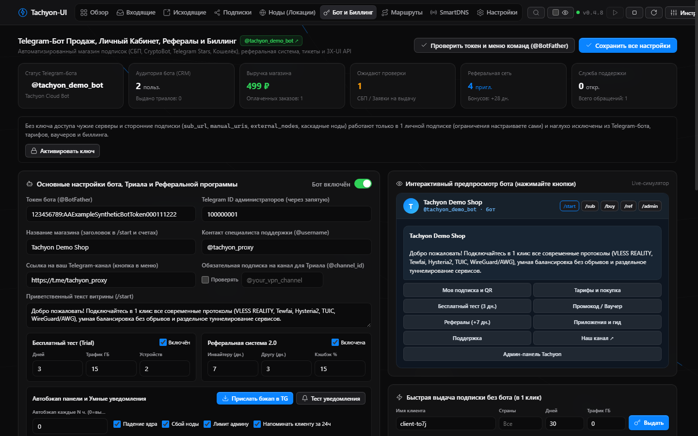

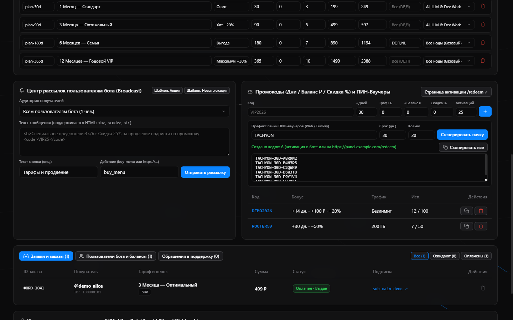

Панель включает встроенного long-polling Telegram-бота на чистом Rust (без Python/Node.js-зависимостей):

- **Команды бота**:
  - Для пользователей: `/start`, `/sub`, `/profile`, `/tariffs`, `/buy`, `/trial`, `/promo`, `/ref` (`/referral`), `/apps`, `/support`, `/help`.
  - Для администраторов (`admin_tg_ids`): `/admin`.
- **Live-симулятор в веб-панели**: правая колонка раздела **Бот и Биллинг** содержит интерактивный предпросмотр бота с кликабельными inline-кнопками (`/start`, «Купить», «Мой профиль», «Подключиться», «Поддержка») — можно проверить тексты и тарифы ещё до запуска на реальных клиентах (обновляется в реальном времени при правке полей).

### Таблица кнопок, секций и CRM вкладки `#tgbot`

| Блок / раздел | Элементы и кнопки управления | API-эндпоинт | Назначение и нюансы |
| :--- | :--- | :--- | :--- |
| **KPI-строка и статус** | Счётчики активных пользователей, ожидающих заказов, выручки, открытых тикетов + плашка режима | `GET /api/tg-bot` | Оперативная сводка по биллингу и саппорту; в базовом режиме без гранта коммерческие функции ограничены |
| **Настройки бота и автоматизация** | Поле `bot_token` + **`Проверить токен`**, `admin_tg_ids`, режим webhook/polling, параметры **Триал-периода** (дни/ГБ/лимит устройств), **Реферальная программа** (% или бонусные дни), **Автобэкап в Telegram** + **`Бэкап сейчас`**, **Алерты админу** + **`Тест алерта`**, кнопка сохранения | `POST /api/tg-bot/verify`, `backup-now`, `test-alert`, `PUT /api/tg-bot` | Проверяет токен через Bot API, отправляет тестовые уведомления и запускает ручной бэкап в Telegram |
| **Настройки Mini App** | URL/путь Mini App, тема и отображение подписок внутри Telegram WebApp | `PUT /api/tg-bot` | Встроенный кабинет клиента в Telegram с авто-авторизацией по `tgWebAppData` (требует HTTPS с валидным TLS) |
| **Быстрая выдача в 1 клик** | Имя клиента, дни, трафик (ГБ), фильтр стран + **`Выдать подписку`** | `POST /api/billing/issue-sub` | Создаёт подписку по шаблону биллинга и сразу возвращает готовую ссылку |
| **Платёжные шлюзы** | **СБП** (реквизиты/ручное или API-подтверждение), **`@CryptoBot`** (токен, USDT/TON), **Telegram Stars** (XTR, курс ₽/⭐), **Произвольная платёжная ссылка** | `PUT /api/tg-bot` | Подключает приём оплаты в боте; заказы СБП с ручной проверкой попадают во вкладку CRM `Orders` |
| **Сетка тарифов и модалка тарифа** | Карточки планов (название, дни, ГБ, цена в ₽ / USD / Stars, макс. устройств, профиль подписки), **`+ Добавить тариф`**, Редактировать / Удалить, **`Заполнить рекомендуемыми пресетами`** | `PUT /api/tg-bot` | Управляет витриной тарифов; кнопка пресетов сразу создаёт базовую линейку планов |
| **Центр рассылок** | Текст (`message`), сегмент (`all` / активные / без подписки / истёкшие), опциональная inline-кнопка (`btn_label`, `btn_url`), **`Отправить рассылку`** | `POST /api/tg-bot/broadcast` | Массовая отправка уведомлений и промо-акций по выбранному сегменту базы |
| **Промокоды и Генератор ваучеров** | Создание промокода (`code`, дни, ГБ, бонус ₽, скидка %, макс. использований), удаление промокода; пачка ваучеров (`prefix`, `days`, `count`) | `POST /api/tg-bot/promo`, `DELETE .../promo/{code}`, `POST /api/vouchers/batch` | Выпуск скидок и одноразовых подарочных/партнёрских кодов для `/redeem` в боте и на странице `<redeem_path>` |
| **CRM (`Заказы` / `Пользователи` / `Тикеты`)** | **Заказы**: `Одобрить` / `Отклонить` / `Удалить`; **Пользователи**: поиск по TG ID/username, корректировка баланса/дней/блокировки, ЛС; **Тикеты**: ответ прямо из панели и закрытие/удаление | `/api/tg-bot/orders/*`, `/users/adjust`, `/send-message`, `/tickets/*` | Полный цикл обработки оплат и поддержки без сторонних систем |
| **Интеграция Webhook / 3X-UI** | Секрет и обработчик внешних событий биллинга | `PUT /api/tg-bot` | Привязка внешних платёжных систем и выдача подписок через `POST /api/billing/issue-sub` |

---

[Назад: Глава 4 — Балансировщики (12 режимов `urltest`), `chain` и маршрутизация](04-balancers-chain-and-routes.md) | [Полный справочник UI](./11-ui-every-tab-and-button-guide.md) | [Каталог протоколов](./protocols/README.md) | [Оглавление](../../README.ru.md) | [Далее: Глава 6 — Диагностика ядра, скрытие приватных данных (`Alt+P`) и REST API](06-diagnostics-privacy-and-api.md)
