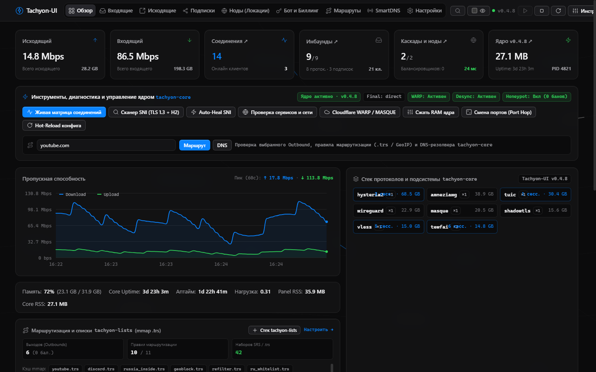
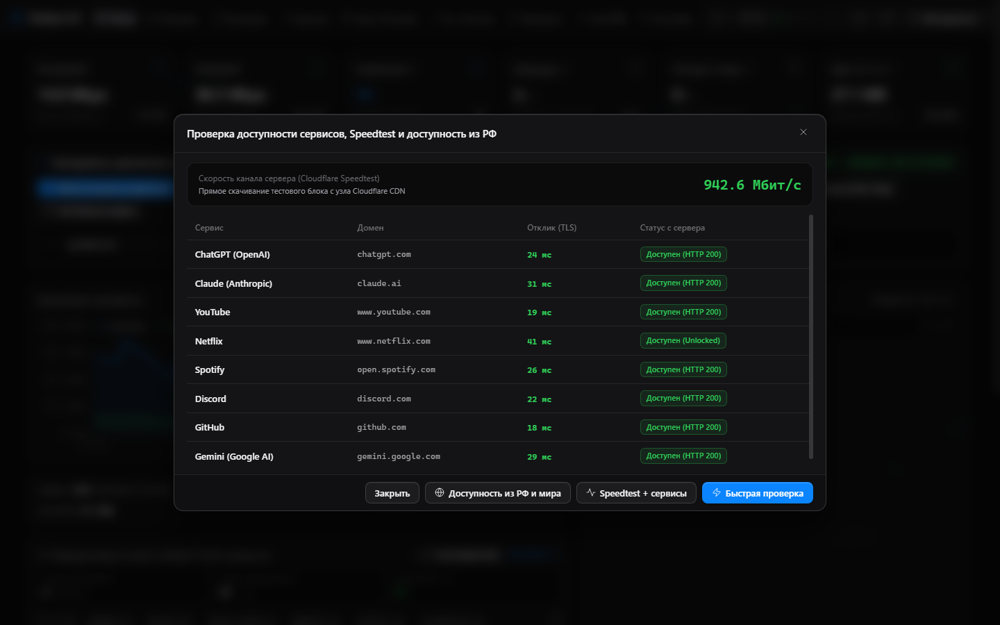
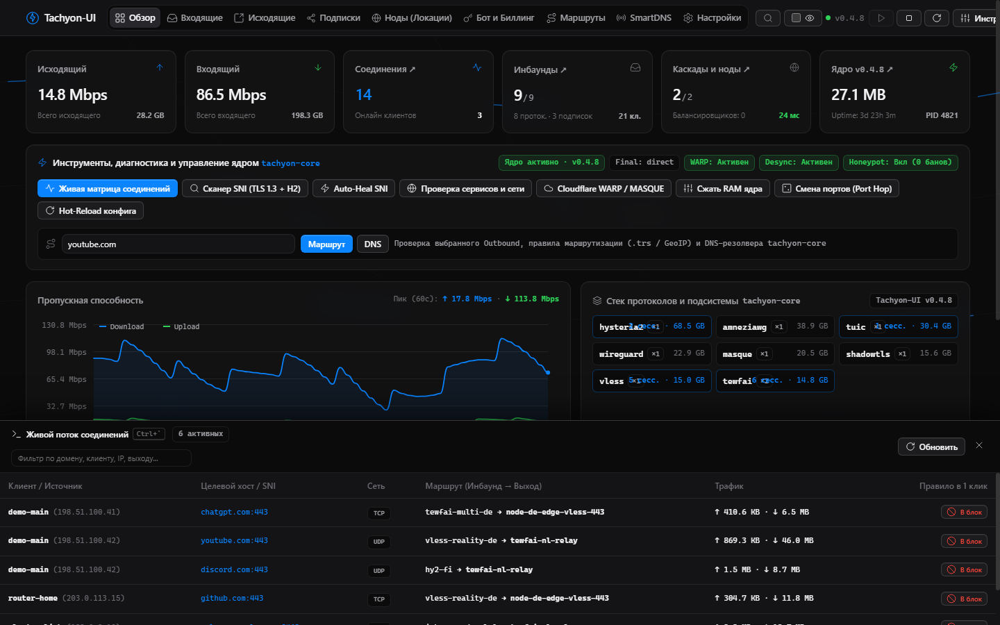
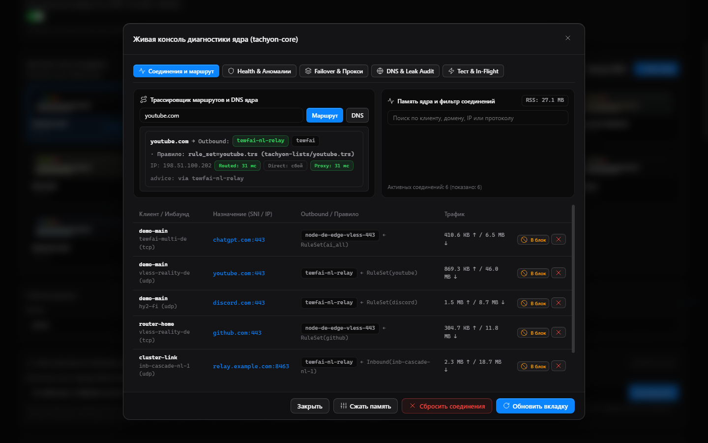
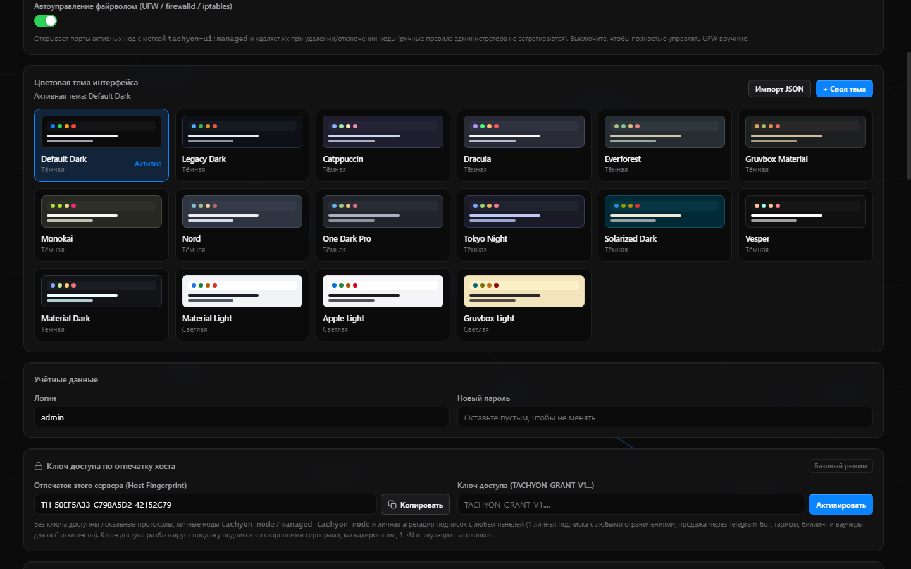
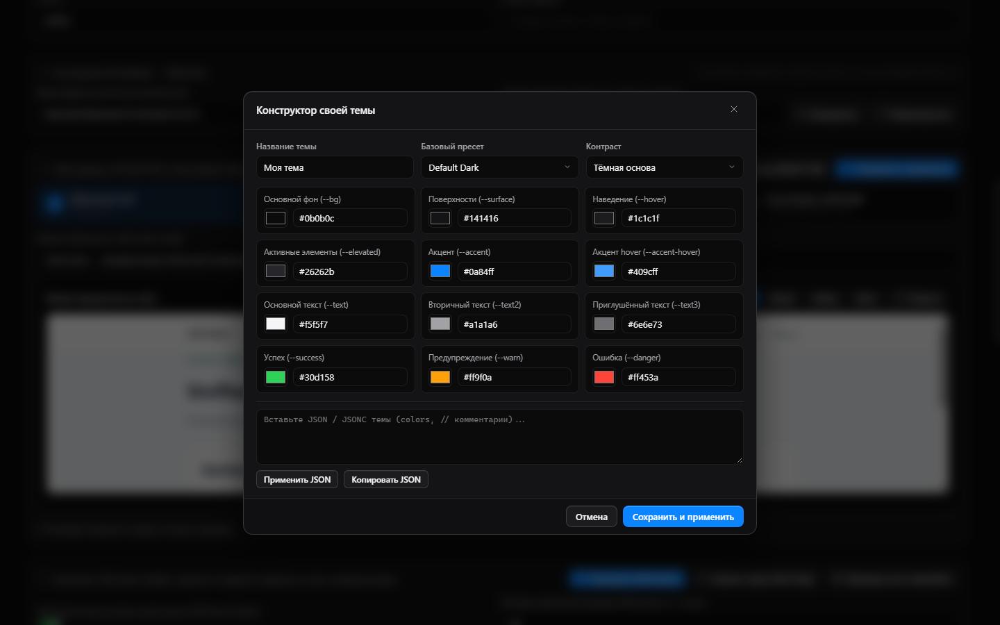
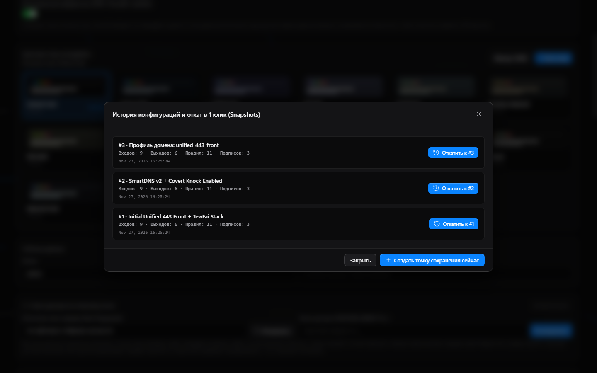
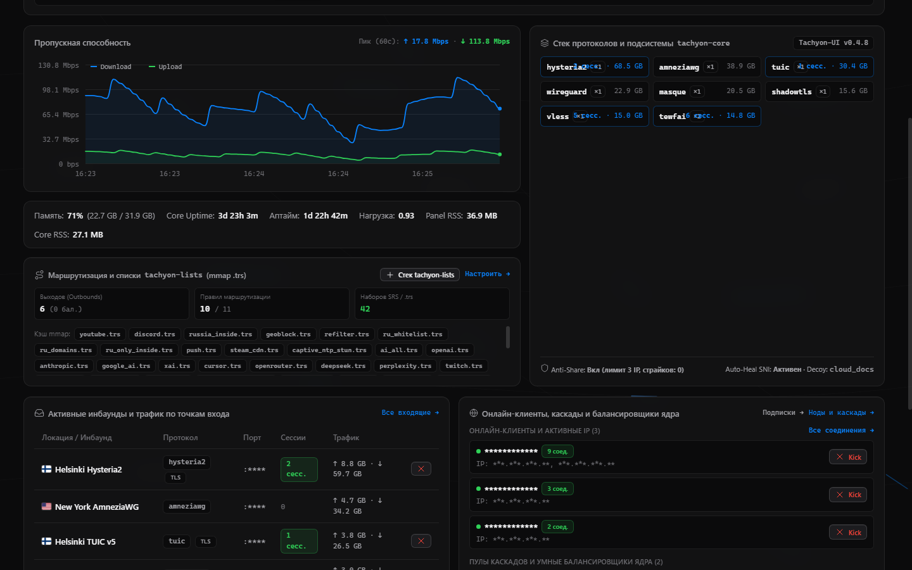
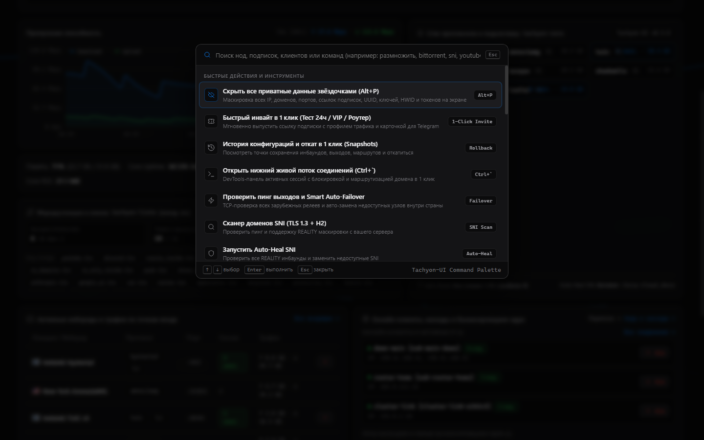
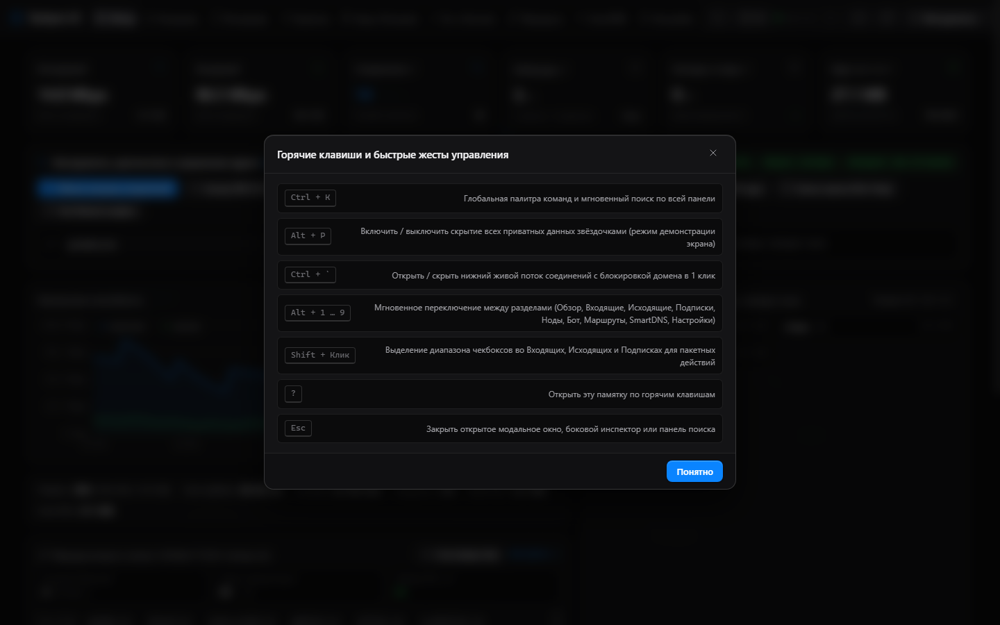

# 6. Дашборд, диагностика ядра, темы, снапшоты, маскировка (`Alt+P`) и REST API

[English version](../en/06-diagnostics-privacy-and-api.md) | [Полное руководство](00-complete-guide.md) | [Полный справочник UI (все вкладки и кнопки)](./11-ui-every-tab-and-button-guide.md) | [Каталог протоколов](./protocols/README.md) | [К оглавлению](../../README.ru.md)

Начиная с **`tachyon-ui v0.4.12`**, инструменты ежедневной эксплуатации сведены в единую связку: живой дашборд, выдвижной нижний поток соединений (**Live Connections Dock**, `` Ctrl+` ``), **5-вкладочная консоль диагностики ядра**, проверка разблокировки и скорости (**Unlock Probe / Speedtest**), автоматика самовосстановления (`Auto-Healer`, `SNI-сканер`, `Cloudflare DNS Failover`, `Zero-Traffic Watchdog`, `Smart Relay Auto-Failover`), **16 встроенных тем с конструктором тем**, **кольцевой буфер снапшотов (до 10 ревизий)**, **режим маскировки приватных данных (`Alt+P`)** и **палитра команд (`Ctrl+K`)**.

---

## 1. Дашборд (`#dashboard`) и Unlock / Speedtest

Главный экран панели собирает операционную сводку без необходимости переключаться по вкладкам:
- **6 KPI-карточек и статус ядра `tachyon-core`:** состояние и аптайм ядра, входящие/клиенты, исходящие/здоровые шлюзы, активные подписки, текущий трафик (`Up/Down`), память RSS и нагрузка системы с кнопкой **`Trim RAM`** (`POST /api/core/memory-trim`) для принудительного освобождения буферов памяти ядра.
- **Бейджи подсистем и матрица протоколов:** индикаторы активности `Core`, `TLS/ACME`, `SmartDNS`, `TG Bot`, `Anti-Share`, `Auto-Healer`, `Failover`, `Watchdog`.
- **2-кнопочный трассировщик и проверка DNS:** поля домена/IP + опционально UDP DNS и кнопки **Проверить маршрут** (`POST /api/core/route-check`) и **Проверить DNS** (`POST /api/core/dns-check`) прямо через работающее ядро `tachyon-core`.
- **График пропускной способности (`Throughput`), карточка `.trs` и живые логи:** установка стека `tachyon-lists`, таблица активных клиентов с кнопкой сброса сессии (**Кик**, `POST /api/core/kick`), а также окно вывода stdout/stderr `tachyon-core` с фильтром и копированием логов.

### Кнопки управления топбара и дашборда

| Элемент / кнопка | Где находится | API / действие | Назначение |
| :--- | :--- | :--- | :--- |
| **`Поиск… Ctrl+K`** | Топбар | Палитра команд | Быстрый переход ко всем 9 вкладкам, инбаундам, аутбаундам, подпискам, нодам и утилитам |
| **`Скрыть данные` (`Alt+P`)** | Топбар | Privacy Mask | Мгновенно скрывает чувствительные IP, домены, UUID, ключи и токены без поломки форм |
| **Индикатор `Ядро: ...`** | Топбар | Центр обновлений | Показывает статус и версию `tachyon-core` и открывает окно обновления ядра и панели |
| **`Старт` / `Стоп` / `Рестарт`** | Топбар и Дашборд | `POST /api/core/{start,stop,restart}` | Запуск, остановка или полный перезапуск процесса `tachyon-core` |
| **`Применить` (`Apply`)** | Дашборд | `POST /api/core/apply` | Генерирует итоговый конфиг `tachyon-core` из состояния панели и выполняет горячее применение |
| **`Конфиг` (`Config Preview`)** | Дашборд | `GET /api/config-preview` | Открывает модальное окно `#modal-config` с полным сгенерированным JSON для аудита |
| **`Инструменты` (меню топбара)** | Топбар | Выпадающее меню | Быстрый доступ к **Потоку соединений**, **Истории снимков**, **Диагностике ядра**, **Проверке сети и Speedtest**, **Центру обновлений**, **Проекту и поддержке** и **Горячим клавишам (`?`)** |

### Проверка сети, разблокировки сервисов и Speedtest (`#modal-unlock-probe`)

Окно **Проверка сети и Speedtest** (открывается с дашборда или через **Топбар → Инструменты**) объединяет три проверки с самого сервера:
- **Чекбокс `Включить Speedtest`**: включает замер входящей/исходящей скорости канала через Cloudflare CDN.
- **Кнопка `Запустить проверку`** (`POST /api/tools/unlock-probe`): проверяет доступность зарубежных и локальных стриминговых, AI- и облачных платформ с IP-адреса сервера (или выбранного маршрута).
- **Кнопка `RKN Check`** (`POST /api/tools/rkn-check`): экспресс-аудит гео-доступности и сетевых ограничений узла.

---

## 2. Нижний Live Connections Dock (`` Ctrl+` ``)

Для постоянного контроля трафика без перекрытия текущей рабочей таблицы предусмотрен нижний выдвижной док **Live Connections Dock** (открывается и сворачивается по `` Ctrl+` `` / `` Cmd+` ``, через меню инструментов топбара или из палитры `Ctrl+K`):

- **Обновление в реальном времени:** опрос `GET /api/core/connections` каждые `2.5` секунды (плюс кнопка ручного обновления) с живым счётчиком активных потоков.
- **Мгновенный фильтр (`debounce` 90 мс):** поиск по целевому домену/SNI, IP назначения, IP источника, имени клиента, тегу инбаунда и активной цепочке выхода (`chains`).
- **Действия в 1 клик на каждой строке:**
  - **В блок** (`POST /api/core/block-domain`) — мгновенно добавляет домен в правило `block` и применяет его в `tachyon-core` без перезапуска остальных сессий.
  - **→ В выход...** (`POST /api/core/route-domain`) — перенаправляет домен через выбранный `outbound` или балансировщик с наивысшим приоритетом.
  - **Сброс (кик)** (`POST /api/core/connections/close`) — принудительно закрывает отдельное соединение по IP/идентификатору.

---

## 3. Живая 5-вкладочная консоль диагностики ядра

Кнопка **Соединения** в топбаре или **Живая матрица соединений** на дашборде открывает модальное окно диагностики в реальном времени (`tachyon-core` Runtime API):

| Вкладка консоли | Функции и эндпоинты ядра |
| :--- | :--- |
| **1. Соединения и маршрут** | Трассировщик маршрутов и DNS (`POST /api/core/route-check`, `POST /api/core/dns-check`), фильтр активных сессий по клиенту/домену/IP/протоколу (`GET /api/core/connections`), принудительное закрытие отдельных потоков или всех потоков пользователя (`POST /api/core/connections/close`, `POST /api/core/kick`), блокировка/маршрутизация домена (`POST /api/core/block-domain`, `POST /api/core/route-domain`), мониторинг и сброс памяти ядра (`GET /api/core/memory`, `POST /api/core/memory-trim`). |
| **2. Health & Аномалии** | Телеметрия состояния ядра (`GET /api/core/health`: аптайм, RSS-память, число открытых файловых дескрипторов, RTT, success rate, состояние Circuit-Breaker по каждому outbound) и журнал аномалий (`GET /api/core/anomalies`). |
| **3. Failover & Прокси** | Состояние групп отказоустойчивости (`GET /api/core/failover`, принудительный возврат `POST /api/core/failover/restore`), живые группы балансировщиков (`GET /api/core/proxies`) с переключением активного узла в `selector` в реальном времени (`POST /api/core/proxies/select`), массовым тестом задержек (`POST /api/core/proxies/delay`) и сбросом Circuit-Breaker (`POST /api/core/outbound/reset`). |
| **4. DNS & Leak Audit** | Сравнительная проверка DNS (`POST /api/core/dns-check` — встроенный движок vs прямой UDP:53 на предмет подмены или bogon), очистка DNS-кэша (`POST /api/core/dns/flush`) и тест утечек (`GET / POST /api/core/leak`: IPv4, IPv6, DNS, WebRTC STUN). |
| **5. Тест & In-Flight** | Активный 8-этапный тест подключения к любому URL/хосту (`POST /api/core/connection-test`: `DNS → Rule → Outbound → TCP → TLS → HTTP`) и просмотр/очистка журнала незавершённых запросов ядра (`GET / DELETE /api/core/flight`). |

---

## 4. Автоматика: Auto-Healer, SNI-сканер, Cloudflare Failover, Watchdog и Relay Failover

В разделе **Настройки (`#settings`)** и на панели инструментов доступны встроенные механизмы автоматического поддержания связности:

- **SNI-сканер (`POST /api/tools/sni-scan`) и Auto-Healer (`POST /api/tools/auto-heal`):**
  - Сканер проверяет реальный TLS 1.3 handshake (`ALPN h2`, время отклика `tls_ms`, отсутствие заглушек) для кандидатов маскировки REALITY.
  - **Auto-Healer** (`auto_heal_enabled`, интервал `auto_heal_interval_mins`, по умолчанию `30` минут) периодически проверяет SNI активных инбаундов REALITY и автоматически заменяет деградировавшие домены на рабочие (с ручным запуском кнопкой **Auto-Heal SNI**).
- **Интеграция с Cloudflare DNS API (`POST /api/tools/cloudflare-dns`):**
  - В карточке **Интеграция с Cloudflare DNS API** в `#settings` укажите `API Token (Zone.DNS Edit)`, `Zone ID`, имя DNS-записи (например, `edge.example.com`) и резервные IP.
  - Позволяет загружать записи зоны, в 1 клик переключать A-запись домена подписок/инбаундов на резервный IP (**DNS Only**) или включать/выключать проксирование **Cloudflare Proxy (CDN)**.
- **Zero-Traffic Watchdog (`tspu_watchdog_enabled`):**
  - Фоновый детектор сравнивает счётчики активных TCP-сессий и полезного трафика на инбаундах. Если по инбаунду идут активные подключения с нулевым полезным трафиком (характерный симптом сброса handshake на DPI), он помечается в `suspect_tspu_inbounds`, отображается на дашборде и отправляет предупреждение в Telegram-бот.
- **Smart Relay Auto-Failover & Failback (`relay_auto_failover`):**
  - Раз в `90` секунд панель проверяет доступность зарубежных релеев (`health_check_outbounds_and_failover`). При падении основного `relay-*` исходящего маршрутизации (`#routes`) автоматически переключаются на резервный рабочий релей внутри той же страны, а после восстановления исходного узла выполняется автоматический **Failback**.

---

## 5. Настройки (`#settings`), безопасность, бэкапы, 16 тем и редактор тем

В разделе **Настройки (`#settings`)** собраны все системные параметры сервера, безопасности, резервного копирования и внешнего вида панели (полный перечень полей и кнопок — в [справочнике UI](./11-ui-every-tab-and-button-guide.md)):

| Секция `#settings` | Основные поля, переключатели и кнопки | API / действие | Назначение |
| :--- | :--- | :--- | :--- |
| **Общие настройки и авто-файрвол** | `web_base_path` (секретный префикс панели), `public_host` (домен/IP для подписок), порт панели, логирование, тумблер **`auto_firewall_enabled`** | `PUT /api/settings` | Безопасное открытие/очистка портов инбаундов и SmartDNS в `UFW` / `firewalld` / `iptables` (метка `tachyon-ui:managed`) без затрагивания SSH и ручных правил |
| **Безопасность и учётные данные** | Новый логин, текущий/новый пароль, **Cluster API (`node_api_token`)** + **`Перевыпустить токен`**, карточка **Грант доступа (`Access Grant`)** (при `TACHYON_GRANT_UI=1`) | `PUT /api/settings`, `POST /api/settings/rotate-node-token`, `PUT /api/access-grant` | Смена пароля администратора, управление токеном дочерней ноды кластера и активация расширенных возможностей |
| **Мастер маскировки, TLS/ACME и Аудит** | 4-шаговый Мастер (`#sw-step-1..4`): **Сайт-прикрытие + Honeypot**, **Домен / `Unified 443 Front` / Let's Encrypt ACME**, **Скрытые пути и `sub_portal_guard`**, **Covert Knock и `Web Self-Audit`** (`0–100`) | `/api/site/*`, `/api/domain/*`, `/api/tls/*`, `POST /api/web/self-audit` | Настройка публичного сайта-заглушки, единого порта `:443`, ACME-сертификатов и внешнего самоаудита (подробнее в [главе 2](02-stealth-web-domain-tls.md)) |
| **Обновление ядра `tachyon-core` и панели** | Модальное окно **Центр обновлений** (из топбара или меню **Инструменты**) | `GET/POST /api/core/releases`, `update`, `/api/panel/*` | Просмотр релизов и обновление бинарников `tachyon-core` и `tachyon-ui` прямо из веб-интерфейса |
| **Резервные копии и Редактор конфига** | **`Скачать бэкап (JSON)`**, **`Восстановить из файла`**, модалка **`Конфиг`** (`Config Preview`) | `GET /api/backup`, `POST /api/restore`, `GET /api/config-preview` | Полный экспорт/импорт конфигурации панели (ноды, подписки, правила, настройки) и аудит итогового JSON `tachyon-core` |
| **Автоматика и Cloudflare DNS API** | Настройки `Auto-Healer`, `Anti-Share`, `Failover`, `Watchdog`; `api_token`, `zone_id` и управление A/AAAA/CNAME записями | `PUT /api/settings`, `POST /api/tools/cloudflare-dns` | Автоматическое поддержание связности и переключение DNS при сбоях |
| **Портал подписки и профиль по умолчанию** | Брендинг портала, `sub_portal_guard`, `profile-update-interval`, DNS/MTU/Split-tunnel флаги для новых подписок | `PUT /api/settings` | Стандартизация веб-портала и заголовков клиентских приложений |
| **16 тем, ширина макета и Конструктор тем** | Переключатель `compact` / `full`, **13 тёмных тем** (`Default Dark`, `Legacy Dark`, `Catppuccin`, `Dracula`, `Everforest`, `Gruvbox Material`, `Monokai`, `Nord`, `One Dark Pro`, `Tokyo Night`, `Solarized Dark`, `Vesper`, `Material Dark`), **3 светлые темы** (`Material Light`, `Apple Light`, `Gruvbox Light`) и кнопка **`+ Создать свою тему...`** | `localStorage` (`#theme-builder-overlay`) | Настройка 12 цветовых CSS-переменных (`--bg`, `--surface`, `--hover`, `--elevated`, `--accent`, `--accent-hover`, `--text`, `--text2`, `--text3`, `--success`, `--warn`, `--danger`), базовой схемы (`dark`/`light`), сохранение и удаление пользовательских тем |

---

## 6. Кольцевой буфер снапшотов (до 10 ревизий) и откат в 1 клик

Для защиты от ошибочных правок панель ведёт **кольцевой буфер снимков конфигурации** (`data/snapshots.json`, хранит **до 10 последних ревизий**):

- **Автоматические точки сохранения:** создаются автоматически перед удалением инбаундов/выходов/подписок, пакетными операциями и изменением правил маршрутизации.
- **Ручные снапшоты:** в окне **История конфигураций и откат в 1 клик** (меню инструментов топбара или `Ctrl+K` → `Rollback`) можно создать точку сохранения в любой момент (`POST /api/snapshots`).
- **Безопасный откат (`POST /api/snapshots/restore`):** восстанавливает инбаунды, исходящие, маршруты и подписки к выбранной ревизии `#id` и перезагружает конфигурацию в `tachyon-core` (перед откатом текущее состояние также сохраняется в буфере).

---

## 7. Режим маскировки приватных данных (`Alt+P`)

Тумблер **Скрыть данные** в правом верхнем углу топбара (дублируется горячей клавишей `Alt+P`, пунктом в палитре `Ctrl+K` и настройкой в `#settings`; состояние запоминается в `localStorage`) позволяет безопасно записывать скринкасты, делать скриншоты и проводить удалённые демонстрации панели.

**Что маскируется (`***`):**
- Все приватные IPv4/IPv6-адреса и нестандартные порты (`198.51.100.21:443` → `***.***.***.**:****`).
- Приватные доменные имена сервера и нод.
- Ссылки и токены подписок (`/sub/...`, `/cdn/v2/...`, `?k=...`, `?v=...`, заголовки `If-None-Match` и `X-Client-Digest`), адреса DoH/DDNS SmartDNS.
- UUID, X25519/WireGuard/SS2022 ключи, пароли, HWID устройств, токены и ID Telegram-бота, Zone ID Cloudflare.
- QR-коды (размываются, чтобы ссылку нельзя было считать с экрана).
- Поля `<input>` / `<textarea>` с секретными значениями маскируются визуально (через SVG-паттерн поверх текста) **без изменения фактического `.value`**, поэтому формы продолжают работать и копирование в буфер копирует реальные значения.

**Что остаётся видимым и читаемым:**
- Общеизвестные публичные тестовые/проверочные домены и URL (`https://www.gstatic.com/generate_204`, `https://cp.cloudflare.com/generate_204`, `example.com`, `youtube.com`, `google.com`, `cloudflare.com`, `github.com`, `microsoft.com`, `telegram.org` и др.).
- Публичные DNS-резолверы (`1.1.1.1`, `1.0.0.1`, `8.8.8.8`, `8.8.4.4`, `9.9.9.9`) и `0.0.0.0`.
- Поля ввода в диагностических инструментах, трассировщиках маршрутов, симуляторе и строке `urltest`-проверки.

---

## 8. Палитра команд (`Ctrl+K`) и горячие клавиши (`Alt+1..9`, `?`)

| Сочетание | Действие |
| :--- | :--- |
| **`Ctrl + K`** (или `Cmd + K`) | Глобальная палитра команд: мгновенный поиск по всем 9 вкладкам, инбаундам, аутбаундам, подпискам, нодам, темам оформления и быстрым действиям (`Apply`, `Restart`, `Auto-Heal SNI`, `Core Diag`, `SmartDNS Wizard`, `Snapshots`, `` Ctrl+` ``, `Alt+P`). |
| **`` Ctrl + ` ``** (или `` Cmd + ` ``) | Открыть или свернуть нижний живой поток соединений (**Live Connections Dock**). |
| **`Alt + P`** | Мгновенно включить или выключить режим маскировки приватных данных звёздочками (`Privacy Mask`). |
| **`Alt + 1 … 9`** | Мгновенное переключение между всеми 9 разделами (`1: Обзор`, `2: Входящие`, `3: Исходящие`, `4: Подписки`, `5: Ноды`, `6: Бот и Биллинг`, `7: Маршруты`, `8: SmartDNS`, `9: Настройки`). |
| **`Shift + Клик`** | Выделение диапазона чекбоксов во Входящих, Исходящих и Подписках с вызовом плавающей панели пакетных операций (`Bulk Bar`). |
| **`?`** | Открыть встроенную памятку `#modal-shortcuts` по всем горячим клавишам и жестам (вне полей ввода). |
| **`Esc`** | Поочерёдное закрытие: мобильное меню → меню «Инструменты» → меню тем → дровер подписки → инспектор ноды → открытая модалка → Live Connections Dock. |

---

## 9. Производительность, HTTP-сжатие и кэширование

- **Прозрачное HTTP-сжатие `gzip`**: парсер `parse_accepts_gzip` учитывает веса `q` в заголовке `Accept-Encoding` (включая корректный отказ при `gzip;q=0`). Для всех ответов `200 OK` размером от `1024` байт (JSON API и подписки, если заголовок `Content-Encoding` ещё не задан) `send_response` сжимает тело потоковым `GzEncoder` (`Compression::fast()`), отправляет сжатую версию при выигрыше в размере и выставляет `Content-Encoding: gzip` и `Vary: Accept-Encoding`.
- **Предсжатый кэш встроенного SPA `UI_HTML` и `ETag`**: структура `CachedUiAsset` (`UI_ASSET_CACHE`) хранит `raw`- и предсжатую `gzip`-версию `ui.html` с внедрённым `web_base_path` (около `225 КБ` в `gzip` против ~`1.05 МБ` в несжатом виде — экономия ~`78%` трафика). Заголовок `ETag` (16 байт SHA-256) сопоставляется с `If-None-Match` (включая списки тегов и weak-теги `W/`) и возвращает `304 Not Modified` с `Cache-Control: no-cache` и `Vary: Accept-Encoding`. Проверка `ETag` выполняется строго **после** Covert Knock, чтобы запросы подписок с `If-None-Match` на корневом пути не перехватывались кэшем SPA.
- **Кэширование X.509-сертификатов**: функция `read_cert_info_cached` валидирует кэш сертификата на диске по паре `(mtime, size)`, а `read_cert_info_from_pem_cached` кэширует разбор встроенных PEM по SHA-256 (до 64 записей с пересчётом `days_left`). При экспорте подписки контекст `CertLookupCtx` вычисляет путь к сертификату один раз на запрос вместо повторных обращений к ФС для каждого клиента.
- **Неблокирующая отдача read-эндпоинтов**: `GET /api/status` собирает данные тремя короткими непересекающимися чтениями блокировок без полного клонирования `LiveTelemetry` (сначала `live.read()` для счётчиков и активных соединений, затем `data.read()` для сводок, затем `live.read()` с прямой сериализацией `&*live`). Эндпоинты `GET /api/inbounds`, `/api/outbounds`, `/api/routes`, `/api/settings`, `/api/config-preview`, `/api/subs`, `/api/backup`, `/api/nodes`, `/api/tg-bot`, `/api/domain/proxy-snippet`, `/api/site/info` (`inspect_www_dir` вынесен за пределы read-lock) и `/api/sub-profiles` выполняют `serde_json::to_vec` под коротким `RwLock` и освобождают блокировку до записи в сокет через `send_json_bytes`.
- **Линейная обработка и оптимизации SPA**: `InboundUserNameResolver` разрешает имена клиентов за `O(C)` на инбаунд при генерации конфигурации, экспорте подписок и сопоставлении статистики; в `poll_stats` дельты трафика агрегируются через вложенную карту `user_deltas`. В `ui.html` таблицы используют per-tick microtask-индексы `Map`/`Set` (очищаемые через `queueMicrotask`), debounce поиска (`90 мс` с мгновенным сбросом `0 мс` при пустом запросе) и батчинг `MutationObserver` режима приватности через `requestAnimationFrame` с дедупликацией предков.

---

## 10. Справочник REST API

При настроенном `web_base_path` (например `/p-8f3c21a9`) все маршруты панели и `/api/*` доступны **только** с этим префиксом (`<web_base_path>/api/...`).

### Аутентификация

| Метод и путь | Описание |
| :--- | :--- |
| `POST /api/login` | Вход по `{ "username", "password" }`. Выдаёт нейтральную cookie `sid=...; HttpOnly; SameSite=Strict` (`+ ; Secure` на TLS) и `{ "token", "expires" }` (поддерживается в `Authorization: Bearer <token>`). |
| `POST /api/logout` | Удаляет серверную сессию и очищает cookie `sid` и legacy `tachyon_session`. |

### Основные ресурсы, кластер, SmartDNS v2, TLS и API ядра

| Группа | Маршруты |
| :--- | :--- |
| **Статус, настройки и снапшоты** | `GET /api/status` (включая `core.user_online_ips`, `core.sub_online_ips` и `access_grant`), `GET /api/config-preview`, `GET/PUT /api/settings`, `GET/PUT /api/access-grant`, `GET /api/backup`, `POST /api/restore`, `GET/POST /api/snapshots` (кольцевой буфер до 10 ревизий), `POST /api/snapshots/restore`, `GET /api/logs` |
| **Управление ядром и панелью** | `POST /api/core/start \| stop \| restart \| apply`, `GET /api/core/releases`, `POST /api/core/update`, `GET /api/panel/releases`, `POST /api/panel/self-update` |
| **Публичный сайт (`SiteEngine`)** | `GET /api/site/info`, `POST /api/site/upload-zip` (raw ZIP или JSON `zip_base64`), `GET/PUT /api/site/index`, `DELETE /api/site/custom`, `GET /api/site/preview?mode=&path=&title=` |
| **Домен и TLS** | `GET /api/tls/status`, `POST /api/tls/self-signed`, `POST /api/tls/issue-acme`, `POST /api/domain/apply-profile` (включая `unified_443_front`), `GET /api/domain/proxy-snippet` |
| **Self-Audit и безопасность** | `POST /api/web/self-audit` (возвращает `score`, `grade`, 9 `checks`), `GET /api/security/honeypot`, `POST /api/security/clear-honeypot` |
| **Инбаунды, аутбаунды и маршруты** | `GET/POST /api/inbounds`, `PUT/DELETE /api/inbounds/:id`, `POST /api/inbounds/:id/clients`, `POST /api/inbounds/sync-clients` (принимает `clients`, `sub_configs`, `delete_sub_ids`, `inbound_ids`; синхронизирует параметры подписок на дочерней ноде, игнорируя `cluster-link-*`, и возвращает `{ ok, added, updated, deleted, sub_configs_synced }`), `GET /api/inbounds/client-stats`, `POST /api/inbounds/batch-action` (`enable`, `disable`, `delete`, `set_country`), `POST /api/inbounds/traffic-policy`, `GET /api/share/:id`, `GET/POST /api/outbounds`, `PUT/DELETE /api/outbounds/:tag`, `POST /api/outbounds/health-check`, `POST /api/outbounds/batch-delete`, `GET/PUT /api/routes`, `POST /api/routes/tachyon-lists-pack`, `POST /api/routes/simulate` |
| **Генераторы и сетевые инструменты** | `GET /api/generate/uuid \| reality-keys \| wg-keys \| ss-key \| password`, `POST /api/tools/sni-scan \| auto-heal \| port-hop \| unlock-probe \| cloudflare-dns` |
| **SmartDNS v2 и SNI-прокси** | `GET/PUT /api/smart-dns`, `GET /api/smart-dns/probe`, `GET /api/smart-dns/lists`, `POST /api/smart-dns/lists/sync`, `POST /api/smart-dns/export-node-egress`, `POST /api/smart-dns/wizard-apply`, `POST /api/smart-dns/bind-my-ip`, `DELETE /api/smart-dns/dynamic-ip/:ip`, `POST /api/smart-dns/rotate-token`, публичные `/dns-bind/<token>` и `/dns-query[/<token>]` |
| **Подписки, Covert Knock и ваучеры** | `GET/POST /api/subs` (поддержка `old_sub_id` для переименования на месте с защитой `409 Conflict` и `total_limit_bytes`), `DELETE /api/subs/:id`, `POST /api/subs/:id/reset-traffic \| rotate \| toggle \| extend \| covert-token \| rotate-secrets`, `DELETE /api/subs/:id/devices/:dev_id`, `POST /api/subs/rotate-token`, `POST /api/subs/clear-strikes`, `POST /api/subs/import-external`, `GET/POST /api/sub-profiles`, `DELETE /api/sub-profiles/:id`, `POST /api/subs/apply-profile`, `POST /api/subs/quick-invite`, `POST /api/subs/batch-action`, `POST /api/subs/inspect-headers`, `POST /api/vouchers/batch`, `POST /api/redeem` |
| **Ноды, кластер, каскады и Telegram-бот** | `GET/POST /api/nodes`, `DELETE /api/nodes/:id`, `POST /api/nodes/test-managed`, `POST /api/nodes/:id/sync-clients`, `POST /api/nodes/:id/export-outbound`, `DELETE /api/nodes/:id/export-outbound/:inb_id`, `POST /api/nodes/sync \| health-check \| multi-clone`, `POST /api/cascade/preview \| /api/cascade`, `GET/PUT /api/tg-bot`, `POST /api/tg-bot/verify \| broadcast \| send-message \| users/adjust \| backup-now \| test-alert`, `POST /api/tg-bot/promo`, `DELETE /api/tg-bot/promo/:code`, `POST /api/tg-bot/orders/:id/approve \| reject`, `DELETE /api/tg-bot/orders/:id`, `DELETE /api/tg-bot/tickets/:id`, `POST /api/billing/issue-sub` |
| **Мост `tachyon-core` Runtime API** | `GET /api/core/connections`, `POST /api/core/connections/close \| kick \| block-domain \| route-domain`, `GET /api/core/proxies`, `POST /api/core/proxies/select \| delay`, `POST /api/core/outbound/reset`, `GET /api/core/health`, `GET /api/core/anomalies`, `GET/POST /api/core/failover`, `POST /api/core/failover/restore`, `POST /api/core/route-check`, `POST /api/core/connection-test`, `POST /api/core/dns-check \| dns/flush`, `GET/POST /api/core/leak`, `GET/DELETE /api/core/flight`, `GET /api/core/memory`, `POST /api/core/memory-trim`, `POST /api/core/warp/register` |

---

[Назад: Глава 5 — Протоколы, мультиноды, каскады и Telegram-бот](05-protocols-nodes-and-tgbot.md) | [Полный справочник UI](./11-ui-every-tab-and-button-guide.md) | [Каталог протоколов](./protocols/README.md) | [Полное руководство](00-complete-guide.md) | [К оглавлению](../../README.ru.md) | [Далее: Глава 7 — Полное пошаговое руководство по настройке и единой подписке](07-full-setup-and-cluster-guide.md)
