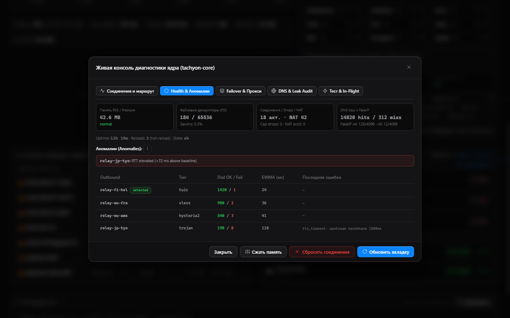
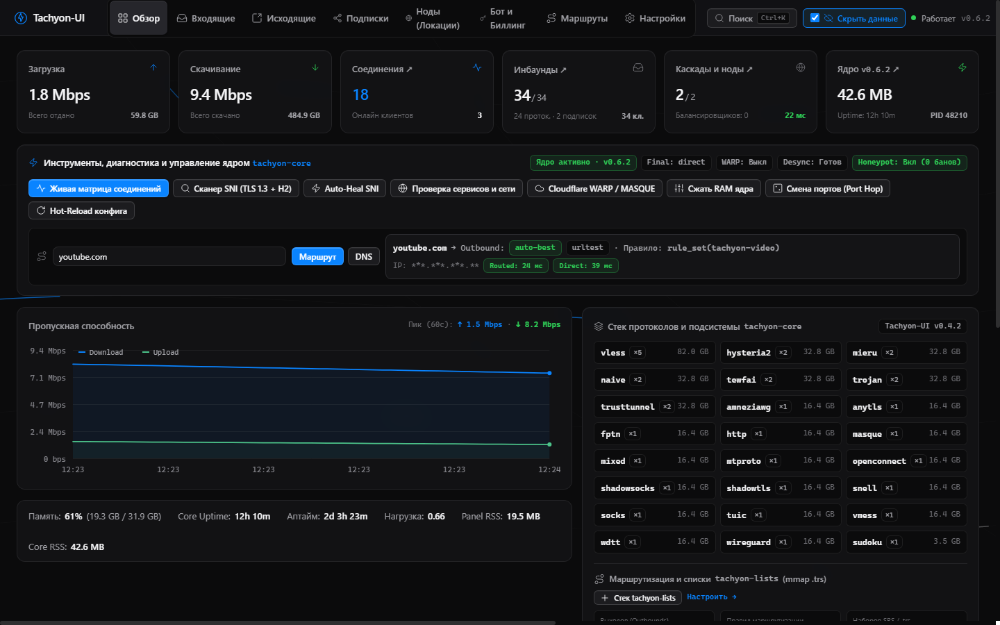

# 6. Диагностика ядра, скрытие приватных данных (`Alt+P`) и REST API

[English version](../en/06-diagnostics-privacy-and-api.md) | [К оглавлению](../../README.ru.md)

## Живая 5-вкладочная консоль диагностики ядра

Кнопка **Соединения** в топбаре или **Живая матрица соединений** на дашборде открывает модальное окно диагностики в реальном времени (`tachyon-core` Runtime API):

| Вкладка консоли | Функции и эндпоинты ядра |
| :--- | :--- |
| **1. Соединения и маршрут** | Встроенный живой трассировщик `POST /api/core/route-check`, проверка маршрута домена `POST /api/core/route-domain`, фильтр активных сессий по клиенту/домену/IP/протоколу (`GET /api/core/connections`), принудительное закрытие отдельных потоков или всех потоков пользователя (`POST /api/core/connections/close`, `POST /api/core/kick`), оперативная блокировка домена (`POST /api/core/block-domain`), мониторинг и очистка памяти ядра (`GET /api/core/memory`, `POST /api/core/memory-trim`). |
| **2. Health & Аномалии** | Телеметрия состояния ядра (`GET /api/core/health`: аптайм, RSS-память, число открытых файловых дескрипторов, RTT, success rate, состояние Circuit-Breaker по каждому outbound) и журнал аномалий (`GET /api/core/anomalies`). |
| **3. Failover & Прокси** | Состояние групп отказоустойчивости (`GET /api/core/failover`, принудительный возврат `POST /api/core/failover/restore`), живые группы балансировщиков (`GET /api/core/proxies`) с переключением активного узла в `selector` в реальном времени, массовым тестом задержек (`POST /api/core/proxies/delay`) и сбросом Circuit-Breaker (`POST /api/core/outbound/reset`). |
| **4. DNS & Leak Audit** | Сравнительная проверка DNS (`POST /api/core/dns-check` — встроенный движок vs прямой UDP:53 на предмет подмены или bogon), очистка DNS-кэша (`POST /api/core/dns/flush`) и тест утечек (`GET / POST /api/core/leak`: IPv4, IPv6, DNS, WebRTC). |
| **5. Тест & In-Flight** | 8-этапный тест подключения к любому URL/хосту (`POST /api/core/connection-test`) и просмотр/очистка буфера незавершённых запросов ядра (`GET / DELETE /api/core/flight`). |

### Нижний Live Connections Dock (`` Ctrl+` ``)

Для постоянного контроля трафика без перекрытия текущей таблицы предусмотрен нижний выдвижной док **Live Connections Dock** (`` Ctrl+` `` или меню инструментов топбара). Он показывает поток активных сессий в реальном времени, позволяет фильтровать домены/клиентов, проверять маршрут (`route-domain`) и блокировать домен в 1 клик (`block-domain`).

---

## Режим скрытия приватных данных (`Alt+P`)

Тумблер **Скрыть данные** в правом верхнем углу топбара (дублируется горячей клавишей `Alt+P`, пунктом в палитре `Ctrl+K` и настройкой в `#settings`; состояние запоминается в `localStorage`) позволяет безопасно записывать скринкасты, делать скриншоты и проводить удалённые демонстрации панели.

**Что маскируется (`***`):**
- Все приватные IPv4/IPv6-адреса и нестандартные порты (`198.51.100.21:443` → `***.***.***.**:****`).
- Приватные доменные имена сервера и нод.
- Ссылки и токены подписок (`/sub/...`, `/cdn/v2/...`, `?k=...`, `?v=...`, заголовки `If-None-Match` и `X-Client-Digest`).
- UUID, X25519/WireGuard/SS2022 ключи, пароли, HWID устройств, токены и ID Telegram-бота.
- QR-коды (размываются, чтобы ссылку нельзя было считать с экрана).
- Поля `<input>` / `<textarea>` с секретными значениями маскируются визуально (через SVG-паттерн поверх текста) **без изменения фактического `.value`**, поэтому формы продолжают работать и копирование в буфер копирует реальные значения.

**Что остаётся видимым и читаемым:**
- Общеизвестные публичные тестовые/проверочные домены и URL (`https://www.gstatic.com/generate_204`, `https://cp.cloudflare.com/generate_204`, `example.com`, `youtube.com`, `google.com`, `cloudflare.com`, `github.com`, `microsoft.com`, `telegram.org` и др.).
- Публичные DNS-резолверы (`1.1.1.1`, `1.0.0.1`, `8.8.8.8`, `8.8.4.4`, `9.9.9.9`) и `0.0.0.0`.
- Поля ввода в диагностических инструментах, трассировщиках маршрутов, симуляторе и строке `urltest`-проверки.

---

## Командная палитра (`Ctrl+K`) и горячие клавиши

| Сочетание | Действие |
| :--- | :--- |
| **`Ctrl + K`** (или `Cmd + K`) | Глобальная палитра команд и быстрый поиск по нодам, клиентам, подпискам, темам оформления и действиям (`Self-Audit`, `Hot-Reload`, инвайт в 1 клик, установка `tachyon-lists`). |
| **`` Ctrl + ` ``** (или `` Cmd + ` ``) | Открыть или скрыть нижний живой поток соединений (**Live Connections Dock**). |
| **`Alt + P`** | Мгновенно включить или выключить режим скрытия приватных данных звёздочками. |
| **`Alt + 1 … 8`** | Мгновенное переключение между 8 основными разделами (`Обзор`, `Входящие`, `Исходящие`, `Подписки`, `Ноды`, `Бот`, `Маршруты`, `Настройки`). |
| **`Shift + Клик`** | Выделение диапазона чекбоксов во Входящих, Исходящих и Подписках с вызовом плавающей панели пакетных операций. |
| **`?`** | Открыть встроенную памятку по всем горячим клавишам и жестам. |
| **`Esc`** | Закрыть открытое модальное окно, боковой инспектор или палитру команд. |

---

## Производительность, HTTP-сжатие и кэширование

- **Прозрачное HTTP-сжатие `gzip`**: парсер `parse_accepts_gzip` учитывает веса `q` в заголовке `Accept-Encoding` (включая корректный отказ при `gzip;q=0`). Для всех ответов `200 OK` размером от `1024` байт (JSON API и подписки, если заголовок `Content-Encoding` ещё не задан) `send_response` сжимает тело потоковым `GzEncoder` (`Compression::fast()`), отправляет сжатую версию при выигрыше в размере и выставляет `Content-Encoding: gzip` и `Vary: Accept-Encoding`.
- **Предсжатый кэш встроенного SPA `UI_HTML` и `ETag`**: структура `CachedUiAsset` (`UI_ASSET_CACHE`) хранит `raw`- и предсжатую `gzip`-версию `src/ui.html` с внедрённым `web_base_path` (около `225 КБ` в `gzip` против ~`1.05 МБ` в несжатом виде — экономия ~`78%` трафика). Заголовок `ETag` (16 байт SHA-256) сопоставляется с `If-None-Match` (включая списки тегов и weak-теги `W/`) и возвращает `304 Not Modified` с `Cache-Control: no-cache` и `Vary: Accept-Encoding`. Проверка `ETag` выполняется строго **после** Covert Knock, чтобы запросы подписок с `If-None-Match` на корневом пути не перехватывались кэшем SPA.
- **Кэширование X.509-сертификатов**: функция `read_cert_info_cached` валидирует кэш сертификата на диске по паре `(mtime, size)`, а `read_cert_info_from_pem_cached` кэширует разбор встроенных PEM по SHA-256 (до 64 записей с пересчётом `days_left`). При экспорте подписки контекст `CertLookupCtx` вычисляет путь к сертификату один раз на запрос вместо повторных обращений к ФС для каждого клиента.
- **Неблокирующая отдача read-эндпоинтов**: `GET /api/status` собирает данные тремя короткими непересекающимися чтениями блокировок без полного клонирования `LiveTelemetry` (сначала `live.read()` для счётчиков и активных соединений, затем `data.read()` для сводок, затем `live.read()` с прямой сериализацией `&*live`). Эндпоинты `GET /api/inbounds`, `/api/outbounds`, `/api/routes`, `/api/settings`, `/api/config-preview`, `/api/subs`, `/api/backup`, `/api/nodes`, `/api/tg-bot`, `/api/domain/proxy-snippet`, `/api/site/info` (`inspect_www_dir` вынесен за пределы read-lock) и `/api/sub-profiles` выполняют `serde_json::to_vec` под коротким `RwLock` и освобождают блокировку до записи в сокет через `send_json_bytes`.
- **Линейная обработка и оптимизации SPA**: `InboundUserNameResolver` разрешает имена клиентов за `O(C)` на инбаунд при генерации конфигурации, экспорте подписок и сопоставлении статистики; в `poll_stats` дельты трафика агрегируются через вложенную карту `user_deltas`. В `src/ui.html` таблицы используют per-tick microtask-индексы `Map`/`Set` (очищаемые через `queueMicrotask`), debounce поиска (`90 мс` с мгновенным сбросом `0 мс` при пустом запросе) и батчинг `MutationObserver` режима приватности через `requestAnimationFrame` с дедупликацией предков.

---

## Справочник REST API

При настроенном `web_base_path` (например `/p-8f3c21a9`) все маршруты панели и `/api/*` доступны **только** с этим префиксом (`<web_base_path>/api/...`).

### Аутентификация

| Метод и путь | Описание |
| :--- | :--- |
| `POST /api/login` | Вход по `{ "username", "password" }`. Выдаёт нейтральную cookie `sid=...; HttpOnly; SameSite=Strict` (`+ ; Secure` на TLS) и `{ "token", "expires" }` (поддерживается в `Authorization: Bearer <token>`). |
| `POST /api/logout` | Удаляет серверную сессию и очищает cookie `sid` и legacy `tachyon_session`. |

### Основные ресурсы, инструменты, TLS и API ядра

| Группа | Маршруты |
| :--- | :--- |
| **Статус, настройки и снапшоты** | `GET /api/status` (включая `core.user_online_ips`, `core.sub_online_ips` и `access_grant`), `GET /api/config-preview`, `GET/PUT /api/settings`, `GET/PUT /api/access-grant`, `GET /api/backup`, `POST /api/restore`, `GET/POST /api/snapshots`, `POST /api/snapshots/restore`, `GET /api/logs` |
| **Управление ядром и панелью** | `POST /api/core/start \| stop \| restart \| apply`, `GET /api/core/releases`, `POST /api/core/update`, `GET /api/panel/releases`, `POST /api/panel/self-update` |
| **Публичный сайт (`SiteEngine`)** | `GET /api/site/info`, `POST /api/site/upload-zip` (raw ZIP или JSON `zip_base64`), `GET/PUT /api/site/index`, `DELETE /api/site/custom`, `GET /api/site/preview?mode=&path=&title=` |
| **Домен и TLS** | `GET /api/tls/status`, `POST /api/tls/self-signed`, `POST /api/tls/issue-acme`, `POST /api/domain/apply-profile` (включая `unified_443_front`), `GET /api/domain/proxy-snippet` |
| **Self-Audit и безопасность** | `POST /api/web/self-audit` (возвращает `score`, `grade`, 9 `checks`), `GET /api/security/honeypot`, `POST /api/security/clear-honeypot` |
| **Инбаунды, аутбаунды и маршруты** | `GET/POST /api/inbounds`, `PUT/DELETE /api/inbounds/:id`, `POST /api/inbounds/:id/clients`, `POST /api/inbounds/batch-action` (`enable`, `disable`, `delete`, `set_country`), `POST /api/inbounds/traffic-policy`, `GET /api/share/:id`, `GET/POST /api/outbounds`, `PUT/DELETE /api/outbounds/:tag`, `POST /api/outbounds/health-check`, `POST /api/outbounds/batch-delete`, `GET/PUT /api/routes`, `POST /api/routes/tachyon-lists-pack`, `POST /api/routes/simulate` |
| **Генераторы и сетевые инструменты** | `GET /api/generate/uuid \| reality-keys \| wg-keys \| ss-key \| password`, `POST /api/tools/sni-scan \| auto-heal \| port-hop \| unlock-probe \| cloudflare-dns` (и диагностика региональной связности в `/api/tools/*`) |
| **Подписки, Covert Knock и ваучеры** | `GET/POST /api/subs` (поддержка `old_sub_id` для переименования на месте с защитой `409 Conflict` и `total_limit_bytes`), `DELETE /api/subs/:id`, `POST /api/subs/:id/reset-traffic \| rotate \| toggle \| extend \| covert-token \| rotate-secrets`, `DELETE /api/subs/:id/devices/:dev_id`, `POST /api/subs/rotate-token`, `POST /api/subs/clear-strikes`, `POST /api/subs/import-external`, `GET/POST /api/sub-profiles`, `DELETE /api/sub-profiles/:id`, `POST /api/subs/apply-profile`, `POST /api/subs/quick-invite`, `POST /api/subs/batch-action`, `POST /api/subs/inspect-headers`, `POST /api/vouchers/batch`, `POST /api/redeem` |
| **Ноды, кластер, каскады и Telegram-бот** | `GET/POST /api/nodes`, `DELETE /api/nodes/:id`, `POST /api/nodes/test-managed`, `POST /api/nodes/:id/sync-clients`, `POST /api/nodes/:id/export-outbound`, `DELETE /api/nodes/:id/export-outbound/:inb_id`, `POST /api/nodes/sync \| health-check \| multi-clone`, `POST /api/cascade/preview \| /api/cascade`, `GET/PUT /api/tg-bot`, `POST /api/tg-bot/verify \| broadcast \| send-message \| users/adjust \| backup-now \| test-alert`, `POST /api/tg-bot/promo`, `DELETE /api/tg-bot/promo/:code`, `POST /api/tg-bot/orders/:id/approve \| reject`, `DELETE /api/tg-bot/orders/:id`, `DELETE /api/tg-bot/tickets/:id`, `POST /api/billing/issue-sub` |
| **Мост `tachyon-core` Runtime API** | `GET /api/core/connections`, `POST /api/core/connections/close \| kick \| block-domain \| route-domain`, `GET /api/core/proxies`, `POST /api/core/proxies/select \| delay`, `POST /api/core/outbound/reset`, `GET /api/core/health`, `GET /api/core/anomalies`, `GET/POST /api/core/failover`, `POST /api/core/failover/restore`, `POST /api/core/route-check`, `POST /api/core/connection-test`, `POST /api/core/dns-check \| dns/flush`, `GET/POST /api/core/leak`, `GET/DELETE /api/core/flight`, `GET /api/core/memory`, `POST /api/core/memory-trim`, `POST /api/core/warp/register` |

---

[Назад: Глава 5 — Протоколы, мультиноды, каскады и Telegram-бот](05-protocols-nodes-and-tgbot.md) | [К оглавлению](../../README.ru.md) | [Далее: Глава 7 — Полное пошаговое руководство по настройке и единой подписке](07-full-setup-and-cluster-guide.md)
