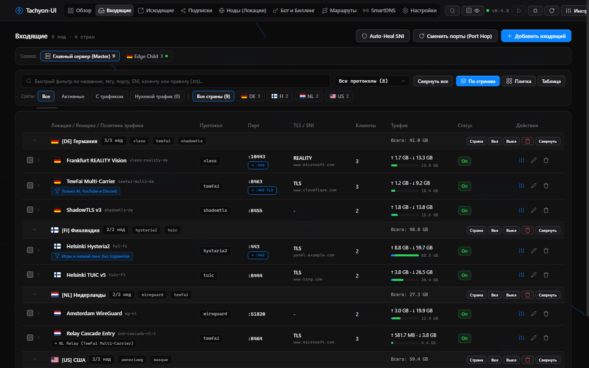
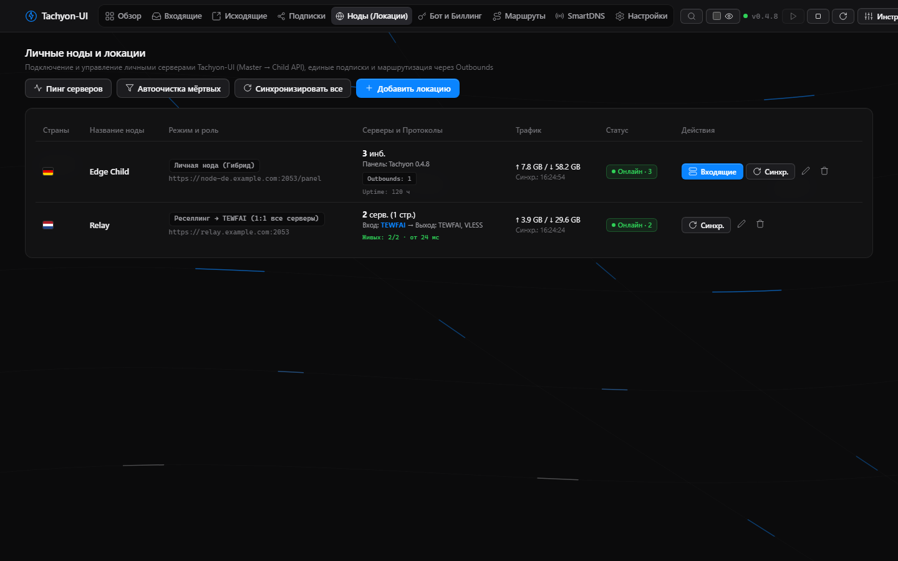
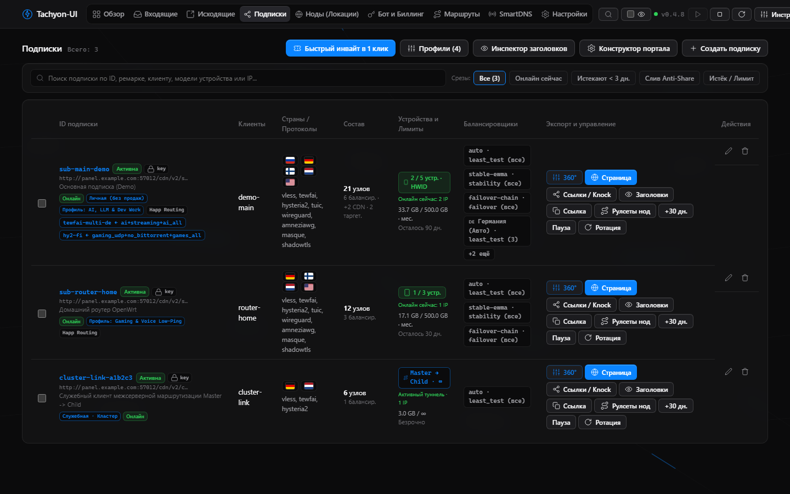
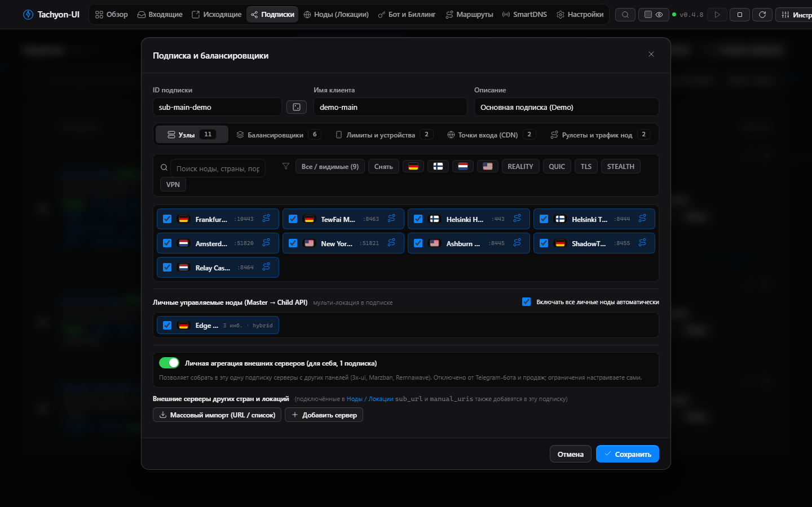
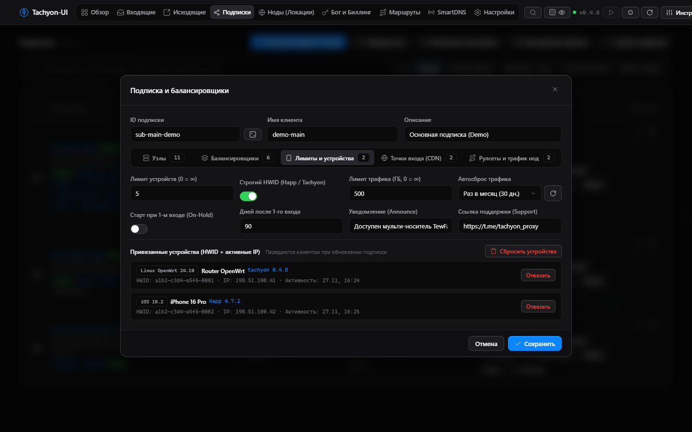
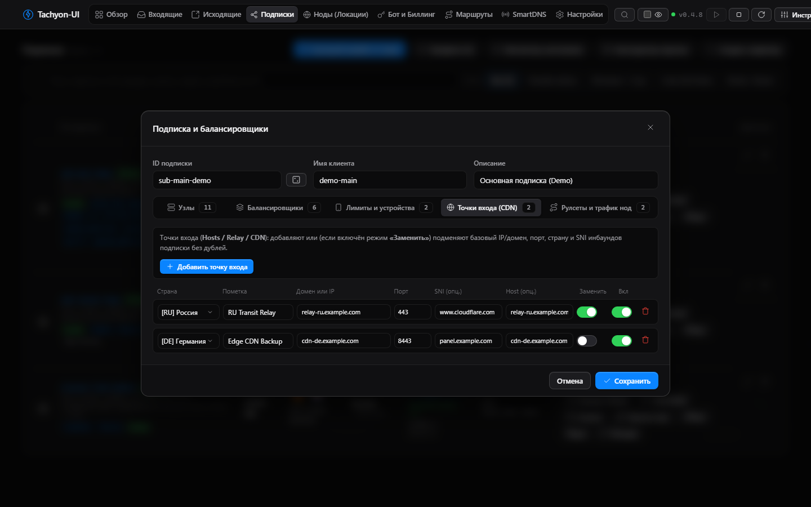
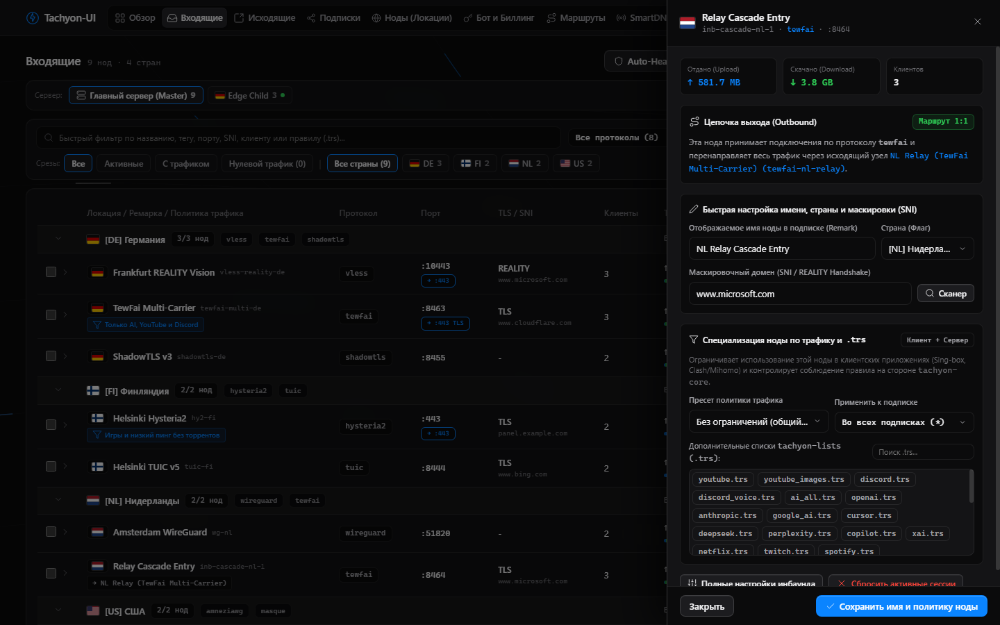
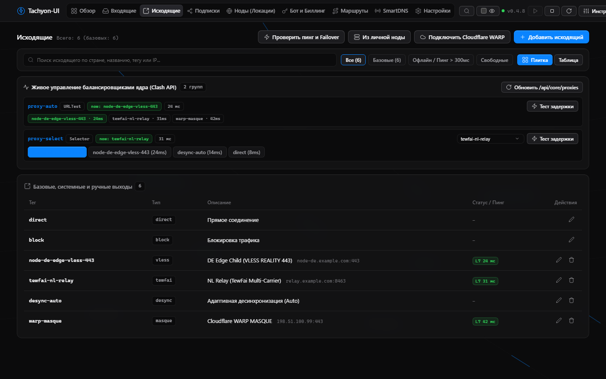
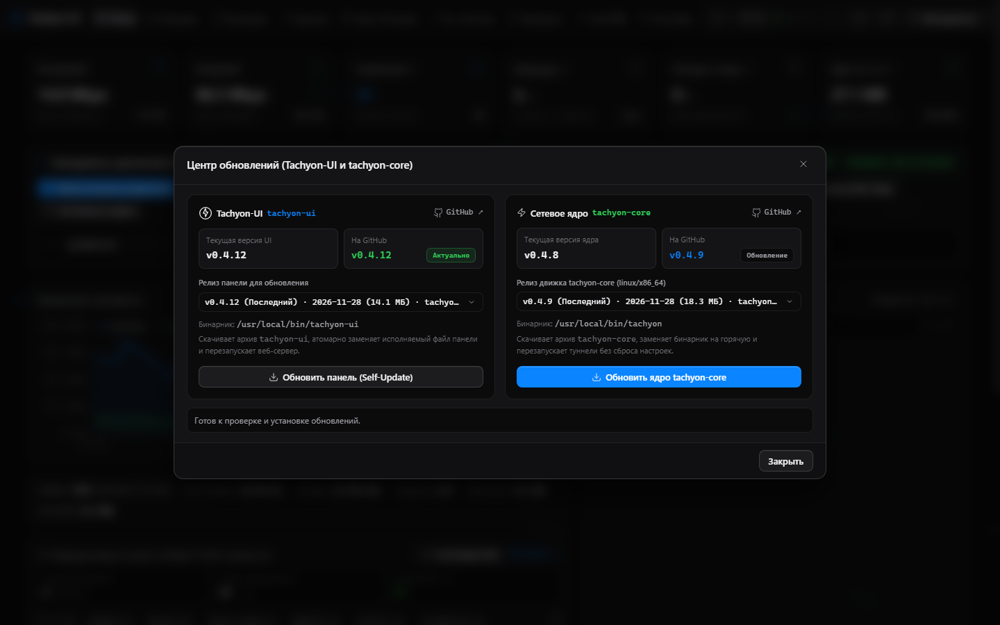

# 7. Полное пошаговое руководство: от установки до единой мультисерверной подписки

[English version](../en/07-full-setup-and-cluster-guide.md) | [Полное руководство](00-complete-guide.md) | [Полный справочник UI (все вкладки и кнопки)](./11-ui-every-tab-and-button-guide.md) | [Каталог протоколов (27 гайдов)](./protocols/README.md) | [К оглавлению](../../README.ru.md) | [Глава 5 — Мультиноды и протоколы](05-protocols-nodes-and-tgbot.md) | [Глава 6 — Диагностика и API](06-diagnostics-privacy-and-api.md)

Это практическая инструкция «от А до Я» для версии **`tachyon-ui v0.4.12`**: как с нуля поднять основной сервер (`Master`), настроить маскировку под публичный сайт (`SiteEngine`) и единый порт `443` (`Unified 443 Front`), добавить свои дополнительные серверы на `tachyon-ui` (`Child`), управлять их инбаундами из одной панели, синхронизировать лимиты и HWID (`sub_configs`), объединить все локации в **единую мультисерверную подписку**, настроить релеи (`cluster-link-*`) и избежать типовых ошибок (включая сообщение `«Требуется ключ доступа»` и ошибки сертификатов у `NaiveProxy` / `MASQUE`).

---

## 1. Архитектура и режимы работы (что работает без ключа доступа)

```text
                       ┌───────────────────────────────────────────┐
                       │         Клиент (Happ / v2RayTun /         │
                       │      Hiddify / Mihomo / OpenWrt и др.)    │
                       └─────────────────────┬─────────────────────┘
                                             │
            1) Получает единую подписку      │  2) Подключается напрямую
               с сервера Master              │     к Master и к Child 1..N
                                             ▼
┌────────────────────────────────────┐               ┌───────────────────────────────────┐
│      Основной сервер (Master)      │  Master→Child │     Личный сервер 1 (Child DE)    │
│          tachyon-ui v0.4.12         ├──────────────►│         tachyon-ui v0.4.12         │
│                                    │  REST API     │                                   │
│ • Хранит подписки (#subs)          │ (Bearer Token)│ • Управляется из #inbounds Master │
│ • Синхронизирует клиентов и        │               │ • Получает clients + sub_configs  │
│   sub_configs (HWID/лимиты/remark) │               │   (sub_configs_synced)            │
│ • Может строить релеи (Outbounds)  ├───────┐       │ • Отдаёт статистику трафика       │
└────────────────────────────────────┘       │       └───────────────────────────────────┘
                                             │
                                             │       ┌───────────────────────────────────┐
                                             └──────►│     Личный сервер 2 (Child NL)    │
                                                     │         tachyon-ui v0.4.12         │
                                                     │ • Входит в ту же единую подписку  │
                                                     │ • Либо работает как relay/hybrid  │
                                                     └───────────────────────────────────┘
```

Перед настройкой важно различать **два сценария**:
1. **Работа со своими серверами на `tachyon-ui`** — полностью доступна **в базовом режиме без ключа доступа**.
2. **Подключение и перепродажа сторонних (чужих) подписок** — требует ключ доступа по отпечатку хоста (`TH-XXXX-XXXX-XXXX`, раздел **Настройки → Ключ доступа**; для получения ключа необходимо обратиться напрямую к разработчику).

| Место в интерфейсе | Режим / Действие | Для чего используется | Нужен ключ доступа? |
| :--- | :--- | :--- | :--- |
| **Ноды → Добавить локацию** | `managed_tachyon_node` (**Личная управляемая нода `Master → Child API`**) | Полное управление своими серверами с `tachyon-ui`: правка инбаундов прямо во вкладке **Входящие** основной панели, выбор серверов в подписке, автосинхронизация клиентов и `sub_configs` (HWID, лимиты, метаданные), экспорт инбаундов в **Исходящие (`Outbounds`)** | **Нет** (работает всегда) |
| **Ноды → Добавить локацию** | `tachyon_node` (**Подписка Tachyon-UI на другом сервере**) | Read-only получение готовых узлов из конкретной подписки вашего второго сервера с `tachyon-ui` (можно вставить как базовый URL панели + `remote_sub_id`, так и полную ссылку `/sub/<id>`) | **Нет** (для импорта узлов в `v0.4.4+`; реселлинг-каскад отключён) |
| **Ноды → Добавить локацию** | `sub_url` (**Внешняя ссылка подписки**) | Подписка стороннего провайдера по URL с эмуляцией клиентских заголовков (`User-Agent`, `x-hwid`, ОС, модель) | **Да** |
| **Ноды → Добавить локацию** | `manual_uris` (**Пакетный список ключей URI**) | Импорт произвольного списка `vless://`, `hy2://`, `tuic://` вручную | **Да** |
| **Ноды → Переназначить подписку (Реселлинг)** | Мастер каскадного реселлинга (`#modal-cascade`) | Скачивание чужой подписки и переупаковка её в ваш протокол | **Да** |
| **Подписки → Импорт внешней подписки** | Импорт чужой ссылки / URI в карточку подписки | Объединение сторонних URI прямо внутри подписки | **Да** |

---

## 2. Шаг 1 — Подготовка основного сервера (`Master`)

### 2.1. Установка и первый вход

На чистом VPS (Ubuntu / Debian / RHEL / Alpine Linux) выполните установку одной командой:

```bash
bash <(curl -Ls https://raw.githubusercontent.com/Dushnilin/tachyon-ui/main/install.sh)
```

Скрипт установит статический бинарник `/opt/tachyon-ui/tachyon-ui` (или `/usr/local/bin/tachyon-ui`), системный сервис `tachyon-ui`, утилиту `tachyon-panel`, откроет порт панели в файрволе и выведет ссылку и временный пароль входа.

Сразу после первого входа откройте **Настройки**:
1. Смените стандартный пароль администратора (и при необходимости логин).
2. Задайте скрытый путь панели `web_base_path` (например, `/adm-9x4k/`), чтобы панель не открывалась по корневому `/` на основном порту.
3. Проверьте, что включён тумблер **Автоматическое управление файрволом (`auto_firewall_enabled`)** — при создании или смене портов инбаундов `tachyon-ui` сам безопасно откроет нужные порты в `UFW` / `firewalld` / `iptables`, не трогая ваши ручные правила и SSH.
4. На **Дашборде** убедитесь, что ядро `tachyon-core` находится в статусе **Запущено** (при необходимости нажмите **Применить / Запустить**).

### 2.2. Базовые входящие подключения на `Master` и правило для `NaiveProxy` / `MASQUE`



При первом старте панель создаёт стартовый набор входящих подключений (`#inbounds`). Проверьте их список и обязательно учтите требование к TLS-сертификатам:

> [!IMPORTANT]
> **О протоколах `NaiveProxy HTTP/3 QUIC`, `MASQUE HTTP/3` и `Trojan TLS`:**
> Протоколы `NaiveProxy`, `MASQUE` и `Trojan TLS` требуют **привязанный домен и доверенный TLS-сертификат (Let's Encrypt)**, совпадающий с SNI клиента.
> - Если сервер работает **по голому IP без домена**, либо сертификат ещё не выпущен на нужный домен: клиенты (особенно роутеры, Mihomo, Sing-box) будут падать с ошибкой проверки сертификата вроде `certificate not valid for name "www.bing.com"; certificate is valid for DnsName("...")` или таймаутом `504`.
> - **Что делать на сервере без домена:** отключите или удалите `NaiveProxy HTTP/3 QUIC` и `MASQUE HTTP/3` (либо выпустите валидный доменный сертификат Let's Encrypt через **Мастер настройки → Домен и TLS**). Для работы без домена используйте `VLESS + REALITY`, `TewfAI`, `Hysteria2`, `TUIC`, `ShadowTLS v3` или `WireGuard / AmneziaWG`.
> - В `v0.4.12` для `MASQUE` и `NaiveProxy HTTP/3 QUIC` подставляются валидный домен сертификата и устойчивые таймауты (`keep_alive_period: "20s"`, `idle_timeout: "50s"`), но **действующий доменный сертификат для этих протоколов по-прежнему обязателен**.

Для корректного отображения флага в единой подписке укажите 2-буквенный код страны для каждого инбаунда на `Master` (например, `DE`, `FI`, `NL`) через редактирование инбаунда или пакетную кнопку в шапке группы стран.

### 2.3. Публичный сайт (`SiteEngine`), домен, TLS и режим `Unified 443 Front`

Если к `Master` привязан собственный домен (A-запись DNS указывает на IP сервера), настройте маскировку и единый вход на порту `443`:

1. Откройте **Мастер настройки → Шаг «Публичный сайт (`SiteEngine`)»** (подробнее в [Главе 2](02-stealth-web-domain-tls.md)):
   - Выберите один из 6 встроенных многостраничных шаблонов сайта-прикрытия **или** загрузите собственный статический сайт в `.zip` (до `15 МБ`, через `POST /api/site/upload-zip`).
   - Включите активный **Honeypot** для регистрации сканеров и ботов.
2. Перейдите на шаг **«Домен и TLS»**:
   - Выпустите сертификат Let's Encrypt (`HTTP-01` со встроенным временным слушателем `:80` или `Cloudflare DNS-01`).
   - Выберите профиль привязки:
     - **`dual_single_port`** — базовый вариант (панель на своём порту `2053`, инбаунды на отдельных портах).
     - **`unified_443_front`** *(рекомендуется при наличии домена)* — единый порт `443` TCP/UDP через NGINX:
       - stream-блок `ssl_preread` направляет `REALITY`-соединения напрямую на внутренний порт `tachyon-core`, а доменный HTTPS-трафик — на L7 HTTPS-сервер;
       - панель доступна только по скрытому `web_base_path` (напр. `/adm-9x4k/`), подписки и L7-транспорты (`WS`/`gRPC`/`XHTTP`) работают на том же `:443`;
       - для `Hysteria2` / `TUIC` на `443/udp` поднимается изолированный loopback masquerade `127.0.0.1:18080`, чтобы masquerade-ответы не светили панель.
3. Нажмите **Применить в NGINX**: панель автоматически определяет версию `nginx -v` (`listen ... ssl http2;` для `< 1.25.1` или `http2 on;` для `>= 1.25.1`), считывает системного воркера `user`, дедуплицирует `location`, проверяет `nginx -t -e /dev/stderr` и при ошибке откатывает конфиг.

> [!NOTE]
> В профиле **`unified_443_front`** stream-маршрутизация с `REALITY` работает **без `proxy_protocol`**, поэтому локальные L7-запросы, прошедшие через NGINX на `:443`, видны панели как `127.0.0.1`. Учитывайте это для SmartDNS `/dns-bind/<token>` и привязки IP через DoH-токен — для определения реального внешнего IP используйте прямой порт панели (`:2053`).

---

## 3. Шаг 2 — Установка и подготовка дочерних серверов (`Child`)

На каждом дополнительном VPS, который вы хотите добавить в общую панель и единую подписку, выполните те же действия:

1. Установите `tachyon-ui` версии `v0.4.12` (если панель уже была установлена ранее — обновите её через `Настройки → Обновление панели` или переустановите бинарник из релиза):
   ```bash
   bash <(curl -Ls https://raw.githubusercontent.com/Dushnilin/tachyon-ui/main/install.sh)
   ```
2. Войдите в веб-интерфейс дочернего сервера, смените пароль администратора и проверьте, что `tachyon-core` запущен.
3. Во вкладке **Входящие (`#inbounds`)** дочернего сервера оставьте нужные входящие подключения (`VLESS + REALITY`, `TewfAI`, `Hysteria2`, `TUIC` и т.д.) и задайте корректный код страны (например, `NL`, `US`, `FI`). На сервере без домена отключите `NaiveProxy` / `MASQUE`.
4. Откройте на **дочернем сервере** раздел **Настройки**, найдите карточку **Кластерный API-токен (`node_api_token`)** и скопируйте Bearer-токен.
   - При необходимости здесь же можно перевыпустить токен кнопкой ротации (после перевыпуска нужно обновить токен на `Master`).
5. Убедитесь, что порт дочерней панели (по умолчанию `2053`, либо `443` при `unified_443_front`) доступен по сети с IP-адреса сервера `Master` (проверьте файрвол у хостера / `UFW`).

---

## 4. Шаг 3 — Подключение своих серверов к `Master` (без ключа доступа)



Вернитесь в панель **`Master`**, откройте вкладку **Ноды (`#nodes`)** и нажмите кнопку **«Добавить локацию»**.

> **Обратите внимание:** нажимайте именно **«Добавить локацию»**, а не «Переназначить подписку (Реселлинг)». Кнопка реселлинга предназначена только для чужих подписок и всегда требует ключ доступа.

### Вариант A (рекомендуемый): `Личная управляемая нода (Master → Child API)`

Этот способ превращает `Master` в единый центр управления всеми вашими серверами без ключа доступа:

1. **Страна по умолчанию:** выберите страну дочернего VPS (например, `NL`).
2. **Название подписки / локации:** введите понятное имя (например, `Нидерланды-1`).
3. **Способ подключения:** убедитесь, что выбран пункт **`Личная управляемая нода (Master → Child API)`** (`managed_tachyon_node`).
4. **URL ноды:** укажите **базовый адрес дочерней панели** (именно адрес панели, **без** `/sub/...`):
   - Если панель на порту `2053` в корне: `https://198.51.100.20:2053` или `http://198.51.100.20:2053`
   - Если у дочерней панели настроен скрытый путь `web_base_path`: `https://nl.example.com:2053/adm-9x4k` (или `https://nl.example.com/adm-9x4k` за NGINX)
   - *Примечание:* если на дочернем сервере используется самоподписанный TLS-сертификат, укажите `https://...` — кластерный клиент `Master` корректно принимает самоподписанные сертификаты личных нод.
5. **Кластерный Bearer API-токен:** вставьте скопированный на шаге 3 токен `node_api_token` с дочернего сервера. (Резервный блок логина/пароля можно оставить пустым, если указан Bearer-токен.)
6. **Роль ноды:**
   - **`direct` (по умолчанию)** — прямая выдача подключений этой ноды пользователям в подписках + полное управление её вкладкой **Входящие**. Для единой подписки с несколькими локациями выбирайте `direct` (или `hybrid`).
   - **`hybrid`** — прямая выдача пользователям + возможность экспорта инбаундов в `Outbounds` на `Master` для релеев.
   - **`relay`** — сервер не выдаётся напрямую клиентам в подписке, а используется только как выходной узел (`Outbound`) на `Master` для каскадной маршрутизации.
7. Нажмите **«Проверить подключение (API)»**: должна появиться зелёная строка `Подключено (v0.4.12 · инбаундов: N · id: ...)`.
8. Нажмите **«Сохранить и синхронизировать»**. Нода появится в таблице со статусом **Онлайн**.

Повторите шаги 1–8 для каждого следующего вашего сервера (`Child 2`, `Child 3`, ...).

### Вариант B (read-only): `Подписка Tachyon-UI на другом сервере (tachyon_node)`

Используйте этот режим, только если вам не нужно управлять инбаундами удалённого сервера и не нужно объединять общий учёт трафика/клиентов по подписке, а нужно просто забирать уже готовую подписку со своего второго сервера `tachyon-ui`:
1. В **Ноды → Добавить локацию** выберите `Подписка Tachyon-UI на другом сервере (tachyon_node)`.
2. Вставьте базовый URL дочерней панели (и в правом поле укажите `ID подписки`, по умолчанию `tachyon-all`), **либо** вставьте сразу полную ссылку вида `https://198.51.100.20:2053/sub/sub-xxxxxx` — панель сама извлечёт базовый URL и `remote_sub_id`, очистит скрытые заголовки эмуляции клиента и сохранит ноду без запроса ключа доступа.

---

## 5. Шаг 4 — Управление инбаундами дочерних нод прямо с `Master`

После добавления нод в режиме `managed_tachyon_node` логиниться в каждую дочернюю панель больше не нужно:

1. Откройте вкладку **Входящие (`#inbounds`)** на `Master`.
2. Вверху страницы отобразится переключатель серверов: **Текущий сервер (Master)** и кнопки для каждой подключённой личной ноды.
3. Кликните по нужной дочерней ноде — панель загрузит список её инбаундов через Child API.
4. Вы можете **создавать**, **редактировать**, **включать/отключать** и **удалять** инбаунды на дочернем сервере точно так же, как локальные (при этом ядро `tachyon-core` перезагружается только на том сервере, который вы редактируете).
5. Если дочерняя нода временно недоступна по сети, интерфейс покажет кэшированный список её инбаундов с пометкой кэша, не ломая остальную панель.

---

## 6. Шаг 5 — Объединение всех серверов в ОДНУ подписку (`#subs`) и синхронизация `sub_configs`



Теперь соберём локальный сервер (`Master`) и все подключённые личные ноды (`Child 1..N` с ролью `direct` или `hybrid`) в **единую ссылку подписки** для клиента:

1. Перейдите во вкладку **Подписки (`#subs`)** на `Master`.
2. Нажмите **«Создать подписку»** (или **Редактировать** у уже существующей подписки, например `tachyon-all` / `main`).
3. Задайте параметры подписки:
   - **ID / Имя (`sub_id`):** уникальный латинский идентификатор (например, `vip-all` или `my-vpn`). Поддерживается переименование на месте (`old_sub_id`) с защитой `409 Conflict`.
   - **Квота трафика (ГБ), стратегия сброса (`none` / `daily` / `weekly` / `monthly`), срок действия** и **старт при первом подключении**.
   - **Лимит устройств (`device_limit`)** и при необходимости строгий HWID (`strict_hwid`).



4. В секции выбора узлов:
   - Выберите нужные **локальные инбаунды** на `Master` (например, `VLESS + REALITY`, `TewfAI`, `Hysteria2`).
   - В блоке **Личные ноды / Серверы кластера** отметьте галочками подключённые дочерние серверы (`DE`, `NL`, `FI`, ...).
   - *Важно:* если дочерняя нода добавлена с ролью **`relay`**, она намеренно не выдаётся пользователям напрямую — для участия в единой подписке её роль должна быть **`direct`** или **`hybrid`**.

| Лимиты устройств, HWID и Anti-Share | Хосты, CDN и доменные подстановки |
| :---: | :---: |
|  |  |

5. Нажмите **Сохранить**.

### Что происходит под капотом автоматически (включая `sub_configs` в `v0.4.12`)
- Для каждого выбранного дочернего сервера `Master` вызывает синхронизацию (`POST /api/nodes/:id/sync-clients` → на дочернем сервере `POST /api/inbounds/sync-clients`), а также повторяет её при создании/правке/блокировке/продлении подписки и в фоне раз в 60 секунд.
- **Синхронизация клиентов:** на дочерних серверах во всех активных инбаундах создаются соответствующие клиентские учётки с тем же `sub_id` и теми же ключами/UUID, что и на `Master`.
- **Синхронизация `sub_configs` (`sub_configs_synced`):** начиная с `v0.4.12`, вместе с массивом `clients` передаётся массив `sub_configs`. На дочерние ноды автоматически переносятся `remark`, `device_limit`, `strict_hwid`, список привязанных `devices` (HWID), `traffic_reset_strategy`, `start_on_first_use`, `expire_duration_days` и `activated_at`. Благодаря этому в таблице `#subs` на `Child` отображается актуальный лимит устройств и HWID с `Master` (а не `0/∞` по умолчанию), а в колонке статуса выводится живой счётчик **`Онлайн сейчас: N IP`** для каждой синхронизированной подписки.
- **Суммарная квота:** раз в 60 секунд `Master` собирает статистику трафика (`up`/`down`) с дочерних серверов и учитывает её в общей квоте подписки. Если квота исчерпана или подписка отключена — клиент отключается сразу на всех серверах.
- **Переименование и удаление:** при смене `sub_id` (`old_sub_id`), продлении срока или удалении подписки изменения автоматически раскатываются и на клиентов, и на `sub_configs` привязанных нод.

### Проверка и выдача единой ссылки пользователю
Нажмите на иконку ссылки/копирования у созданной подписки:
- **Обычный URL подписки** (для Happ, v2RayTun, Hiddify, v2rayN, Shadowrocket, Streisand):
  `https://<ваш-домен-или-IP>:<порт>/sub/<sub_id>`
- При просмотре в браузере (или `?format=html`) откроется **веб-портал пользователя** с кнопками импорта в один клик, QR-кодом и статистикой устройств.
- Поддерживаемые суффиксы URL:
  - `?format=clash` / `?format=mihomo` — готовый YAML для Clash Meta / Mihomo / FlClash (все локации и балансировщики по странам и группам);
  - `?format=singbox` / `?format=tachyon` — полный JSON для Sing-box / `tachyon-core`;
  - `?format=openwrt` и `?format=openwrt-install` — готовый конфиг и 1-клик скрипт для роутера OpenWrt;
  - `?country=DE,NL` — отфильтровать только нужные страны;
  - `?mode=ru-direct` (или `antiblock`, `gaming`, `full`) — выбрать политику маршрутизации на устройстве клиента.

---

## 7. Шаг 6 — Релеи, каскады и служебная подписка `cluster-link-*`

Если вам нужно, чтобы трафик пользователя приходил на **`Master`**, а затем отправлялся через **`Child`** (схема «Клиент → `Master` → `Child` → Интернет» или маршрутизация отдельных доменов/игр/сервисов через нужную страну) — в `v0.4.12` это работает **в базовом режиме без ключа доступа**.



### 7.1. Экспорт инбаунда дочерней ноды в `Outbounds` на `Master`



Выберите любой из **трёх** удобных способов:

1. **Точечно из вкладки «Входящие» (`#inbounds`):**
   - В переключателе серверов сверху выберите нужную дочернюю ноду.
   - На строке нужного инбаунда (например, `VLESS + REALITY` на `NL`) нажмите кнопку **`⇄ Outbound`**.
   - На дочернем сервере автоматически создастся выделенный служебный клиент **`cluster-link-<id_мастера>`**, а на `Master` в разделе **Исходящие (`#outbounds`)** сразу появится готовый outbound вида `node-<id>-inb-<inb_id>`.
2. **Из вкладки «Исходящие» (`#outbounds`):**
   - Нажмите кнопку **«Из личной ноды»**, выберите подключённую ноду и конкретный инбаунд из списка и подтвердите создание.
3. **Автоматически при добавлении/редактировании релей-ноды (`#nodes`):**
   - В настройках ноды `managed_tachyon_node` выберите роль **`relay`** или **`hybrid`**.
   - Включите появившийся переключатель **«Автоматически создать Outbounds на Master для активных инбаундов этой ноды»** (`auto_export_outbounds`).

### 7.2. Как в `v0.4.12` устроена и отображается служебная подписка `cluster-link-*`

При открытии вкладки **Подписки (`#subs`)** на дочерней ноде `Child` вы увидите запись с префиксом `cluster-link-...`. В `v0.4.12` для неё введено специальное поведение:
- **Бейдж и роль в таблице:** вместо обычной пользовательской подписки отображается синий бейдж **`Служебная · Кластер`**, а в столбце лимитов и устройств — **`Master → Child · ∞`** (лимит устройств принудительно отключён, HWID-привязка для межсерверного туннеля не используется).
- **Живой индикатор туннеля:** когда `Master` держит активные сессии через этот релей, на `Child` под бейджем отображается **`Активный туннель · N IP`** (в отличие от пользовательских подписок, где выводится **`Онлайн сейчас: N IP`**).
- **Защита от перезаписи при синхронизации:** эндпоинт `POST /api/inbounds/sync-clients` и фоновый цикл синхронизации `Master → Child` намеренно пропускают `sub_id`, начинающиеся с `cluster-link-`, при обновлении `sub_configs` и пакетном удалении — поэтому служебный релей никогда не сбросится при изменении пользовательских тарифов.

### 7.3. Автообновление и маршрутизация
- **Автосинхронизация параметров:** если вы измените порт, SNI, домен или публичный ключ на дочернем сервере (из `#inbounds` или напрямую на child-панели), привязанный `OutboundRecord` на `Master` автоматически обновится при сохранении или в ближайшем 60-секундном цикле синхронизации.
- **Проверка задержки:** во вкладке **Исходящие (`#outbounds`)** можно сразу нажать проверку задержки (`Health Check`), чтобы увидеть пинг от `Master` до каждой дочерней ноды (при включённом `relay_auto_failover` панель также автоматически переключает мёртвые релеи на резервные в той же стране).
- **Балансировщики и цепочки:** создайте `urltest` / `selector` / `chain` outbound во вкладке **Исходящие** и добавьте в него экспортированные узлы дочерних нод (подробнее в [Главе 4](04-balancers-chain-and-routes.md)).
- **Правила маршрутизации (`#routes`):** добавьте правило:
  - *по доменам / `.trs`-спискам* → отправить через выбранный outbound (или балансировщик) дочерней страны;
  - *по входящему тегу инбаунда (`inbound`)* → весь трафик с конкретного инбаунда `Master` целиком заворачивать в outbound дочернего сервера (классический мост «Master → Child»).

---

## 8. Обслуживание кластера и обновление ядра `tachyon-core` / панели `tachyon-ui`



Перед добавлением новых протоколов (`TewFai`, `MASQUE`, `TrustTunnel`, `AmneziaWG`) или обновлением кластера `Master → Child` поддерживайте одинаковую актуальную связку версий **`tachyon-ui v0.4.12`** + **`tachyon-core 0.6.9`** на всех узлах:

1. **Создайте точку восстановления:** перед обновлением откройте **Инструменты → История снимков** (`#modal-snapshots`) и нажмите **Создать снимок сейчас** (`POST /api/snapshots`).
2. **Откройте Центр обновлений (`#modal-core-update`):** нажмите на индикатор **`Ядро: ...`** в топбаре или выберите **Инструменты → Центр обновлений**.
3. **Обновите `tachyon-core`:** в блоке релизов ядра (`GET /api/core/releases`) выберите целевой тег (например, `0.6.9`) и нажмите кнопку обновления (`POST /api/core/update`). Панель загрузит бинарник, заменит его и перезапустит `tachyon-core`.
4. **Обновите панель `tachyon-ui`:** в блоке релизов панели (`GET /api/panel/releases`) выберите новый релиз (`v0.4.12`) и нажмите **Обновить панель** (`POST /api/panel/self-update`). На дочерних серверах (`Child`) обновление выполняется через их собственную панель или скрипт установки.
5. **Проверьте здоровье узла:** после перезапуска откройте **Инструменты → Диагностика ядра** (или дашборд) и убедитесь, что `tachyon-core` работает, а все инбаунды/аутбаунды прошли проверку конфигурации. Подробную карту всех кнопок обслуживания см. в [полном справочнике UI](./11-ui-every-tab-and-button-guide.md).

---

## 9. Решение проблемы «Требуется ключ доступа» и других частых ошибок

### Почему при добавлении своего сервера просит «Ключ доступа»?

На практике эта ошибка возникает по **четырём** причинам. Проверьте их по порядку:

1. **Панель ниже версии `v0.4.4` или не сброшен кэш браузера:**
   - В старых сборках при добавлении `tachyon_node` со ссылкой `/sub/...` или скрытыми дефолтными полями эмуляции клиента (`User-Agent` / `HWID`) срабатывала проверка гранта и появлялось сообщение про ключ доступа.
   - **Решение:** обновите `tachyon-ui` на `Master` (и желательно на `Child`) до **`v0.4.12`** и обновите страницу в браузере через **`Ctrl+F5`** (в правом блоке Дашборда должно отображаться `Tachyon-UI v0.4.12`).
2. **Нажата кнопка «Переназначить подписку (Реселлинг)» или «Подписки → Импорт внешней подписки»:**
   - Эти две кнопки предназначены **только для перепродажи чужих подписок** и всегда требуют ключ доступа (получается напрямую у разработчика).
   - **Решение:** для своих серверов на `tachyon-ui` используйте **Ноды → «Добавить локацию»**.
3. **В поле «Способ подключения» выбран `sub_url` или `manual_uris` вместо личной ноды:**
   - В форме **Добавить локацию** по умолчанию или по привычке могли выбрать `Внешняя ссылка подписки (URL)` (`sub_url`).
   - **Решение:** выбирайте **`Личная управляемая нода (Master → Child API)`** (`managed_tachyon_node`, рекомендуется) либо **`Подписка Tachyon-UI на другом сервере`** (`tachyon_node`).
4. **В `managed_tachyon_node` указана ссылка на подписку (`/sub/...`) вместо адреса панели, либо включена каскадная перепродажа у `tachyon_node`:**
   - В `managed_tachyon_node` указывается **адрес самой панели** (например, `https://198.51.100.20:2053` или `https://de.example.com/adm-path`), а не `/sub/tachyon-all`.
   - Если выбран режим `tachyon_node`, ссылку с `/sub/...` вставлять можно, но галочка каскадной перепродажи для этого режима в базовой версии отключена — для маршрутизации между своими нодами используйте `managed_tachyon_node` и экспорт в `Outbounds` (см. Раздел 7).

### Другие типовые ошибки и их быстрое устранение

| Ошибка / Симптом | Причина | Как исправить |
| :--- | :--- | :--- |
| `Нельзя подключить ноду к самой себе (совпадает instance_id)` | Вы пытаетесь добавить локальный `Master` как дочернюю ноду, либо клонировали файл `tachyon-ui.json` между серверами с одинаковым `instance_id` | Локальные инбаунды `Master` не нужно добавлять в `#nodes` — они уже доступны во `#inbounds` и `#subs`. Если база клонировалась с другого VPS, на дочернем сервере удалите `instance_id` в настройках JSON (панель сгенерирует новый при запуске) и перезапустите `tachyon-ui`. |
| `HTTP 401` / `HTTP 403` при проверке подключения | Неверный `node_api_token` или не указан скрытый `web_base_path` в URL ноды | Скопируйте токен заново из **Настройки → Кластерный API-токен** на дочернем сервере. Если у дочерней панели задан `web_base_path`, допишите его в конец URL ноды (например, `https://198.51.100.20:2053/mybase`). |
| Таймаут соединения / статус `Оффлайн` | Закрыт порт панели на дочернем VPS в файрволе провайдера или ОС | Откройте TCP-порт панели (например, `2053` или `443`) на дочернем сервере; проверьте доступность с `Master`: `curl -kI https://<IP_child>:2053/api/status`. |
| `NaiveProxy HTTP/3 QUIC`: `certificate not valid for name "www.bing.com"` или таймаут `MASQUE HTTP/3` | Используется старая сборка, либо для `NaiveProxy`/`MASQUE` не настроен домен с валидным сертификатом Let's Encrypt; на outbound `naive` запрещён `insecure: true` | Обновитесь до `v0.4.12`. Если домена с CA-сертификатом на сервере нет — отключите инбаунды `NaiveProxy` и `MASQUE`. Если домен есть — выпустите сертификат Let's Encrypt в Мастере настройки и примените его к инбаундам (см. [NaiveProxy](./protocols/10-naive.md), [MASQUE](./protocols/11-masque.md)). |
| `TewFai` в режиме `REALITY + QUIC` не подключается по QUIC | REALITY применяется только к TCP-носителю; на QUIC-сокете без явного сертификата используется self-signed ALPN `h3` | Используйте подписку из `tachyon-ui v0.4.12` (панель автоматически добавляет клиенту `quic.tls: { "enabled": true, "insecure": true, "alpn": ["h3"] }`, см. [TewFai](./protocols/01-tewfai.md)). |
| Ошибка `MTProto`: `secret must be 32 hex characters` | В конфиг `tachyon-core` передан секрет с префиксом `ee`/`dd` и hex-хвостом домена вместо чистых 32 hex-символов | Сохраните inbound/outbound через форму `tachyon-ui` — панель автоматически нормализует секрет до 32 hex-символов перед записью в конфиг (см. [MTProto](./protocols/15-mtproto.md)). |
| Ошибка `Desync`: `unknown field 'udp_fake_packets'` | В конфиге осталось устаревшее поле `udp_fake_packets`, отклонённое строгим валидатором `tachyon-core 0.6.9` | Пересохраните outbound в `tachyon-ui v0.4.12` или замените на `udp_fake`, `quic_desync` и `udp_repeats` (см. [Desync](./protocols/24-desync.md)). |
| `nginx -t` падает на `map_hash_bucket_size`, `http2 on;`, правах `error.log` или дублях `location` | Старая версия генератора NGINX или старый NGINX `< 1.25.1` | Обновитесь до `v0.4.12`, откройте **Мастер → Домен и TLS** (или `proxy-snippet`) и перепримените конфигурацию заново. |
| Дочерняя нода добавлена, но её узлов нет в подписке | Забыли отметить галочку ноды внутри подписки, либо выбрали роль `relay` | Откройте **Подписки → Редактировать**, отметьте чекбокс нужной ноды; в **Нодах** проверьте, что у ноды стоит роль `direct` или `hybrid` и статус `Онлайн`. |
| На дочерней ноде не видны лимиты устройств/HWID | На Child стоит версия до `v0.4.12`, либо ещё не прошёл цикл синхронизации | Обновите `Child` до `v0.4.12` и нажмите принудительную синхронизацию ноды в `#nodes` (`sub_configs_synced > 0` в ответе `POST /api/inbounds/sync-clients`). |

---

## 10. Итоговый чеклист готовности

1. На `Master` и всех `Child`-серверах установлена версия `tachyon-ui v0.4.12`, ядро `tachyon-core` запущено, файрвол открывает нужные порты.
2. При наличии домена настроены `SiteEngine`, TLS-сертификат Let's Encrypt и профиль `Unified 443 Front` (или `dual_single_port`). На серверах без домена отключены `NaiveProxy` и `MASQUE`.
3. Все личные дочерние серверы добавлены в **Ноды** в режиме **`Личная управляемая нода (Master → Child API)`** с ролью `direct` или `hybrid` и отображаются как **Онлайн**.
4. Во вкладке **Подписки** в вашей подписке отмечены локальные инбаунды `Master` и чекбоксы всех нужных дочерних нод, а `sub_configs` (лимиты устройств и HWID) синхронизированы на `Child`.
5. Если нужна маршрутизация трафика через дочерний сервер как шлюз — нужные инбаунды экспортированы в **Исходящие** кнопкой `⇄ Outbound` (на `Child` появилась служебная запись `cluster-link-*` с `Master → Child · ∞`) и привязаны правилами в **Маршруты**.
6. Единая ссылка подписки открывается в клиенте, показывает серверы всех выбранных стран, а трафик и квота обновляются суммарно по всем локациям.

---

[Назад: Глава 6 — Диагностика ядра, скрытие приватных данных (`Alt+P`) и REST API](06-diagnostics-privacy-and-api.md) | [Полный справочник UI](./11-ui-every-tab-and-button-guide.md) | [Каталог протоколов](./protocols/README.md) | [Полное руководство](00-complete-guide.md) | [К оглавлению](../../README.ru.md) | [Далее: Глава 8 — SmartDNS / GeoHide v2](08-smartdns-geohide-guide.md)
