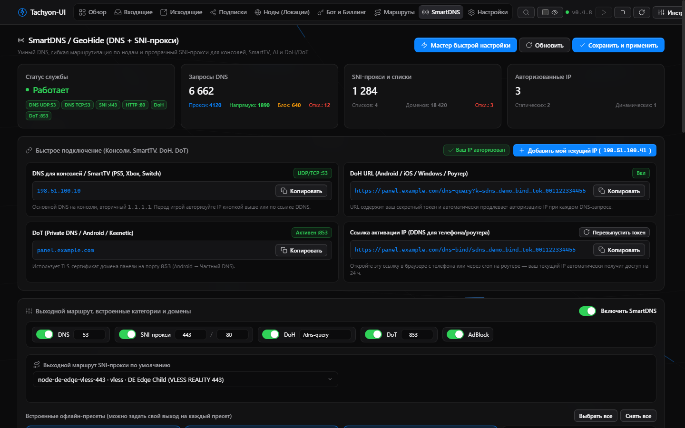
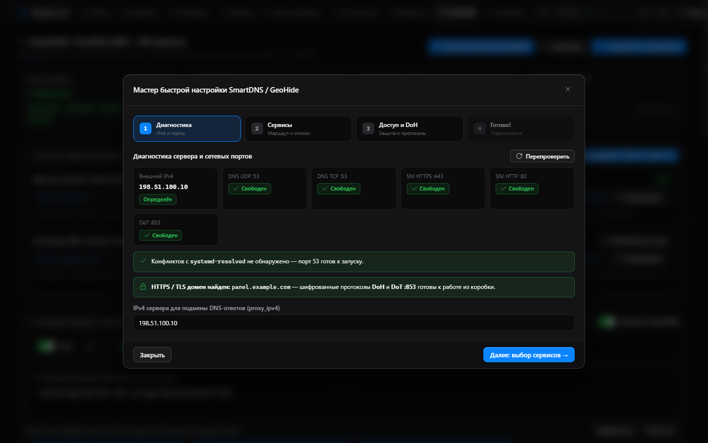

# 8. Собственный SmartDNS / GeoHide v2, SNI-прокси, `tachyon-lists`, DoH/DoT и Мастер настройки

[English version](../en/08-smartdns-geohide-guide.md) | [Полное руководство](00-complete-guide.md) | [Полный справочник UI (все вкладки и кнопки)](./11-ui-every-tab-and-button-guide.md) | [Каталог протоколов](./protocols/README.md) | [К оглавлению](../../README.ru.md) | [Глава 7 — Полная настройка и кластер](07-full-setup-and-cluster-guide.md)

Начиная с `v0.4.5` и в расширенной версии **SmartDNS v2 (`tachyon-ui v0.4.12`)**, в панель встроен собственный **SmartDNS (GeoHide-сервер) + прозрачный SNI-прокси** на чистом Rust (без `dnsmasq`, `nginx`, `sniproxy` или сторонних зависимостей). Вы можете за 1 минуту поднять личный DNS-сервер с поддержкой **UDP/TCP `:53`**, **DNS-over-HTTPS (DoH RFC 8484)** и **DNS-over-TLS (DoT `:853`)**, подключать каталоги доменов **`tachyon-lists` (`.lst`)**, задавать **точку выхода по каждому пресету или списку** (включая локальный SOCKS5-мост к любой дочерней ноде кластера) и подключать устройства, на которые нельзя поставить VPN-клиент: **PS5, Xbox, Nintendo Switch, SmartTV (LG, Samsung, Apple TV)**, а также компьютеры, телефоны и роутеры.



---

## 1. Как это работает: SmartDNS v2 + прозрачный SNI-прокси + мосты `tachyon-core`

В отличие от обычного VPN, **SmartDNS** не шифрует весь трафик туннелем и не требует установки приложений на устройство:

```text
┌─────────────────────────────┐
│ Консоль / SmartTV / ПК /    │   1. DNS-запрос (:53 / DoH / DoT)
│ Телефон / Роутер            ├───────────────────────────────────────────┐
│ DNS = IP вашего VPS         │                                           ▼
└──────────────┬──────────────┘                              ┌──────────────────────────┐
               │                                             │  tachyon-ui SmartDNS v2  │
               │                                             │  Проверка IP клиента     │
               │                                             │  Пресеты + tachyon-lists │
               │                                             └───┬──────────────────┬───┘
               │                                                 │                  │
               │  2а. Обычный домен (ya.ru, банк)                │ DIRECT           │ PROXY (правило/список)
               │      Получает реальный IP сайта ◄───────────────┤                  │ Отдаёт IP этого VPS
               │      → трафик идёт НАПРЯМУЮ к сайту             │                  ▼ (proxy_ipv4)
               │                                                 │         + NOERROR NODATA на AAAA/HTTPS
               │  2б. Целевой сервис (PSN, YouTube, ChatGPT)     │
               │      Стучится на VPS (:443 TLS / :80 HTTP) ◄────┴───────────────────────────────────────┘
               ▼
┌─────────────────────────────┐   3. Извлекает SNI (ClientHello) / HTTP Host (без расшифровки TLS!)
│   Встроенный SNI-прокси     │      Проверяет, что IP клиента авторизован и домен разрешён правилами
│   tachyon-ui (:443 / :80)   ├───────► direct → прямой выход с этого VPS
└─────────────────────────────┘   или   outbound:<tag> → локальный SOCKS5-мост 127.0.0.1:<port> на ноду/outbound tachyon-core
                                  или   socks5 → ручной SOCKS5-адрес (outbound_socks_addr)
```

### Ключевые особенности архитектуры
- **End-to-End TLS сохраняется:** SNI-прокси читает только открытый заголовок `ClientHello` (`SNI`) на порту `443` (или заголовок `Host:` на порту `80`) и пробрасывает байты прозрачно. Устройство видит подлинный SSL-сертификат целевого сайта (например, `chatgpt.com` или `youtube.com`).
- **Защита от утечек IPv6 и QUIC (`AAAA` / `HTTPS` / `SVCB`):** для проксируемых доменов при пустом `proxy_ipv6` SmartDNS возвращает `NOERROR NODATA`, чтобы консоли и браузеры не обходили SNI-прокси по IPv6 или HTTP/3 Alt-Svc.
- **Нет петли на локальный DNS:** SNI-прокси резолвит реальные адреса целевых сайтов напрямую через `upstream_dns` (например, `1.1.1.1:53`, `8.8.8.8:53`), игнорируя собственный `:53`, и отклоняет loopback / собственный `proxy_ipv4`.
- **Гибкая маршрутизация по точкам выхода (новинка SmartDNS v2):**
  - Вы можете задать глобальный выход по умолчанию (`direct`, `outbound:<tag>` или `socks5`), а также **переопределить выход индивидуально для каждого встроенного пресета (`preset_egress`) и каждого списка `tachyon-lists` (`list_rules`)**.
  - При выборе `outbound:<tag>` (например, зарубежной дочерней ноды кластера или балансировщика `tachyon-core`) панель автоматически поднимает **локальный loopback SOCKS5-мост (`127.0.0.1:<port>`)** внутри `tachyon-core` и пробрасывает SNI-трафик выбранной категории в нужную страну.
  - Если личная управляемая нода из `#nodes` ещё не экспортирована в `Outbounds`, в панели SmartDNS есть кнопка **подключения ноды в 1 клик** (`POST /api/smart-dns/export-node-egress`).

### Таблица кнопок, карточек и переключателей вкладки `#smartdns`

| Элемент / кнопка | Где находится | API / действие | Назначение и на что обратить внимание |
| :--- | :--- | :--- | :--- |
| **Баннер предупреждений и 4 KPI слушателей** | Верх `#smartdns` | `GET /api/smart-dns`, `probe` | Показывает статус `DNS :53`, `DoT :853`, `DoH :443/:80`, `Egress / домены` и предупреждает о конфликтах портов (`systemd-resolved` и др.) |
| **`Мастер быстрой настройки`** | Тулбар `#smartdns` | `#modal-smartdns-wizard` | Запускает 4-шаговый Мастер (`probe` → сценарий и Egress → пресеты и списки → реквизиты и кнопка **`Без https://`**) |
| **`Авторизовать мой IP` (`Bind My IP`)** | Панель быстрого доступа | `POST /api/smart-dns/bind-my-ip` | Добавляет внешний IP браузера в белый список (`allowed_ips` или `dynamic_ips`) |
| **Кнопка `Без https://`** | Блок «Быстрое подключение» и Шаг 4 Мастера | Копирование DoH-строки | Копирует DoH URL **без префикса `https://`** (`domain.tld/dns-query/...`) — необходимо для роутеров **Keenetic**, **OpenWrt** и клиентов, которые подставляют схему автоматически или принимают домен + путь раздельно |
| **`Перевыпустить токен` (`Rotate Token`)** | Блок «Быстрое подключение» | `POST /api/smart-dns/rotate-token` | Генерирует новый `bind_token` и отзывает прежние ссылки `/dns-bind/<token>` и `/dns-query/<token>` |
| **Тумблеры служб и порты** | Карточка служб | `PUT /api/smart-dns` | Включение/выключение `DNS :53`, `DoT :853`, `SNI-Proxy :443/:80`, настройка пути DoH и `upstream_dns` |
| **Global Egress + `Экспортировать ноду в Egress`** | Секция выхода GeoHide v2 | `PUT /api/smart-dns`, `POST /api/smart-dns/export-node-egress` | Выбор глобального выхода (`direct`, `outbound:<tag>`, `socks5`) и экспорт управляемой ноды кластера в `egress` в 1 клик |
| **6 пресетов с per-preset Egress** | Карточки пресетов | `PUT /api/smart-dns` | Независимое включение `consoles`, `ai`, `streaming`, `games`, `social`, `smarttv` с выбором отдельной выходной ноды для каждого |
| **Каталог `tachyon-lists` + `Синхронизировать`** | Карточка списков | `GET /api/smart-dns/lists`, `POST .../sync` | Подключение `.lst`-списков (`proxy`/`direct`/`block` + per-list Egress), поля `bypass_domains`, `AdBlock` и кастомных доменов |
| **Контроль доступа и тумблер `allow_public`** | Карточка доступа | `PUT /api/smart-dns`, `DELETE .../dynamic-ip/{ip}` | Управление `allowed_ips` и динамическими IP. **Никогда** не включайте `allow_public` в открытом интернете на `:53/udp` |
| **Живой лог DNS / SNI** | Нижняя таблица | Из `/api/smart-dns` | Показывает последние 50 запросов с фильтром по домену, IP и решению (`PROXY` / `DIRECT` / `BLOCK` / `DENY`) |

---

## 2. Требования к серверу, порты, `Unified 443 Front` и TLS-сертификат

### Сетевые порты
| Протокол | Порт по умолчанию | Назначение | Что нужно в файрволе |
| :--- | :--- | :--- | :--- |
| **DNS (UDP + TCP)** | `53` | Классический DNS для PS5, Xbox, Switch, SmartTV, Windows, роутеров | Открыть `53/udp` и `53/tcp` |
| **SNI-прокси HTTPS** | `443` | Прозрачная переадресация TLS-соединений по SNI | Открыть `443/tcp` |
| **SNI-прокси HTTP** | `80` | Прозрачная переадресация HTTP по заголовку `Host` | Открыть `80/tcp` |
| **DNS-over-TLS (DoT)** | `853` | Шифрованный DNS для Android Private DNS и роутеров | Открыть `853/tcp` |
| **DNS-over-HTTPS (DoH)** | Порт панели (напр. `2053`) | Эндпоинт RFC 8484 (`/dns-query` и `/dns-query/<token>`) | Порт веб-панели уже открыт |

> [!NOTE]
> Если в разделе **Настройки** включено **Автоматическое управление файрволом** (`auto_firewall_enabled`), `tachyon-ui` при активации или изменении настроек SmartDNS автоматически открывает (и при отключении убирает) правила `UFW` / `firewalld` / `iptables` для активных портов (`dns_port`, `sni_https_port`, `sni_http_port`, `dot_port`). Если вы используете облачный сервер, дополнительно откройте эти порты во **внешнем облачном файрволе провайдера**.

### Автоматический обход `systemd-resolved` на Ubuntu / Debian
На многих Ubuntu/Debian VPS локальный `systemd-resolved` занимает `127.0.0.53:53` (UDP/TCP), из-за чего бинд на `0.0.0.0:53` падает с `Address already in use (EADDRINUSE)`.
`tachyon-ui` решает это автоматически: если `bind_addr` пуст (режим `auto`) и `0.0.0.0:53` возвращает `EADDRINUSE`, служба автоматически определяет внешний не-loopback IPv4-адрес сервера (например, `198.51.100.10:53`) и привязывается к нему без остановки системного резолвера сервера. В интерфейсе при этом отображается информационное предупреждение.

### Голый IP, домен с Let's Encrypt и нюанс `Unified 443 Front`
- **Сервер по голому IP (без домена):**
  - Полностью работают классический **DNS `:53` + SNI-прокси `:443/:80`** на консолях (PS5, Xbox, Switch), SmartTV, ПК и роутерах.
  - DoH и DoT работают технически (например, через `curl -k` или клиенты с разрешённым self-signed), но **Android Private DNS (DoT)**, браузеры и **iOS** строго требуют доверенный сертификат от удостоверяющего центра.
- **Сервер с доменом и сертификатом Let's Encrypt (рекомендуется для DoH/DoT):**
  - Привяжите домен в разделе **Настройки → Домен и TLS** (ACME HTTP-01 / DNS-01) — подробнее в [Главе 2](02-stealth-web-domain-tls.md).
- **Важный нюанс при использовании профиля `Unified 443 Front`:**
  1. **Порт `443` занят NGINX:** если на этом сервере включён `Unified 443 Front` (или инбаунд `VLESS REALITY` на `:443`), порт `443` нельзя одновременно отдать встроенному SNI-прокси `:443` — для SNI-прокси используйте отдельный VPS или перенесите инбаунд/SNI-порт. Занятость всех портов автоматически проверяет **Шаг 1 Мастера настройки**.
  2. **Привязка IP через `/dns-bind/<token>` и DoH-токен (без `proxy_protocol`):** stream-маршрутизация `Unified 443 Front` с `REALITY` передаёт локальный HTTP-трафик на панель без `proxy_protocol`, поэтому панель получает адрес источника `127.0.0.1` и отклоняет автопривязку с предупреждением. Чтобы авторизовать свой внешний IP по ссылке **`/dns-bind/<token>`** или через DoH-токен при активном `Unified 443 Front`, открывайте её по **прямому порту панели** (например, `https://198.51.100.10:2053/dns-bind/<token>`) либо добавьте внешний IP вручную в `allowed_ips`.

---

## 3. Быстрый запуск через 4-шаговый Мастер настройки (`#smartdns`)



Откройте панель управления, перейдите в пункт меню **SmartDNS / GeoHide** (`#smartdns`) и нажмите кнопку **Мастер быстрой настройки**:

1. **Шаг 1 — Диагностика сервера (`GET /api/smart-dns/probe`):**
   - Определяет внешний IPv4-адрес сервера и IP клиента, с которого вы открыли панель.
   - Проверяет доступность портов `53` (UDP/TCP), `443` (TCP), `80` (TCP) и `853` (TCP), статус `systemd-resolved`, наличие валидного доменного TLS-сертификата, профиль `Unified 443 Front` и доступные локальные/кластерные выходы.
2. **Шаг 2 — Сценарий, точка выхода и популярные списки `tachyon-lists`:**
   - Выберите один из 4 готовых сценариев:
     - **`console_tv`** (*Консоль и SmartTV*) — включает пресеты `consoles`, `streaming`, `smarttv` + DNS `:53` + SNI `:443/:80` + DoH.
     - **`ai_work`** (*AI и работа*) — включает пресеты `ai`, `social` + DNS `:53` + SNI `:443/:80` + DoH.
     - **`full_geohide`** (*Полный GeoHide*) — включает все 6 пресетов + AdBlock + DNS `:53` + SNI `:443/:80` + DoH.
     - **`adblock_only`** (*Чистый DNS + AdBlock*) — отключает SNI-прокси (`sni_proxy_enabled = false`), оставляет только быстрый DNS-сервер с блокировкой рекламы и трекеров.
   - Выберите **выходной маршрут по умолчанию**: **`direct`** (напрямую с VPS), **`outbound:<tag>`** (через выбранный outbound / дочернюю ноду кластера через автоматический локальный SOCKS5-мост) или **`socks5`** (ручной адрес вида `127.0.0.1:10808`).
   - При желании сразу отметьте популярные списки **`tachyon-lists` (`.lst`)** — мастер автоматически скачает недостающие списки при применении.
3. **Шаг 3 — Контроль доступа и протоколы:**
   - Отметьте галочку **«Авторизовать мой текущий IP сразу»** (включена по умолчанию) и при необходимости впишите дополнительные IP/подсети CIDR.
   - Включите нужные транспорты: `DNS :53`, `SNI-прокси :443/:80`, `DoH`, `DoT :853`.
4. **Шаг 4 — Готово (`POST /api/smart-dns/wizard-apply`):**
   - Мастер сохраняет конфигурацию, поднимает нужные SOCKS5-мосты в `tachyon-core`, загружает отмеченные `.lst`-списки `tachyon-lists`, применяет правила файрвола, запускает слушатели и сразу выдаёт карточки с кнопкой копирования:
     - **IP-адрес DNS для консолей / SmartTV** (`effective_proxy_ipv4`),
     - **DoH URL** (`https://<host>:<port>/dns-query/<token>`),
     - **DoT хост** (`<domain>`),
     - **Ссылка активации IP (DDNS)** (`/dns-bind/<token>`).

---

## 4. Встроенные пресеты, каталог `tachyon-lists` (`.lst`), исключения и AdBlock

### Встроенные офлайн-пресеты (`enabled_presets` + `preset_egress`)
Для каждого пресета можно выбрать не только включение/выключение, но и собственный выход (`По умолчанию`, `direct` или `outbound:<tag>`):

| ID пресета | Название в UI | Примеры доменов (включая все поддомены) |
| :--- | :--- | :--- |
| `consoles` | **Консоли (PlayStation, Xbox, Nintendo)** | `playstation.com`, `playstation.net`, `sonyentertainmentnetwork.com`, `psn.com`, `xbox.com`, `xboxlive.com`, `xboxservices.com`, `gamepass.com`, `nintendo.com`, `nintendo.net`, `nintendowifi.net` |
| `ai` | **AI и нейросети** | `openai.com`, `chatgpt.com`, `oaistatic.com`, `oaiusercontent.com`, `sora.com`, `anthropic.com`, `claude.ai`, `claude.com`, `gemini.google.com`, `aistudio.google.com`, `perplexity.ai`, `copilot.microsoft.com`, `cursor.com`, `midjourney.com`, `grok.com`, `x.ai` |
| `streaming` | **Стриминг и музыка** | `youtube.com`, `googlevideo.com`, `ytimg.com`, `youtu.be`, `netflix.com`, `nflxvideo.net`, `spotify.com`, `scdn.co`, `twitch.tv`, `ttvnw.net`, `disneyplus.com`, `soundcloud.com` |
| `games` | **Игровые платформы (ПК)** | `steampowered.com`, `steamcommunity.com`, `steamstatic.com`, `ea.com`, `origin.com`, `epicgames.com`, `ubisoft.com`, `riotgames.com`, `valorant.com`, `roblox.com`, `battle.net`, `blizzard.com`, `supercell.com` |
| `social` | **Соцсети и мессенджеры** | `discord.com`, `discord.gg`, `discordapp.com`, `discord.media`, `instagram.com`, `cdninstagram.com`, `facebook.com`, `fbcdn.net`, `threads.net`, `x.com`, `twitter.com`, `tiktok.com`, `linkedin.com`, `patreon.com` |
| `smarttv` | **SmartTV и кинотеатры** | `lgappstv.com`, `lgtvcommon.com`, `samsungcloud.com`, `samsungqbe.com`, `tv.apple.com`, `itunes.apple.com`, `roku.com`, `plex.tv`, `kinopub.net` |

### Каталог списков маршрутизации `tachyon-lists` (`.lst`)
В карточке **Списки маршрутизации `tachyon-lists`** (`GET /api/smart-dns/lists`) доступен курируемый каталог списков доменов (формат `.lst` в локальном кэше `<data_dir>/smart_dns_lists/`):
- **Поиск и фильтрация по группам:** быстрый фильтр по ID, названию или группе (`AI`, `IT/Облака/CDN`, `Соцсети`, `Стриминг`, `Игры`, `Реклама/Трекеры` и др.).
- **Индивидуальное действие и выход для каждого списка (`list_rules`):**
  - Действие: **`proxy`** (через SNI-прокси), **`direct`** (напрямую) или **`block`** (`0.0.0.0` / `::`).
  - Точка выхода (`egress`): **`По умолчанию`**, **`direct`** или конкретный **`outbound:<tag>`** (например, чтобы `ai` шёл через узел US, а `streaming` — через DE).
- **Синхронизация (`POST /api/smart-dns/lists/sync`):** скачивает или обновляет `.lst`-файлы из каталога `tachyon-lists`. Общий объём доменов в памяти ограничен предохранителем (`600 000` доменов) для защиты от перерасхода ОЗУ на слабых VPS.

### Приоритет правил и синтаксис
Для каждого домена решение принимается в следующем порядке:
1. **`bypass_domains` (Исключения — всегда `DIRECT`):** наивысший приоритет. Если нужно пустить конкретный поддомен напрямую (например, `dl.playstation.net` для максимальной скорости скачивания дистрибутивов при проксировании авторизации PSN), добавьте его сюда.
2. **AdBlock (`adblock_enabled` + `custom_block_domains` + списки с действием `block` — `BLOCK`):** при срабатывании возвращает `0.0.0.0` (для `A`) / `::` (для `AAAA`). Включает встроенный список рекламных/трекерных доменов (`doubleclick.net`, `googlesyndication.com`, `an.yandex.ru`, `mc.yandex.ru`, `taboola.com`, `criteo.com` и др.) + ваши домены + выбранные списки `tachyon-lists`.
3. **`enabled_presets` + `custom_proxy_domains` + списки `tachyon-lists` с действием `proxy` (`PROXY`):** возвращает `proxy_ipv4` для `A`-запросов, `NOERROR NODATA` для `AAAA`/`HTTPS`/`SVCB` (если `proxy_ipv6` не задан) и разрешает прохождение через SNI-прокси `:443/:80` с выбранным выходом (`direct` / `outbound:<tag>` / `socks5`).
4. **Всё остальное (`DIRECT`):** форвардится к `upstream_dns` и кэшируется в памяти.

Поддерживаются форматы `example.com` (матчит сам домен и все `*.example.com`) и `*.example.com`.

---

## 5. Безопасность и контроль доступа

Открытый DNS-сервер в интернете без фильтрации (Open Resolver) быстро используют для DNS-амплификационных DDoS-атак, а открытый SNI-прокси (Open Proxy) — для паразитного трафика. В `tachyon-ui` это заблокировано на уровне ядра:

- **`allow_public = false` по умолчанию:** все посторонние IP получают **`REFUSED` (`RCODE 5`)** по UDP/TCP `:53` и DoT `:853`, **`HTTP 403`** на бестокеновом `/dns-query`, и мгновенный сброс соединения на SNI-прокси `:443/:80`. Включайте `allow_public` только для временной отладки в изолированной сети.
- **SNI-прокси работает по белому списку доменов:** даже авторизованный клиент не может использовать порт `:443/:80` для обращения к произвольному сайту, которого нет в активных правилах проксирования (`RuleDecision::Proxy`).
- **3 способа авторизации ваших устройств:**
  1. **Статический список `allowed_ips`:** конкретные IP (`203.0.113.10`) или подсети CIDR IPv4/IPv6 (`198.51.100.0/24`, `2001:db8::/32`).
  2. **Динамическая ссылка активации IP (`/dns-bind/<token>`):** если у вас дома или в мобильной сети динамический IP, просто откройте эту ссылку в браузере или дерните с роутера по cron (`curl -fsS https://<host>:<port>/dns-bind/<token>` — при активном `Unified 443 Front` обращайтесь на прямой порт панели, например `:2053`). Ваш текущий IP будет добавлен в таблицу `dynamic_ips` на срок `dynamic_ip_ttl_hours` (по умолчанию `24` часа). На самой странице `#smartdns` также есть кнопка **«+ Добавить мой текущий IP»**.
  3. **Автопривязка через DoH-токен (`/dns-query/<token>`):** если указать на телефоне, компьютере или роутере DoH-URL с токеном `/dns-query/<token>`, первый же DNS-запрос автоматически привяжет ваш актуальный внешний IP — после этого на том же Wi-Fi заработают и консоль, и SmartTV без входа в панель!
- **Защита токена:** `bind_token` проверяется функцией `constant_time_eq`; при неверном токене публичные эндпоинты отдают стандартный маскировочный ответ сайта (`SiteEngine` 404). Токен можно перевыпустить в любой момент кнопкой **«Перевыпустить токен»** (`POST /api/smart-dns/rotate-token`).

---

## 6. Подключение устройств (пошагово)

> [!IMPORTANT]
> Перед подключением консолей или телевизора убедитесь, что внешний IP вашего домашнего интернета добавлен в **Контроль доступа** (`allowed_ips` или через `/dns-bind/<token>`).

### PlayStation 5 / PlayStation 4
1. **Настройки → Сеть → Настройки → Установить соединение с Интернетом**.
2. Нажмите **Параметры** (`Options`) на вашей сети Wi-Fi / LAN → **Дополнительные настройки**.
3. **Настройки DNS:** выберите **Вручную**.
   - **Основной DNS:** `<IP_вашего_сервера>`
   - **Дополнительный DNS:** `1.1.1.1` (или оставьте `0.0.0.0`, чтобы консоль не уходила мимо SmartDNS при сбое)
4. Нажмите **OK** и выполните **Проверить соединение с Интернетом**.

### Xbox Series X|S / Xbox One
1. **Профиль и система → Параметры → Общие → Параметры сети → Дополнительные настройки → Настройки DNS → Вручную**.
2. **Основной DNS IPv4:** `<IP_вашего_сервера>`.
3. **Дополнительный DNS IPv4:** `<IP_вашего_сервера>` или `1.1.1.1`.
4. Перезапустите консоль или очистите MAC/переподключите сеть для сброса кэша DNS.

### Nintendo Switch
1. **System Settings → Internet → Internet Settings → <Ваша сеть> → Change Settings**.
2. **DNS Settings:** переключите с Automatic на **Manual**.
3. **Primary DNS:** `<IP_вашего_сервера>`, **Secondary DNS:** `1.1.1.1` → **Save**.

### SmartTV (LG webOS, Samsung Tizen, Android TV / Apple TV)
- **LG webOS:** Настройки → Сеть → Подключение (Wi-Fi или проводное) → **Изменить** → снимите галочку *Автоматически* → укажите **DNS-сервер** = `<IP_вашего_сервера>`.
- **Samsung Tizen:** Настройки → Общие → Сеть → Состояние сети → **Настр. IP** → **Настр. DNS → Ввести вручную** → `<IP_вашего_сервера>`.
- **Apple TV / Android TV:** в свойствах Wi-Fi/Ethernet переключите режим IP/DNS на ручной (DHCP с ручным DNS) и пропишите `<IP_вашего_сервера>`.

### Windows 10 / 11 и macOS
- **Windows (для классического DNS `:53`):** `Win + R` → `ncpa.cpl` → свойства активного адаптера → **IP версии 4 (TCP/IPv4)** → **Использовать следующие адреса DNS-серверов**: Предпочитаемый `<IP_вашего_сервера>`, Альтернативный `1.1.1.1`. Затем выполните `ipconfig /flushdns`.
- **Windows 11 (DoH при наличии домена и Let's Encrypt):** Параметры → Сеть и Интернет → Ethernet/Wi-Fi → Назначение DNS-сервера → Изменить → Предпочитаемый DNS: `<IP_вашего_сервера>`, *DNS через HTTPS: Вкл (ручной шаблон)* → `https://<ваш_домен>:<порт>/dns-query/<token>`.
- **macOS:** Системные настройки → Сеть → Подробности → вкладка **DNS** → добавьте `<IP_вашего_сервера>` в самый верх списка и выполните `sudo dscacheutil -flushcache; sudo killall -HUP mDNSResponder`.

### Android и iOS (DoT `:853` / DoH)
> [!WARNING]
> Системный **Персональный DNS (Private DNS)** в Android и профили **DoH** в iOS/браузерах проверяют цепочку TLS-сертификата. Они работают только при наличии **привязанного домена с доверенным сертификатом Let's Encrypt** (вкладка **Настройки → Домен и TLS**). По голому IP используйте приложение с поддержкой пользовательского DNS (например, **Intra** / **AdGuard** / **Nebulo**) с разрешением вашего сертификата либо классический DNS `:53` через настройки Wi-Fi / роутер.

- **Android (с доменом и Let's Encrypt):** Настройки → Сеть и Интернет → **Персональный DNS-сервер** → Имя хоста провайдера: `<ваш_домен>` (подключается по DoT `:853`; предварительно откройте ссылку `/dns-bind/<token>`, чтобы телефон авторизовал свой IP).
- **Роутеры (OpenWrt / Keenetic / Tachyon Router):**
  - Пропишите DNS-форвардер `<IP_вашего_сервера>#53` (или DoH URL с токеном).
  - Для прошивок **Keenetic** и **OpenWrt**, которые сами добавляют схему `https://` или разделяют хост и URI, в блоке «Быстрое подключение» (и на Шаге 4 Мастера SmartDNS) нажимайте кнопку **`Без https://`** — она копирует строку в формате `panel.example.com:2053/dns-query/<token>` без `https://`.
  - При динамическом IP у провайдера добавьте в `cron` роутера (например, каждые 30 минут):
    ```sh
    curl -fsS --max-time 10 "https://<ваш_хост>:<порт_панели>/dns-bind/<bind_token>?format=json" >/dev/null
    ```

---

## 7. Как тестировать SmartDNS и диагностировать проблемы

### Шаг А. Проверка резолвинга с ПК (PowerShell / cmd / Linux / macOS)

```powershell
# 1. Целевой домен (из активного пресета или списка) -> должен вернуть proxy_ipv4 (IP вашего VPS)
nslookup chatgpt.com <IP_вашего_сервера>
nslookup playstation.com <IP_вашего_сервера>
nslookup youtube.com <IP_вашего_сервера>

# 2. Домен вне пресетов -> должен вернуть реальный IP сайта (DIRECT)
nslookup ya.ru <IP_вашего_сервера>
```

Через `dig` (Linux / macOS / WSL):

```bash
# Должен вернуть <IP_вашего_сервера>
dig +short @<IP_вашего_сервера> chatgpt.com A

# Должен вернуть пустой ответ (NOERROR NODATA), чтобы не было утечки через IPv6
dig @<IP_вашего_сервера> chatgpt.com AAAA

# Должен вернуть реальные IP Яндекса (DIRECT)
dig +short @<IP_вашего_сервера> ya.ru A
```

### Шаг Б. Проверка DoH (RFC 8484) через `curl` / Python

```bash
# Простейшая проверка RFC 8484 POST с wire-запросом (chatgpt.com A):
python3 - <<'PY'
import struct, socket, ssl, urllib.request
host, port = "<IP_или_домен>", 2053
q = struct.pack("!HHHHHH", 0x1234, 0x0100, 1, 0, 0, 0) + b"\x07chatgpt\x03com\x00" + struct.pack("!HH", 1, 1)
ctx = ssl._create_unverified_context()
req = urllib.request.Request(f"https://{host}:{port}/dns-query/<bind_token>", data=q, method="POST",
                             headers={"Content-Type": "application/dns-message"})
with urllib.request.urlopen(req, context=ctx, timeout=8) as r:
    ans = r.read()
    print("HTTP:", r.status, "CT:", r.headers.get("Content-Type"), "Last4BytesIP:", socket.inet_ntoa(ans[-4:]))
PY
```

### Шаг В. Проверка прозрачного SNI-прокси (`:443`)

```bash
# С вашего авторизованного IP соединение на порт 443 с SNI из правил должно пройти handshake и вернуть 200/301:
curl -I --resolve chatgpt.com:443:<IP_вашего_сервера> https://chatgpt.com/

# Домен ВНЕ правил SmartDNS (например, example.com) должен быть отклонён SNI-прокси (подтверждение защиты от Open Proxy):
curl -I --resolve example.com:443:<IP_вашего_сервера> https://example.com/
```

### Шаг Г. Живой лог в панели `#smartdns`
Откройте **SmartDNS / GeoHide → Живой лог DNS / SNI-запросов** — в таблице в реальном времени видно последние 50 записей с указанием протокола (`udp`/`tcp`/`doh`/`dot`/`sni-tls`), клиента, домена и решения:
- `PROXY` — отдан `proxy_ipv4` или успешно открыт SNI-туннель;
- `DIRECT` — переслано на `upstream_dns`;
- `BLOCK` — заблокировано модулем AdBlock или списком `block` (`0.0.0.0`);
- `DENY` — клиент не авторизован (`REFUSED` / сброс SNI).

### Типовые проблемы при тестировании
| Симптом | Причина | Что сделать |
| :--- | :--- | :--- |
| `nslookup <домен> <IP>` возвращает **`198.18.x.x`** | На вашем **роутере** (например, Tachyon Router / OpenWrt / Mihomo / sing-box) или на **ПК** включён VPN/TUN с `FakeIP` и прозрачным перехватом порта `53` | Отключите TUN / DNS-перехват на время теста, либо исключите `<IP_вашего_сервера>` / тестовое устройство на роутере |
| `nslookup` возвращает **`Query refused`** (`RCODE 5`) | Внешний IP устройства не найден в `allowed_ips` или `dynamic_ips` (либо сменился IP у провайдера) | Откройте ссылку `/dns-bind/<token>` (по прямому порту панели при `Unified 443 Front`) или нажмите **«+ Добавить мой текущий IP»** в `#smartdns` |
| `/dns-bind/<token>` возвращает ошибку `127.0.0.1` | Ссылка открыта через `Unified 443 Front` (локальный NGINX без `proxy_protocol`) | Откройте `/dns-bind/<token>` напрямую по порту панели (напр. `:2053`) или впишите внешний IP в `allowed_ips` |
| DoT (`:853`) даёт таймаут с ПК при том, что сервер слушает `853` | Провайдер или домашний роутер блокирует/перехватывает порт `853` | Используйте **DoH** (`:2053/dns-query/<token>`) или классический **DNS `:53`** |
| В статусе панели предупреждение `Порт 443 уже занят` | Порт `443` занят другим сервисом/инбаундом (например, `VLESS REALITY` или `Unified 443 Front`) | Освободите `443` (перенесите инбаунд на `8443`) или используйте отдельный узел под SmartDNS + SNI |
| Сайт открывается только на ПК, но не на консоли | Консоль использует IPv6 DNS роутера или закэшировала старый IP | Убедитесь, что `proxy_ipv6` в панели пуст (чтобы резались `AAAA`), и перезапустите сетевой интерфейс консоли |
| Выбран выход `outbound:<tag>`, но трафик не идёт | Остановлено ядро `tachyon-core` или ещё не поднят локальный SOCKS5-мост | Запустите `tachyon-core` на Дашборде и нажмите **Сохранить и применить** в `#smartdns` |

---

## 8. Справочник REST API и публичных маршрутов

| Метод и путь | Доступ | Назначение |
| :--- | :--- | :--- |
| `GET /api/smart-dns` | Админ (`Bearer`/`sid`) | Полный конфиг `smart_dns` (`preset_egress`, `list_rules`, `outbound_tag`), `presets`, `egress_options`, `bridge_ports`, `core_running`, `status` (слушатели, `active_bridges`, `active_lists_count`, `loaded_list_domains`, `stats`, `dynamic_ips`, `recent_logs`), готовые `doh_url`, `dot_host`, `bind_url`, `client_ip` |
| `PUT /api/smart-dns` | Админ | Сохранить `SmartDnsConfig`, при необходимости пересоздать локальные SOCKS5-мосты в `tachyon-core`, обновить правила файрвола (`reconcile_firewall`) и перезапустить слушатели SmartDNS |
| `GET /api/smart-dns/probe` | Админ | Диагностика окружения: внешний IPv4, статус портов `53/443/80/853`, `systemd-resolved`, TLS, профиль `Unified 443 Front`, `socks_candidates` |
| `GET /api/smart-dns/lists` | Админ | Получить каталог списков **`tachyon-lists` (`.lst`)** с метаданными и состоянием локального кэша (`?fetch=true` подгрузит каталог при отсутствии в кэше) |
| `POST /api/smart-dns/lists/sync` | Админ | Синхронизировать каталог и/или выбранные `list_ids` (`.lst`) в `<data_dir>/smart_dns_lists/` |
| `POST /api/smart-dns/export-node-egress` | Админ | В 1 клик экспортировать управляемую ноду кластера (`node_id`) в `Outbound` `tachyon-core` и вернуть готовый `egress: "outbound:<tag>"` |
| `POST /api/smart-dns/wizard-apply` | Админ | Применить выбранный сценарий мастера (`console_tv`, `ai_work`, `full_geohide`, `adblock_only`), глобальный выход, пресеты, выбранные `list_rules`, порты и авто-авторизацию текущего IP |
| `POST /api/smart-dns/bind-my-ip` | Админ | Добавить или удалить IP клиента (`allowed_ips` / `dynamic_ips`) прямо из UI |
| `DELETE /api/smart-dns/dynamic-ip/:ip` | Админ | Удалить конкретный динамический IP из активной сессии |
| `POST /api/smart-dns/rotate-token` | Админ | Сгенерировать новый `bind_token` (отзывает старые ссылки `/dns-bind/<token>` и `/dns-query/<token>`) |
| `GET /dns-bind/<token>` | Публичный (по токену) | Авторизовать текущий IP клиента на `dynamic_ip_ttl_hours` часов; поддерживает `?format=json` / `Accept: application/json` или HTML-страницу подтверждения |
| `GET/POST /dns-query` | Публичный (для авторизованных IP) | RFC 8484 DoH (`application/dns-message`); для неавторизованных IP возвращает `403` |
| `GET/POST /dns-query/<token>` | Публичный (по токену) | RFC 8484 DoH с автоматической привязкой IP клиента при валидном `bind_token` (иначе decoy 404) |

---

[Назад: Глава 7 — Полное пошаговое руководство по настройке и единой подписке](07-full-setup-and-cluster-guide.md) | [Полный справочник UI](./11-ui-every-tab-and-button-guide.md) | [Каталог протоколов](./protocols/README.md) | [Полное руководство](00-complete-guide.md) | [К оглавлению](../../README.ru.md) | [Далее: Глава 9 — Энциклопедия протоколов Tachyon](09-protocols-encyclopedia.md)
