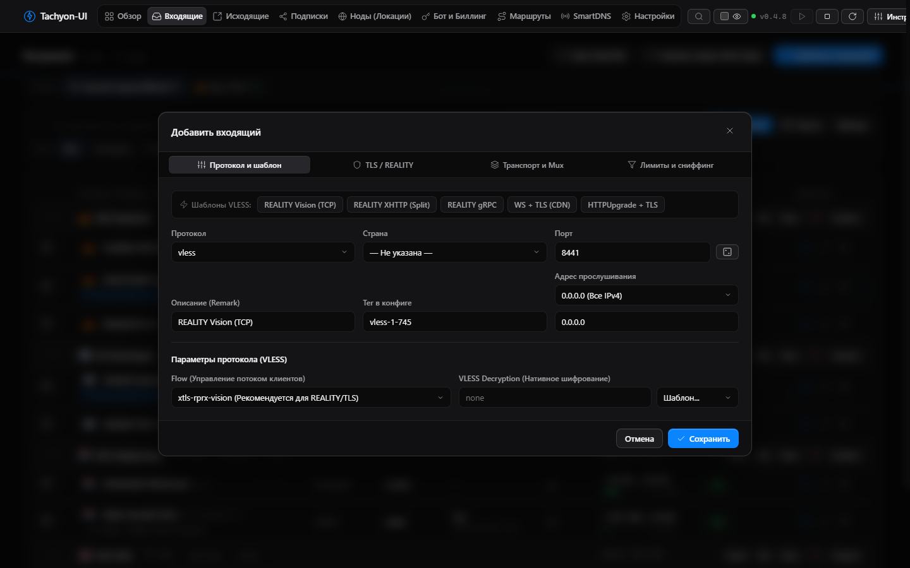
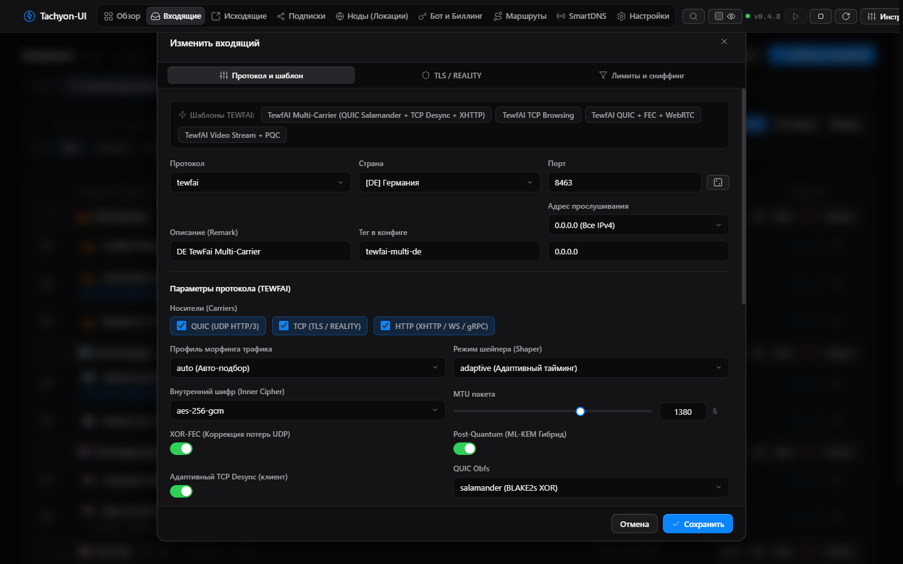
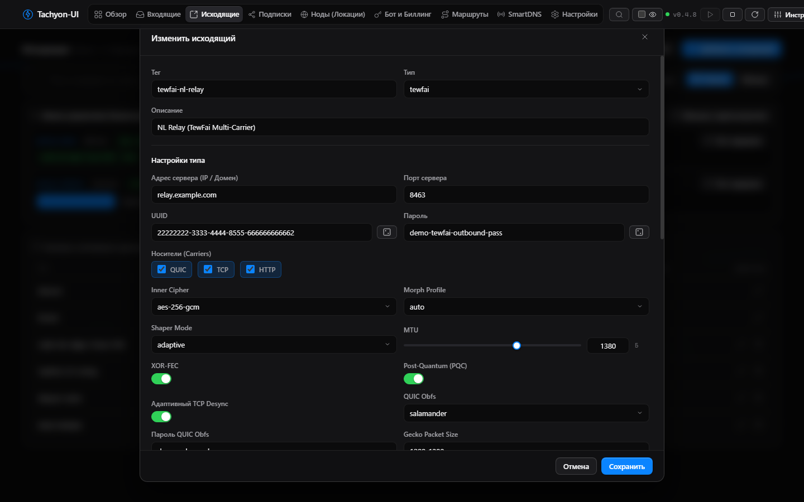

# 9. Энциклопедия протоколов Tachyon: все протоколы простыми словами

[English version](../en/09-protocols-encyclopedia.md) | [Полное руководство](00-complete-guide.md) | [Полный справочник UI (все вкладки и кнопки)](./11-ui-every-tab-and-button-guide.md) | [Каталог протоколов (27 технических гайдов)](./protocols/README.md) | [К оглавлению](../../README.ru.md) | [Глава 8 — SmartDNS / GeoHide](08-smartdns-geohide-guide.md) | [Глава 10 — Подписка для роутера Tachyon 2.0](10-tachyon-router-subscription-guide.md)

Эта глава — практический обзор **каждого протокола**, который поддерживают `tachyon-ui v0.4.12` и движок `tachyon-core 0.6.9` (начиная с флагманского протокола экосистемы **TewFai**). Здесь разобраны простая аналогия из жизни, принцип работы шаг за шагом, плюсы и минусы, требования к домену/сертификату и сценарий выбора. Подробный технический разбор полей UI, маппинга JSON, пресетов, правил файрвола, форматов экспорта и диагностики для каждого протокола доступен в [каталоге протоколов (`protocols/README.md`)](./protocols/README.md) и в 27 отдельных гайдах по ссылкам ниже.

---

## Содержание

1. [Быстрая матрица выбора: какой протокол взять под вашу задачу](#1-быстрая-матрица-выбора-какой-протокол-взять-под-вашу-задачу)
2. [Флагман экосистемы Tachyon: TewFai (TCP / QUIC + Morphing + FEC + PQC)](#2-флагман-экосистемы-tachyon-tewfai)
3. [Современные TLS, HTTP и маскировочные протоколы](#3-современные-tls-http-и-маскировочные-протоколы)
   - [VLESS (REALITY / Vision / XHTTP / gRPC / WS / HTTPUpgrade)](#31-vless-reality--vision--xhttp--grpc--ws--httpupgrade)
   - [AnyTLS](#32-anytls)
   - [ShadowTLS v3](#33-shadowtls-v3)
   - [NaiveProxy (HTTP/2 и HTTP/3 QUIC)](#34-naiveproxy-http2-и-http3-quic)
   - [MASQUE (HTTP/3 CONNECT-IP)](#35-masque-http3-connect-ip)
   - [TrustTunnel](#36-trusttunnel)
   - [Mieru](#37-mieru)
   - [Snell (v4 / v5 / v6)](#38-snell-v4--v5--v6)
   - [FPTN](#39-fptn)
   - [WDTT (WG / Raw / CSQTT)](#310-wdtt-wg--raw--csqtt)
   - [Sudoku](#311-sudoku)
4. [Скоростные UDP / QUIC протоколы](#4-скоростные-udp--quic-протоколы)
   - [Hysteria2](#41-hysteria2)
   - [Hysteria (v1)](#42-hysteria-v1)
   - [TUIC (v5)](#43-tuic-v5)
5. [Классические прокси-протоколы](#5-классические-прокси-протоколы)
   - [Trojan](#51-trojan)
   - [VMess](#52-vmess)
   - [Shadowsocks (AEAD и Shadowsocks-2022)](#53-shadowsocks-aead-и-shadowsocks-2022)
   - [MTProto (FakeTLS / Padded DD / telegram-ws / kws)](#54-mtproto-faketls--padded-dd--telegram-ws--kws)
6. [L3 VPN-туннели и корпоративные протоколы](#6-l3-vpn-туннели-и-корпоративные-протоколы)
   - [WireGuard](#61-wireguard)
   - [AmneziaWG (AWG 1.0 / 2.0 + Port Hopping)](#62-amneziawg-awg-10--20--port-hopping)
   - [OpenConnect / AnyConnect](#63-openconnect--anyconnect)
7. [Специальные, служебные транспорты и маршрутные мета-исходящие](#7-специальные-служебные-транспорты-и-маршрутные-мета-исходящие)
   - [Cloudflared](#71-cloudflared)
   - [SSH](#72-ssh)
   - [Tor](#73-tor)
   - [Bridge](#74-bridge)
   - [Desync](#75-desync)
   - [SOCKS / HTTP / Mixed](#76-socks--http--mixed)
   - [Маршрутные мета-исходящие: direct, block, urltest, selector, chain](#77-маршрутные-мета-исходящие-direct-block-urltest-selector-chain)

---

## 1. Быстрая матрица выбора: какой протокол взять под вашу задачу



### Выбор по сценарию

| Ваша задача | Рекомендуемый выбор | Почему именно он |
| :--- | :--- | :--- |
| **Универсальный основной канал между узлами и клиентами Tachyon** | **TewFai** (TCP + QUIC + Morphing + FEC + PQC) | Единая сессия поверх TCP и QUIC, нормализация профиля трафика, защита от потерь UDP через FEC и постквантовый обмен ключами. |
| **Нужен быстрый старт без покупки домена и сертификата** | **VLESS + REALITY (Vision / XHTTP)** или **ShadowTLS v3** | Используют реальный TLS 1.3 handshake публичного сайта или Self-Steal без собственного Let's Encrypt. |
| **Плохой мобильный интернет, Wi-Fi в дороге, потери 5–15% пакетов** | **TewFai (QUIC + FEC)**, **Hysteria2** или **TUIC v5** | QUIC не тормозит все потоки из-за одного потерянного пакета, а FEC / BBR / Brutal держат скорость на зашумлённом канале. |
| **Строгие корпоративные сети и прокси-шлюзы (открыт только HTTPS 443)** | **NaiveProxy**, **TrustTunnel**, **MASQUE**, **VLESS WS/XHTTP + CDN** | Используют стандартный HTTP/2 или HTTP/3 (`CONNECT` / `CONNECT-IP`) без нестандартных сигнатур. |
| **Домашний роутер (OpenWrt / Keenetic / MikroTik) на уровне L3** | **AmneziaWG (с Port Hopping)**, **WireGuard** или **MASQUE** | Минимум нагрузки на слабый CPU роутера, чистый IP-туннель с авто-keepalive. |
| **Нужно принять трафик за NAT вообще без открытых портов на VPS** | **Cloudflared** | Сервер сам устанавливает исходящий туннель к сети Cloudflare Edge. |
| **Отдельный лёгкий прокси только для Telegram** | **MTProto** (`FakeTLS` / `telegram-ws` / `kws`) | Нативный протокол Telegram, подключается прямо в настройках мессенджера без сторонних приложений. |
| **Локальная адаптация TCP/UDP-пакетов без внешнего VPN-сервера** | **Desync** | Работает на выходе как локальный обработчик фрагментации/порядка заголовков без удалённого узла. |

### Сводная таблица всех протоколов и ссылки на 27 детальных гайдов

| Протокол | Транспорт | Домен и TLS-сертификат | Скорость при потерях пакетов | Режим в `tachyon-ui` | Детальный гайд |
| :--- | :--- | :--- | :--- | :--- | :--- |
| **TewFai** | TCP (TLS/REALITY) и/или QUIC (UDP) | Опционально (REALITY или сертификат; QUIC умеет self-signed) | Очень высокая (QUIC + XOR-FEC) | Inbound + Outbound | [01-tewfai.md](./protocols/01-tewfai.md) |
| **VLESS** | TCP / WS / gRPC / XHTTP / HTTPUpgrade | Не нужен с REALITY; нужен для обычного TLS/CDN | Средняя (TCP) | Inbound + Outbound | [02-vless.md](./protocols/02-vless.md) |
| **AnyTLS** | TCP + TLS 1.3 / REALITY | Нужен для TLS; не нужен с REALITY | Средняя (TCP + пул сессий) | Inbound + Outbound | [08-anytls.md](./protocols/08-anytls.md) |
| **ShadowTLS v3** | TCP (внешний реальный TLS) | Не нужен (используется живой decoy-хост) | Средняя (TCP) | Inbound + Outbound | [09-shadowtls.md](./protocols/09-shadowtls.md) |
| **NaiveProxy** | TCP (HTTP/2) / QUIC (HTTP/3) | Нужен реальный домен + сертификат (`insecure` запрещён) | Средняя (H2) / Высокая (H3) | Inbound + Outbound | [10-naive.md](./protocols/10-naive.md) |
| **MASQUE** | QUIC / UDP (HTTP/3 `CONNECT-IP`) | Нужен реальный домен + сертификат | Высокая (HTTP/3 Datagrams) | Inbound + Outbound | [11-masque.md](./protocols/11-masque.md) |
| **TrustTunnel** | TCP (HTTP/2) / QUIC (HTTP/3) | Нужен реальный домен + сертификат | Средняя (H2) / Высокая (H3) | Inbound + Outbound | [12-trusttunnel.md](./protocols/12-trusttunnel.md) |
| **Mieru** | TCP или UDP | Не нужен | Средняя (TCP) / Высокая (UDP) | Inbound + Outbound | [13-mieru.md](./protocols/13-mieru.md) |
| **Snell (v4–v6)** | TCP (и UDP-релей) | Не нужен | Средняя (TCP) | Inbound + Outbound | [14-snell.md](./protocols/14-snell.md) |
| **FPTN** | TCP + TLS / REALITY (REST + WS) | Нужен для TLS; не нужен с REALITY | Средняя (TCP) | Inbound + Outbound | [16-fptn.md](./protocols/16-fptn.md) |
| **WDTT** | UDP (RTP + DTLS 1.2 + WG/Raw/CSQTT) | Не нужен | Высокая (UDP) | Inbound + Outbound | [17-wdtt.md](./protocols/17-wdtt.md) |
| **Sudoku** | TCP (+ опционально TLS / HTTP-маска) | Опционально | Средняя (TCP) | Inbound + Outbound *(схема)* | [18-sudoku.md](./protocols/18-sudoku.md) |
| **Hysteria2** | QUIC (UDP) | Нужен сертификат (или self-signed + `insecure`) | Максимальная (BBR/Brutal) | Inbound + Outbound | [03-hysteria2.md](./protocols/03-hysteria2.md) |
| **Hysteria v1** | QUIC (UDP) / WeChat-UDP | Нужен сертификат | Высокая | Outbound *(схема)* | [25-hysteria1.md](./protocols/25-hysteria1.md) |
| **TUIC v5** | QUIC (UDP) | Нужен сертификат (или self-signed) | Высокая (BBR + 0-RTT) | Inbound + Outbound | [04-tuic.md](./protocols/04-tuic.md) |
| **Trojan** | TCP / WS / gRPC + TLS / REALITY | Нужен для классического TLS | Средняя (TCP) | Inbound + Outbound | [05-trojan.md](./protocols/05-trojan.md) |
| **VMess** | TCP / WS / gRPC (+ TLS) | Опционально (рекомендуется для WS/CDN) | Средняя (TCP) | Inbound + Outbound | [06-vmess.md](./protocols/06-vmess.md) |
| **Shadowsocks** | TCP + UDP | Не нужен | Средняя / Высокая (2022 + UDP) | Inbound + Outbound | [07-shadowsocks.md](./protocols/07-shadowsocks.md) |
| **MTProto** | TCP (FakeTLS/DD) / TLS WebSocket (`kws`) | Не нужен | Средняя | Inbound + Outbound | [15-mtproto.md](./protocols/15-mtproto.md) |
| **WireGuard** | UDP (L3 IP) | Не нужен | Высокая (UDP, минимальный оверхед) | Endpoint (Inbound + Outbound) | [21-wireguard.md](./protocols/21-wireguard.md) |
| **AmneziaWG** | UDP (L3 IP + Junk/Headers + Port Hopping) | Не нужен | Высокая (UDP) | Endpoint (Inbound + Outbound) | [22-amneziawg.md](./protocols/22-amneziawg.md) |
| **OpenConnect** | TCP (SSL/TLS) + UDP (DTLS/ESP) | Нужен сертификат | Средняя / Высокая (DTLS) | Inbound + Outbound | [19-openconnect.md](./protocols/19-openconnect.md) |
| **Cloudflared** | QUIC / HTTP/2 (исходящий в Edge) | Домен в Cloudflare (Zero Trust) | Высокая (Anycast Cloudflare) | Inbound *(сборка `with_cloudflared`)* | [20-cloudflared.md](./protocols/20-cloudflared.md) |
| **SSH / Tor / Bridge** | TCP / луковая сеть / L2-L3 мост | Не нужен | Зависит от типа | Outbound *(схема)* | [26-ssh-tor-bridge.md](./protocols/26-ssh-tor-bridge.md) |
| **Desync** | TCP / UDP (прямой выход) | Не нужен | Как у прямого канала | Outbound | [24-desync.md](./protocols/24-desync.md) |
| **SOCKS / HTTP / Mixed** | TCP (+ UDP для SOCKS5) | Опционально (для HTTP/Mixed) | Как у базовой сети | Inbound + Outbound | [23-mixed-socks-http.md](./protocols/23-mixed-socks-http.md) |
| **Балансировщики и Chain** | Наследуется от узлов | Наследуется от узлов | Управляется пулом (`urltest`, `selector`, `chain`) | Outbound-группы | [27-balancers-and-chain.md](./protocols/27-balancers-and-chain.md) |

---

## 2. Флагман экосистемы Tachyon: TewFai

**TewFai** — собственный транспортный протокол нового поколения, спроектированный специально для ядра `tachyon-core` и управляемый нативно из `tachyon-ui`. Он объединяет то, ради чего раньше приходилось комбинировать несколько инструментов: единую мультиплексированную сессию поверх взаимозаменяемых носителей (**TCP + TLS 1.3 / uTLS / REALITY**, **QUIC v1 ALPN `h3`** с опциональной обфускацией **Salamander / Gecko** и **HTTP-носитель `XHTTP` / `WebSocket` / `gRPC` / `HTTPUpgrade`**), **адаптивную десинхронизацию пакетов TCP (`desync`)**, **пул SNI и ротацию портов (`sni_pool`, `server_ports`)**, **студийную гонку носителей (`race_delay_ms`)**, **адаптивный морфинг трафика**, **коррекцию ошибок FEC для UDP** и **гибридный постквантовый обмен ключами (X25519 + ML-KEM-768)**.

### Простая аналогия
Представьте бронированный модульный экспресс, который умеет на ходу менять колёсные пары. Если путь по скоростному шоссе (QUIC/UDP) свободен — он едет по нему с минимальной задержкой; если дорога сузилась или UDP временно недоступен — тот же самый состав без пересадки пассажиров переходит на рельсы (TCP + TLS 1.3 / REALITY). Внешне вагоны по размерам и интервалам движения выглядят как обычные городские маршрутки, видеопотоки или рабочие звонки (профили морфинга), а к каждой четвёрке хрупких посылок (UDP-пакетов) прикреплена контрольная копия (FEC), позволяющая восстановить потерянную коробку мгновенно, не прося отправителя высылать её заново.

### Архитектура протокола TewFai

```text
+-----------------------------------------------------------------------------+
|                        ПРИЛОЖЕНИЯ КЛИЕНТА (TCP + UDP)                       |
+--------------------------------------+--------------------------------------+
                                       |
                                       v
+-----------------------------------------------------------------------------+
|                    УРОВЕНЬ СЕССИИ TEWFAI (Session Layer)                    |
|  1. Мультиплексирование: TCP-потоки (DATA 0x02) + UDP-потоки (UDP_DGRAM 04) |
|  2. Взаимная аутентификация HELLO / HELLO_OK (HMAC-SHA256 по PSK из UUID)   |
|  3. Криптография: X25519 [+ ML-KEM-768 PQC] -> HKDF-SHA256 -> AES-256-GCM   |
|     (implicit nonce, 1024-bit anti-replay, авто-rekey раз в 1 ГиБ / 1 час)  |
|  4. Сессионное возобновление (LRU Resume + TTL 60 с) и бесшовный handover   |
+-------------------+----------------------------------+----------------------+
                    |                                  |
                    v                                  v
+-----------------------------------+  +--------------------------------------+
|    TRAFFIC MORPHING & SHAPER      |  |       XOR-FEC ДЛЯ UDP-ПОТОКОВ        |
|  - Профили: auto, browsing,       |  |  - Схема (k, k+1), по умолч. k = 4   |
|    video, webrtc, bulk            |  |  - На 4 датаграммы + 1 XOR-паритет   |
|  - Гистограммы первых 30 чанков   |  |    (+25% оверхеда)                   |
|    + PAD-фреймы (0x0A)            |  |  - Восстановление 1 потерянного      |
|  - Token-bucket pacing:           |  |    пакета на лету без RTT-задержки   |
|    adaptive / fixed / off         |  |                                      |
|    (квант 10-20 мс, буфер <=256КБ)|  |                                      |
+-------------------+---------------+  +------------------+-------------------+
                    |                                     |
                    +------------------+------------------+
                                       |
               +-----------------------+-----------------------+
               |                       |                       |
               v                       v                       v
+-----------------------+ +-----------------------+ +-----------------------+
| T1: TCP-НОСИТЕЛЬ      | | T2: QUIC-НОСИТЕЛЬ     | | T3: HTTP-НОСИТЕЛЬ     |
| - TLS 1.3/uTLS/REALITY| | - QUIC v1 ALPN h3     | | - xhttp/ws/grpc/      |
| - Адаптивный Desync   | | - Obfs: Salamander/   | |   httpupgrade         |
| - SNI Pool + Fallback | |   Gecko + Port Hop    | | - CDN front:// /      |
|   (или Zero-Oracle)   | | - Live H3 Fallback    | |   gateway:// routes   |
+-----------------------+ +-----------------------+ +-----------------------+
```

### Как работает шаг за шагом

1. **Выбор и гонка носителей (Carriers T1 / T2 / T3):** клиент может использовать **TCP** (`TLS 1.3` / `uTLS` / `REALITY` + 28 профилей адаптивной десинхронизации `desync`), **QUIC v1** (с обфускацией дейтаграмм **Salamander** или **Gecko** и сменой портов `server_ports`) и **HTTP-носитель** (`xhttp`, `ws`, `grpc`, `httpupgrade`), в том числе через альтернативные точки `alt_endpoints` (`quic://`, `tcp://`, `http://`, `front://sni:port` для TLS SNI-фронтинга, `gateway://`). При заданном `race_delay_ms` клиент запускает ступенчатую параллельную гонку носителей и запоминает наиболее стабильный канал.
2. **Watchdog зависаний и защита от отсечки на 16 КиБ:** подсистема handover отслеживает зависание потока (`stall_timeout_ms`, `ping_timeout_ms`) и ранний сброс соединения на объёмах около `16 КиБ`, автоматически снижая порог ротации сессий и переключая носитель без разрыва клиентских подключений.
3. **Живой Fallback (TCP/HTTP и QUIC/HTTP3):** входящий узел может прозрачно проксировать неаутентифицированные TCP/HTTP-запросы на локальный веб-сайт (`fallback`) и QUIC/HTTP3-запросы на HTTP/1.1-апстрим (`quic.fallback`). При отключённом `fallback` сохраняется строгая тишина Zero-Oracle на TCP и ответ HTTP/3 `404` на QUIC.
4. **Взаимное рукопожатие `HELLO` / `HELLO_OK`:** из `UUID` (или пароля) пользователя вычисляется 32-байтовый ключ `PSK = SHA256(secret)`.
   - Клиент отправляет `HELLO` с эфемерным ключом `X25519` (и ключом инкапсуляции `ML-KEM-768`, если включён режим `pqc`), случайным `client_nonce`, привязкой к типу транспорта (`0` = QUIC, `1` = TCP, `2` = HTTP) и тегом `HMAC-SHA256`.
   - Сервер проверяет тег в постоянном времени и сверяет `client_nonce` в кэше защиты от повторов (`NONCE_CACHE_CAP = 4096`, `TTL = 120 с`).
   - Проверенному клиенту сервер отвечает `HELLO_OK`, подписывая его `HMAC-SHA256` с включением `client_nonce` и рекламируя список `alt_endpoints`.
5. **Ключевое расписание и внутренний шифр:** через `HKDF-SHA256` из соли `client_nonce || server_nonce` и материала `X25519 [|| ML-KEM-768] || PSK` выводятся раздельные ключи для направлений клиент->сервер (`tewfai c2s`) и сервер->клиент (`tewfai s2c`).
   - Режим `inner_cipher = "aes-256-gcm"` включает внутреннее AEAD-шифрование с неявным строго растущим счётчиком nonce и автоматической сменой ключей (rekey ratchet) каждые **1 ГиБ** данных или **1 час** работы.
   - Режим `inner_cipher = "none"` отключает двойное шифрование там, где достаточно внешнего TLS 1.3 / QUIC (экономия CPU на слабых устройствах).
6. **Мультиплексирование и бесшовное возобновление (Session Resume):** внутри одной сессии открывается до `256` параллельных потоков (`OPEN` / `DATA` / `UDP_DGRAM` / `WINDOW`). Если мобильный клиент переключился с Wi-Fi на 5G, сервер хранит состояние сессии в LRU-кэше (`до 1024 сессий`, grace-период `60 с`), а идентификатор `session_id` при переподключении маскируется одноразовой маской `HMAC(psk, "tewfai resume", client_nonce)`.
7. **Морфинг трафика (`morph_profile`) и шейпер (`shaper`):**
   - На первых `30` чанках сессии (и на каждом новом интерактивном всплеске после паузы `200 мс` в режиме `auto`) TewFai дополняет пакеты служебными `PAD`-фреймами (`0x0A`) так, чтобы распределение их длин соответствовало статистической гистограмме выбранного профиля:
     * **`auto` (`transformer`)** — динамически классифицирует живой поток, сбрасывает окно морфинга после пауз и сглаживает вложенные TLS-рукопожатия.
     * **`browsing`** — профиль обычного веб-серфинга (мелкие HTTP/2 запросы 192–512 Б и средние ресурсы 1.4–4 КБ).
     * **`webrtc`** — профиль голосовой и видеосвязи (короткие аудиофреймы 180–360 Б и видео RTP 720–1400 Б).
     * **`video`** — профиль адаптивного видеопотока ABR (крупные сегменты 8–16 КБ с редкими подтверждениями).
     * **`bulk`** — профиль высокоскоростной передачи файлов (максимальные чанки до 16 КБ).
   - **Шейпер (`shaper.mode`):** `adaptive` (мягкое выравнивание темпа отправки с квантом 10–20 мс и жёстким лимитом буфера 256 КиБ), `fixed` (стабильный поток по заданному темпу) или `off` (без искусственного темпирования).
8. **Коррекция ошибок FEC (`fec: true`):** для UDP-потоков включается лёгкий код чётности `(k, k+1)` на базе операции XOR (по умолчанию `k = 4`: к каждыми 4 UDP-датаграммам добавляется 1 контрольный пакет чётности, +25% трафика). Если в мобильной или Wi-Fi сети пропал 1 пакет из четвёрки, принимающая сторона мгновенно восстанавливает его вместе с точной исходной длиной без ожидания повторной отправки (0 лишних RTT).

### Встроенные пресеты TewFai в `tachyon-ui`



В конструкторе инбаундов `tachyon-ui` сразу доступны четыре готовых профиля:
1. **`TewfAI Multi-Carrier (QUIC Salamander + TCP Desync + XHTTP)`** — все три носителя `["quic", "tcp", "http"]`, QUIC-обфускация `Salamander`, HTTP-носитель `xhttp`, адаптивный `desync`, гонка каналов `race_delay_ms: 250`, `FEC`, `PQC` (`ML-KEM-768`), `auto`/`adaptive`, `MTU 1380`. Максимальная отказоустойчивость на сложных маршрутах.
2. **`TewfAI TCP Browsing`** — TCP + TLS/REALITY + адаптивный `desync`, профиль `browsing`, шейпер `adaptive`, `aes-256-gcm`, `MTU 1400`. Универсальный повседневный вариант для сетей, где UDP ограничен.
3. **`TewfAI QUIC + FEC + WebRTC`** — QUIC v1 + TCP резерв, включённый `FEC`, морфинг `webrtc`, шейпер `adaptive`, постквантовый `PQC` (`ML-KEM-768`), `MTU 1380`. Оптимален для мобильной связи, звонков и нестабильного Wi-Fi.
4. **`TewfAI Video Stream + PQC`** — QUIC v1 + TCP резерв, `FEC`, морфинг `video`, шейпер `fixed`, `PQC`, `MTU 1400`. Для 4K-стриминга, крупных загрузок и стабильной полосы.

### Плюсы и минусы TewFai

- **Плюсы:**
  - Полностью нативная реализация на чистом Rust внутри `tachyon-core` (единый стек без внешних библиотек).
  - Взаимозаменяемые TCP и QUIC носители в одном протоколе + автоматический откат.
  - Реальная защита от статистического анализа (гистограммный морфинг + шейпер) и от активного сканирования (Zero-Oracle в TCP, честный HTTP/3 404 в QUIC).
  - Встроенный XOR-FEC спасает UDP-трафик на сетях с потерями, где обычные прокси «заикаются».
  - Гибридная постквантовая защита `X25519 + ML-KEM-768` защищает перехваченный трафик от будущей расшифровки.
- **Минусы:**
  - Протокол относится к экосистеме Tachyon: на стороне клиента требуется `tachyon-core` / совместимый клиент Tachyon (в сторонних клиентах вроде V2rayN без ядра Tachyon он недоступен).
  - Включение `FEC` (+25% на UDP) и агрессивного морфинга немного увеличивает служебный трафик.

### Нужен ли домен с Let's Encrypt?
- В режиме **TCP + REALITY** — **не нужен** (используется живой SNI или `Self-Steal`).
- В режиме **TCP + TLS** — рекомендуется реальный домен с сертификатом (удобно выпустить за 1 клик через встроенный ACME в `tachyon-ui`).
- В режиме **QUIC** — желателен реальный сертификат, но если сертификат не задан, `tachyon-core` автоматически сгенерирует самоподписанный сертификат на лету.

### Когда выбирать TewFai
Выбирайте **TewFai** как основной транспорт между собственными серверами (каскады, кластер Master-Child), на домашних роутерах с `tachyon-core` и на устройствах с фирменными клиентами Tachyon — особенно когда важны стабильность при смене сети, высокий уровень приватности (PQC) и устойчивость к потерям пакетов.



---

## 3. Современные TLS, HTTP и маскировочные протоколы

Эти протоколы делают туннельный трафик максимально похожим на обычный защищённый веб-трафик (`HTTPS`, `HTTP/2`, `HTTP/3`) или на стандартные мультимедийные потоки.

### 3.1. VLESS (REALITY / Vision / XHTTP / gRPC / WS / HTTPUpgrade)

- **Простая аналогия:** VLESS — это сверхлёгкий прозрачный конверт, который сам по себе не тратит силы на лишние замки, а полностью полагается на «бронированный сейф» внешнего транспорта (`TLS 1.3` или `REALITY`).
- **Как работает шаг за шагом:**
  1. Клиент устанавливает внешнее соединение:
     - **REALITY:** маскируется под реальный чужой сайт (например, `www.microsoft.com`), подписывая запрос вашим приватным ключом X25519 (опционально с постквантовым ключом `reality_pq_key`). Посторонние сканеры получают настоящий ответ и сертификат целевого сайта.
     - **TLS:** классический HTTPS с вашим доменом и сертификатом.
  2. Поверх шифрованного канала клиент передаёт свой `UUID` и адрес назначения.
  3. Выбирается транспортный режим:
     - **TCP + `xtls-rprx-vision`:** избегает двойного шифрования («TLS внутри TLS») и добавляет выравнивание начальных пакетов.
     - **XHTTP (`auto`, `packet-up`, `stream-up`, `stream-one`):** разделяет исходящие и входящие потоки на обычные HTTP-запросы с настраиваемым паддингом (`100-1000` Б), совместим с CDN.
     - **WebSocket (`ws`) / `HTTPUpgrade` / `gRPC`:** отлично проходят через Cloudflare, Nginx и корпоративные обратные прокси (включая профиль `Unified 443 Front`).
- **Плюсы:** самый распространённый протокол — поддерживается почти каждым клиентом на iOS, Android, Windows, macOS, Linux и роутерах; минимальный оверхед; богатейший выбор транспортов.
- **Минусы:** работает только поверх TCP (при сильных потерях пакетов в мобильных сетях возможны микропаузы из-за TCP head-of-line blocking).
- **Нужен ли домен с Let's Encrypt?** С **REALITY** — **не нужен**. Для **WS / HTTPUpgrade / gRPC / XHTTP за CDN** — **нужен** (выдаётся автоматически через ACME).
- **Когда выбирать:** как главный универсальный протокол для массовых пользовательских подписок, чтобы клиент без проблем открылся в любом приложении.

### 3.2. AnyTLS

- **Простая аналогия:** если обычный прокси для каждой открытой вкладки браузера стучится в дверь заново, то AnyTLS держит несколько заранее открытых коридоров (пул TLS-сессий) и аккуратно раскладывает коробки разного размера по заданной схеме, чтобы снаружи поток не выдавал «TLS внутри TLS».
- **Как работает шаг за шагом:**
  1. Клиент открывает стандартное TLS 1.3 (или REALITY) соединение к серверу.
  2. Сразу после рукопожатия отправляется `SHA256(password)` и начальный блок выравнивания (padding).
  3. Сервер передаёт клиенту схему выравнивания (`padding_scheme`: в `tachyon-ui` есть пресеты `default`, `aggressive` и `lowlatency`), определяющую целевые диапазоны длин первых пакетов.
  4. Множество TCP-соединений и UDP-потоков (`UoT`) мультиплексируются внутри пула живых TLS-сессий командами `CMD_SYN`, `CMD_PSH`, `CMD_FIN`.
- **Плюсы:** эффективно устраняет сигнатуру вложенного TLS-трафика; заметно ускоряет открытие сайтов с десятками мелких запросов за счёт переиспользования сессий; встроенная гибкая настройка схем паддинга.
- **Минусы:** новее VLESS, поэтому поддерживается в современных ядрах (`tachyon-core`, `sing-box`, `mihomo`), но не во всех старых клиентах.
- **Нужен ли домен с Let's Encrypt?** Поддерживает **TLS** (нужен сертификат) и **REALITY** (домен не нужен).
- **Когда выбирать:** когда нужен современный и очень отзывчивый TCP-протокол с контролем длин пакетов и экономией ресурсов на частых коротких запросах.

### 3.3. ShadowTLS v3

- **Простая аналогия:** представьте, что на входе в здание стоит живой охранник с настоящим паспортом известной корпорации (например, `www.microsoft.com`), который здоровается с каждым прохожим по всем правилам. Но если гость незаметно показывает секретный знак в номере пропуска (`Session ID`), охранник открывает ему внутренний проход.
- **Как работает шаг за шагом:**
  1. Клиент инициирует TLS-рукопожатие с SNI реального публичного сайта (`handshake.server`), пряча метку `HMAC-SHA1(password)` внутри поля `Session ID` пакета `ClientHello`.
  2. Сервер ShadowTLS v3 пересылает рукопожатие настоящему сайту-приманке и получает подлинный `ServerHello` и подлинный сертификат.
  3. Если метка верна — после завершения рукопожатия поток переключается на внутренний полезный трафик.
  4. Если зашёл посторонний браузер или сканер — сервер продолжает прозрачно проксировать его на настоящий сайт (при `strict_mode: false`) либо строго отклоняет подмены.
- **Плюсы:** не требует собственного домена и сертификата; внешний трафик проходит реальное TLS 1.3 рукопожатие с настоящим сертификатом крупного сайта.
- **Минусы:** добавляет один дополнительный сетевой прыжок до сайта-приманки на момент установки соединения; в классическом варианте обычно работает в паре с внутренним протоколом (например, Shadowsocks).
- **Нужен ли домен с Let's Encrypt?** **Нет** — используется сертификат реального внешнего хоста (`www.microsoft.com`, `www.cloudflare.com`, `www.apple.com`).
- **Когда выбирать:** когда нужно быстро поднять маскированный TCP-вход на «голом» IP-адресе без покупки домена, особенно как обёртку для Shadowsocks.

### 3.4. NaiveProxy (HTTP/2 и HTTP/3 QUIC)

- **Простая аналогия:** вместо того чтобы «рисовать» поддельный пропуск, NaiveProxy буквально использует тот же самый сетевой стек, что и браузер Google Chrome, превращая ваш туннель в абсолютно обычный HTTPS-прокси.
- **Как работает шаг за шагом:**
  1. Клиент соединяется с сервером по стандартному `HTTPS` (`HTTP/2` поверх TCP или `HTTP/3` поверх QUIC).
  2. Отправляет стандартный запрос `CONNECT` с заголовком `Proxy-Authorization: Basic` и специальным заголовком `Padding`.
  3. Первые 8 блоков данных в каждом направлении упаковываются с контрольным выравниванием (`[len][pad][data][zeros]`), чтобы скрыть характерные размеры начала прокси-сессии.
  4. Для UDP поддерживается упаковка `UDP-over-TCP` (`uot`).
- **Плюсы:** эталонная совместимость с сетевыми шлюзами — трафик неотличим от обычного браузерного HTTP/2 или HTTP/3; поддерживает как TCP, так и быстрый QUIC (`network: "udp"`).
- **Минусы:** требуется настоящий домен с валидным TLS-сертификатом; слегка выше накладные расходы заголовков HTTP по сравнению с голым VLESS.
- **Нужен ли домен с Let's Encrypt?** **Да, обязательно** (рекомендуется настроить через ACME в `tachyon-ui` вместе с публичным сайтом `SiteEngine`).
- **Когда выбирать:** если у вас уже есть свой домен с сайтом и нужен максимально «законопослушный» HTTPS-туннель с браузерным профилем.

### 3.5. MASQUE (HTTP/3 CONNECT-IP)

- **Простая аналогия:** это официальный стандарт интернета (RFC 9484), придуманный инженерами IETF (включая Apple и Cloudflare), который позволяет проложить полноценный IP-туннель прямо внутри современного HTTP/3 соединения — точно так же, как работают Apple iCloud Private Relay и Cloudflare WARP.
- **Как работает шаг за шагом:**
  1. Клиент устанавливает стандартное соединение **QUIC / HTTP/3** (`ALPN: h3`) с вашим сервером (или с сервером Cloudflare WARP).
  2. Через расширение `Extended CONNECT` (`CONNECT-IP`) клиент запрашивает виртуальный IP-канал; сервер отвечает `200 OK` (`capsule-protocol: ?1`) и выдаёт маршрут `ROUTE_ADVERTISEMENT` (`0.0.0.0/0`, `::/0`) и адрес из пула (например, `10.10.1.0/24`).
  3. Все IP-пакеты (TCP, UDP, ICMP) летят внутри **HTTP/3 Datagrams** без лишней TCP-переупаковки; на сервере `tachyon-core` обрабатывает их через легковесный виртуальный TCP/IP-стек `smoltcp` и `UdpHub`.
  4. В `tachyon-ui` при экспорте клиентских профилей автоматически выставляются `keep_alive_period: "20s"` и `idle_timeout: "50s"` (ниже серверных `60s`), чтобы роутерные туннели не засыпали на NAT.
- **Плюсы:** настоящий открытый стандарт RFC 9484; работает поверх быстрого HTTP/3 QUIC; идеален для роутеров; в `tachyon-ui` в 1 клик регистрируется исходящий Cloudflare WARP/MASQUE для безопасного выхода.
- **Минусы:** работает по UDP (в сетях, где полностью закрыт UDP/443, потребуется запасной TCP-протокол).
- **Нужен ли домен с Let's Encrypt?** **Да**, требуется TLS-сертификат для QUIC/HTTP3 (для исходящего WARP сертификат не нужен).
- **Когда выбирать:** для стабильных L3-туннелей на роутерах, для выхода через Cloudflare WARP и для сетей, где HTTP/3 работает свободно и быстро.

### 3.6. TrustTunnel

- **Простая аналогия:** «двоюродный брат» NaiveProxy, построенный по принципу чистого HTTP/2 или HTTP/3 туннеля, но с выделенным быстрым каналом для мультиплексирования UDP-пакетов.
- **Как работает шаг за шагом:**
  1. Устанавливается стандартная сессия `HTTP/2 over TLS` или `HTTP/3 over QUIC` (`quic: true`) с авторизацией `username/password`.
  2. Каждый целевой TCP-поток открывается как обычный HTTP `CONNECT` к нужному адресу.
  3. Весь UDP-трафик идёт через отдельный `CONNECT` к служебному псевдо-хосту `_udp2`, где каждый пакет несёт свой адрес источника и назначения; для проверки доступности используется `_check`.
- **Плюсы:** чистый HTTP/2 и HTTP/3 на проводе; аккуратная нативная работа с UDP через один мультиплексированный поток; простая настройка логин/пароль.
- **Минусы:** менее распространён среди сторонних мобильных приложений по сравнению с VLESS и Hysteria2.
- **Нужен ли домен с Let's Encrypt?** **Да**, требуется TLS-сертификат.
- **Когда выбирать:** когда нужен аккуратный современный HTTP/2 или HTTP/3 туннель с хорошей поддержкой UDP и простым управлением пользователями.

### 3.7. Mieru

- **Простая аналогия:** автономный курьер в неприметной форме, который не притворяется HTTPS-сайтом, а просто шифрует каждый сегмент целиком так, чтобы в потоке не было вообще никаких открытых заголовков или предсказуемых меток.
- **Как работает шаг за шагом:**
  1. Клиент и сервер общаются напрямую по **TCP** или **UDP** без внешнего TLS-слоя.
  2. Идентификация пользователя происходит прямо по первому зашифрованному сегменту (`name` + `password`).
  3. Внутри защищённой сессии передаётся компактный SOCKS5 `CONNECT`-запрос и данные; степень объединения потоков регулируется настройкой `multiplexing` (`MULTIPLEXING_LOW` / `MIDDLE` / `HIGH`).
- **Плюсы:** не нужен домен и сертификат; поддерживает и TCP, и UDP; в потоке отсутствуют открытые поля SNI/сертификатов; хорошая пропускная способность при `MULTIPLEXING_HIGH`.
- **Минусы:** полностью случайный поток байтов (высокая энтропия) может привлекать внимание строгих сетевых фильтров, пропускающих только распознанный TLS/HTTP.
- **Нужен ли домен с Let's Encrypt?** **Нет.**
- **Когда выбирать:** для прямых серверов без домена, связок между VPS и в сетях, где открытый TCP/UDP проходит свободно.

### 3.8. Snell (v4 / v5 / v6)

- **Простая аналогия:** спортивный болид без лишней обшивки — минималистичный протокол, созданный разработчиками экосистемы Surge ради предельно низкой задержки и экономии батареи.
- **Как работает шаг за шагом:**
  1. Клиент и сервер разделяют один общий ключ `PSK` (Pre-Shared Key) и версию протокола (`v5` или `v6` в пресетах `tachyon-ui`).
  2. Соединение открывается коротким бинарным рукопожатием поверх TCP без тяжеловесного TLS-цикла.
  3. Команда `CMD_CONNECT_V2` позволяет переиспользовать TCP-соединение для нескольких запросов, `CMD_UDP` обслуживает UDP-пакеты, `CMD_PING` проверяет живость канала.
- **Плюсы:** мгновенное подключение; минимальный расход CPU и батареи; отличная поддержка в Surge, Clash/Mihomo и `tachyon-core`.
- **Минусы:** один общий `PSK` на инбаунд (нет раздельных аккаунтов на уровне протокола); не маскируется под TLS сам по себе (часто комбинируется с ShadowTLS).
- **Нужен ли домен с Let's Encrypt?** **Нет.**
- **Когда выбирать:** если вы используете Surge / Clash на macOS и iOS, либо строите быструю внутреннюю связку (например, Snell внутри ShadowTLS v3).

### 3.9. FPTN

- **Простая аналогия:** полноценный VPN-туннель, который замаскирован под обычное веб-приложение: сначала пользователь «логинится» через REST API и получает JWT-токен, а затем обменивается IP-пакетами через обычный WebSocket, подражая сетевому поведению современного браузера.
- **Как работает шаг за шагом:**
  1. Внешний транспорт — `TLS` или `REALITY` с профилями имитации браузера (`reality_chrome149`, `reality_yandex26_4`, `tls`).
  2. Клиент проходит авторизацию `POST /api/v1/login` и получает JWT-токен, может запросить настройки DNS (`GET /api/v1/dns`) и выполнить тест скорости (`GET /api/v1/test/file.bin`).
  3. Открывается WebSocket на `/api/v1/fptn` с сериализацией `yaff` / `protobuf` и пулом сессий (`RollingTunnel`).
  4. Сервер назначает клиенту IPv4-адрес из пула (например, `10.10.3.0/24`), после чего клиент и сервер обмениваются пакетами `MSG_BATCH_IP_PACKET` (поддерживаются TCP, UDP и ICMP ping).
- **Плюсы:** настоящий L3 IP-туннель поверх обычного HTTPS/WebSocket; встроенные профили имитации браузеров (`Chrome 149`, `Yandex 26`); работает нативно с клиентами проекта FPTN.
- **Минусы:** перенос IP-пакетов поверх TCP WebSocket может страдать от «TCP-внутри-TCP» на каналах с большими потерями пакетов.
- **Нужен ли домен с Let's Encrypt?** При `obfuscation = "tls"` нужен сертификат; с профилями `reality_*` домен не обязателен.
- **Когда выбирать:** когда нужен полноценный L3 VPN поверх обычного HTTPS 443 или совместимость с клиентскими приложениями FPTN.

### 3.10. WDTT (WG / Raw / CSQTT)

- **Простая аналогия:** грузовой конвой, который на время проезда через загруженную трассу перекрашивается в поток обычного видеозвонка или аудиоконференции (RTP/DTLS), а внутри везёт полноценный шифрованный L3 VPN.
- **Как работает шаг за шагом:**
  1. Всё работает целиком в пространстве пользователя по UDP (`listen_port` и опциональный `raw_port`).
  2. Внешние пакеты оформляются как RTP-поток видео (`obfs: video`), аудио Opus (`obfs: audio`, `PT=111`) или универсальный профиль (`unified`) в обёртке `WDTT-WRAP-v1` / `CSQTT-WRAP-v1` и/или `DTLS 1.2` с расширением `Connection ID` (RFC 9146).
  3. Внутри поддерживаются три режима туннеля:
     - **`wg` (`all`):** автоматическая выдача параметров (`GETCONF`/`READY`) и полноценный WireGuard (`Noise_IKpsk2`) с IPv4-пулом (например, `10.66.0.1/16`).
     - **`raw`:** облегчённый бинарный L3-канал с защитой от переупорядочивания пакетов (`RA`-фреймы).
     - **`csqtt` / `csqtt_v1`:** нативный UDP-туннель с компактной конфигурацией `GETCONF`/`TUNCONF`.
- **Плюсы:** высокая скорость UDP; не требует домена и TLS-сертификата; естественно вписывается в профили VoIP/видеозвонков; полноценный L3 (TCP + UDP + ICMP).
- **Минусы:** требуется совместимый клиент (`tachyon-core` / WDTT-клиент); не подходит для сетей с полностью закрытым UDP.
- **Нужен ли домен с Let's Encrypt?** **Нет.**
- **Когда выбирать:** для скоростных UDP L3-туннелей в сетях, где мультимедийный RTP/DTLS-трафик проходит стабильнее классического WireGuard.

### 3.11. Sudoku

- **Простая аналогия:** если обычный шифрованный поток похож на «белый шум» из случайных байтов, то Sudoku перекодирует каждый байт через математическую таблицу подстановки (как ячейки головоломки) так, чтобы поток выглядел как читаемый ASCII-текст или обычный HTTP-обмен с низкой энтропией.
- **Как работает шаг за шагом:**
  1. Внутри используется надёжное AEAD-шифрование (`chacha20-poly1305` и др.) на базе ключа `key`.
  2. Шифротекст пропускается через выбранную таблицу преобразования (`table_type`: например, `prefer_ascii` или пользовательские `custom_table` / `custom_tables`) и дополняется случайным выравниванием (`padding_min`..`padding_max`).
  3. Опционально сверху накладывается гибкая HTTP-маска (`http_mask`: `mode`, `host`, `path_root`, `multiplex`) и режим `enable_pure_downlink` (облегчённый обратный канал от сервера к клиенту для максимальной скорости скачивания).
- **Плюсы:** управляемая энтропия трафика (полезно против эвристических фильтров, реагирующих на высокоэнтропийные потоки); гибкая настройка таблиц и HTTP-маски; ускоренный обратный канал `Pure Downlink`.
- **Минусы:** кодирование в ASCII увеличивает объём передаваемых байтов (особенно в восходящем канале, если не включён Pure Downlink); поддерживается специализированными клиентами и `tachyon-core`.
- **Нужен ли домен с Let's Encrypt?** **Нет** (опционально можно добавить TLS).
- **Когда выбирать:** в специфических сетях, где эвристические сетевые фильтры ограничивают потоки с высокой энтропией без явных TLS-заголовков.

---

## 4. Скоростные UDP / QUIC протоколы

Эти протоколы работают поверх **QUIC (UDP)** и созданы для того, чтобы выжимать максимум скорости и минимальный пинг даже там, где обычный TCP «захлёбывается» от потерь пакетов.

### 4.1. Hysteria2

- **Простая аналогия:** обычный TCP при каждой потере пакета вежливо сбавляет скорость вдвое («вдруг дорога перегружена?»). Hysteria2 ведёт себя как раллийный автомобиль с точным лимитом скорости: вы задаёте реальную ширину своего канала (`up_mbps` / `down_mbps`), а алгоритм управления перегрузкой (Brutal / BBR) держит темп, не сбавляя ход из-за случайных потерь на плохом Wi-Fi или 4G.
- **Как работает шаг за шагом:**
  1. Клиент устанавливает QUIC-соединение (поверх UDP) и проходит авторизацию через HTTP/3 (успешный ответ сервера — нестандартный статус `233`).
  2. Посторонние HTTPS/HTTP3 запросы сервер прозрачно перенаправляет на указанный сайт маскировки (`masquerade`, например `https://www.bing.com` или локальный SiteEngine на `:18080` в профиле `Unified 443 Front`).
  3. TCP-потоки передаются как независимые QUIC-стримы (`FRAME_TCP_REQUEST 0x401`), а UDP — как нативные QUIC-датаграммы с фрагментацией.
  4. Можно выбрать профиль контроля перегрузок (`bbr_profile`: `standard`, `conservative`, `aggressive`) и опциональную UDP-обфускацию `salamander` (или `gecko`), скрывающую стандартные заголовки QUIC.
- **Плюсы:** рекордная скорость на линиях с высоким пингом и потерями пакетов 3–15%; встроенный masquerade; отличная поддержка в большинстве современных клиентов.
- **Минусы:** работает только по UDP (если сеть режет UDP, нужен запасной TCP-канал); при включённой обфускации `salamander` пропадает совместимость с обычным HTTP/3 masquerade на том же порту.
- **Нужен ли домен с Let's Encrypt?** **Желателен** (для полноценной проверки сертификата и `Unified 443 Front`), но технически работает и с самоподписанным сертификатом + флагом `insecure` на клиенте.
- **Когда выбирать:** когда нужно смотреть 4K-видео, быстро качать файлы и комфортно работать через мобильный интернет или нестабильный публичный Wi-Fi.

### 4.2. Hysteria (v1)

- **Простая аналогия:** первая версия раллийного автомобиля Hysteria — сегодня в новых инсталляциях её вытеснила Hysteria2, но в `tachyon-ui` она сохранена как исходящий драйвер для совместимости.
- **Как работает шаг за шагом:**
  1. Устанавливает QUIC-соединение с удалённым сервером Hysteria v1, авторизуясь строкой `auth_str` и заданными лимитами полосы.
  2. Передаёт TCP и UDP потоки поверх QUIC.
- **Плюсы:** позволяет без переделки подключать существующие внешние серверы Hysteria v1 в каскады и балансировщики `tachyon-core`.
- **Минусы:** устаревшая спецификация; только исходящий режим (`outbound`), для новых серверов всегда лучше поднимать Hysteria2 или TewFai QUIC.
- **Нужен ли домен с Let's Encrypt?** На стороне удалённого сервера используется TLS-сертификат.
- **Когда выбирать:** исключительно при подключении к уже существующей внешней ноде, работающей на Hysteria v1.

### 4.3. TUIC (v5)

- **Простая аналогия:** если Hysteria2 — это силовой «раллийный» тягач, то TUIC v5 — лёгкий и аккуратный спорткар на чистом QUIC, который стремится доставить каждый пакет с минимальной задержкой и поддерживает мгновенный старт `0-RTT`.
- **Как работает шаг за шагом:**
  1. Клиент открывает QUIC-соединение с `ALPN: h3` и с включённым `zero_rtt_handshake` может отправлять первые данные сразу в первом же пакете без ожидания полного круга (RTT).
  2. Авторизация (`UUID` + `password`) выполняется через экспортируемый ключевой материал TLS (**EKM**) в отдельном однонаправленном потоке.
  3. TCP-соединения идут по двунаправленным потокам QUIC (`CONNECT`), а UDP — либо нативными QUIC-датаграммами (минимальный пинг), либо через однонаправленные потоки (надёжная доставка).
  4. Поддерживаются классические алгоритмы перегрузки (`bbr`, `cubic`, `new_reno`) и периодический `heartbeat` (например, `10s`) для удержания NAT-трансляции.
- **Плюсы:** минимальная задержка (особенно с `0-RTT`); очень чистая и нативная передача UDP (отлично для онлайн-игр, Discord, VoIP); аккуратное соблюдение сетевой вежливости (BBR/Cubic не «забивают» соседний трафик).
- **Минусы:** работает только по UDP; на экстремальных потерях (>15%) может уступать Hysteria2 Brutal или TewFai с FEC.
- **Нужен ли домен с Let's Encrypt?** **Желателен** (или самоподписанный сертификат).
- **Когда выбирать:** для онлайн-игр, голосовых/видеозвонков и интерактивной работы, где важнее минимальный пинг и стабильный UDP, чем агрессивное «пробивание» полосы.

---

## 5. Классические прокси-протоколы

Проверенные временем протоколы, которые поддерживаются огромным парком устройств и программ — от старых роутеров до любых мобильных клиентов.

### 5.1. Trojan

- **Простая аналогия:** веб-сервер с «потайной дверью». Для любого обычного браузера он честно показывает ваш сайт, но если клиент в первой строчке после TLS-рукопожатия шепнёт правильный хеш пароля — дверь открывается в прокси-туннель.
- **Как работает шаг за шагом:**
  1. Клиент устанавливает стандартное TLS-соединение (или REALITY / WebSocket) с сервером.
  2. Первым сообщением отправляет `SHA224(password)` (56 hex-символов), команду (TCP или UDP) и адрес назначения.
  3. Если пароль совпал — сервер начинает передачу трафика; если нет — соединение перенаправляется на обычный веб-сервер (fallback).
- **Плюсы:** предельно простая и надёжная конструкция; минимальная нагрузка на CPU; поддерживается почти везде; в `tachyon-ui` умеет работать не только с TLS, но и с **WS + CDN** и **REALITY**.
- **Минусы:** без дополнительных мер (вроде REALITY или XHTTP) в чистом виде уступает современным VLESS Vision / AnyTLS / TewFai по скрытию паттернов длин вложенного TLS.
- **Нужен ли домен с Let's Encrypt?** **Да** для классического Trojan TCP/WS + TLS; **нет** для пресета Trojan REALITY.
- **Когда выбирать:** когда нужна совместимость с простыми клиентами, работающими с Trojan, или как проверенный запасной HTTPS-канал на собственном домене.

### 5.2. VMess

- **Простая аналогия:** «ветераны» мира V2Ray — надёжный протокол со встроенным шифрованием и проверкой времени, который всё ещё используется в старых корпоративных и клиентских парках.
- **Как работает шаг за шагом:**
  1. Клиент и сервер синхронизируют системное время и используют общий `UUID`.
  2. Заголовок и данные шифруются встроенным AEAD-алгоритмом (AES-128-GCM / ChaCha20-Poly1305).
  3. Поверх может идти любой транспорт (`TCP`, `WebSocket + TLS`, `gRPC + TLS`).
- **Плюсы:** широкая историческая совместимость со старыми клиентами V2Ray/Clash.
- **Минусы:** чувствителен к рассинхронизации часов на устройстве (>90 секунд — ошибка подключения); при работе поверх TLS возникает двойное шифрование (лишний расход CPU и батареи).
- **Нужен ли домен с Let's Encrypt?** Опционально, но для **WS + TLS** и **gRPC + TLS** — **да**.
- **Когда выбирать:** в основном для обратной совместимости со старыми приложениями; для новых подключений лучше предпочесть **VLESS** или **TewFai**.

### 5.3. Shadowsocks (AEAD и Shadowsocks-2022)

- **Простая аналогия:** сверхбыстрый шифрованный «почтовый жёлоб» без лишних церемоний. Новое поколение **Shadowsocks-2022** (на базе хеш-функции `BLAKE3`) закрыло все слабые места старых версий — включая защиту от повторного воспроизведения пакетов (anti-replay) и активного сканирования.
- **Как работает шаг за шагом:**
  1. Клиент и сервер используют общий двоичный ключ (в SS-2022 — base64-ключ ровно 16 или 32 байта) и выбранный шифр:
     - Современные: `2022-blake3-aes-128-gcm`, `2022-blake3-aes-256-gcm`, `2022-blake3-chacha20-poly1305`.
     - Классические: `aes-128-gcm`, `aes-256-gcm`, `chacha20-ietf-poly1305`.
  2. На каждое соединение генерируется одноразовый сессионный ключ через `BLAKE3`, в заголовок добавляется метка времени (в SS-2022) и каждый чанк защищён AEAD-тегом.
  3. В `tachyon-ui` дополнительно поддерживается режим **Multiplex + Brutal** для ускорения поверх TCP.
- **Плюсы:** молниеносная скорость и минимальная нагрузка на процессор (идеально для роутеров и старых смартфонов); отличная поддержка UDP; не нужен домен.
- **Минусы:** в «голом» виде поток выглядит как случайные байты без TLS-обёртки, поэтому на строгих промежуточных шлюзах его лучше комбинировать с **ShadowTLS v3** или использовать в связке между VPS.
- **Нужен ли домен с Let's Encrypt?** **Нет.**
- **Когда выбирать:** для высокоскоростных межузловых каналов, для слабых роутеров и в паре с ShadowTLS v3.

### 5.4. MTProto (FakeTLS / Padded DD / telegram-ws / kws)

- **Простая аналогия:** отдельный «служебный вход» прямо в мессенджер Telegram — его не нужно включать на весь телефон, он прописывается одной ссылкой внутри самого Telegram.
- **Как работает шаг за шагом:**
  1. **Входящий сервер (`inbound`):** принимает подключения от официальных клиентов Telegram по секрету формата `ee...` (**FakeTLS**, маскируется под TLS-соединение к указанному домену, например `www.google.com` или `1c.ru`, в режиме `padded_intermediate`) или `dd...` (**Padded DD**, `abridged`).
  2. **Исходящий драйвер (`outbound`):** в `tachyon-core` поддерживает три режима: классический `mtproto`, быстрый `mtproxy` и нативный мост **`telegram-ws` (`kws`)**, который читает 64-байтовый заголовок `obfuscated2`, определяет нужный дата-центр Telegram (`DC1..DC5`) и туннелирует трафик через стандартный `wss://kws{dc}.web.telegram.org/apiws` с автоматическим откатом на прямой TCP.
- **Плюсы:** не требует установки отдельных VPN-приложений — ссылка `tg://proxy?...` открывается в один тап прямо в Telegram; минимальная нагрузка на сервер; не трогает трафик остальных приложений.
- **Минусы:** работает **только** для Telegram (браузер и другие программы через него не идут).
- **Нужен ли домен с Let's Encrypt?** **Нет** (FakeTLS использует только доменное имя для генерации секрета `ee...`).
- **Когда выбирать:** когда нужно раздать лёгкий доступ к Telegram друзьям, родственникам или корпоративным сотрудникам без настройки системного VPN.

---

## 6. L3 VPN-туннели и корпоративные протоколы

В отличие от L4/L7 прокси, эти протоколы создают полноценный виртуальный сетевой интерфейс уровня IP (L3): через них прозрачно работают любые протоколы ОС — TCP, UDP, ICMP (`ping`), локальные сети и корпоративные сервисы.

### 6.1. WireGuard

- **Простая аналогия:** современный цифровой кабель Ethernet длиной в тысячи километров. В нём нет громоздких переговоров и десятков устаревших шифров — только 4 тысячи строк выверенного кода и одна пара ключей на каждый узел.
- **Как работает шаг за шагом:**
  1. Сервер и клиент обмениваются публичными ключами `X25519` (в `tachyon-ui` ключи генерируются автоматически, а свободный IP клиента `10.10.0.<octet>/32` подбирается без конфликтов).
  2. При появлении первого пакета выполняется компактное рукопожатие `Noise_IKpsk2` поверх UDP (1 RTT), после чего все IP-пакеты шифруются быстрым `ChaCha20-Poly1305`.
  3. Пока трафика нет — канал абсолютно «молчит», экономя заряд батареи телефона.
  4. `tachyon-ui` также поддерживает ротацию диапазона портов (**Port Hopping**: `wg_server_ports`, `wg_hop_interval`, `wg_hop_interval_max`) и экспорт стандартных файлов `.conf` + QR-кодов.
- **Плюсы:** невероятная скорость и минимальная задержка; встроен в ядра Linux/OpenWrt/Keenetic/MikroTik и все мобильные ОС; почти не расходует батарею.
- **Минусы:** стандартные заголовки рукопожатия WireGuard имеют фиксированную структуру, поэтому некоторые операторские и корпоративные шлюзы ограничивают их по сигнатуре.
- **Нужен ли домен с Let's Encrypt?** **Нет.**
- **Когда выбирать:** для домашних роутеров, объединения офисов и серверов, а также в любых сетях, где стандартный UDP WireGuard работает без ограничений.

### 6.2. AmneziaWG (AWG 1.0 / 2.0 + Port Hopping)

- **Простая аналогия:** тот же сверхбыстрый WireGuard, но с «переменным обвесом»: перед началом диалога он посылает несколько случайных разогревочных пакетов, а стандартные номера заголовков меняет на уникальные числа вашего сервера.
- **Как работает шаг за шагом:**
  1. Вся криптография, скорость и L3-архитектура идентичны WireGuard.
  2. Перед рукопожатием клиент отправляет `Jc` служебных пакетов случайного размера в диапазоне `Jmin..Jmax` байт.
  3. К пакетам рукопожатия добавляются случайные префиксы длины `S1` и `S2`, а стандартные 4-байтовые типы пакетов (`1, 2, 3, 4`) заменяются на уникальные значения `H1..H4` (включая расширенные параметры AWG 2.0).
  4. В `tachyon-ui` дополнительно включается **Port Hopping** (автоматическая смена UDP-порта из заданного диапазона по таймеру) и есть три готовых пресета: «Стандартный» (`MTU 1380`), «Усиленный Junk» (`MTU 1360`) и «Мобильный Лайт» (`MTU 1280`).
- **Плюсы:** сохраняет почти 100% скорости и энергоэффективности WireGuard; устраняет статические сигнатуры стандартных заголовков; работает в официальных клиентах AmneziaWG, роутерах OpenWrt/Keenetic и `tachyon-core`.
- **Минусы:** требует клиент с поддержкой параметров AWG (стандартный клиент WireGuard без AWG-параметров не подключится); зависит от доступности UDP.
- **Нужен ли домен с Let's Encrypt?** **Нет.**
- **Когда выбирать:** лучший выбор для роутеров и мобильных устройств, когда хочется получить скорость WireGuard в сетях со строгой фильтрацией стандартных UDP-сигнатур.

### 6.3. OpenConnect / AnyConnect

- **Простая аналогия:** деловой костюм корпоративного стандарта — это протокол, которым пользуются банки, университеты и крупные компании по всему миру (Cisco AnyConnect, Palo Alto GlobalProtect, Fortinet FortiGate, Juniper Pulse).
- **Как работает шаг за шагом:**
  1. Клиент подключается к серверу по обычному `HTTPS` (`TLS`) на порт `443` (или выбранный порт) и проходит аутентификацию (cookie / логин-пароль) в выбранном диалекте (`flavor`: `anyconnect`, `gp`, `pulse`, `fortinet`).
  2. Сервер выдаёт параметры L3-интерфейса (`MTU 1400`, IP-адрес).
  3. Данные передаются либо внутри TLS-туннеля (TCP), либо переключаются на быстрый UDP-канал (**DTLS** или **ESP** для GlobalProtect/Fortinet) при его доступности.
- **Плюсы:** выглядит как легитимный корпоративный SSL VPN; поддерживается официальными корпоративными клиентами и OpenConnect на всех ОС (включая Linux NetworkManager и OpenWrt).
- **Минусы:** несколько тяжелее WireGuard и TewFai по накладным расходам; требует TLS-сертификат.
- **Нужен ли домен с Let's Encrypt?** **Да**, требуется TLS-сертификат.
- **Когда выбирать:** когда нужно подключить устройства с уже установленным OpenConnect / AnyConnect или работать в корпоративной среде, где SSL VPN разрешён политиками сети.

---

## 7. Специальные, служебные транспорты и маршрутные мета-исходящие

Эти протоколы решают нестандартные инфраструктурные задачи: работа за NAT без белого IP, маршрутизация через SSH/Tor, локальная интеграция с сетевым стеком Linux и умное объединение узлов.

### 7.1. Cloudflared

- **Простая аналогия:** вместо того чтобы оставлять входную дверь открытой и ждать гостей по IP-адресу вашего VPS, ваш сервер сам протягивает защищённый кабель наружу к ближайшему дата-центру Cloudflare, а клиенты заходят уже через сеть Cloudflare.
- **Как работает шаг за шагом:**
  1. Вы создаёте туннель в панели Cloudflare Zero Trust и вставляете токен `cloudflared_token` в `tachyon-ui`.
  2. `tachyon-core` сам открывает несколько отказоустойчивых исходящих соединений (`ha_connections`) к Cloudflare Edge по `QUIC` или `HTTP/2` (поддерживается постквантовый обмен ключами `post_quantum`, выбор `edge_ip_version` и `region`).
  3. Входящие порты на вашем VPS могут быть **полностью закрыты** — реальный IP сервера вообще не светится клиентам.
- **Плюсы:** работает даже за серым NAT (домашний мини-ПК, Raspberry Pi, сервер без публичного IPv4); скрывает реальный IP сервера за защитой Cloudflare Anycast.
- **Минусы:** скорость и задержка зависят от маршрута до ближайшего узла Cloudflare; требуется бесплатный аккаунт Cloudflare и домен.
- **Нужен ли домен с Let's Encrypt?** Домен привязан к Cloudflare (сертификаты на стороне Edge выпускает сам Cloudflare).
- **Когда выбирать:** для домашнего сервера за NAT или когда нужно полностью скрыть реальный IP-адрес узла за инфраструктурой Cloudflare.

### 7.2. SSH

- **Простая аналогия:** универсальный «швейцарский нож» системного администратора — если у вас уже есть любой Linux-сервер с доступом по SSH, `tachyon-core` умеет использовать его как готовый исходящий прокси без установки на нём какого-либо дополнительного ПО.
- **Как работает шаг за шагом:**
  1. `tachyon-core` подключается к удалённому серверу по протоколу SSH (порт `22` или любой другой) по паролю или приватному ключу.
  2. Для каждого исходящего TCP-запроса внутри SSH-сессии открывается канал `direct-tcpip`.
- **Плюсы:** не нужно ничего устанавливать на удалённом сервере; поддерживается любым VPS «из коробки».
- **Минусы:** работает только для TCP (нет нативного UDP); при больших нагрузках уступает специализированным прокси из-за двойного TCP-контроля перегрузок.
- **Нужен ли домен с Let's Encrypt?** **Нет.**
- **Когда выбирать:** как экстренный резервный выход или быстрый мост к удалённому серверу, где нельзя устанавливать `tachyon-core`.

### 7.3. Tor

- **Простая аналогия:** письмо, запечатанное в три вложенных конверта и отправленное через трёх независимых курьеров в разных странах — каждый курьер знает только предыдущего и следующего, но никто не видит одновременно отправителя и получателя.
- **Как работает шаг за шагом:**
  1. Вы создаёте исходящий драйвер `tor` в `tachyon-ui` и привязываете к нему конкретные правила маршрутизации (например, только домены `.onion` или отдельные сайты).
  2. `tachyon-core` автоматически прокладывает цепочку через 3 узла луковой сети и выводит туда только трафик, попавший под правило.
- **Плюсы:** максимальный уровень сетевой анонимности и доступ к скрытым сервисам `.onion`; работает выборочно по правилам, не замедляя остальной интернет.
- **Минусы:** высокая задержка и заметно более низкая скорость из-за трёх промежуточных пересылок; только TCP.
- **Нужен ли домен с Let's Encrypt?** **Нет.**
- **Когда выбирать:** исключительно точечно — через правила маршрутизации для ресурсов `.onion` или задач с повышенными требованиями к анонимности.

### 7.4. Bridge

- **Простая аналогия:** локальный «стрелочник» внутри операционной системы Linux, который направляет отобранный трафик не на внешний VPN-сервер, а в конкретный сетевой интерфейс, мост (`bridge_name`) или отдельную таблицу маршрутизации ядра (`iproute2`).
- **Как работает шаг за шагом:**
  1. В параметрах исходящего драйвера указываются сетевой интерфейс (`interface`), имя моста (`bridge_name`) и при необходимости индексы `iproute2_table_index` / `iproute2_rule_index`.
  2. Трафик, направленный правилом маршрутизации в этот `outbound`, уходит напрямую через заданный системный маршрут Linux (например, через второй канал провайдера, корпоративный VLAN или сторонний туннель ОС).
- **Плюсы:** нулевые накладные расходы на дополнительное шифрование; бесшовная интеграция `tachyon-core` со сложной сетевой топологией Linux-роутера или multi-WAN сервера.
- **Минусы:** предназначен только для Linux-систем с настроенными сетевыми интерфейсами и таблицами маршрутизации.
- **Нужен ли домен с Let's Encrypt?** **Нет.**
- **Когда выбирать:** на Linux-шлюзах и серверах с несколькими сетевыми картами / VLAN / внешними VPN-интерфейсами.

### 7.5. Desync

- **Простая аналогия:** если промежуточный сетевой фильтр плохо читает «слишком длинные предложения» в первом пакете соединения, Desync аккуратно разрезает начальный пакет на несколько корректных TCP-сегментов (или корректирует порядок отправки), оставаясь на 100% в рамках стандарта TCP/IP — и всё это **без какого-либо внешнего VPN-сервера**.
- **Как работает шаг за шагом:**
  1. Исходящий драйвер `desync` подключается напрямую к целевому сайту (`direct`), но перед отправкой начального `ClientHello` (TCP) или первого QUIC-пакета (UDP) применяет адаптивный профиль фрагментации/сегментации (`DesyncMode`, `SplitPos`, `DesyncFooling`).
  2. Встроенный адаптивный движок `tachyon-core` отслеживает успешность доставки (включая пороги 32 КБ и отклик узла), автоматически подбирает рабочий рецепт для конкретного домена и запоминает его.
- **Плюсы:** нулевая стоимость (не нужен зарубежный VPS); скорость и пинг равны прямому соединению с вашим провайдером; автоматический подбор рабочих рецептов под каждый домен.
- **Минусы:** не меняет ваш реальный IP-адрес (региональные ограничения на стороне самого целевого сервиса останутся); эффективность зависит от особенностей промежуточного оборудования конкретного провайдера.
- **Нужен ли домен с Let's Encrypt?** **Нет.**
- **Когда выбирать:** для локальной нормализации TCP/UDP-подключений на прямом канале, когда не требуется смена IP-адреса и важна полная скорость домашнего тарифа.

### 7.6. SOCKS / HTTP / Mixed

- **Простая аналогия:** стандартные «розетки», в которые умеет включаться любая программа — от браузера и curl до системных служб и соседних модулей на том же сервере.
- **Как работает шаг за шагом:**
  - **`socks` (SOCKS5):** работает на уровне TCP и UDP (`UDP ASSOCIATE`), поддерживает авторизацию логин/пароль.
  - **`http` (HTTP CONNECT):** проксирует HTTP и HTTPS-запросы (через метод `CONNECT`), может принимать соединения в открытом виде или поверх TLS.
  - **`mixed`:** объединяет SOCKS5 и HTTP CONNECT на **одном порту** (например, `1080`) — сам распознаёт протокол по первому байту клиента.
- **Плюсы:** стопроцентная универсальность; незаменимы для локальных связок (например, выход встроенного SmartDNS SNI-прокси в локальный SOCKS5 `127.0.0.1:10808` ядра `tachyon-core`).
- **Минусы:** в открытом виде (`tls: none`) не шифруют трафик — выставлять их в публичный интернет без шифрования и строгой авторизации нельзя.
- **Нужен ли домен с Let's Encrypt?** Для локального (`127.0.0.1`) использования — **нет**; для публичного HTTPS-прокси — **да**.
- **Когда выбирать:** для локальной привязки приложений, интеграции со SmartDNS/роутерами и как базовый выход на локальные/корпоративные прокси.

### 7.7. Маршрутные мета-исходящие: `direct`, `block`, `urltest`, `selector`, `chain`

Помимо транспортных протоколов, в списке исходящих (`OUTBOUND_TYPES`) `tachyon-ui` есть пять служебных строительных блоков, из которых собирается отказоустойчивая архитектура (подробный разбор настроек и 12 режимов балансировки — в [главе 4](04-balancers-chain-and-routes.md)):

- **`direct`** — отправка трафика напрямую в интернет с текущего сервера (для локальных сайтов, банков и доверенных ресурсов).
- **`block`** — мгновенный сброс соединения (для фильтрации рекламы, телеметрии и нежелательных доменов).
- **`urltest`** — автоматический балансировщик с **12 режимами работы** (от минимальной задержки и `least_load` до `ewma`, `p95`, `sticky_hash` и уровней приоритета `tiers`).
- **`selector`** — группа с ручным переключением активного узла в реальном времени и опциональным автопереключением при сбое (`auto_failover`).
- **`chain`** — многохоповая цепочка (каскад), пропускающая трафик последовательно через несколько серверов (например, `Клиент -> TewFai (входной узел) -> MASQUE / VLESS (выходной узел)`).

---

[Назад: Глава 8 — SmartDNS / GeoHide](08-smartdns-geohide-guide.md) | [Каталог протоколов (27 гайдов)](./protocols/README.md) | [Полный справочник UI](./11-ui-every-tab-and-button-guide.md) | [Полное руководство](00-complete-guide.md) | [К оглавлению](../../README.ru.md) | [Далее: Глава 10 — Подписка для роутера Tachyon 2.0](10-tachyon-router-subscription-guide.md) | [English](../en/09-protocols-encyclopedia.md)
