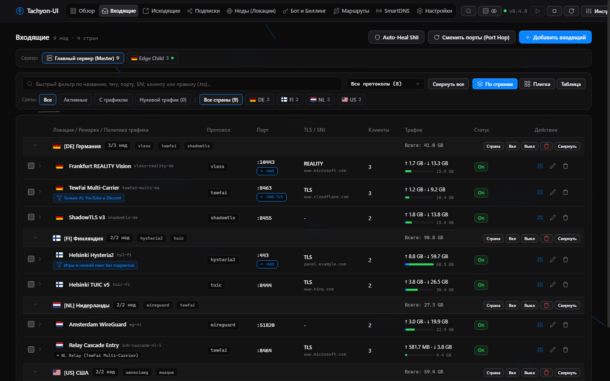
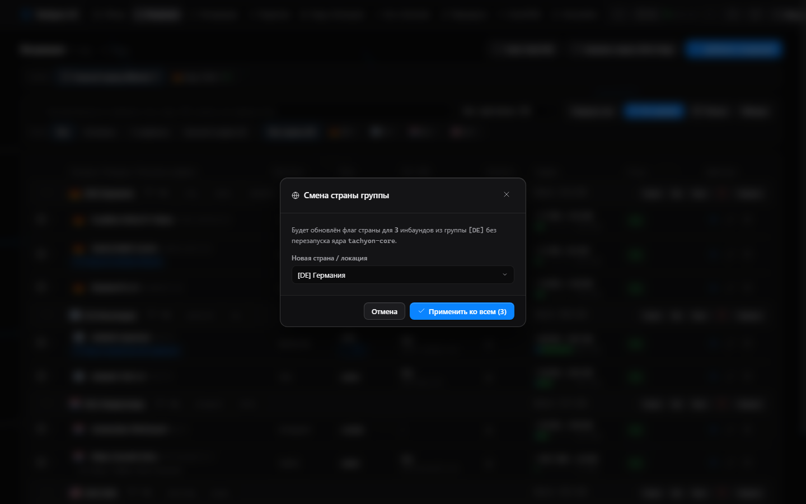
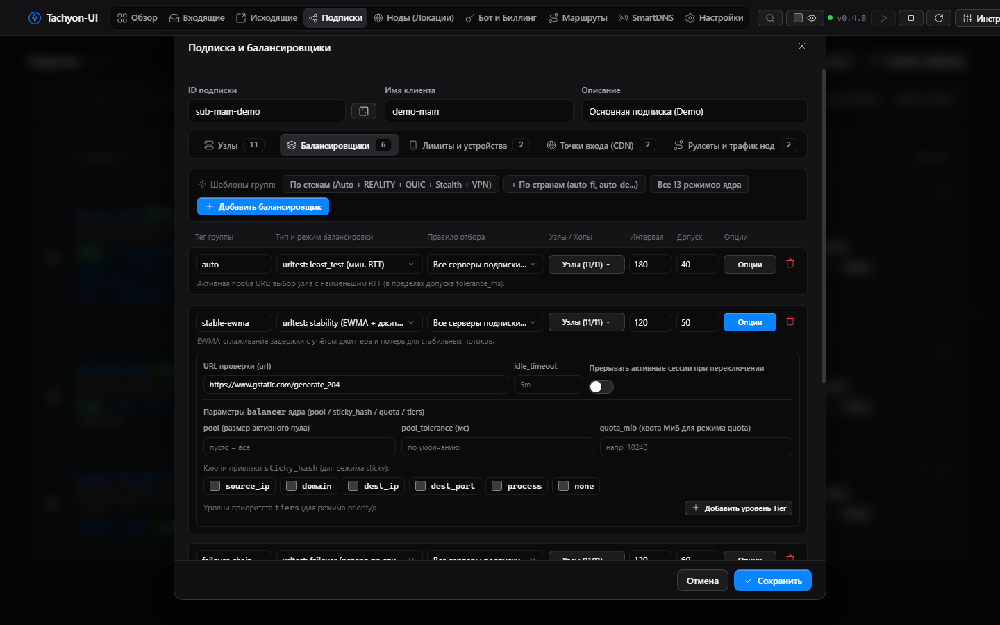
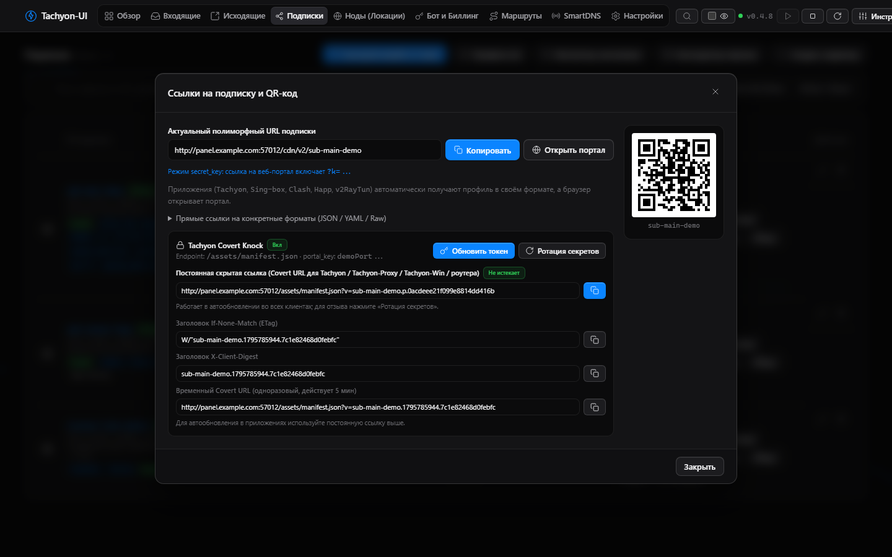
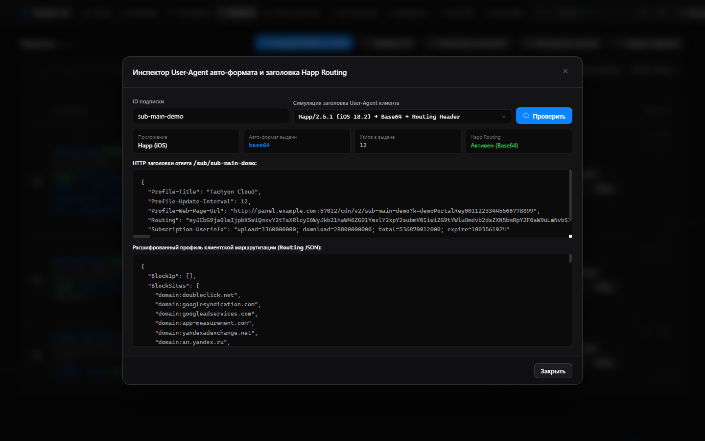

# 10. Настройка единой подписки `tachyon-ui` для роутера Tachyon 2.0 (OpenWrt / Entware)

**Версия:** `tachyon-ui v0.4.12` и `Tachyon 2.0` (`tachyon-core 0.6.9`)  
**Язык:** **Русский** | [English](../en/10-tachyon-router-subscription-guide.md)  
**Навигация:** [Полное руководство](00-complete-guide.md) | [Полный справочник UI (все вкладки и кнопки)](./11-ui-every-tab-and-button-guide.md) | [Каталог протоколов](./protocols/README.md) | [Гайд по Desync](./protocols/24-desync.md) | [К оглавлению](../../README.ru.md) | [Глава 9 — Энциклопедия протоколов](09-protocols-encyclopedia.md)

---

## 1. Почему связка `tachyon-ui` + `Tachyon 2.0` работает лучше в нативном JSON-режиме

При обновлении подписки `tachyon-ui` анализирует заголовок `User-Agent` клиента:

| Клиент / `User-Agent` | Что отдаёт `tachyon-ui` | Что происходит на роутере |
| :--- | :--- | :--- |
| `Happ/*`, `v2rayNG/*`, без `User-Agent` | Base64 со списком URI (`vless://`, `hy2://`, `ss://`...) | Уникальные протоколы **TewFai**, **TrustTunnel**, **OpenConnect**, **MTProto** и `urltest`-группы не передаются в URI-формате; в подписку попадает только базовый набор URI |
| `tachyon-core/2.0 (compatible; sing-box 1.14.3)` | **Плоский JSON-профиль (`tachyon_json_profile`)**: все листовые `outbounds` + `endpoints` (WireGuard/AmneziaWG) + страновые и режимные `urltest`-балансировщики (без синтетических `selector` / `direct` / `block`) | Роутер импортирует **100% серверов** (включая `TewFai`, `MASQUE HTTP/3`, `TrustTunnel`, `Snell`, `FPTN`, `MTProto`, `WireGuard/AWG`), метаданные флагов/стран и готовые `urltest`-балансировщики без конфликтов с системными выходами секций |

> [!TIP]
> Именно поэтому для роутера Tachyon 2.0 важно использовать `User-Agent` с подстрокой `tachyon` (рекомендуется `tachyon-core/2.0 (compatible; sing-box 1.14.3)`).

---

## 2. Пошаговая настройка на стороне панели `tachyon-ui` (VPS)

### Шаг 2.1. Выставите страну для базовых инбаундов

| Список входящих подключений (`#inbounds`) | Массовое назначение страны |
| :---: | :---: |
|  |  |

Чтобы базовые протоколы (`VLESS REALITY`, `Hysteria2`, `TUIC`, `MASQUE`, `TewfAI`, `WireGuard` и др.) в подписке получили флаги и попадали в страновые балансировщики:
1. Откройте вкладку **Входящие (`#inbounds`)**.
2. Нажмите **Массовое изменение страны** (через панель групповых операций, выделив строки или всю группу, либо отредактируйте каждый базовый инбаунд) и укажите реальный 2-буквенный ISO-код сервера (например, `FI` для Хельсинки или `DE` для Франкфурта).
3. Смена поля `country` не требует перезапуска `tachyon-core` — изменения сразу попадают в выдаваемую подписку.

### Шаг 2.2. Проверьте каскадные и кластерные узлы
- Каскадные инбаунды `TewfAI` (`inb-cascade-*`) и дочерние ноды кластера (`managed_tachyon_node`, см. [Главу 7](07-full-setup-and-cluster-guide.md)) наследуют страну из поля `country` исходного узла или инбаунда.
- Проверьте, чтобы в выдаваемой подписке у всех нужных вам узлов отображался префикс с флагом (`🇩🇪`, `🇳🇱`, `🇫🇮`, `🇵🇱` и т.д.).

### Шаг 2.3. Настройте страновые и режимные балансировщики подписки



1. Откройте **Подписки (`#subs`) → Настройка подписки → Балансировщики (`balancers`)** (подробный разбор 12 режимов — в [Главе 4](04-balancers-chain-and-routes.md)).
2. Оставьте или создайте глобальные `urltest`-балансировщики под разные задачи:
   - `auto` (`least_test`) — выбор узла с минимальной задержкой;
   - `stable-ewma` (`stability`) — защита от скачков пинга (EWMA);
   - `reality-fast` — только `VLESS REALITY` инбаунды;
   - `quic-h3` — быстрые UDP/QUIC-протоколы (`hysteria2`, `tuic`, `masque`, `naive`);
   - `failover-chain` (`failover`) — последовательный резерв.
3. Добавьте страновые `urltest`-балансировщики с тегами вида `country-<cc>` (например, `country-fi`, `country-de`, `country-nl`, `country-pl`, `country-us`, `country-se`) и добавьте `selector` с тегом `proxy` (если хотите общую точку входа для sing-box/Clash-клиентов).
4. При формировании профиля для роутера `tachyon-ui` автоматически преобразует `country-<cc>` в наглядные `urltest`-группы вида `🇩🇪 Германия (Авто)`, `🇳🇱 Нидерланды (Авто)`, `🇫🇮 Финляндия (Авто)` и отфильтрует несуществующие теги.

### Шаг 2.4. Скопируйте постоянную скрытую ссылку Covert Knock и проверьте заголовки

| Скрытые ссылки Covert Knock | Инспектор заголовков и отдачи подписки |
| :---: | :---: |
|  |  |

1. В карточке подписки скопируйте **Постоянную ссылку** (подробнее о 4-уровневой защите в [Главе 3](03-subscriptions-and-covert-knock.md)):
   `https://<HOST_ИЛИ_IP>:<PORT>/<base_path_или_polymorph_path>?v=<sub_id>.p.<hmac24>`
2. Не используйте 5-минутную временную ссылку из браузера — её токен истечёт до следующего автообновления роутера.
3. При необходимости воспользуйтесь встроенным **Инспектором заголовков подписки** (`POST /api/subs/inspect-headers`), указав `User-Agent: tachyon-core/2.0 (compatible; sing-box 1.14.3)`, чтобы заранее убедиться, что панель отдаёт полный `tachyon_json_profile` со всеми флагами и балансировщиками.

---

## 3. Пошаговая настройка на стороне роутера `Tachyon 2.0`

Откройте веб-интерфейс роутера (по адресу вашего роутера в LAN, например `http://192.0.2.1` или адресу локального шлюза):

### Шаг 3.1. Создайте источник подписки (раздел **Серверы / Источники**)
Укажите параметры источника:
- **Тип (`source_type`):** `subscription`
- **URL:** постоянная ссылка Covert Knock с панели `tachyon-ui`
- **Самоподписанный сертификат (`subscription_insecure`):** `true` (если панель открыта по IP без доверенного доменного SSL)
- **Режим User-Agent (`auto_user_agent`):** **выключено (`false`)**
- **Явный `User-Agent` (`user_agent`):**
  ```text
  tachyon-core/2.0 (compatible; sing-box 1.14.3)
  ```
- **Показывать встроенные `urltest`-группы (`include_urltest_groups`):** **включено (`true`)**
- **Скрывать серверы внутри `urltest`-групп (`hide_urltest_group_outbounds`):** **выключено (`false`)** — именно эта комбинация позволяет видеть в интерфейсе роутера и готовые страновые/режимные балансировщики, и каждый отдельный сервер.

### Шаг 3.2. Подключите источник к секции (например `Main`) и проверьте фильтры
1. Откройте **Секции → `Main` → Источники (`outbound_source_refs`)** и добавьте созданный источник.
2. Проверьте фильтры самой секции — они напрямую влияют на то, сколько серверов из подписки отображается на вкладке секции:
   - `exclude_countries` (часто `["RU", "BY"]`) скрывает узлы с флагами РФ/РБ;
   - `node_filter_deny` (например, `"Без рекламы|LTE|Белые списки|Обход глушилок"`) скрывает специализированные узлы по ключевым словам в названии;
   - При необходимости ослабьте фильтры в секции или создайте отдельную секцию без исключений (например, для РФ-выхода или мобильных обходов).
3. Сохраните и нажмите **Обновить подписку** — роутер скачает нативный `Tachyon-tachyon.json`, обновит метаданные (`Profile-Title`, `Subscription-Userinfo`, `Support-Url`, `Profile-Web-Page-Url`), пересоберёт `/etc/tachyon-core/config.json` и запустит проверки задержек.

---

## 4. Что должно отображаться в результате в Tachyon 2.0

После успешного обновления в секции `Main` (и в разделе **Серверы**) доступны:
- **Блок «Автовыбор / Балансировщики»**: локальные балансировщики секции (`SoftPortal`, `Stability`, `Priority`) плюс импортированные из подписки `urltest`-группы по странам (`🇩🇪 Германия (Авто)`, `🇳🇱 Нидерланды (Авто)`, `🇫🇮 Финляндия (Авто)` и т.д.) и по режимам (`auto`, `stable-ewma`, `reality-fast`, `quic-h3`, `failover-chain`).
- **Таблица серверов**: все отдельные серверы источника с указанием флага страны, протокола (`TewfAI`, `VLESS`, `Hysteria2`, `TUIC`, `MASQUE`, `TrustTunnel`, `WireGuard`, `FPTN`, `Snell`, `MTProto`), источника и живого пинга.

---

## 5. Диагностика типичных проблем

| Симптом | Причина | Решение |
| :--- | :--- | :--- |
| В подписке **0 серверов** или `404` | Вставлена временная 5-минутная ссылка или неверный префикс/секрет Covert Knock | Скопируйте постоянную ссылку (`?v=<sub_id>.p.<hmac24>`) и отключите старый кэшированный URL; если URL открывается по IP с самоподписанным SSL — включите `subscription_insecure: true` |
| Видно только **27 серверов**, пропали `TewfAI` / `TrustTunnel` / `OpenConnect` | В `auto_user_agent` залип `Happ/4.6.2` (или выбран формат `base64`/`singbox`) | Выключите `auto_user_agent` и явно задайте `user_agent = "tachyon-core/2.0 (compatible; sing-box 1.14.3)"`; проверьте ответ через **Инспектор заголовков подписки** |
| В таблице нет страновых групп, видны только серверы | В настройках источника на роутере выключено `include_urltest_groups` или на `tachyon-ui` у инбаундов не заполнено поле `country` | Заполните `country` у инбаундов на `tachyon-ui` (`v0.4.6+`), включите `include_urltest_groups: true` и выключите `hide_urltest_group_outbounds: false` на роутере |
| Есть страновые группы, но пропали отдельные серверы | На роутере включено `hide_urltest_group_outbounds: true` | Выключите `hide_urltest_group_outbounds` и обновите подписку |
| Ошибка секции `unsupported version` / `unknown transport` | Версия `tachyon-core` на роутере строже, чем экспорт старой панели (`snell v3`, `mtproto faketls`) | Обновите `tachyon-ui` до `v0.4.12`, где `snell` экспортируется с версией `4..6`, `mtproto` — с 32-hex секретом и `padded_intermediate`, а `masque` — с обязательным `uri=` (см. [Snell](./protocols/14-snell.md), [MTProto](./protocols/15-mtproto.md), [MASQUE](./protocols/11-masque.md)) |
| Часть стран или узлов не видна в `Main`, хотя в файле подписки они есть | Срабатывают фильтры секции (`exclude_countries`, `node_filter_deny`) | Проверьте настройки фильтров в **Секции → `Main`** (например, `RU`/`BY`, `LTE`, `Без рекламы`, `Обход глушилок`) |
| `TewFai` с `REALITY + QUIC` не подключается по QUIC | REALITY работает только на TCP-носителе, а на QUIC поднимается self-signed ALPN `h3` | Используйте профиль из `tachyon-ui v0.4.12`: панель автоматически добавляет `quic.tls: { "enabled": true, "insecure": true, "alpn": ["h3"] }` ([подробнее о TewFai](./protocols/01-tewfai.md)) |
| `MTProto`: `secret must be 32 hex characters` | Передан секрет с префиксом `ee`/`dd` и hex-доменом напрямую в конфиг `tachyon-core` | Сохраните/экспортируйте через `tachyon-ui` — панель обрезает `ee`/`dd` и доменный хвост до чистых 32 hex-символов ([подробнее о MTProto](./protocols/15-mtproto.md)) |
| `Desync`: `unknown field 'udp_fake_packets'` | Использовано устаревшее поле `udp_fake_packets`, отклонённое `reject_unknown_fields` в `tachyon-core 0.6.9` | Используйте `udp_fake`, `quic_desync` и `udp_repeats` (и не передавайте `fooling: "none"` или `fake_ttl: 0` — подробнее в [гайде по Desync](./protocols/24-desync.md)) |
| `NaiveProxy` / `MASQUE`: `insecure is not supported` или отказ TLS | На outbound `naive` строго запрещены `tls.insecure: true` и `tls.disable_sni: true`; для `masque` (`standard`) нужна проверка SAN | Привяжите домен и доверенный сертификат Let's Encrypt с совпадающим `server_name` ([NaiveProxy](./protocols/10-naive.md), [MASQUE](./protocols/11-masque.md)) |
| `tachyon-core check` проходит, но `run` завершается ошибкой | Приоритет проверок: `tachyon-core check` сначала валидирует синтаксис и схему полей, но некоторые типы/поля (`tls.acme`, `sudoku`, `hysteria` v1, `ssh`/`tor`/`bridge`, `cloudflared` без флага сборки) отключены в серверном runtime `0.6.9` | Проверяйте статус поддержки каждого типа в [каталоге протоколов](./protocols/README.md) и открывайте детали в [справочнике UI](./11-ui-every-tab-and-button-guide.md) |

---

[Назад: Глава 9 — Энциклопедия протоколов Tachyon](09-protocols-encyclopedia.md) | [Полный справочник UI](./11-ui-every-tab-and-button-guide.md) | [Каталог протоколов](./protocols/README.md) | [Полное руководство](00-complete-guide.md) | [К оглавлению](../../README.ru.md)
