# 11. Полный гид по интерфейсу `tachyon-ui v0.4.12`: каждая вкладка, кнопка, модальное окно и горячая клавиша

[Полное руководство](00-complete-guide.md) | [Каталог протоколов](protocols/README.md) | [К оглавлению](../../README.ru.md)

Практический справочник формата **«Что · Где · Как · Зачем · На что обратить внимание»** по каждому элементу управления веб-панели **`tachyon-ui v0.4.12`** (движок **`tachyon-core`**). Документ описывает экран входа, верхнюю панель, выпадающее меню инструментов, 16 тем оформления и конструктор тем, все **9 основных вкладок** навигации в точном порядке меню, а также все модальные окна, боковые инспекторы, мастеры настройки и глобальные горячие клавиши.

---

## Содержание и навигация по смежным гайдам

### Оглавление руководства

1. [Навигация по смежной документации](#1-навигация-по-смежной-документации)
2. [Экран входа и первый запуск (аутентификация, сессия и климат безопасности)](#2-экран-входа-и-первый-запуск)
3. [Верхняя панель (`Topbar`), управление ядром `tachyon-core`, меню «Инструменты», Палитра команд, `Alt+P`, Live Dock и горячие клавиши](#3-верхняя-панель-topbar-меню-инструменты-и-горячие-клавиши)
4. [Темы оформления (16 встроенных палитр) и Конструктор своей темы (`Theme Builder`)](#4-16-встроенных-тем-и-конструктор-своей-темы)
5. [Все 9 вкладок панели в порядке главного меню](#5-все-9-вкладок-панели-в-порядке-меню)
   - [Вкладка 1. Обзор (`#dashboard`, `Alt+1`) — KPI, телеметрия, трассировщик и логи](#вкладка-1-обзор-dashboard-alt1)
   - [Вкладка 2. Входящие (`#inbounds`, `Alt+2`) — конструкторы, 25 протоколов, пресеты и дровер ноды](#вкладка-2-входящие-inbounds-alt2)
   - [Вкладка 3. Исходящие (`#outbounds`, `Alt+3`) — Clash API, пулы, TewFai, Desync, WARP и цепочки](#вкладка-3-исходящие-outbounds-alt3)
   - [Вкладка 4. Подписки (`#subs`, `Alt+4`) — 5-вкладочный редактор, Быстрый инвайт, 360°-дровер, Covert Knock и профили](#вкладка-4-подписки-subs-alt4)
   - [Вкладка 5. Ноды / Кластер (`#nodes`, `Alt+5`) — 4 режима подключения, `Master → Child` и Каскад-билдер](#вкладка-5-ноды-локации-nodes-alt5)
   - [Вкладка 6. Бот и Биллинг (`#tgbot`, `Alt+6`) — настройки бота, Live-симулятор, тарифы, ваучеры, рассылки и CRM](#вкладка-6-бот-и-биллинг-tgbot-alt6)
   - [Вкладка 7. Маршруты (`#routes`, `Alt+7`) — Flow-карта, `.trs`-списки блокировок, правила и 2-уровневый симулятор](#вкладка-7-маршруты-routes-alt7)
   - [Вкладка 8. SmartDNS / GeoHide (`#smartdns`, `Alt+8`) — `:53`/DoT/DoH, «Без https://», 6 пресетов и Мастер настройки](#вкладка-8-smartdns--geohide-smartdns-alt8)
   - [Вкладка 9. Настройки (`#settings`, `Alt+9`) — Мастер маскировки (4 шага), TLS/ACME, файрвол, бэкапы, грант и персонализация](#вкладка-9-настройки-settings-alt9)
6. [Сервисные модальные окна (Телеметрия, Диагностика ядра, Обновления `tachyon-core`, Снапшоты и JSON-конфиг)](#6-сервисные-модальные-окна-диагностика-обновление-и-аудит)

### 1. Навигация по смежной документации

| Документ | О чём рассказывает | Ссылка |
| :--- | :--- | :--- |
| **Сводный путеводитель** | Архитектура `v0.4.12`, 5 сценариев внедрения, карта 34 экранов | [00-complete-guide.md](00-complete-guide.md) |
| **Глава 1. Установка и CLI** | Установка, Docker, `tachyon-panel`, `--reset-creds`, `--host-fp` | [01-installation-and-cli.md](01-installation-and-cli.md) |
| **Глава 2. Стелс, домен и TLS** | `SiteEngine`, `Unified 443 Front`, ACME, `web_base_path`, Self-Audit | [02-stealth-web-domain-tls.md](02-stealth-web-domain-tls.md) |
| **Глава 3. Подписки и Knock** | Полиморфные URL, 360°-дровер, HWID, Anti-Share, Covert Knock | [03-subscriptions-and-covert-knock.md](03-subscriptions-and-covert-knock.md) |
| **Глава 4. Балансировщики и маршруты** | 12 режимов `urltest`, `chain`, `.trs`-списки и симулятор | [04-balancers-chain-and-routes.md](04-balancers-chain-and-routes.md) |
| **Глава 5. Протоколы, кластер и бот** | `TewFai`, `Master → Child`, каскады, Telegram-бот и CRM | [05-protocols-nodes-and-tgbot.md](05-protocols-nodes-and-tgbot.md) |
| **Глава 6. Диагностика и API** | Live Connections Dock, 5-вкладочная консоль, `Alt+P`, снапшоты | [06-diagnostics-privacy-and-api.md](06-diagnostics-privacy-and-api.md) |
| **Глава 7. Полная настройка кластера** | Пошаговая сборка связки `Master → Child` без гранта | [07-full-setup-and-cluster-guide.md](07-full-setup-and-cluster-guide.md) |
| **Глава 8. SmartDNS / GeoHide** | DNS `:53`, DoH/DoT, SNI-прокси, консоли и ТВ | [08-smartdns-geohide-guide.md](08-smartdns-geohide-guide.md) |
| **Глава 9. Энциклопедия протоколов** | Сравнение всех протоколов простым языком | [09-protocols-encyclopedia.md](09-protocols-encyclopedia.md) |
| **Глава 10. Роутер Tachyon 2.0** | Единая подписка для OpenWrt/Entware в JSON-режиме | [10-tachyon-router-subscription-guide.md](10-tachyon-router-subscription-guide.md) |
| **Каталог протоколов (`01..27`)** | Детальные параметры форм и JSON для всех 27 протоколов | [protocols/README.md](protocols/README.md) |

---

## 2. Экран входа и первый запуск

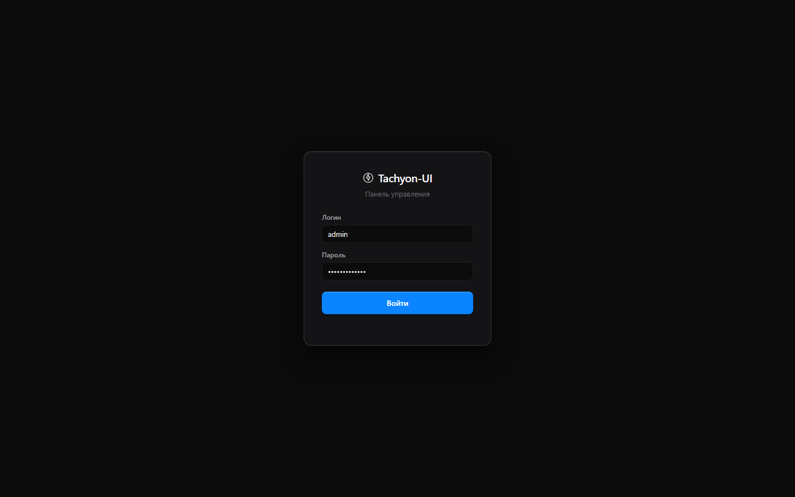

При первом открытии панели по адресу `http://198.51.100.10:2053/` (или по секретному пути, например `https://panel.example.com/p-8f3c21a9/`, если уже настроен `web_base_path`) открывается минималистичная форма авторизации на нейтральном HTTP-профиле без утечки баннеров панели.

| Элемент UI | Где находится | Что делает (How) | Зачем нужен (Why) | Важные нюансы и частые ошибки |
| :--- | :--- | :--- | :--- | :--- |
| **Поле `Логин` (`Username`)** | Экран входа, верхнее поле ввода | Принимает имя учётной записи администратора. | Идентификация администратора при запросе сессии (`POST /api/login`). | При первом запуске логин и временный пароль генерируются установщиком; сразу после входа смените их в **Настройки → Учётные данные администратора**. |
| **Поле `Пароль` (`Password`)** | Экран входа, нижнее поле с маскировкой символов | Принимает пароль; нажатие `Enter` внутри поля сразу отправляет форму. | Защита доступа к конфигурации сервера и приватным ключам. | Если пароль утерян, сбросьте его на сервере через `tachyon-panel reset-pass` или запуском `TACHYON_ADMIN_PASS='StrongPass123!' ./tachyon-ui /opt/tachyon-ui/data --reset-creds` (см. [Главу 1](01-installation-and-cli.md)). |
| **Кнопка `Войти` (`Sign In`)** | Под полем пароля | Отправляет учётные данные на сервер, получает токен сессии (cookie `sid` и токен вкладки) и переводит в `#dashboard`. | Открытие рабочей оболочки панели. | При неверной паре выводится строка ошибки. Если вместо формы входа отдаётся сайт-заглушка или `404`, проверьте секретный `web_base_path` командой `tachyon-panel info`. |

> [!NOTE]
> **О модели сессии входа:** форма входа использует пару **Логин** + **Пароль** и сохраняет авторизацию в серверной cookie `sid` и `sessionStorage` браузера. Периметр входа дополнительно защищается секретным URL-путём `web_base_path`, нейтральными заголовками ответа, фильтром сканеров и профилем `Unified 443 Front`. На общих компьютерах обязательно завершайте сеанс кнопкой **Выйти** в правом углу верхней панели.

---

## 3. Верхняя панель (`Topbar`), меню «Инструменты» и горячие клавиши

Верхняя панель (`Topbar`) закреплена над всеми вкладками и даёт доступ к навигации, управлению процессом `tachyon-core`, мгновенному поиску, маскировке экрана и служебным консолям без ухода с текущей страницы.

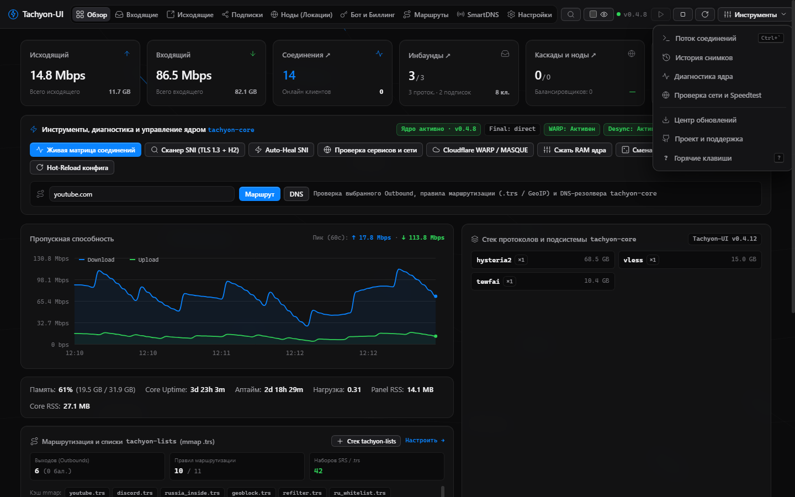

### 3.1. Элементы верхней панели (`Topbar`)

| Элемент UI | Где находится | Что делает (How) | Зачем нужен (Why) | Важные нюансы и частые ошибки |
| :--- | :--- | :--- | :--- | :--- |
| **Кнопка `Меню` (бургер)** | Левый край `Topbar` (на узких экранах) | Выдвигает боковую панель мобильной навигации, включающую все 9 вкладок, кнопки управления ядром, пункты «Инструменты» и выбор темы. | Полноценное управление сервером со смартфона или узкого окна браузера. | Закрывается нажатием на крестик, фон или клавишей `Esc`. |
| **Вкладки навигации (`1..9`)** | Центрально-левая часть `Topbar` | Переключают рабочие разделы (`Обзор`, `Входящие`, `Исходящие`, `Подписки`, `Ноды`, `Бот и Биллинг`, `Маршруты`, `SmartDNS`, `Настройки`) или по `Alt+1`…`Alt+9`. | Единая структура всей панели без глубоких вложенных меню. | Несохранённые данные внутри открытого модального окна при переключении вкладки не сохраняются автоматически — сперва нажмите `Сохранить`. |
| **Кнопка `Поиск… Ctrl+K`** | Правый блок `Topbar` | Открывает модальную **Палитру команд** по нажатию или шорткату `Ctrl+K` (`Cmd+K` на macOS). | Мгновенный переход к любому inbound, outbound, подписке, ноде, теме или инструменту за 2–3 нажатия клавиш. | Индексирует текущее состояние вкладок, сущностей и 16+ тем. |
| **Тумблер `Скрыть данные` (`Alt+P`)** | Правый блок `Topbar`, рядом с поиском | Включает глобальную DOM-маскировку (`MutationObserver`) звёздочками для IP-адресов, приватных доменов, портов, ссылок, UUID, ключей, HWID и токенов. | Безопасная запись скринкастов, снятие скриншотов и демонстрация экрана без утечки секретов. | Общеизвестные тестовые домены и URL-проверки (например `gstatic.com/generate_204`) в режиме маскировки остаются читаемыми; перед копированием ссылки отключайте `Alt+P`. |
| **Индикатор `Ядро: Работает / Остановлено` + версия** | Правый блок `Topbar` | Показывает статус процесса **`tachyon-core`** (зелёная или красная точка) и текущую версию; клик открывает **Центр обновлений**. | Постоянный контроль работоспособности прокси-движка и быстрый переход к обновлению ядра. | Остановка ядра не гасит веб-панель: интерфейс остаётся доступен для диагностики и правок. |
| **Кнопки `Старт` / `Стоп` / `Рестарт`** | Группа кнопок сразу за статусом ядра | Отправляют команды запуска (`POST /api/core/start`), остановки (`POST /api/core/stop`) или полного перезапуска (`POST /api/core/restart`) процесса **`tachyon-core`**. | Экстренное управление демоном ядра и сброс зависших сокетов/портов. | Кнопка `Стоп` и `Рестарт` разрывают все активные пользовательские сессии. После правок конфигурации на вкладках используйте `Применить` (`Apply`) на дашборде. |
| **Кнопка `Инструменты`** | Правый блок `Topbar`, выпадающее меню | Открывает меню из 7 сервисных утилит: Поток соединений, История снимков, Диагностика ядра, Проверка сети и Speedtest, Центр обновлений, Проект и поддержка, Горячие клавиши. | Доступ к инструментам аудита и откатов без потери контекста текущей вкладки. | Повторный клик или `Esc` закрывает поповер. |
| **Переключатель тем** | Кнопка с цветной точкой и названием темы | Открывает список из **16 встроенных тем** (3 светлых и 13 тёмных), список пользовательских тем и кнопку **`+ Создать свою тему...`**. | Быстрая настройка контрастности под дневное/ночное освещение. | Активная тема сохраняется локально в `localStorage` браузера. |
| **Переключатель `RU / EN`** | Правый край `Topbar` | Мгновенно переключает язык интерфейса панели между русским и английским. | Удобство администрирования для смешанных команд и сверки с англоязычными терминами. | Часть серверных уведомлений/ошибок API может оставаться на английском. |
| **Кнопка `Выйти`** | Крайняя правая кнопка-иконка | Завершает сессию (`POST /api/logout`), очищает авторизацию и возвращает на экран входа. | Защита панели после завершения работы. | Обязательно используйте на общих рабочих станциях. |

### 3.2. Меню «Инструменты», Палитра команд, `Alt+P`, Live Dock и Горячие клавиши

| Палитра команд (`Ctrl+K`) | Режим приватности (`Alt+P`) |
| :---: | :---: |
| 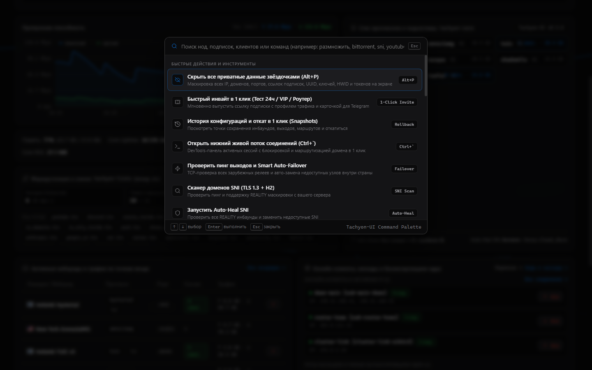 | 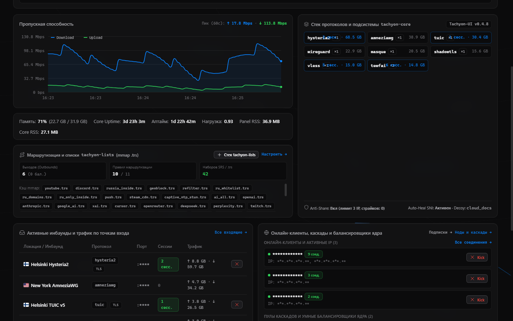 |

| Нижний поток соединений (`` Ctrl+` ``) | Памятка горячих клавиш (`?`) |
| :---: | :---: |
| 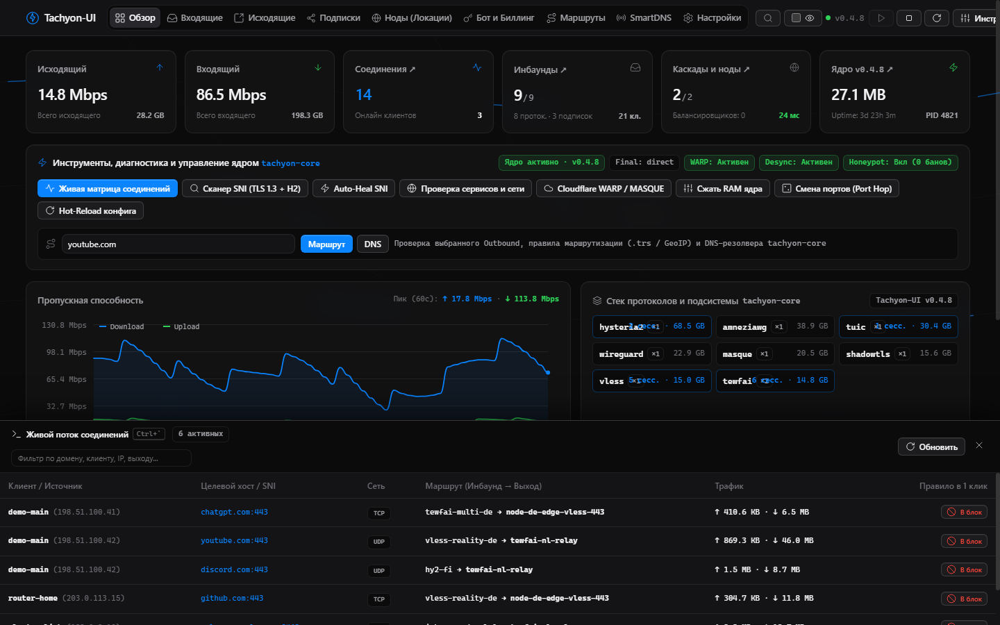 | 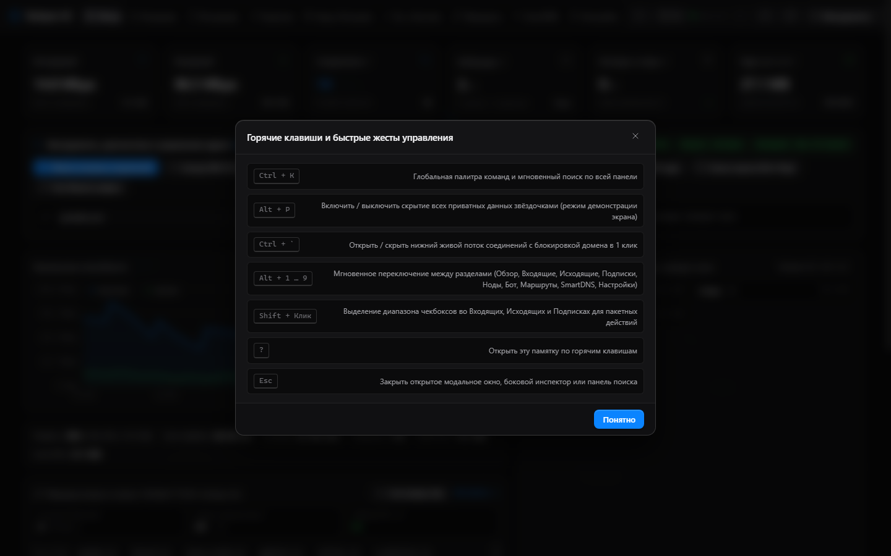 |

| Элемент UI | Где находится | Что делает (How) | Зачем нужен (Why) | Важные нюансы и частые ошибки |
| :--- | :--- | :--- | :--- | :--- |
| **`Поток соединений`** (`` Ctrl+` ``) | Меню `Инструменты` → пункт 1 | Открывает нижний выдвижной dock с таблицей активных сессий `tachyon-core` (обновление раз в `2.5` с). Внутри: строка фильтра (`90` мс debounce), пауза/пуск, закрыть одну сессию или все, кнопки **`В блок`** и **`→ В выход...`** для домена в 1 клик. | Реалтайм-наблюдение за доменами/клиентами и мгновенная блокировка/перенаправление домена без перезагрузки всех сессий. | Включённый режим `Alt+P` замаскирует домены и IP в таблице dock. |
| **`История снимков`** | Меню `Инструменты` → пункт 2 | Открывает окно версий состояния панели (кольцевой буфер до `10` снимков) с кнопками создания снимка и восстановления. | Страховка перед рискованными правками маршрутов, маскировки или кластера. | Также автоматический снимок создаётся при применении профилей домена в Мастере. |
| **`Диагностика ядра`** | Меню `Инструменты` → пункт 3 | Открывает 5-вкладочную консоль Runtime API (`Соединения и маршрут`, `Health & Аномалии`, `Failover & Прокси`, `DNS & Leak Audit`, `Тест & In-Flight`). | Глубокая отладка утечек DNS, состояния Circuit-Breaker и 8-этапная трассировка соединений. | Подробный разбор всех 5 вкладок см. в [разделе 6](#6-сервисные-модальные-окна-диагностика-обновление-и-аудит). |
| **`Проверка сети и Speedtest`** | Меню `Инструменты` → пункт 4 | Открывает окно проверки разблокировки зарубежных/РФ платформ, гео-блокировок IP, RKN-проверки и замера скорости через CDN. | Аудит «чистоты» и пропускной способности IP нового VPS или выходного шлюза. | Запуск Speedtest создаёт кратковременную нагрузку на канал сервера. |
| **`Центр обновлений`** | Меню `Инструменты` → пункт 5 (или клик по версии ядра) | Загружает списки релизов `tachyon-core` и `tachyon-ui` с GitHub и позволяет обновиться в 1 клик. | Поддержка актуальных протоколов и исправлений безопасности без ручной работы в SSH. | Перед обновлением рекомендуется сделать снимок или JSON-бэкап. |
| **`Проект и поддержка`** | Меню `Инструменты` → пункт 6 | Показывает ссылки на сообщество (`@tachyon_proxy`), страницу поддержки и QR-коды. | Быстрая связь с каналом проекта. | — |
| **`Горячие клавиши` (`?`)** | Меню `Инструменты` → пункт 7 (или клавиша `?`) | Выводит карточку всех 7 сочетаний: `Ctrl+K`, `Alt+P`, `` Ctrl+` ``, `Alt+1…9`, `Shift+Клик`, `?`, `Esc`. | Ускорение ежедневного администрирования с клавиатуры. | Клавиша `?` срабатывает только вне полей ввода (`<input>`, `<textarea>`, `<select>`). |
| **Плавающий Bulk-бар** | Появляется снизу при отметке чекбоксов | Поддерживает выделение диапазона через `Shift+Клик` во вкладках `Входящие`, `Исходящие` и `Подписки`; предлагает пакетные действия (вкл/выкл, страна, профиль, `+30д`, удаление). | Массовая обработка десятков нод или сотен подписок за одну операцию. | Удаление через Bulk-бар необратимо (при удалении в `Исходящих` можно выбрать очистку связанных правил/цепочек). |

---

## 4. 16 встроенных тем и Конструктор своей темы

Панель предлагает **16 встроенных цветовых тем** (13 тёмных и 3 светлые) в выпадающем списке в `Topbar` и на карточке **Оформление** во вкладке **Настройки**, а также интерактивный **Конструктор своей темы** с живым предпросмотром.

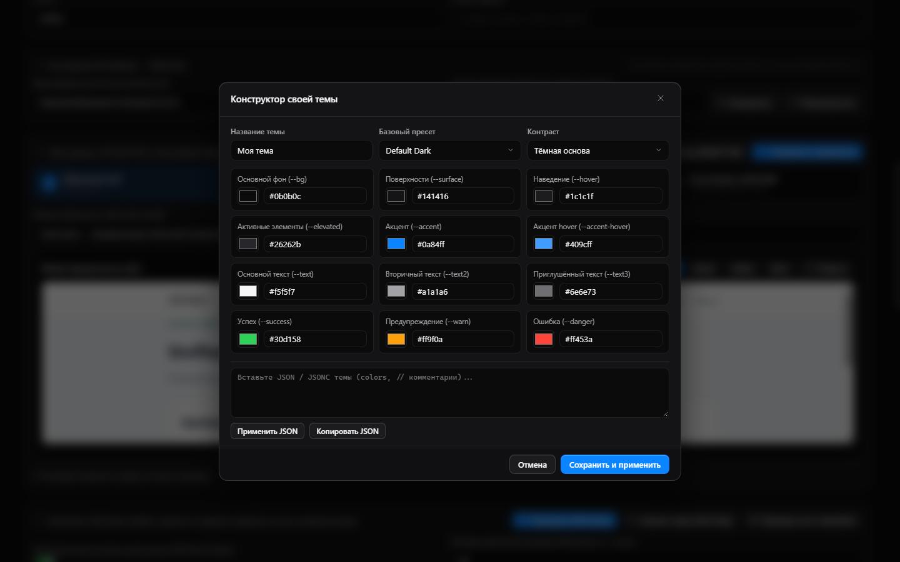

- **13 тёмных тем**: `Default Dark`, `Legacy Dark`, `Catppuccin`, `Dracula`, `Everforest`, `Gruvbox Material`, `Monokai`, `Nord`, `One Dark Pro`, `Tokyo Night`, `Solarized Dark`, `Vesper`, `Material Dark`.
- **3 светлые темы**: `Material Light`, `Apple Light`, `Gruvbox Light`.

| Элемент UI | Где находится | Что делает (How) | Зачем нужен (Why) | Важные нюансы и частые ошибки |
| :--- | :--- | :--- | :--- | :--- |
| **Список тем / Кнопка `+ Создать свою тему...`** | `Topbar → Тема` или `Настройки → Цветовая тема` | Применяет выбранную палитру мгновенно без перезагрузки; `+ Создать свою тему...` открывает конструктор. | Адаптация интерфейса под монитор, освещение или корпоративный стиль. | Хранится в `localStorage` конкретного браузера (не переносится автоматически на другой ПК без экспорта JSON). |
| **Кнопка `Импорт JSON`** | Карточка темы в `Настройки` | Загружает файл `.json` / `.jsonc` с пользовательской палитрой. | Быстрый перенос корпоративной или командной темы между устройствами администраторов. | — |
| **Поля `Название темы`, `Базовый пресет`, `Контраст`** | Верхняя строка модалки конструктора | Задают имя темы, исходный пресет из 16 встроенных (при смене заполняет все цвета) и схему (`Тёмная основа` / `Светлая основа`). | Быстрый старт от готовой палитры и корректная генерация полупрозрачных рамок/стекла. | Выбор слишком светлого текста на светлой основе сделает интерфейс нечитаемым — при нажатии `Отмена` или `Esc` палитра откатывается. |
| **12 пар Color-Picker + HEX** | Сетка пикеров в центре конструктора | Управляют CSS-переменными: `--bg`, `--surface`, `--hover`, `--elevated`, `--accent`, `--accent-hover`, `--text`, `--text2`, `--text3`, `--success`, `--warn`, `--danger`. | Точная настройка каждого элемента, бейджа статуса и акцента в реальном времени. | Поддерживаются 3-, 6- и 8-символьные HEX-коды; при смене `--bg` контраст определяется автоматически по яркости. |
| **Поле JSON/JSONC, `Применить JSON`, `Копировать JSON`** | Нижний блок конструктора | Позволяет вставить JSON-конфиг темы (поддерживаются `//` комментарии) или скопировать готовую палитру в буфер. | Обмен темами в чатах/документации и версионирование. | При синтаксической ошибке в JSON выводится предупреждение без поломки текущей темы. |
| **`Сохранить и применить` / `Отмена`** | Футер конструктора | Сохраняет кастомную тему в браузере и активирует её (или отменяет предпросмотр). | Завершение настройки палитры. | Пользовательские темы появляются в отдельном разделе `Свои` в списке тем. |

---

## 5. Все 9 вкладок панели в порядке меню

### Вкладка 1. Обзор (`#dashboard`, `Alt+1`)

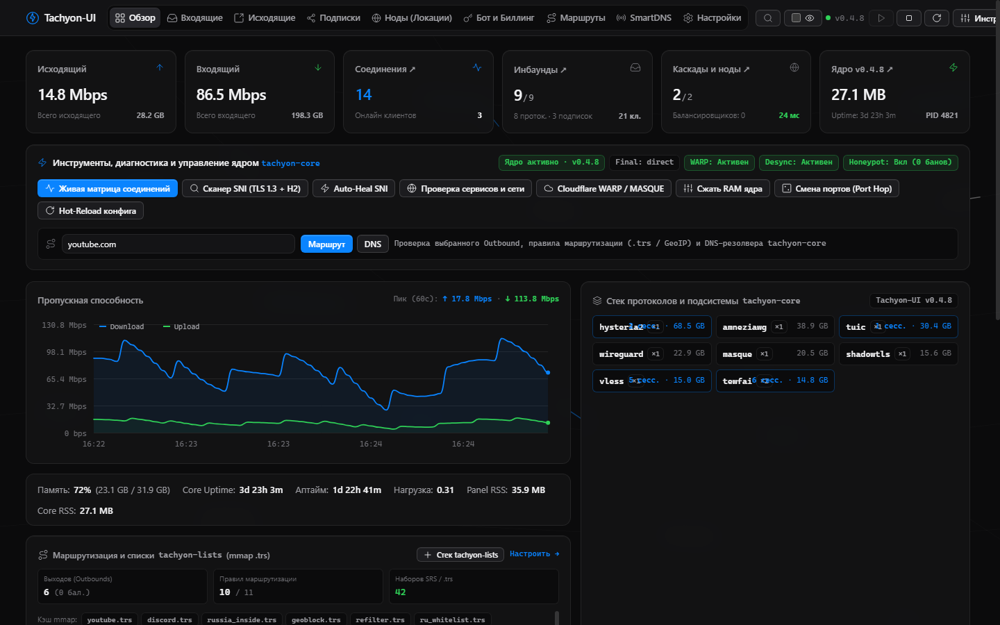

Главный экран оперативного мониторинга сервера, телеметрии ресурсов (`CPU`, `RAM`, трафик), статуса подсистем и запуска быстрых проверок.

#### 5.1.1. Верхние кнопки управления и быстрого аудита

| Элемент UI | Где находится | Что делает (How) | Зачем нужен (Why) | Важные нюансы и частые ошибки |
| :--- | :--- | :--- | :--- | :--- |
| **`Применить` (`Apply`)** | Шапка вкладки `Обзор`, основная кнопка | Генерирует итоговый JSON-конфиг `tachyon-core` из состояния панели и выполняет горячее применение (`POST /api/core/apply`). | Активация всех накопленных изменений во входящих, исходящих, маршрутах и подписках. | Если нажать кнопку забыли, изменения останутся только в панели, но реальный трафик пойдёт по старым правилам. При ошибке конфигурации выводится подробный текст ошибки. |
| **`Рестарт ядра` / `Старт` / `Стоп`** | Шапка `Обзор` (дублирует `Topbar`) | Перезапускает, запускает или останавливает процесс `tachyon-core`. | Сброс зависших портов или экстренное отключение приёма трафика. | Разрывает текущие клиентские подключения. |
| **`Конфиг` (`Config Preview`)** | Шапка `Обзор` | Открывает модалку с полным сгенерированным JSON-конфигом `tachyon-core` (`GET /api/config-preview`) и кнопкой копирования. | Проверка того, какие именно секции `inbounds`, `outbounds`, `endpoints` и `route` сформированы перед или после `Apply`. | Полезно при отладке порядка правил маршрутизации и параметров `REALITY`/транспортов. |
| **Кнопки быстрого аудита (`Живая матрица соединений`, `Auto-Heal SNI`, `Cloudflare WARP`, `Сканер SNI`, `Проверка сети и Speedtest`, `Снимки`)** | Панель быстрых действий на дашборде | Запускают диагностику ядра, сканер SNI, проверку разблокировки и скорости, самовосстановление SNI, быструю регистрацию WARP или окно снэпшотов. | Диагностика и типовые операции в 1 клик сразу после входа. | Для работы `Auto-Heal SNI` и живой матрицы ядро должно быть запущено. |

#### 5.1.2. KPI-карточки, телеметрия, трассировщик и логи

| Элемент UI | Где находится | Что делает (How) | Зачем нужен (Why) | Важные нюансы и частые ошибки |
| :--- | :--- | :--- | :--- | :--- |
| **6 KPI-карточек (Статус, Входящие, Исходящие, Подписки, Трафик, Память)** | Верхняя сетка `#dashboard` | Показывают аптайм ядра, количество активных входящих и здоровых исходящих, лимиты подписок, текущий/суммарный трафик (Up/Down) и потребление RAM (`RSS`). | Моментальная оценка состояния сервера и нагрузки. | На карточке памяти есть кнопка **`Trim RAM`** (`POST /api/core/memory-trim`), принудительно освобождающая неиспользуемые буферы памяти ядра на маломощных VPS. |
| **Бейджи подсистем и стек протоколов** | Под KPI-карточками | Отображают состояние модулей (`Core`, `TLS/ACME`, `SmartDNS`, `TG Bot`, `Anti-Share`, `Auto-Healer`, `Failover`, `Watchdog`) и матрицу активных протоколов. | Визуальный контроль того, какие сервисы подняты и какие протоколы реально слушают порты. | Серый бейдж указывает на отключённый или неиспользуемый модуль. |
| **2-кнопочный трассировщик (`Проверить маршрут` / `Проверить DNS`)** | Блок трассировки на дашборде | Принимает домен или IP (и опционально UDP DNS) и проверяет через живое ядро (`POST /api/core/route-check`, `POST /api/core/dns-check`), в какой outbound пойдёт цель и в какой IP она резолвится. | Проверка правил маршрутизации и анти-подмены DNS за 2 секунды без тестирования с телефона. | Показывает реальную реакцию запущенного `tachyon-core` (после `Apply`), а не черновик формы. |
| **График пропускной способности и полоса `Sysinfo`** | Центральный блок дашборда | Отрисовывает живую кривую Up/Down скорости, а также метрики `CPU`, `RAM`, `OS` и `Load Average`. | Выявление пиков трафика, просадок канала и нехватки CPU/памяти. | Резкое падение трафика до нуля при живых подключениях (и срабатывание бейджа **Zero-Traffic Watchdog**) сигнализирует о проблеме DPI на одном из инбаундов. |
| **Карточка `.trs`-маршрутизации** | Блок статуса баз маршрутов | Показывает наличие и размер загруженных бинарных баз (`tachyon-lists`, `geoip`, `geosite`) с кнопкой установки/перехода в `#routes`. | Контроль актуальности списков раздельной маршрутизации. | Если базы не установлены, правила на базе `rule_set` работать не будут. |
| **Топ активных входящих и онлайн-клиенты (+ кнопка `Кик`)** | Нижняя часть дашборда | Показывает активных пользователей, их подключённые IP и кнопку принудительного сброса сессий (`POST /api/core/kick`). | Контроль нагрузки и оперативное отключение злоупотребляющего клиента. | Кик разрывает только текущие активные потоки без удаления подписки. |
| **Окно логов ядра + кнопка копирования** | Нижняя панель дашборда | Выводит `stdout`/`stderr` процесса `tachyon-core` с фильтром по уровню/поиску и кнопкой копирования в буфер. | Первичный поиск причин, если ядро не запускается после `Apply` или рвутся TLS-рукопожатия. | Для сохранения приватности при копировании на форум/в чат предварительно проверьте отсутствие личных IP или включите `Alt+P` для скриншота. |

---

### Вкладка 2. Входящие (`#inbounds`, `Alt+2`)

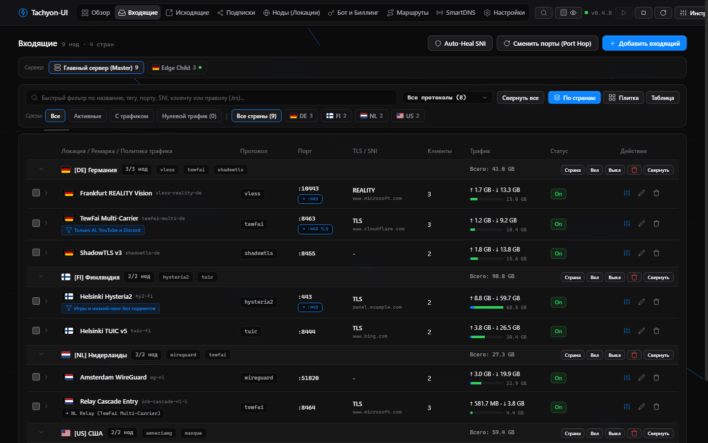

Раздел управляет точками входа прокси/VPN как на локальном сервере (`Master`), так и на всех подключённых управляемых серверах кластера (`Child`).

#### 5.2.1. Панель выбора ноды и тулбар входящих

| Элемент UI | Где находится | Что делает (How) | Зачем нужен (Why) | Важные нюансы и частые ошибки |
| :--- | :--- | :--- | :--- | :--- |
| **Переключатель ноды (`Master` / дочерние `Child`)** | Самый верх `#inbounds` | Переключает контекст вкладки между текущим сервером и любой управляемой нодой (`managed_tachyon_node`). | Централизованное создание, правка и удаление инбаундов по всему кластеру из одной вкладки. | При выборе `Child`-ноды все запросы идут на её API; если нода офлайн, появится баннер с кнопками **`Обновить с ноды`** и **`Применить ядро ноды`**. |
| **Поиск, Сохранённые виды, Фильтры протоколов и стран, `Сбросить фильтры`** | Панель фильтрации над списком | Фильтруют список по `tag`, порту, SNI, заметке, одному из 25 протоколов или ISO-коду страны; кнопка сброса очищает все фильтры. | Быстрая навигация при наличии десятков входящих на разных портах и серверах. | Если часть инбаундов «пропала» из вида, в первую очередь проверьте и нажмите `Сбросить фильтры`. |
| **Переключатель вида (`Дерево / Карточки / Таблица`)** | Правая часть панели фильтров | Меняет плотность отображения между сгруппированным по странам деревом, сеткой карточек и компактной таблицей. | Выбор удобного формата работы для обзора или массового редактирования. | Массовое выделение `Shift+Клик` работает через чекбоксы в строках/карточках. |
| **Кнопка `Batch Country` (Массовая разметка стран)** | Тулбар вкладки `Входящие` | Открывает диалог пакетного назначения 2-буквенного ISO-кода страны (`DE`, `NL`, `FI`, `US` и т.д.) для выбранных инбаундов. | Корректная сортировка локаций и автогенерация страновых балансировщиков (`auto-de`, `auto-nl`). | Изменение только страны, заметки или `external_port`/`external_tls` сохраняется **мгновенно без перезапуска `tachyon-core`**. |
| **Кнопка `Auto-Heal SNI`** | Тулбар `Входящие` | Проверяет доступность текущих REALITY/TLS SNI-доменов и при деградации автоматически ротирует их на рабочие (доступен режим принудительной ротации). | Автоматическое восстановление маскировки, если домен-донор заблокирован или перестал поддерживать TLS 1.3 / H2. | После ротации клиенты должны обновить подписку (или получить актуальные параметры при следующем автообновлении). |
| **Кнопка `Port Hop`** | Тулбар `Входящие` | Сдвигает/ротирует рабочие порты у настроенных для прыжков портов инбаундов. | Обход точечной блокировки по порту (особенно актуально для UDP-протоколов). | При включённом `auto_firewall_enabled` новые порты открываются в файрволе автоматически, старые очищаются. |
| **Кнопка `1→N Clone`** | Тулбар `Входящие` | Открывает мастер тиражирования эталонного инбаунда сразу на 1..N дочерних нод или серию портов. | Быстрое разворачивание одинакового профиля по всему парку серверов. | Зависит от наличия активного гранта доступа при коммерческом масштабировании. |
| **Кнопка `Cascade / Resell`** | Тулбар `Входящие` | Запускает конструктор цепочек: входной сервер (мост) → зарубежный outbound/нода с предпросмотром конфликтов портов. | Построение двойных транзитных цепочек. | Перед сохранением всегда нажимайте **`Предпросмотр`**, чтобы проверить отсутствие коллизий портов. |
| **Кнопка `+ Добавить входящий`** | Правый край тулбара `Входящие` | Открывает 4-вкладочный конструктор нового входящего подключения. | Создание новой точки входа на одном из 25 поддерживаемых протоколов. | Не забудьте после сохранения нажать `Применить` на дашборде (или `Применить ядро ноды` для Child). |

| Массовая разметка стран | Настройка входящего `TewFai Multi-Carrier` |
| :---: | :---: |
| 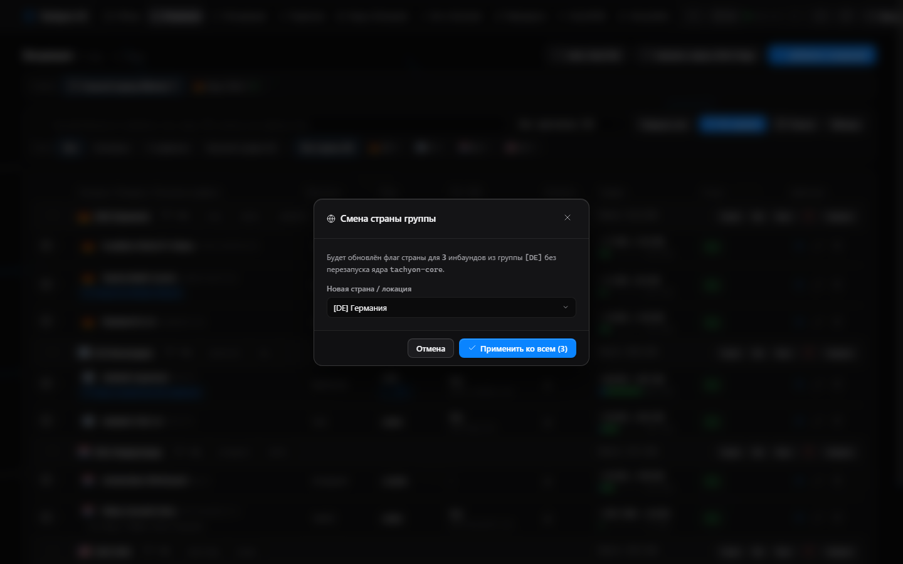 | 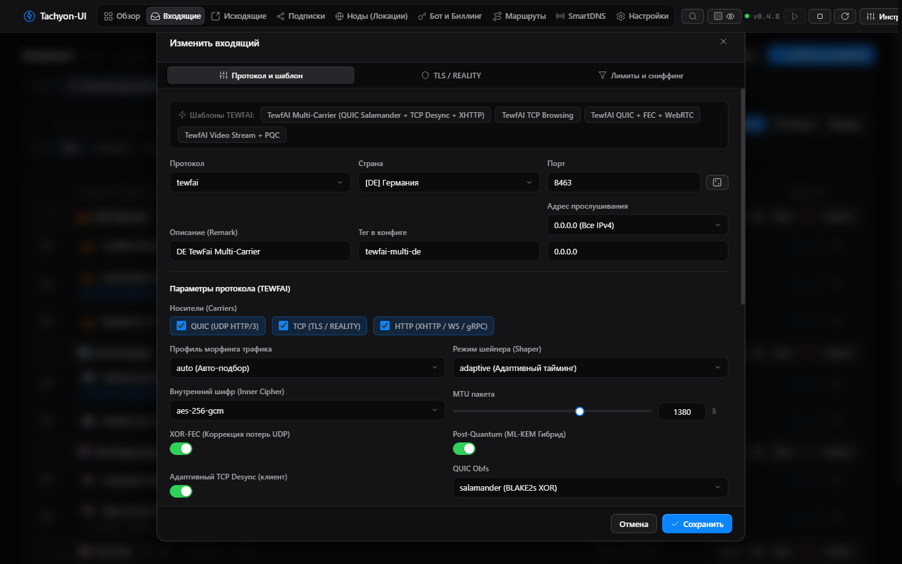 |

#### 5.2.2. Действия в строке/карточке входящего и правый Инспектор ноды

- **Чекбокс**: выделение для пакетных операций (`Вкл/Выкл`, `Смена страны`, `Удаление`, `Shift+Клик`).
- **Переключатель Вкл/Выкл**: мгновенно активирует или отключает inbound.
- **`+ Добавить клиента`**: добавляет отдельного пользователя (`UUID` / пароль / имя / лимит) прямо внутрь этого inbound.
- **Кнопка `Поделиться` (Share)**: открывает окно с QR-кодом и прямой URI-ссылкой (`tewfai://`, `vless://`, `hy2://`, `trojan://`, `anytls://` и др.) для одного клиента.
- **Кнопки `Редактировать` / `Клонировать` / `Удалить`**: изменение параметров, дублирование или удаление точки входа.
- **Клик по строке / иконке инспектора ноды** — открывает **Правый инспектор-дровер ноды**, где отображаются трафик инбаунда, цепочка выхода (`relay`), быстрая смена SNI/страны и сохранение гранулярной политики трафика/правил `.trs` (`POST /api/inbounds/traffic-policy`).

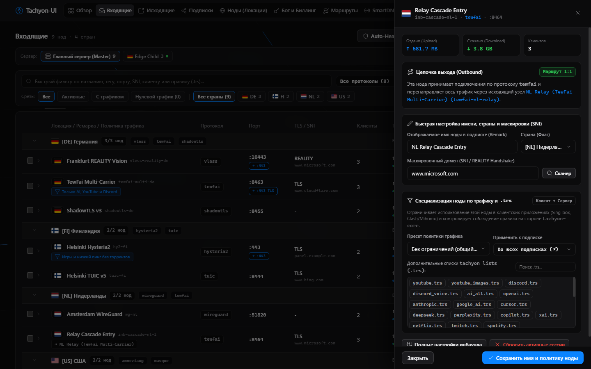

#### 5.2.3. Конструктор Inbound (4 вкладки) и Сканер SNI

| Пресеты конструктора Inbound | Сканер доменов SNI |
| :---: | :---: |
| 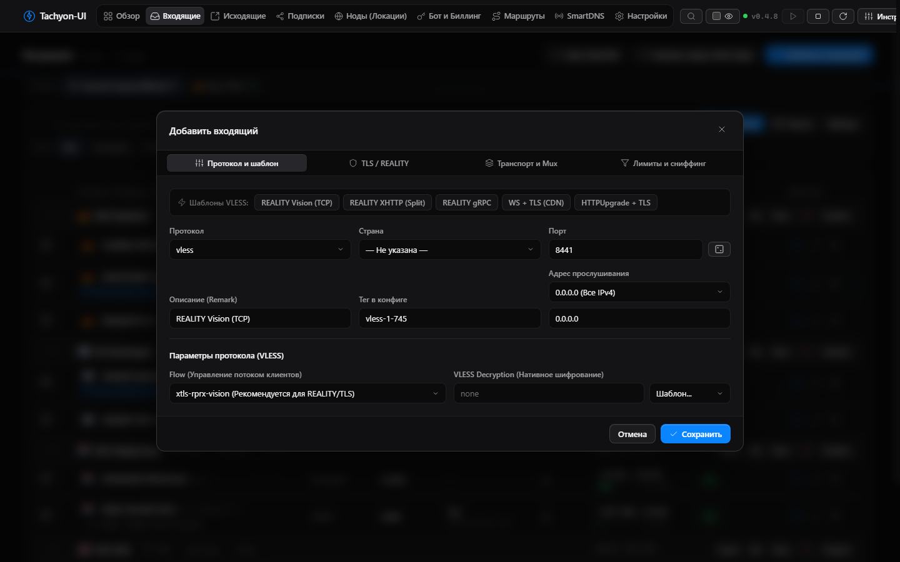 | 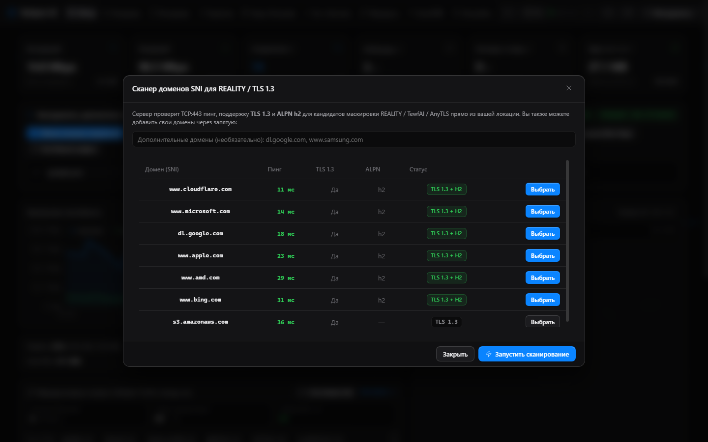 |

| Элемент UI | Где находится | Что делает (How) | Зачем нужен (Why) | Важные нюансы и частые ошибки |
| :--- | :--- | :--- | :--- | :--- |
| **Панель быстрых пресетов** | Верхняя строка модалки конструктора | В 1 клик заполняет протокол, режим TLS/REALITY, транспорт и оптимальные флаги (например `TewFai Multi-Carrier`, `VLESS REALITY Vision`, `Hysteria2`, `TUIC v5`, `AmneziaWG`, `MASQUE` и др.). | Безошибочный старт без ручной сборки десятков опций. | После выбора пресета проверьте порт (при работе за `Unified 443 Front` настройте локальный адрес или совместимый порт). |
| **Вкладка 0: `Основное`** | Первая вкладка модалки | Поля: `tag` (тег), `country` (ISO-код), `listen` (`::` или `0.0.0.0`), `listen_port` (+ кнопка случайного свободного порта), `protocol` (25 протоколов), `sniff` / `sniff_override_destination`, `domain_strategy`, а также специфические поля протокола (UUID, пароли, шифр SS-2022, полоса Up/Down для Hysteria2, ключи WireGuard/AWG с генератором, `external_port` / `external_tls`, настройки `TewFai` носителей и т.д.). | Базовая настройка адреса прослушивания, протокола и учётных данных. | При смене протокола интерфейс динамически скрывает неподдерживаемые вкладки и поля (например, REALITY недоступен для Hysteria2/TUIC). |
| **Вкладка 1: `TLS и REALITY`** | Вторая вкладка модалки | Выбор режима (`Без TLS` / `Standard TLS` / `REALITY` / `Self-Signed`), поле `server_name` (SNI) + шаблоны SNI + кнопка запуска **Сканера SNI**, ALPN, версии TLS. Для `REALITY`: `handshake.server`, `handshake.server_port`, генератор пары ключей `X25519` (и `ML-KEM` PQ для TewFai/VLESS), `short_id`, `max_time_difference`, `uTLS fingerprint`. | Настройка шифрования и маскировки TLS 1.3 handshake под реальный веб-сайт. | Внутренний **Сканер SNI** проверяет кандидатов именно с вашего VPS на TLS 1.3, HTTP/2, отсутствие редиректов и низкую задержку. При `REALITY` на порту `443` убедитесь, что он не конфликтует с другим процессом (кроме `Unified 443 Front`). |
| **Вкладка 2: `Транспорт и Сеть`** | Третья вкладка модалки | Тип транспорта (`tcp`, `ws`, `grpc`, `http`, `httpupgrade`, `xhttp`, `quic`), `path`, `host`, `service_name`, WS `early_data`, пресеты `Desync`, `TCP Fast Open`, `MPTCP`, `Proxy Protocol`. | Совместимость с CDN (Cloudflare) и обход L7-инспекции трафика. | Для проксирования через CDN используйте `ws` или `httpupgrade` + `Standard TLS`; для прямых подключений предпочтительны `tcp` + `REALITY Vision` или `TewFai`. Никогда не включайте `Proxy Protocol` при работе с `Unified 443 Front` + REALITY. |
| **Вкладка 3: `Mux, Brutal и Лимиты`** | Четвёртая вкладка модалки | Включение `multiplex` (`h2mux`/`smux`/`yamux`), `padding`, `brutal` (TCP Brutal + полоса Up/Down), таймауты и лимиты подключений. | Оптимизация пропускной способности на каналах с потерями пакетов и уплотнение потоков. | Для `VLESS` с `xtls-rprx-vision` мультиплексирование отключается автоматически. Агрессивный `TCP Brutal` на слабых каналах может повышать задержку. |
| **Кнопки `Сохранить` / `Отмена`** | Футер модалки | Сохраняет конфигурацию inbound в панель (или на выбранную Child-ноду). | Фиксация настроек перед применением ядра. | Для вступления сетевых правок в силу перейдите на дашборд и нажмите `Применить` (кроме правок метаданных `country`/`remark`/`external_*`). |

> [!TIP]
> **Мастер стелс-развёртывания (4 шага)**, который обеспечивает маскировку веб-сервера, привязку домена, ACME-сертификаты, `Unified 443 Front` (единый порт `443` для сайта, панели и инбаундов), скрытый `web_base_path` и 9-критериальный `Self-Audit`, находится во вкладке **Настройки** — подробный разбор каждого шага приведён в [разделе 5.9](#вкладка-9-настройки-settings-alt9) (см. также [Главу 2](02-stealth-web-domain-tls.md)).

#### 5.2.4. Справочник входящих протоколов (перекрёстные ссылки на `protocols/01..23`)

- [01. TewFai (Multi-Carrier)](protocols/01-tewfai.md) · [02. VLESS](protocols/02-vless.md) · [03. Hysteria2](protocols/03-hysteria2.md) · [04. TUIC v5](protocols/04-tuic.md)
- [05. Trojan](protocols/05-trojan.md) · [06. VMess](protocols/06-vmess.md) · [07. Shadowsocks](protocols/07-shadowsocks.md) · [08. AnyTLS](protocols/08-anytls.md)
- [09. ShadowTLS v3](protocols/09-shadowtls.md) · [10. NaiveProxy](protocols/10-naive.md) · [11. MASQUE](protocols/11-masque.md) · [12. TrustTunnel](protocols/12-trusttunnel.md)
- [13. Mieru](protocols/13-mieru.md) · [14. Snell](protocols/14-snell.md) · [15. MTProto](protocols/15-mtproto.md) · [16. FPTN](protocols/16-fptn.md)
- [17. WDTT](protocols/17-wdtt.md) · [18. Sudoku](protocols/18-sudoku.md) · [19. OpenConnect](protocols/19-openconnect.md) · [20. Cloudflared](protocols/20-cloudflared.md)
- [21. WireGuard](protocols/21-wireguard.md) · [22. AmneziaWG](protocols/22-amneziawg.md) · [23. Mixed / SOCKS / HTTP](protocols/23-mixed-socks-http.md)

---

### Вкладка 3. Исходящие (`#outbounds`, `Alt+3`)

| Пул исходящих подключений | Редактор исходящего `TewFai` |
| :---: | :---: |
| 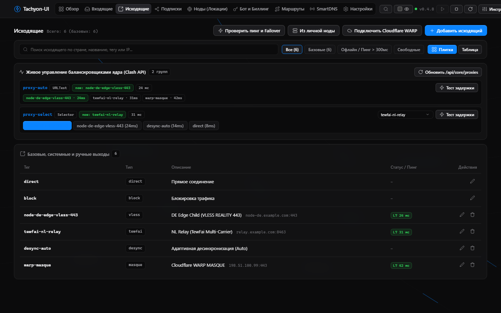 | 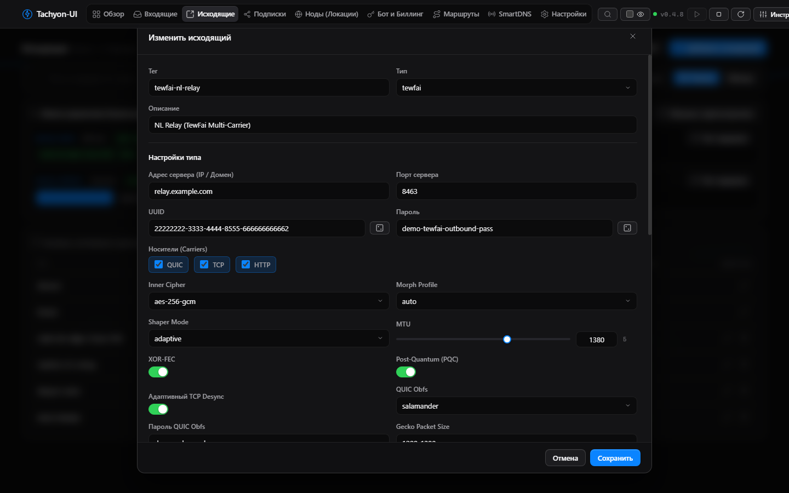 |

Раздел настраивает выходные шлюзы сервера (`direct`, `block`, внешние прокси, `WARP`, `Desync`, `SSH`, `Tor`, `Bridge`, экспортированные инбаунды с `Child`-нод), а также балансировщики (`urltest`, `selector`, `chain`).

#### 5.3.1. Clash API Live-панель, тулбар и карточки пулов

| Элемент UI | Где находится | Что делает (How) | Зачем нужен (Why) | Важные нюансы и частые ошибки |
| :--- | :--- | :--- | :--- | :--- |
| **`Обновить задержки` (Live Clash API)** | Верхняя live-панель селекторов | Запрашивает у работающего `tachyon-core` актуальное дерево селекторов/групп и задержки узлов (`GET /api/core/proxies`). | Показывает реальную задержку каждого шлюза глазами ядра без догадок. | Доступно только при запущенном ядре. |
| **Выбор узла в группе + Кнопка пинга группы** | Карточка группы `selector` / `urltest` в live-панели | Клик по узлу переключает активный шлюз в памяти ядра на лету; кнопка пинга запускает L7-замер (до `https://www.gstatic.com/generate_204`, таймаут `5000` мс). | Мгновенное ручное переключение выходного канала без рестарта `tachyon-core`. | Высокая задержка или таймаут подсвечиваются красным цветом. |
| **Поиск, категории и вид `Grid / Table`** | Тулбар вкладки `Исходящие` | Фильтруют шлюзы по тегу и типу (включая сохранённые виды) и переключают отображение пулами или таблицей. | Быстрая работа с большим пулом шлюзов и каскадов. | Чекбоксы в таблице/карточках поддерживают `Shift+Клик` для массового удаления. |
| **`Проверить и переключить` (`Run Health Check / Failover`)** | Тулбар `Исходящие` | Запускает проверку доступности всех исходящих (`POST /api/outbounds/health-check`) и автоматически переводит failover-группы на живые узлы. | Массовый аудит выходных каналов и немедленная отработка отказов. | Полезно запускать после обслуживания удалённых серверов. |
| **`Из управляемой ноды` (`From Managed Node`)** | Тулбар `Исходящие` | Открывает окно выбора дочерней `Child`-ноды и её инбаунда для автоматического экспорта в готовый outbound на `Master`. | Сборка мостов «Master → Child» без ручного копирования UUID, портов и ключей `REALITY`. | Если у дочерней ноды сменится порт или ключ, переэкспортируйте или синхронизируйте связку. |
| **`Multi-Clone 1→N`** | Тулбар `Исходящие` | Размножает конфигурацию исходящего сразу на 1..N целевых узлов. | Быстрое масштабирование парков релеев. | Доступность зависит от режима гранта. |
| **`Подключить Cloudflare WARP`** | Тулбар `Исходящие` | Автоматически регистрирует аккаунт Cloudflare WARP, генерирует ключи WireGuard/MASQUE и добавляет outbound `warp-out`. | Быстрое получение чистого выходного IP для AI-сервисов, Google или обхода ограничений датацентра. | После создания `warp-out` направьте на него нужные домены во вкладке `Маршруты`. |
| **`+ Добавить исходящий`** | Правый край тулбара `Исходящие` | Открывает конструктор нового исходящего шлюза или балансировщика (поддерживается **33 типа**). | Подключение любых внешних прокси, `TewFai`, `Desync`, `urltest`, `chain`, `SSH`, `Tor`, `Bridge`, `WireGuard` и др. | Не забудьте нажать `Применить` на дашборде после сохранения. |
| **Кнопка `Reset Circuit Breaker` / `Удалить пул`** | На карточке/строке пула или шлюза | `Reset` сбрасывает блокировку «залипшего» после обрыва сети шлюза; `Удалить пул` удаляет балансировщик (с опцией очистки связанных дочерних шлюзов). | Быстрое возвращение узла в работу без рестарта ядра и аккуратная уборка устаревших каскадов. | При удалении пула проверяйте чекбокс очистки связанных исходящих, чтобы не удалить общие ноды случайно. |

#### 5.3.2. Конструктор Outbound и шаблоны (`TewFai`, `Desync`, `urltest`, `chain`)

| Шаблон / Тип | Что настраивается в конструкторе | Перекрёстная ссылка |
| :--- | :--- | :--- |
| **`tewfai`** | Носители (`quic`, `tcp`, `http`), `salamander`/`gecko`, `xhttp`, клиентский `desync`, `sni_pool`, `server_ports`, таймауты `handover` и `Race Delay`, `XOR-FEC`, `ML-KEM`. | [01. TewFai](protocols/01-tewfai.md) |
| **`desync`** | Прямой выход с фрагментацией/спуфингом TCP/TLS и адаптивным `udp_fake` для обхода DPI без внешнего зарубежного сервера. | [24. Desync](protocols/24-desync.md) |
| **`urltest` (12 режимов)** | `least_test`, `stability`, `failover`, `sticky` (`sticky_hash`), `least_load`, `weighted`, `round_robin`, `passive`, `priority` (`tiers`), `hedged`, `throughput`, `quota` (`quota_mib`), плюс `url`, `interval`, `tolerance`, `pool`. | [27. Балансировщики и Chain](protocols/27-balancers-and-chain.md) |
| **`selector` / `chain`** | `selector`: список тегов, узел `default`, `auto_failover`. `chain`: упорядоченный список из 2+ хопов (`Хоп 1 → Хоп 2 → …`), `strip_evasion` и гранулярные чекбоксы `strip` (`multiplex.padding`, `tls.fragment`, `tls.utls`, `xhttp.padding`). | [27. Балансировщики и Chain](protocols/27-balancers-and-chain.md) |
| **Прочие протоколы и шлюзы** | `direct`, `block`, `dns`, `vless`, `vmess`, `trojan`, `hysteria2`, `tuic`, `anytls`, `shadowtls`, `shadowsocks`, `naive`, `masque`, `trusttunnel`, `mieru`, `snell`, `mtproto`, `fptn`, `wdtt`, `sudoku`, `openconnect`, `wireguard`, `amneziawg`, `socks`, `http`, `hysteria` (v1), `ssh`, `tor`, `bridge`, настройки `Dialer` (`detour`, `bind_interface`, `tcp_fast_open`). | [Каталог протоколов](protocols/README.md), [25. Hysteria v1](protocols/25-hysteria1.md), [26. SSH / Tor / Bridge](protocols/26-ssh-tor-bridge.md) |

---

### Вкладка 4. Подписки (`#subs`, `Alt+4`)

| Список подписок и срезы | Быстрый инвайт в 1 клик |
| :---: | :---: |
| 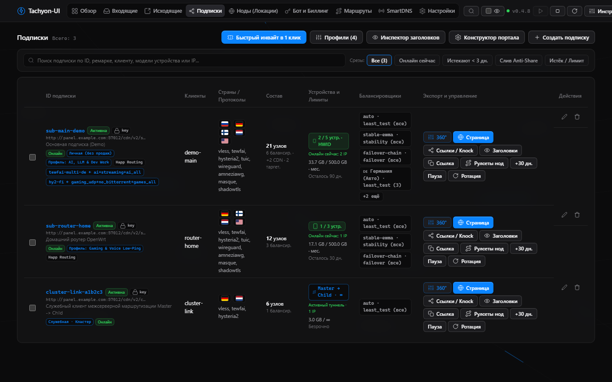 | 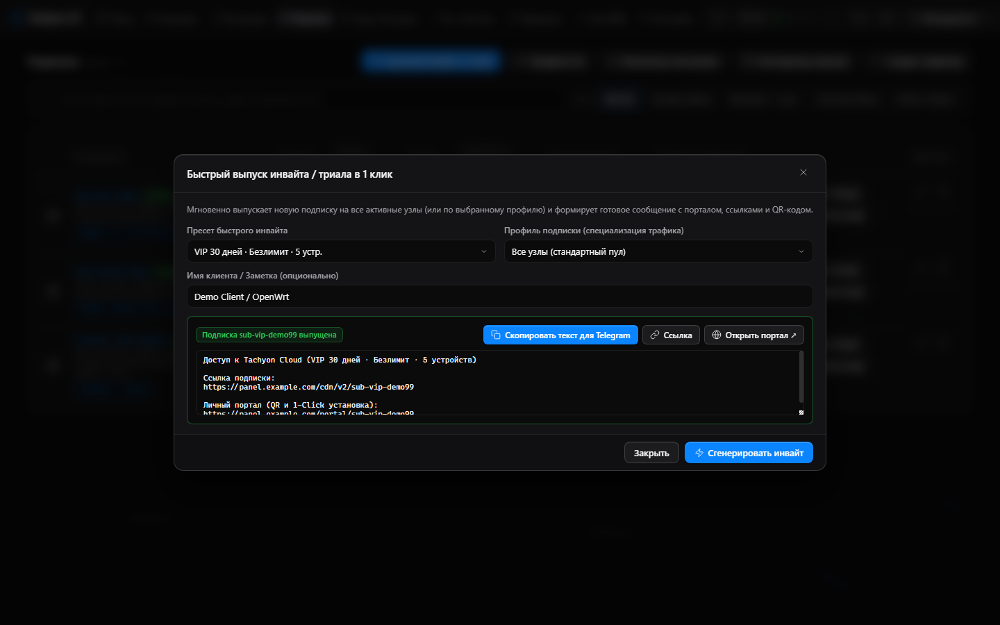 |

Раздел объединяет локальные протоколы, дочерние узлы кластера и балансировщики в единые клиентские ссылки, веб-портал и профили для роутеров.

#### 5.4.1. Тулбар подписок и действия в строке таблицы

| Элемент UI | Где находится | Что делает (How) | Зачем нужен (Why) | Важные нюансы и частые ошибки |
| :--- | :--- | :--- | :--- | :--- |
| **Поиск и Срезы (Slices)** | Шапка `#subs` | Поиск по ID, ремарке, клиенту, модели устройства или IP; быстрые фильтры: `Все`, `Онлайн сейчас`, `Истекают < 3 дн.`, `Слив Anti-Share`, `Истёк / Лимит`. | Моментальный отбор активных или проблемных абонентов. | Живой счётчик `Онлайн сейчас: N IP` агрегирует подключения, включая дочерние ноды кластера. |
| **`+ Добавить подписку`** | Тулбар `#subs` | Открывает 5-вкладочную карточку создания новой подписки. | Тонкая ручная настройка узлов, балансировщиков, лимитов, CDN-точек и рулсетов. | Без коммерческого гранта доступна 1 персональная агрегация (для собственных серверов лимит не мешает). |
| **`+ Быстрый инвайт в 1 клик`** | Тулбар `#subs` | В одном компактном окне позволяет выбрать срок, лимит трафика/устройств, профиль и комментарий, сразу выдавая ссылку и QR-код. | Выдача гостевого или тестового доступа за 5 секунд без обхода 5 вкладок. | Идеально для друзей, тестов и разовых подключений. |
| **`Профили подписок`** | Тулбар `#subs` | Открывает менеджер шаблонов (`Gaming Low-Ping`, `AI & Dev`, `Streaming 4K` и др.) с правилами маршрутизации, лимитами и `Happ Routing`. | Единообразная стандартизация тарифов; можно применять пакетно через Bulk-бар. | Привязывается также к тарифам Telegram-бота. |
| **`Инспектор заголовков`** | Тулбар `#subs` | Эмулирует запрос от выбранного `User-Agent` (клиенты `Tachyon 2.0`, формат `singbox`, `Mihomo/Clash`, `Happ`, `v2rayNG`, браузер), показывает авто-формат выдачи, HTTP-заголовки и расшифрованный JSON маршрутизации. | Отладка того, почему приложение не показывает остаток трафика или выбирает не тот формат профиля. | Незаменим перед массовой рассылкой новой конфигурации на роутеры или смартфоны. |
| **`Конструктор портала`** | Тулбар `#subs` | Переносит к настройкам брендинга клиентского веб-портала подписки в разделе `Настройки`. | Оформление страницы с кнопками «Добавить в Happ / Hiddify / v2rayTun» и инструкциями. | — |
| **`Импорт внешней подписки`** | Тулбар `#subs` | Загружает внешнюю ссылку или список URI для объединения в агрегатор. | Перенос сторонних конфигов в единый профиль. | Для коммерческой перепродажи сторонних подписок требуется грант доступа. |
| **Действия в строке подписки (`Ссылки / QR`, `Вкл/Выкл`, `+30д`, `Ротация ссылки`, `Сброс страйков`, `360°`, `Редактировать`, `Удалить`)** | Каждая строка таблицы подписок | Быстрые кнопки управления конкретным подписчиком; служебные кластерные туннели помечены `cluster-link-*` с бейджем `Master → Child · ∞`. | Повседневное обслуживание клиентов в 1 клик без открытия полной карточки. | **Ротация ссылки** немедленно аннулирует старый URL подписки — используйте при утечке ссылки в сеть. |

#### 5.4.2. 5 вкладок редактора подписки, 360°-дровер, Ссылки/Knock, Инспектор заголовков и Профили

| Вкладка 0: Узлы | Вкладка 1: Балансировщики | Вкладка 2: Лимиты и устройства |
| :---: | :---: | :---: |
| 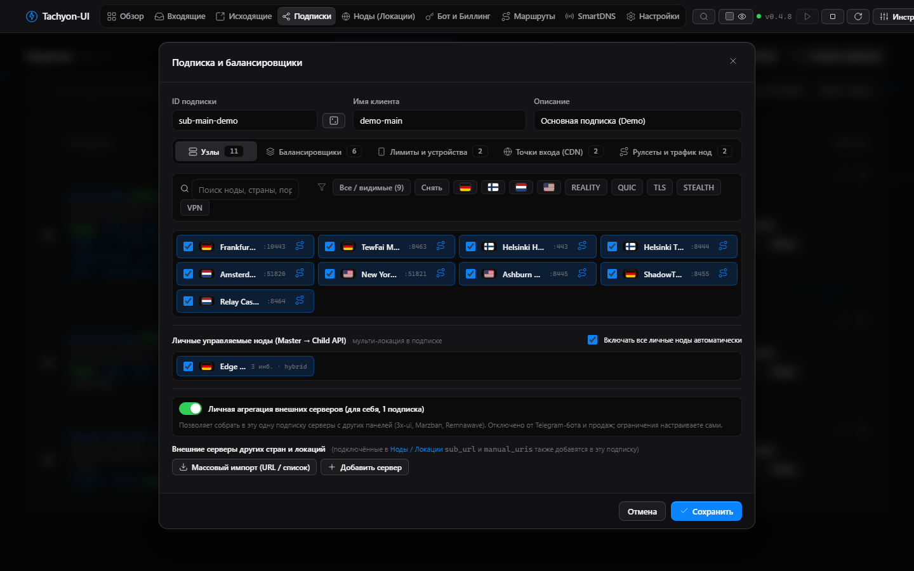 | 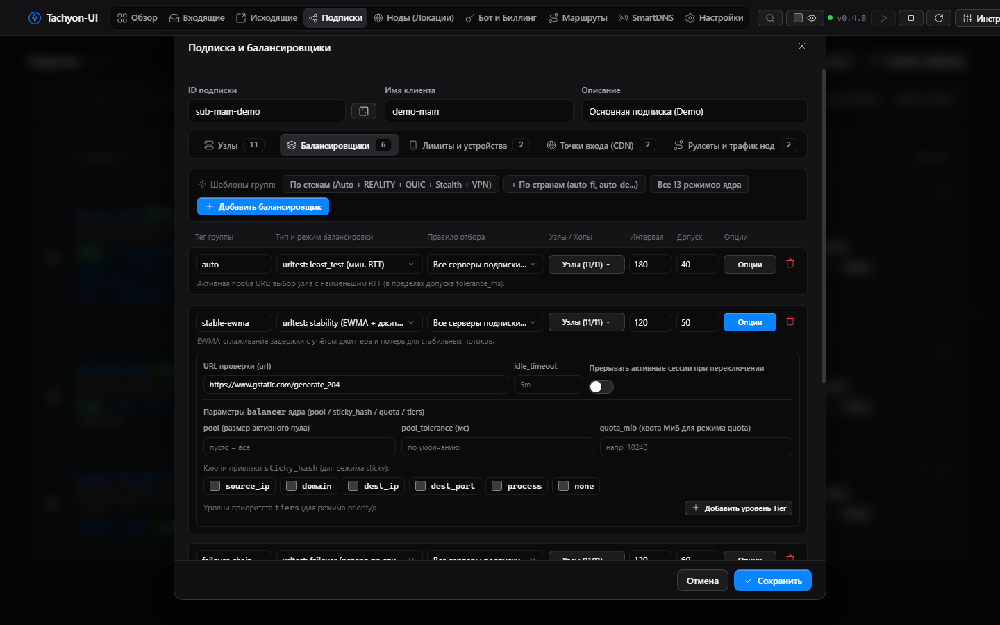 | 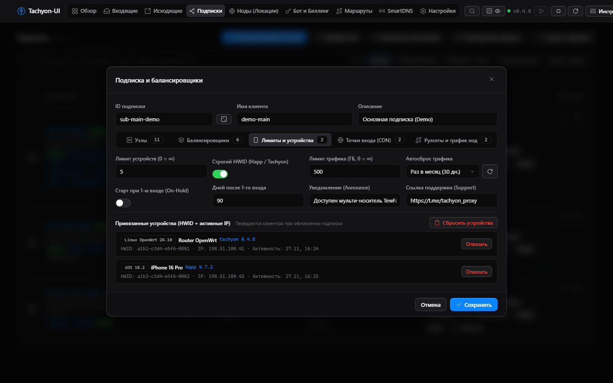 |

| Вкладка 3: Точки входа (CDN) | Вкладка 4: Рулсеты нод | Боковой 360°-дровер |
| :---: | :---: | :---: |
| 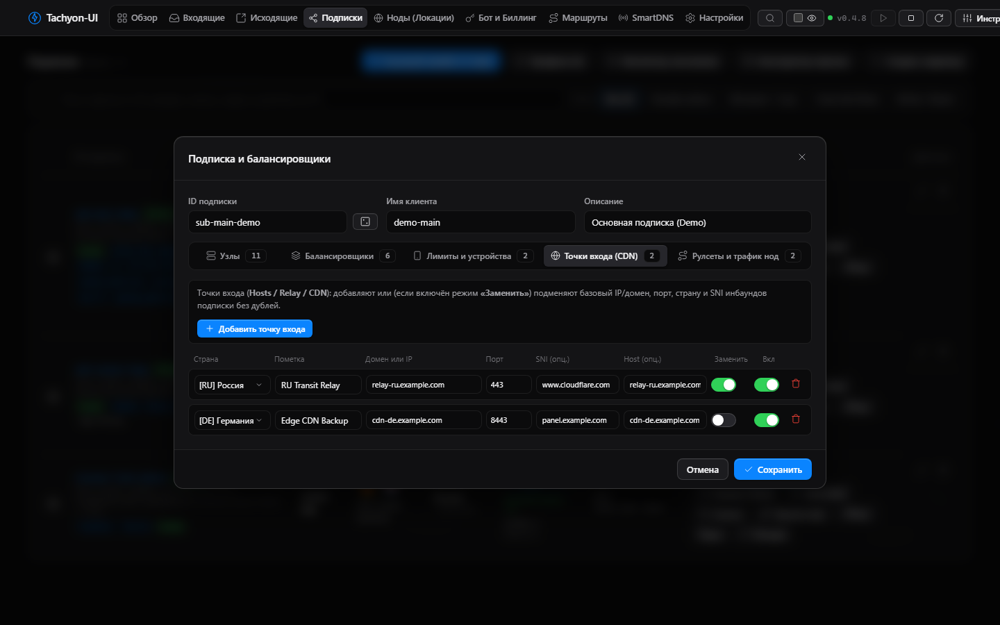 | 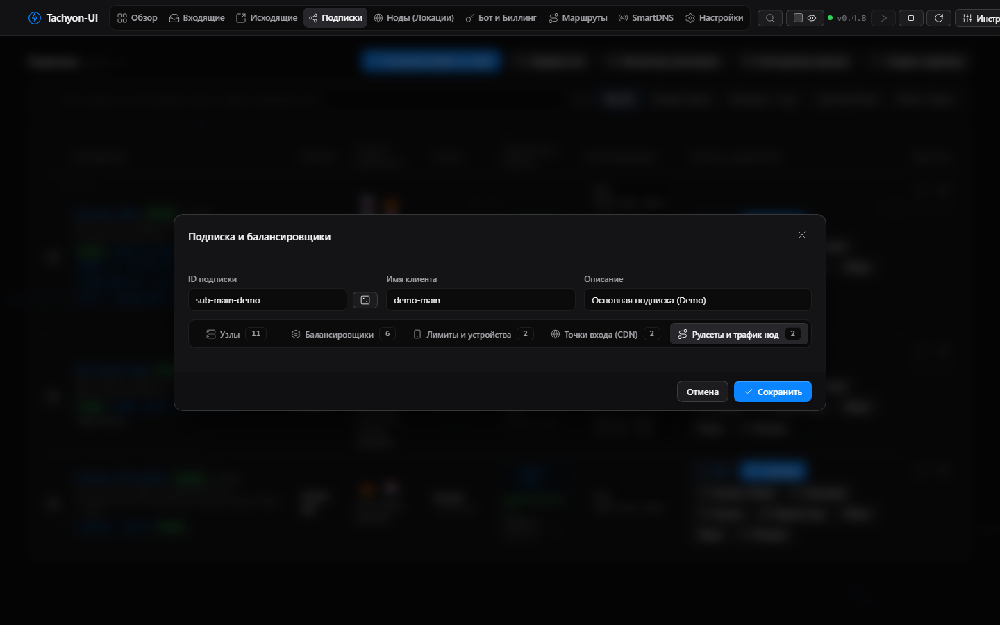 | 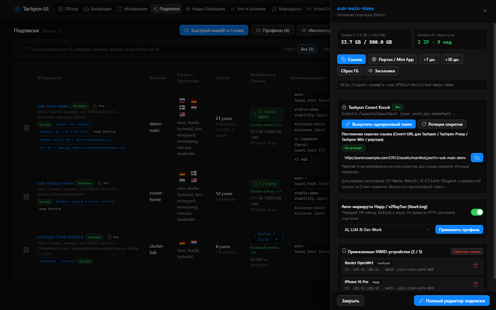 |

| Ссылки / Covert Knock / OpenWrt 1-Click / QR | Инспектор заголовков | Профили подписок |
| :---: | :---: | :---: |
| 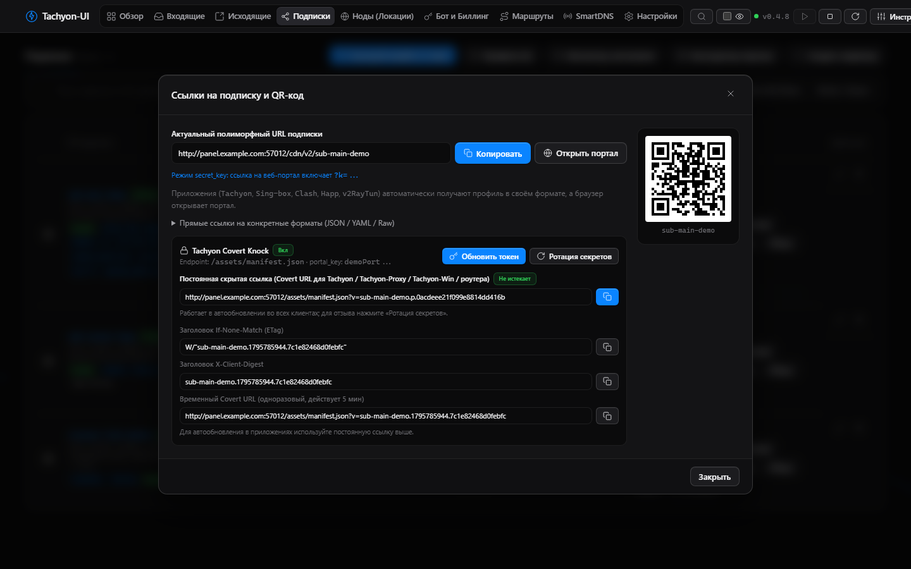 | 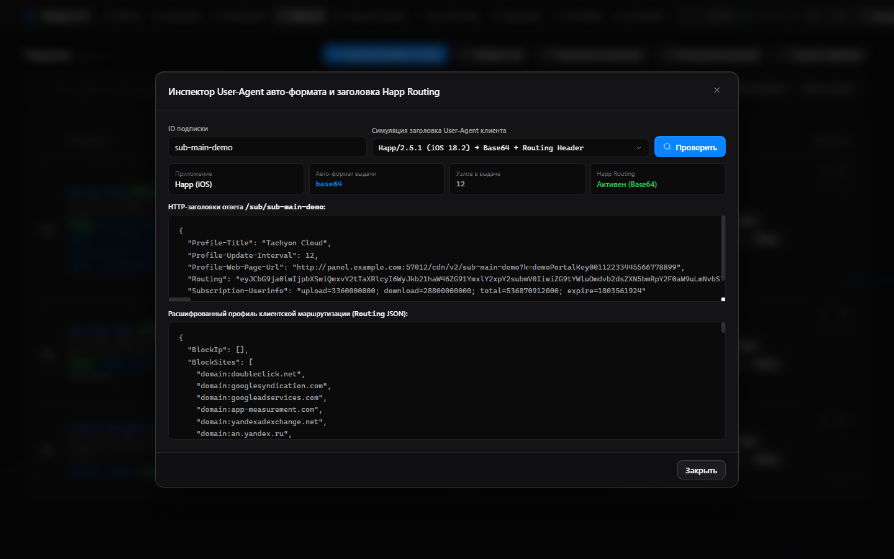 | 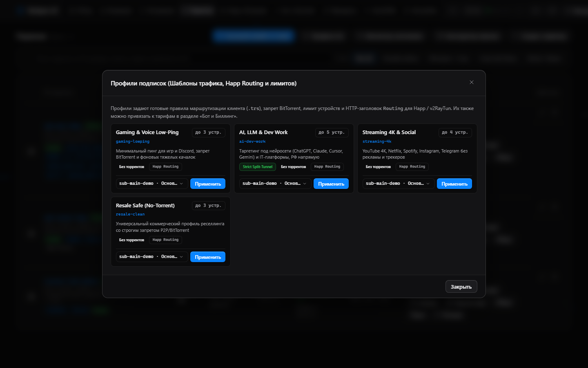 |

| Элемент UI | Где находится | Что делает (How) | Зачем нужен (Why) | Важные нюансы и частые ошибки |
| :--- | :--- | :--- | :--- | :--- |
| **Шапка редактора (`sub_id`, имя, ремарка)** | Верх модалки подписки | Позволяет задать или **переименовать на месте** `sub_id`, указать клиента и заметку. | Удобная адресация и организация клиентской базы. | При совпадении с существующим `sub_id` сервер вернёт ошибку `409 Conflict`. |
| **Вкладка 0: `Узлы`** | Редактор подписки, вкладка 0 | Фильтрует локальные инбаунды и личные `Child`-ноды по странам и стекам (`REALITY`, `QUIC`, `TLS`, `STEALTH`, `VPN`), включает переключатель авто-подключения всех личных нод. | Определяет, какие серверы и протоколы попадут клиенту. | Для роутеров и клиентов с широким парком серверов включайте как TCP REALITY, так и QUIC/TewFai ноды. |
| **Вкладка 1: `Балансировщики`** | Редактор подписки, вкладка 1 | Кнопка **`+ По странам (auto-fi, auto-de...)`**, кнопки по стекам и ручной конструктор `urltest` (12 режимов), `selector`, `chain`. | Отдаёт клиентским приложениям готовые группы автовыбора лучшего сервера. | При сборке профиля движок автоматически отфильтровывает несуществующие теги и не включает пустые группы. |
| **Вкладка 2: `Лимиты и устройства`** | Редактор подписки, вкладка 2 | Лимит трафика (ГБ), стратегия автосброса (`none`, `daily`, `weekly`, `monthly`), кнопка **Сбросить трафик**, дата/дни истечения, **Старт при 1-м входе (`On-Hold`)**, `device_limit`, **`strict_hwid`**, список привязанных HWID-устройств (с отвязкой) и радар Anti-Share. | Жёсткий контроль квот и защита от передачи подписки третьим лицам. | `strict_hwid` требует, чтобы клиентское приложение передавало заголовок `x-hwid`; при работе с роутерами или старыми клиентами оставляйте его выключенным либо не ограничивайте `device_limit`. |
| **Вкладка 3: `Точки входа (CDN)`** | Редактор подписки, вкладка 3 | Добавляет или подменяет (`Заменить` / `replace_default`) домен/IP, порт, SNI и `Host` в выдаваемых конфигурациях. | Подключение через CDN (`cdn.example.com`), домены-зеркала или входные релеи без дублирования инбаундов. | При активном `Unified 443 Front` L7-узлы автоматически экспортируются на порт `:443` со строгим TLS. |
| **Вкладка 4: `Рулсеты и трафик нод`** | Редактор подписки, вкладка 4 | Привязка конкретных нод к `.trs` спискам, типам трафика или портам (`only_this` / `prefer_node`), быстрые пресеты (*Без BitTorrent*, *Только AI*, *Только Стриминг* и т.д.), тумблер **`Happ Routing`** и **`strict_routing_only`**. | Разделение трафика по серверам (например, стриминг только через одну ноду, всё остальное напрямую). | **`strict_routing_only`** переводит клиентский `final` в `direct` и принудительно блокирует на сервере `tachyon-core` трафик мимо выбранных правил. |
| **360°-дровер подписки** | Клик по имени/ID или кнопке `360°` | Боковая карточка: трафик `↑ / ↓`, онлайн-IP, кнопка **`Сбросить сессии`**, управление Covert Knock, тумблер `Happ Routing`, выбор профиля, отвязка HWID и быстрые кнопки (`+30д`, `Сбросить трафик`, `Ротировать`, `Удалить`). | Полный срез по абоненту без перекрытия остальной таблицы. | Счётчик онлайна суммирует IP со всех синхронизированных нод кластера. |
| **Окно `Ссылки / Knock / OpenWrt 1-Click / QR`** | Кнопка `Ссылки / QR` | Полиморфный URL, ссылка на веб-портал (`?k=` при `sub_portal_guard`), прямые ссылки по форматам (`?format=singbox`, `clash`, `tachyon`, `raw`, `sip008`, `openwrt`), команда **OpenWrt / Linux 1-Click SSH**, генератор **Covert Knock** (временный `±300` с и **постоянный Covert Knock URL** для роутера), ротация секретов и QR-код. | Удобная выдача ссылки под любое устройство — от iPhone до роутера Tachyon 2.0. | Для роутера OpenWrt / `Tachyon 2.0` используйте постоянный Covert Knock URL (`?v=...&fmt=tachyon`) или 1-Click SSH-команду. |

---

### Вкладка 5. Ноды / Кластер (`#nodes`, `Alt+5`)

| Кластер нод `Master → Child` | Модалка `+ Добавить ноду` |
| :---: | :---: |
| 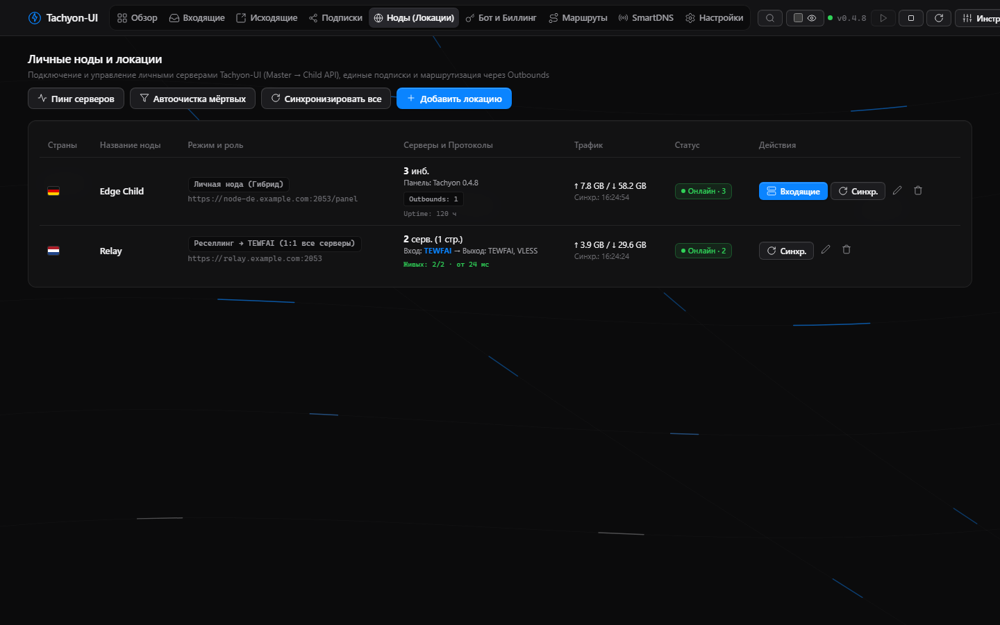 | 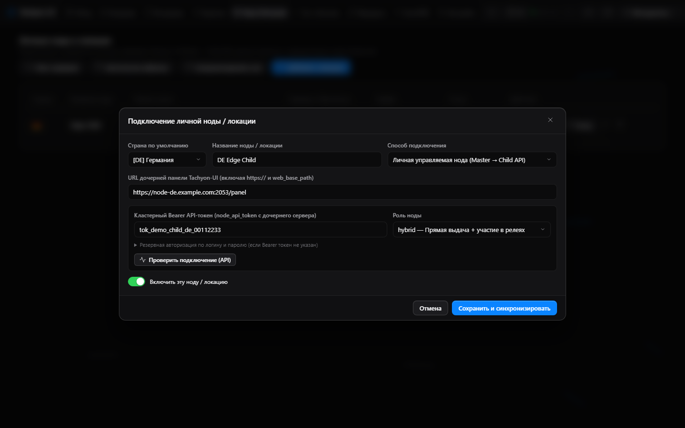 |

Раздел объединяет собственные серверы в кластер `Master → Child` и управляет подключением внешних источников серверов и каскадов.

#### 5.5.1. Тулбар, 4 режима подключения в `+ Добавить ноду` и Каскад-билдер

| Элемент UI | Где находится | Что делает (How) | Зачем нужен (Why) | Важные нюансы и частые ошибки |
| :--- | :--- | :--- | :--- | :--- |
| **Баннер режима доступа** | Верхняя плашка `#nodes` | Показывает ограничения базового режима (до 1 персональной агрегации внешних источников) либо статус активированного гранта. | Прозрачное пояснение доступных опций кластера и каскадного реселлинга. | Собственные серверы (`managed_tachyon_node`, `tachyon_node`) работают **всегда без ключа доступа**. |
| **`Синхронизировать все`** | Тулбар `#nodes` | Обновляет состав инбаундов, клиентов, `sub_configs`, HWID и внешних подписок по всем подключённым узлам. | Поддержание единого состояния по всему парку серверов. | Запускайте после смены портов, SNI или токенов на дочерних серверах. |
| **`Health Check всех нод` (+ `Auto-Clean`)** | Тулбар `#nodes` | Проверяет доступность и пинг каждой ноды; в режиме `Auto-Clean` автоматически удаляет недоступные внешние узлы и пересобирает каскады. | Автоматическая зачистка мёртвых локаций. | Не запускайте `Auto-Clean`, если ваш личный сервер временно перезагружается. |
| **`+ Добавить ноду`** | Правый край тулбара `#nodes` | Открывает окно добавления ноды с выбором одного из **4 режимов**: 1) **`managed_tachyon_node`** (полноценная дочерняя панель: `url`, `node_api_token`, роль `direct`/`hybrid`/`relay`, **`auto_export_outbounds`**, кнопки `Тест API`, `Входящие`, `Синхронизировать клиентов`, `Экспорт в outbound`); 2) **`tachyon_node`** (read-only подписка с другого сервера `tachyon-ui`); 3) **`sub_url`** (внешняя ссылка с настройкой `User-Agent`, `x-hwid`); 4) **`manual_uris`** (ручной список URI-ссылок). | Расширение географии локаций и построение мультисерверных подписок и мостов. | Для `managed_tachyon_node` скопируйте `node_api_token` со вкладки `Настройки → Cluster API` на дочернем сервере и обязательно нажмите **`Тест API`** перед сохранением. |
| **Кнопки карточки ноды (`Синхронизировать`, `Входящие / Инспекция`, `Мост / Каскад`, `Multi-Clone 1→N`, `Редактировать`, `Удалить`)** | Каждая карточка ноды | Быстрые операции над выбранным сервером: переход к инбаундам дочерней ноды, запуск каскад-билдера или правка настроек связи. | Оперативное управление конкретным сервером кластера. | Кнопка **`Входящие`** сразу открывает вкладку `Входящие` уже переключённой на эту ноду. |
| **Каскад-билдер (`Мост / Каскад`)** | Модалка каскада (из `#nodes` или `#inbounds`) | Позволяет выбрать входную точку (например, РФ-мост) и целевой зарубежный выход, задать имена тегов и выполнить **`Предпросмотр`** перед созданием (`Создать каскад`). | Атомарное создание связки `Inbound → Outbound + 1:1 правило маршрутизации` без ручных ошибок. | Всегда проверяйте коллизии портов в окне **`Предпросмотр`** до сохранения. |

---

### Вкладка 6. Бот и Биллинг (`#tgbot`, `Alt+6`)

| Вкладка Бот и Биллинг | Модалки тарифа и ваучеров |
| :---: | :---: |
| 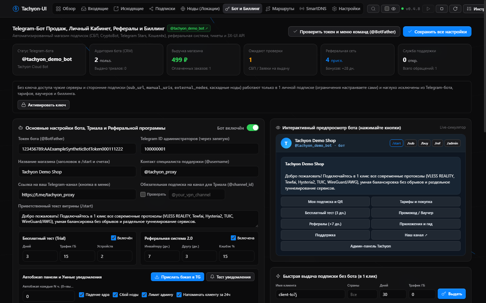 | 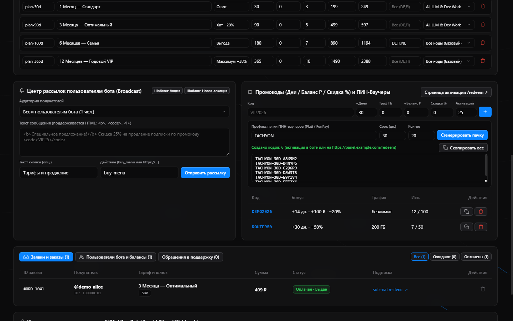 |

Полноценный встроенный биллинг, автоматический Telegram-бот, Telegram Mini App, витрина тарифов, ваучеры и CRM для обработки заказов и тикетов поддержки.

| Элемент UI | Где находится | Что делает (How) | Зачем нужен (Why) | Важные нюансы и частые ошибки |
| :--- | :--- | :--- | :--- | :--- |
| **KPI-строка (`Пользователи`, `Ожидающие заказы`, `Выручка`, `Тикеты`)** | Верх вкладки `#tgbot` | Отображает сводку по продажам и очереди поддержки. | Быстрая оценка нагрузки и конверсии бота. | В базовом режиме без коммерческого гранта выводится уведомление об ограничениях коммерческих продаж. |
| **Настройки бота и автоматизации (`bot_token`, `Проверить токен`, `admin_tg_ids`, Триал, Рефералка, Автобэкап в TG, Алерты админу)** | Левая/верхняя карточка настроек | Подключает бота к Telegram (polling или webhook), проверяет токен через Bot API, настраивает триал (дни/ГБ), реферальные бонусы, автоотправку бэкапов (`Бэкап сейчас`) и тестовые уведомления (`Тест алерта`). | Запуск полностью автономного бота выдачи и продления подписок. | Всегда нажимайте **`Проверить токен`** перед сохранением; укажите свой числовой Telegram ID в `admin_tg_ids` для получения алертов Watchdog и бэкапов. |
| **Настройки Mini App** | Блок веб-приложения внутри настроек бота | Задаёт URL/путь Telegram Mini App, тему и отображение кнопок внутри встроенного веб-кабинета Telegram. | Пользователь продлевает подписку и копирует ключи, не покидая Telegram. | Telegram требует валидного HTTPS-сертификата (ACME/Let's Encrypt) на домене Mini App. |
| **Live-симулятор бота** | Правая панель в `#tgbot` | Интерактивный макет экрана Telegram с кликабельными кнопками (`/start`, `Купить`, `Мой профиль`, `Подключиться`, `Поддержка`). | Визуальная проверка текстов, цен и навигации меню глазами клиента до запуска трафика. | Обновляется мгновенно по полям формы. |
| **Быстрая выдача подписки в 1 клик** | Карточка ручной выдачи | Поля: имя клиента, дни, трафик (ГБ), фильтр стран + кнопка **`Выдать подписку`**. | Мгновенное создание подписки по биллинг-шаблону с выдачей готовой ссылки при ручной продаже. | Удобно при приёме оплаты в личных сообщениях. |
| **Платёжные шлюзы (`СБП`, `@CryptoBot`, `Telegram Stars`, `Платёжная ссылка`)** | Карточка платёжных методов | Включает и настраивает реквизиты, токены API и курсы приёма оплаты. | Автоматизация оплаты тарифов в разных валютах и способах. | При ручном переводе по СБП заказы падают во вкладку CRM **`Заказы`** для ручного подтверждения администратором. |
| **Сетка тарифов + Модалка тарифа + `Заполнить рекомендуемыми пресетами`** | Карточка тарифной сетки | Позволяет создавать/редактировать планы (название, дни, ГБ, цена в `₽`/`USD`/`Stars`, лимит устройств, привязанный профиль подписки) или в 1 клик заполнить стандартную линейку (`1 мес / 3 мес / 1 год`). | Управление витриной тарифов в боте и Mini App. | Привязка к профилю подписки гарантирует, что покупатель сразу получит нужные правила маршрутизации. |
| **Центр рассылок** | Карточка массовых сообщений | Поле текста, выбор сегмента (`Все`, `С активной подпиской`, `Без подписки`, `Истёкшие`), опциональная кнопка со ссылкой и кнопка **`Отправить рассылку`**. | Информирование базы об обновлениях, акциях или техработах. | Всегда перепроверяйте выбранный сегмент, чтобы не отправить акцию для новых пользователей действующим подписчикам. |
| **Промокоды и Генератор пачки ваучеров (`/redeem`)** | Карточка промоакций и ваучеров | Создаёт скидочные/бонусные промокоды (`code`, дни, ГБ, скидка `%`, макс. использований) и генерирует пакеты одноразовых ваучеров (`prefix`, `days`, `count`). | Партнёрские раздачи, подарочные коды и маркетинг. | Ваучеры активируются как командой `/redeem` в боте, так и на скрытой веб-странице `redeem_path`. |
| **CRM (3 вкладки: `Заказы` / `Пользователи` / `Тикеты`) + Интеграция Webhook** | Нижняя часть `#tgbot` | **Заказы**: `Одобрить` / `Отклонить` / `Удалить`; **Пользователи**: поиск по TG ID/username, корректировка баланса/дней/бана и личное сообщение; **Тикеты**: ответ пользователю прямо из панели и закрытие; **Webhook**: интеграция внешних событий биллинга. | Полноценная поддержка клиентов и управление заказами внутри панели. | Нажатие **`Одобрить`** в заказе автоматически создаёт или продлевает подписку клиента и отправляет ему уведомление в Telegram. |

---

### Вкладка 7. Маршруты (`#routes`, `Alt+7`)

| Карта потока трафика (Flow) | Конструктор правила маршрутизации | 2-уровневый симулятор маршрутов |
| :---: | :---: | :---: |
| 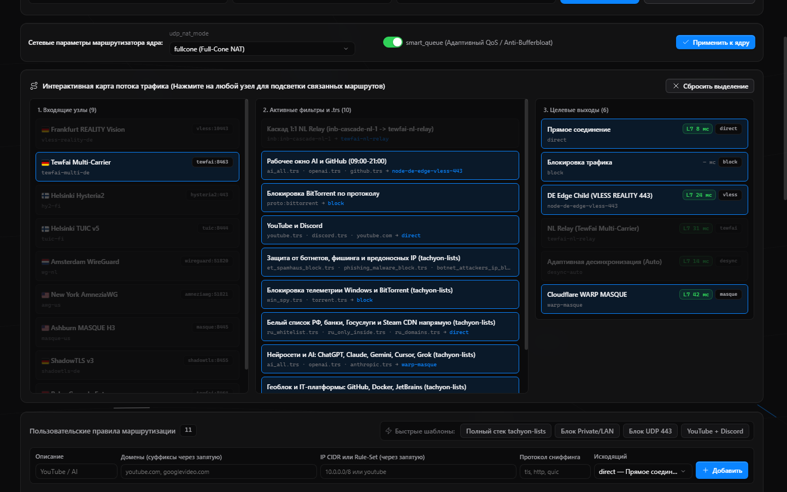 | 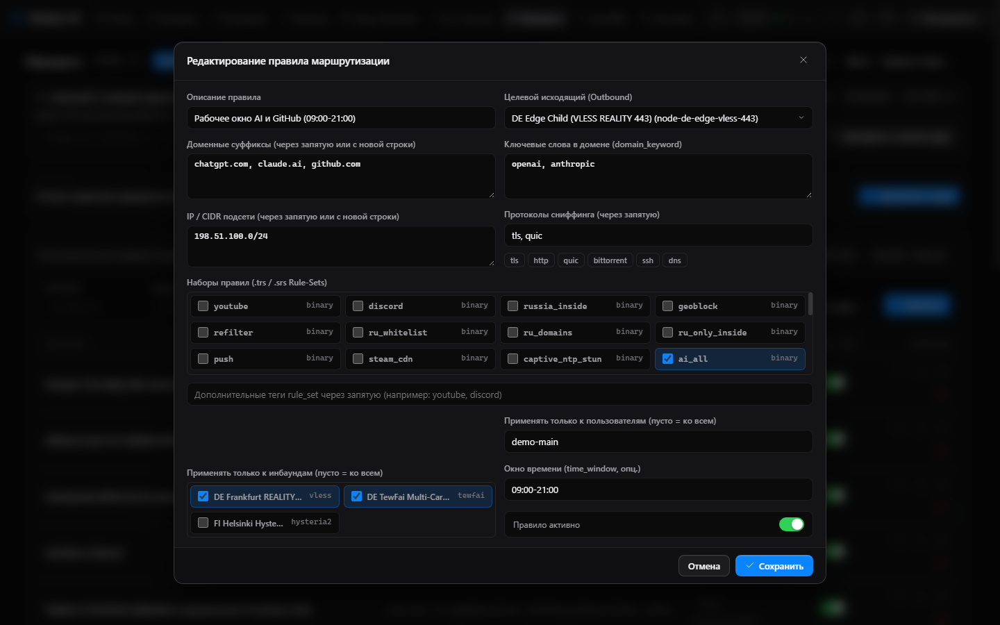 | 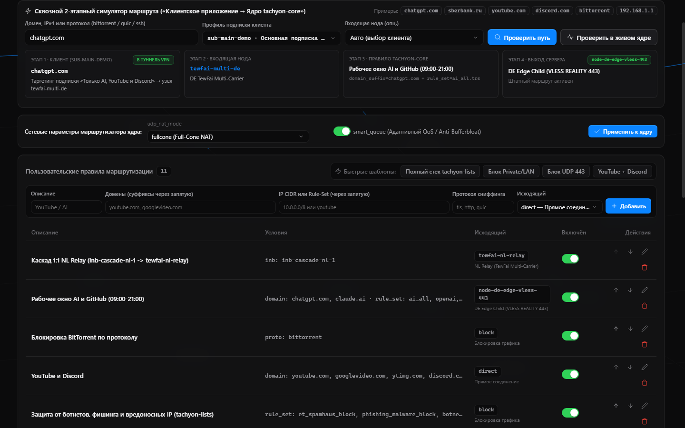 |

Раздел отвечает за маршрутизацию трафика внутри `tachyon-core`, работу с бинарными списками блокировок и сервисов (`.trs` / `tachyon-lists`), режимами NAT/очередей и проверку правил.

| Элемент UI | Где находится | Что делает (How) | Зачем нужен (Why) | Важные нюансы и частые ошибки |
| :--- | :--- | :--- | :--- | :--- |
| **Переключатель вида (`Таблица` / `Flow-карта`)** | Верхняя панель `#routes` | Переключает между списком правил и интерактивной 3-колоночной топологией `Инбаунд → Правило / .trs → Выход`. | Наглядный аудит логики маршрутизации и выявление «затенённых» правил. | На Flow-карте сразу видны все связи и висячие (неиспользуемые) правила. |
| **Глобальные флаги ядра (`udp_nat_mode`, `smart_queue`)** | Панель опций `#routes` | Задают системный режим обработки UDP NAT (`fullcone` / `symmetric` и др.) и умную приоритизацию очереди трафика (`smart_queue`). | `udp_nat_mode` критичен для онлайн-игр, WebRTC, звонков и QUIC; `smart_queue` снижает bufferbloat и задержки при закачках. | После переключения обязательно нажмите `Применить` на дашборде. |
| **`Конечный outbound` (`Final Outbound`)** | Панель маршрутов | Задаёт выход по умолчанию для любого трафика, не попавшего ни под одно правило выше. | Определяет стратегию: «всё идёт напрямую, а выбранные списки через VPN» (`direct`) или «всё в VPN, кроме исключений» (выбранный прокси/балансировщик). | Частая ошибка — поставить `block` в `Final Outbound` и потерять доступ ко всем неучтённым сайтам. |
| **Кнопка `Установить пакет tachyon-lists`** | Блок наборов правил (`.trs`) | В 1 клик скачивает и подключает оптимизированные бинарные базы `.trs` (РФ-сервисы, заблокированные ресурсы, реклама/трекеры/фишинг, AI, стриминг, игры). | Готовая база раздельной маршрутизации без ручного сбора доменов. | Бинарные `.trs` файлы загружаются через `mmap` практически без расхода RAM; после установки нажмите `Применить`. |
| **Кнопка `+ Добавить список правил`** | Блок `Rule Sets` | Подключает локальный или удалённый `.trs`/`.srs`/`.json` список (`type`: `local` / `remote`, `format`, `url`, `download_detour`, `update_interval`). | Использование сторонних или собственных списков блокировки рекламы и маршрутизации. | Если удалённый URL списка заблокирован напрямую с VPS, укажите `download_detour` через рабочий outbound. |
| **Кнопка `+ Добавить правило` + стрелки порядка, Вкл/Выкл, Редактировать, Удалить** | Над таблицей правил и в строках | Открывает конструктор правила: приоритет (сверху вниз), `inbound`-теги, `auth_user`, `domain`, `domain_suffix`, `domain_keyword`, `ip_cidr`, `port`, `protocol` (`bittorrent`, `quic`, `tls`, `dns`, `ssh`), `network`, `time_window`, `rule_set` (списки `.trs` и сервисов блокировок) и целевой `outbound` (`direct`, `block`, любой прокси/балансировщик). | Точное разделение, блокировка рекламы/торрентов и направление категорий трафика по разным странам. | **Правила проверяются строго сверху вниз — выигрывает первое совпадение.** Используйте стрелки вверх/вниз для выставления приоритетов (например, `block` для торрентов или рекламы ставьте выше общих правил). |
| **Спойлер авто-релеев 1:1** | Сворачиваемый блок под таблицей правил | Прячет автоматически сгенерированные правила мостов и каскадов 1:1. | Чтобы служебные правила не загромождали рабочую таблицу. | Раскрывайте только при отладке конкретного транзитного моста. |
| **2-уровневый Симулятор маршрутов (`Симулировать` + `Проверить в живом ядре`)** | Нижний блок `#routes` | Уровень 1 прогоняет введённый домен/IP (с опциональными `sub_id` и `inbound_tag`) по таблице правил панели; Уровень 2 проверяет реальное прохождение в запущенном `tachyon-core` с учётом live-DNS и `.trs`. | Проверка новых правил до и после `Apply` без тестирования на клиентских устройствах. | Если Уровень 1 показывает новое правило, а Уровень 2 — старое, вы забыли нажать `Применить` на дашборде. |

> [!TIP]
> **SmartDNS и сервисы блокировок:** если вам нужно блокировать рекламу/фишинг и выборочно проксировать сервисы на устройствах **без VPN-клиента** (PlayStation, Xbox, SmartTV, приставки), используйте соседнюю вкладку **SmartDNS / GeoHide (`Alt+8`)**, где подключены те же каталоги `tachyon-lists` и встроенный AdBlock.

---

### Вкладка 8. SmartDNS / GeoHide (`#smartdns`, `Alt+8`)

| Обзор SmartDNS v2 / GeoHide | Мастер настройки SmartDNS (4 шага) |
| :---: | :---: |
| 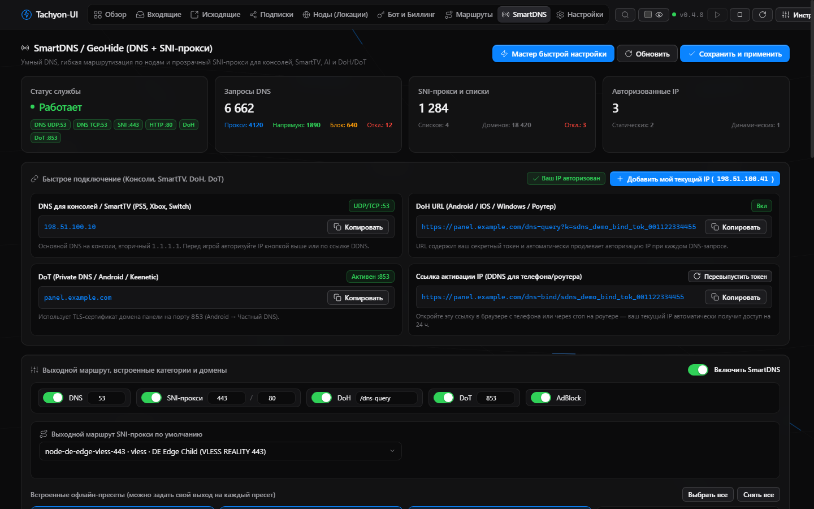 | 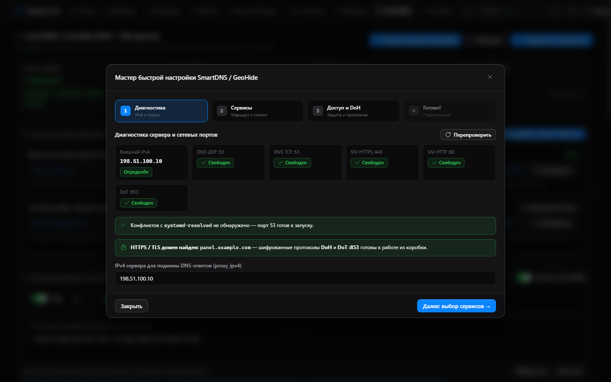 |

Встроенный pure-Rust DNS-сервер (`:53`, `DoT :853`, `DoH /dns-query`) и прозрачный SNI-прокси (`:443` / `:80`) для консолей, SmartTV и устройств без VPN-приложений.

| Элемент UI | Где находится | Что делает (How) | Зачем нужен (Why) | Важные нюансы и частые ошибки |
| :--- | :--- | :--- | :--- | :--- |
| **Баннер предупреждений и 4 KPI-карточки слушателей** | Верх вкладки `#smartdns` | Предупреждает о конфликтах портов (например, занятый `systemd-resolved` порт `:53`), отсутствии TLS или egress; KPI показывают реальный статус `DNS :53`, `DoT :853`, `DoH :443/:80` и число обслуженных доменов. | Мгновенная диагностика готовности всех DNS и SNI-прокси слушателей. | При конфликте на `:53` Мастер предлагает авто-фоллбэк от `systemd-resolved`. |
| **`Авторизовать мой IP` (врем. / пост.)** | Блок `Быстрое подключение` | Добавляет текущий IP браузера администратора в белый список SmartDNS (`POST /api/smart-dns/bind-my-ip`). | Защита от Open Resolver / Open Proxy: посторонние из интернета не смогут использовать ваш DNS/SNI-прокси. | Если у домашнего провайдера динамический IP, используйте **DDNS Bind URL** (`/dns-bind/<token>`). |
| **Реквизиты подключения + Кнопка `Без https://`** | Блок `Быстрое подключение` | Показывает готовые адреса для DNS `:53`, DoT `:853`, полный DoH URL, DDNS Bind URL и кнопку ротации токена. Кнопка **`Без https://`** копирует DoH-адрес в виде `domain.tld/dns-query?...` без схемы. | Быстрое копирование без опечаток для iOS, Android, Windows и роутеров. | **Критично для роутеров:** прошивки **Keenetic**, **OpenWrt** и др. подставляют `https://` сами или требуют домен и путь без протокола — в них вставляйте результат именно кнопки **`Без https://`**. |
| **Тумблеры служб, порты и `upstream_dns`** | Карточка настроек служб | Включает/отключает SmartDNS, задаёт порты DNS (`53`), DoT (`853`), SNI-Proxy (`443`/`80`), DoH-путь и внешний `upstream_dns` (`1.1.1.1`, `9.9.9.9`) для не-проксируемых доменов. | Тонкая настройка сетевых интерфейсов и апстрима. | При использовании `Unified 443 Front` для привязки клиентских IP по `/dns-bind/<token>` и DoH-токенов используйте прямой порт панели (напр. `2053`) или DoT `:853`. |
| **Global Egress + `Экспорт управляемой ноды в Egress`** | Карточка маршрутизации выхода | Выбирает глобальный выход (`direct`, локальный `socks5` или любой `outbound:<tag>`) и позволяет в 1 клик превратить дочернюю ноду кластера в выходной шлюз SmartDNS через локальный SOCKS5-мост. | Пропуск SNI-трафика консолей/ТВ через зарубежный сервер кластера. | — |
| **6 встроенных пресетов с per-preset Egress** | Сетка пресетов в `#smartdns` | Готовые пакеты: `Консоли (PS5 / Xbox / Switch)`, `AI и нейросети`, `Стриминг и музыка`, `Игровые лаунчеры`, `Соцсети и мессенджеры`, `SmartTV и медиаплееры` — каждый со своим тумблером и выбором индивидуального egress. | Гибкое распределение: например, AI-сервисы через США, а стриминг через другой узел. | Работает независимо от основного глобального egress. |
| **Каталог `tachyon-lists` + AdBlock / Кастомные листы** | Таблица каталогов и текстовые поля доменов | Синхронизация и подключение категорийных листов `.trs`/`.lst`, встроенный AdBlock (блокировка рекламы/трекеров на уровне DNS) и ручные списки доменов/hosts-переопределений. | Расширение списка проксируемых сервисов и блокировка рекламы на ТВ/консолях без софта. | Не забудьте сохранить изменения после выбора листов. |
| **Контроль доступа (`allow_public`, статические/динамические IP)** | Карточка безопасности доступа | Белый список IP/CIDR, просмотр и удаление динамически привязанных IP, тумблер `allow_public`. | Предотвращение несанкционированного использования сервера. | **Никогда не включайте `allow_public`** на открытом порту `:53` в интернете — ваш сервер немедленно используют для DNS-амплификационных DDoS-атак. |
| **Live-лог DNS / SNI** | Нижний блок `#smartdns` | Показывает последние запросы в реальном времени с фильтром по домену, IP клиента и сработавшему действию (`DIRECT` / `PROXY` / `BLOCK`). | Моментальная проверка того, что приставка или ТВ действительно шлют запросы на ваш VPS. | — |
| **`Мастер настройки SmartDNS` (4 шага)** | Кнопка запуска Мастера в шапке `#smartdns` | Пошагово проводит через: 1) Проверку портов и выбор роли; 2) Выбор Egress; 3) Выбор 6 пресетов и AdBlock; 4) Готовые реквизиты подключения (включая `Без https://` и DDNS bind). | Полная настройка SmartDNS с нуля за 1 минуту. | Оптимальный способ первичного запуска. |

---

### Вкладка 9. Настройки (`#settings`, `Alt+9`)

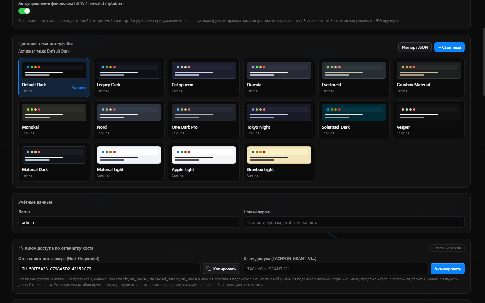

Центр системных параметров: Мастер стелс-развёртывания (маскировка сайта, домен, `Unified 443 Front`, TLS/ACME, скрытые пути и Self-Audit), безопасность учётных данных, файрвол, бэкапы, кластерный токен, автоматика самовосстановления, интеграция Cloudflare, брендинг портала и персонализация тем.

#### 5.9.1. Мастер стелс-развёртывания и маскировки (4 шага)

| Шаг 1: Сайт-прикрытие и Honeypot | Шаг 2: Домен, Профили и `Unified 443 Front` | Шаги 3–4: Скрытые пути, Knock и Self-Audit |
| :---: | :---: | :---: |
| 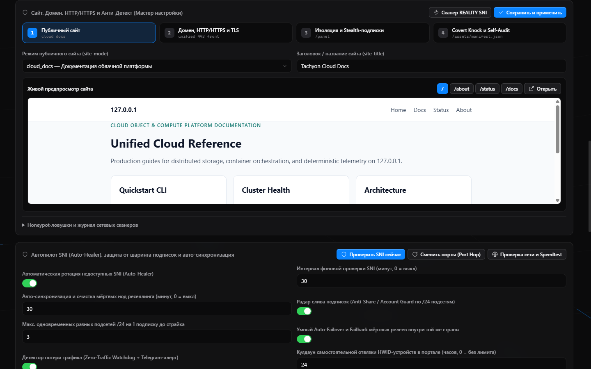 | 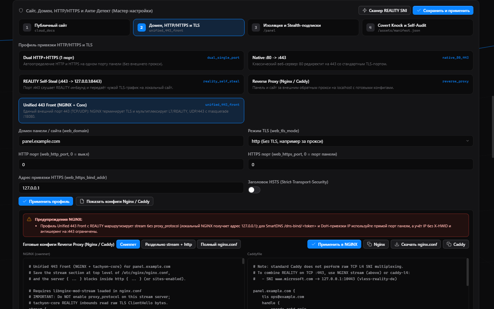 | 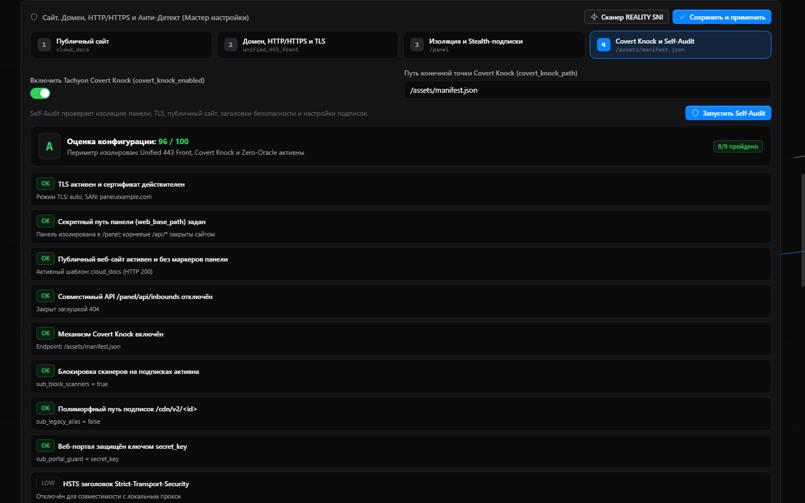 |

| Шаг Мастера | Элементы UI и кнопки | Что делает (How) & Зачем нужен (Why) | Важные нюансы и частые ошибки |
| :--- | :--- | :--- | :--- |
| **Шаг 1: Публичный сайт (`SiteEngine`) и Honeypot** | Выбор режима (6 встроенных многостраничных шаблонов: `blank_nginx`, `cloud_docs`, `status_page`, `devops_blog`, `corporate_it`, `maintenance` / свой HTML-редактор / **`Загрузить ZIP-архив сайта`** до 15 МБ), живой предпросмотр, сброс сайта; журнал **Honeypot** + кнопка очистки. | Разворачивает правдоподобный веб-сайт на корне домена для защиты от активного зондирования и фиксирует запросы сканеров к `/.env`, `/wp-admin`, `/phpmyadmin`. | При открытии корня домена обычный посетитель и цензор видят стандартный сайт и `200 OK` без признаков VPN-панели. |
| **Шаг 2: Домен, Профили и TLS / ACME** | Поле домена (`panel.example.com`), выбор одного из 5 профилей (`dual_single_port`, `native_80_443`, `reality_self_steal`, `reverse_proxy`, **`unified_443_front`**), кнопки **`Применить профиль`**, **`Применить NGINX`**, **`Получить сниппет прокси`**, **`Выпустить Let's Encrypt ACME TLS`**, **`Самоподписанный TLS`**, таблица статуса X.509-сертификатов. | Настраивает единую точку входа `:443` и автоматический выпуск/продление HTTPS-сертификатов (`HTTP-01` или `Cloudflare DNS-01`). | `Unified 443 Front` делит единый порт `443` между сайтом, панелью, подписками, L7-инбаундами, `REALITY` (без `proxy_protocol`) и `443/udp` (Hysteria2/TUIC с loopback-маскарадом `:18080`). Перед применением профиля автоматически создаётся снимок-откат. |
| **Шаг 3: Скрытые пути и защита подписок** | Поле `web_base_path` (например `/p-8f3c21a9`) + генератор, стиль полиморфных URL подписок (`sub`, `static_feed`, `cdn_v2`, `rss_updates`), фильтр сканеров (`sub_block_scanners`), **`sub_portal_guard`** (режим `secret_key` с `?k=`), путь активации ваучеров **`redeem_path`**, отключение совместимости со сторонними путями входа. | Убирает панель и выдачу подписок с предсказуемых путей `/`, `/login`, `/sub`, исключая обнаружение сканерами (Zero-Oracle 404). | **Обязательно сохраните новый `web_base_path` в закладки перед нажатием `Сохранить`**, иначе потеряете URL входа (восстановление возможно через CLI `tachyon-panel info`). |
| **Шаг 4: Covert Knock и Web Self-Audit** | Настройки скрытого стука (`Covert Knock`), кнопка **`Запустить Web Self-Audit`** и таблица 9-критериальной оценки (`0–100`). | Проверяет собственный домен снаружи: отсутствие утечек заголовков панели, валидность TLS, реакцию на несуществующие пути и качество прикрытия. | Целевой показатель после полной настройки всех 4 шагов — `90–100` баллов. |

#### 5.9.2. Остальные карточки вкладки `Настройки`

| Карточка / Элемент UI | Где находится | Что делает (How) | Зачем нужен (Why) | Важные нюансы и частые ошибки |
| :--- | :--- | :--- | :--- | :--- |
| **Резервное копирование и восстановление** | `#settings`, карточка бэкапа | Кнопки **`Скачать бэкап (JSON)`** (`GET /api/backup`) и **`Восстановить из файла`** (`POST /api/restore`). | Перенос всей конфигурации (ноды, подписки, правила, настройки) на новый сервер и страхование от сбоев. | **Файл бэкапа содержит приватные ключи и токены** — храните его только в зашифрованном виде. |
| **Настройки панели и Авто-файрвол** | `#settings`, основная карточка | Поля `web_base_path`, `public_host` (`panel.example.com` или `198.51.100.10`), порт панели, уровень логов и тумблер **`auto_firewall_enabled`** (поддержка `ufw` / `firewall-cmd` / `iptables`). | Управление точкой входа, базовым адресом для ссылок/подписок и автоматическим открытием/закрытием портов инбаундов и SmartDNS. | Авто-файрвол помечает правила тегом `tachyon-ui:managed` и не трогает SSH и ручные правила администратора. |
| **Учётные данные администратора** | `#settings`, карточка безопасности | Поля нового логина, текущего и нового пароля + кнопка сохранения. | Смена дефолтных данных сразу после установки. | После смены потребуется заново войти в панель с новым паролем. |
| **Оформление (16 тем + Редактор)** | `#settings`, карточка `Цветовая тема интерфейса` | Сетка превью 16 встроенных тем + пользовательские темы + кнопки `Импорт JSON` и `+ Своя тема`. | Быстрое сравнение и настройка визуальной палитры. | Дублирует переключатель тем из `Topbar` в более наглядном карточном виде. |
| **Ключ доступа (`Access Grant`)** | `#settings` (отображается при включённом `TACHYON_GRANT_UI=1`) | Показывает отпечаток хоста (`TH-...`), поле ввода токена `TACHYON-GRANT-V1`, кнопки **`Активировать грант`** и **`Сбросить`**. | Активация расширенных функций (коммерческий биллинг, сторонние `sub_url`/`manual_uris`, каскадный реселлинг и `1→N` клонирование). | Для личных серверов и локальных протоколов ключ доступа не требуется. |
| **Cluster API (`Node API Token`)** | `#settings`, карточка кластерного API | Показывает `node_api_token` и `instance_id` + кнопка **`Перевыпустить токен`**. | Авторизация подключений к этому серверу со стороны `Master`-панели в роли управляемой `Child`-ноды. | После перевыпуска токена обязательно обновите его на `Master`-панели во вкладке `Ноды`. |
| **Автоматика (`Auto-Healer`, `Anti-Share`, `Failover`, `Watchdog`)** | `#settings`, карточка фоновых служб | Настройка интервалов проверки SNI (`auto_heal_interval_mins`), порога одновременных `/24`-подсетей и страйков `Anti-Share`, автопереключения релеев (`relay_auto_failover`) и детектора нулевого трафика (`tspu_watchdog_enabled`). | Автономное поддержание работоспособности 24/7 и защита от шеринга аккаунтов. | Слишком жёсткий порог `Anti-Share` (1 подсеть) может давать ложные срабатывания при переходе пользователя с Wi-Fi на мобильную сеть. |
| **Cloudflare DNS API** | `#settings`, карточка интеграции Cloudflare | Поля `API Token`, `Zone ID`, имя DNS-записи и резервные IP; кнопки проверки записей и переключения A/AAAA/CDN. | Быстрая смена IP домена при переключении на резерв или выпуске сертификатов DNS-01. | Требует токен с правами `Zone.DNS: Edit`. |
| **Конструктор портала подписки** | `#settings`, карточка брендинга портала | Название бренда, описание, логотип, настройка видимости блоков, выбор белого списка клиентских приложений и режима `sub_portal_guard`. | Оформление понятной веб-страницы для пользователей вместо сырых ссылок. | — |
| **Параметры профиля клиента по умолчанию** | `#settings`, карточка дефолтов | Значения по умолчанию для новых подписок: имя профиля, `profile-update-interval`, DNS, MTU и флаги split-tunneling. | Ускорение создания новых клиентских подписок с единообразными заголовками. | — |

---

## 6. Сервисные модальные окна (Диагностика, Обновление и Аудит)

Эти окна вызываются из меню **Инструменты**, верхней панели (`Topbar`) или быстрых кнопок на дашборде (`Обзор`).

| Центр обновлений ядра и панели | Проверка сети и Speedtest |
| :---: | :---: |
| 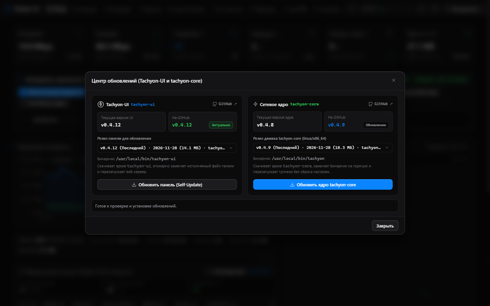 | 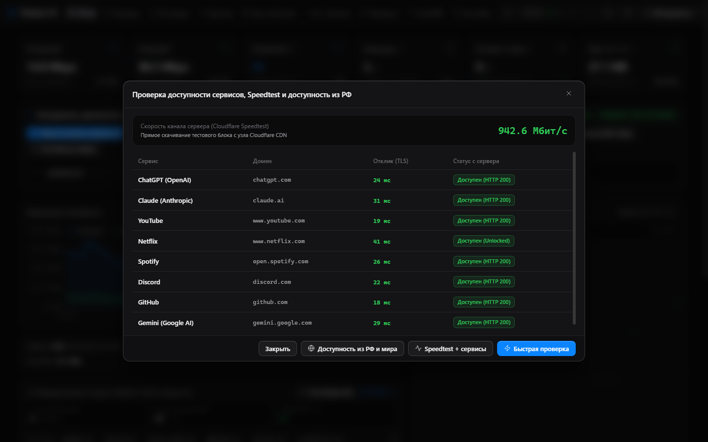 |

| 5-вкладочная консоль диагностики ядра | История снимков и откат |
| :---: | :---: |
| 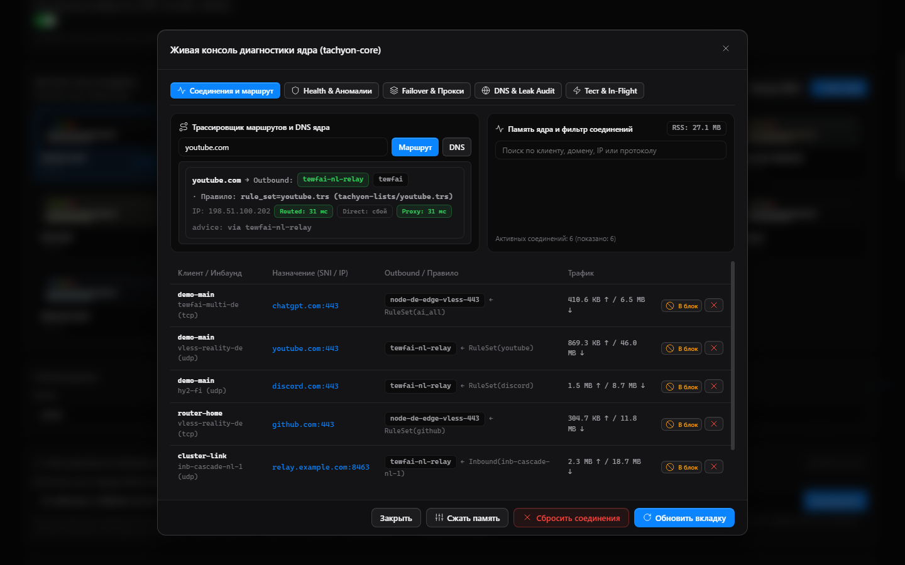 | 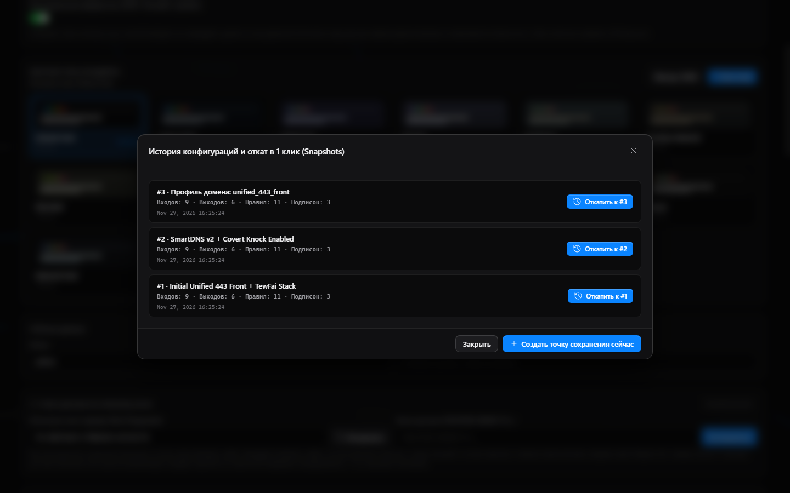 |

| Модальное окно | Откуда открывается | Что внутри и как работает (How / Why) | Важные нюансы и частые ошибки |
| :--- | :--- | :--- | :--- |
| **Консоль диагностики ядра** *(5 вкладок)* | `Инструменты → Диагностика ядра` или дашборд | **1. `conns` (Соединения)**: живые сессии, трассировщик, кик/блокировка, `Trim RAM`. **2. `health` (Здоровье и аномалии)**: RSS-память, файловые дескрипторы, RTT, success rate, статус Circuit-Breaker, журнал аномалий. **3. `failover` (Резервирование)**: переключение/возврат failover-групп, live-селекторы, сброс breaker'ов. **4. `dns_leak` (Утечки DNS и тест)**: сравнение DNS ядра и прямого UDP:53, сброс DNS-кэша (`POST /api/core/dns/flush`), аудит утечек IPv4/IPv6/WebRTC. **5. `test_flight` (Тест & In-Flight)**: 8-этапный тест подключения (`DNS → Rule → Outbound → TCP → TLS → HTTP`) и просмотр/очистка зависших запросов. | Если клиенты жалуются на недоступность отдельных сайтов при живом подключении, начинайте диагностику со вкладок **`dns_leak`** и **`test_flight`**. |
| **Центр обновлений (`tachyon-core` и `tachyon-ui`)** | `Инструменты → Центр обновлений` или клик по версии ядра в `Topbar` | Загружает списки релизов с GitHub; кнопка обновления **`tachyon-core`** (`POST /api/core/update`) скачивает и подменяет бинарник ядра, кнопка **`Обновить панель`** (`POST /api/panel/self-update`) обновляет сам бинарник панели. | Перед обновлением сделайте снимок и JSON-бэкап; обновление панели вызывает короткий перезапуск веб-сервера. |
| **Проверка сети и Speedtest** | `Инструменты → Проверка сети и Speedtest` или дашборд | Чекбокс **Включить Speedtest**, кнопка **`Запустить проверку`** (тест разблокировки стримингов, AI-платформ и гео-доступности + замер скорости через CDN) и кнопка **`RKN Check`**. | Запускайте сразу после аренды нового VPS или смены выходного outbound, чтобы заранее узнать ограничения IP. |
| **История снимков** | `Инструменты → История снимков` или дашборд | Список точек восстановления (до `10` ревизий в кольцевом буфере), кнопка **`Создать снимок сейчас`** и кнопка **`Восстановить (Restore)`** напротив каждой ревизии. | Восстановление возвращает состояние настроек, инбаундов, маршрутов и подписок; после отката нажмите `Применить` для синхронизации работающего ядра. |
| **Просмотр конфига JSON** | Дашборд → кнопка `Конфиг` | Показывает финальный JSON-конфиг `tachyon-core` (`GET /api/config-preview`) с кнопкой копирования в буфер. | Помогает верифицировать итоговый порядок правил и сгенерированные блоки без входа в SSH. |
