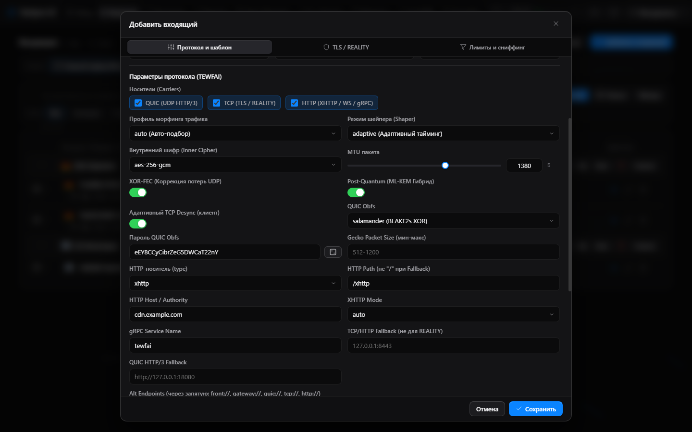
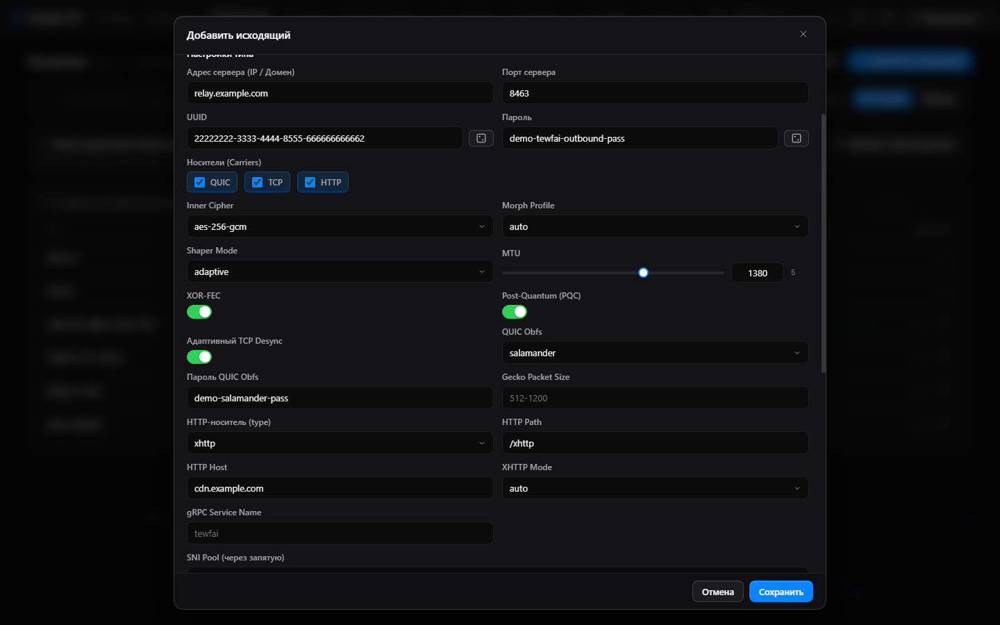

# 01. TewFai

| Параметр | Значение |
| :--- | :--- |
| **Роль в панели `tachyon-ui`** | `Inbound` + `Outbound` (нативный флагманский протокол `tachyon-core`) |
| **L4-транспорт** | `TCP` (TLS 1.3 / REALITY / HTTP-носители `xhttp`, `ws`, `grpc`, `httpupgrade`, `http`) и/или `UDP` (QUIC v1 HTTP/3 ALPN `h3`) |
| **TLS / REALITY / ACME** | Поддерживает `none`, `tls`, `reality`; пресет по умолчанию — `REALITY` (для QUIC в связке с REALITY поднимается self-signed `h3`); ACME управляется панелью `tachyon-ui` |
| **Свой домен** | Не обязателен при `REALITY`; обязателен, если используете сертификатный `tls` без `insecure` |

---

## Зачем нужен и как устроен в `tachyon-core`

Представьте модульный поезд, который умеет на ходу переставлять колёсные пары: на свободном участке он летит по скоростному шоссе (QUIC/UDP), при блокировке или потерях UDP без разрыва пользовательских соединений переходит на рельсы (TCP + REALITY или HTTP-носитель), а к каждой четвёрке хрупких UDP-пакетов прикладывает контрольную копию (XOR-FEC), чтобы восстанавливать потери без повторного запроса.

Внутри `tachyon-core 0.6.9` протокол **TewFai** разделяет **уровень сессии** и **транспортные носители**:
- **Единая сессия**: мультиплексирует TCP-потоки и UDP-дейтаграммы, аутентифицирует клиентов по PSK на базе `uuid` и защищает трафик шифрованием (X25519 + опциональный гибридный постквантовый обмен **ML-KEM-768**).
- **Мульти-носитель (`transport`)**: одновременно или в режиме гонки (`race_delay_ms`) использует `quic`, `tcp` и `http` (`xhttp`, `ws`, `grpc`, `httpupgrade`, `http`), поддерживая бесшовное переключение (`handover` по таймауту застоя `stall_timeout_ms`, пингу `ping_timeout_ms` и ротации `rotate_secs` / `rotate_mb`).
- **Защита от анализа трафика**: профили морфинга (`morph_profile`), шейпер (`shaper.mode`), обфускация QUIC (`salamander` / `gecko`), клиентская десинхронизация TCP (`desync`), пул SNI (`sni_pool`) и ротация портов (`server_ports`).

---

## Скриншот формы в панели





---

## Пошаговая настройка в `tachyon-ui`

### Встроенные пресеты панели
В окне **Входящие (`Inbounds`) → Добавить** выберите тип **`tewfai`** и один из четырёх готовых пресетов:

| Пресет | Порт | TLS-режим и SNI | Носители и ключевые опции |
| :--- | :---: | :--- | :--- |
| **TewfAI REALITY Multi-Carrier (TCP REALITY + QUIC Salamander + XHTTP)** *(по умолчанию)* | `8463` | `reality`, `www.microsoft.com` | `quic`, `tcp`, `http` (`xhttp` `/xhttp`, `auto`), `salamander`, `desync`, `raceDelay: 250`, `fec`, `pqc`, `morph: auto`, `shaper: adaptive`, `aes-256-gcm`, `mtu: 1380` |
| **TewfAI REALITY TCP Stealth (Browsing + Desync)** | `8462` | `reality`, `www.microsoft.com` | `tcp`, `desync`, `morph: browsing`, `pqc`, `mtu: 1400` |
| **TewfAI REALITY Video Stream + PQC** | `8463` | `reality`, `dl.google.com` | `quic`, `tcp`, `salamander`, `fec`, `morph: video`, `shaper: fixed`, `pqc`, `mtu: 1400` |
| **TewfAI TLS + Свой домен (QUIC + FEC + WebRTC)** | `8463` | `tls`, `www.cloudflare.com` (замените на свой домен) | `quic`, `tcp`, `fec`, `morph: webrtc`, `shaper: adaptive`, `pqc`, `mtu: 1380` |

### Порядок действий
1. Откройте **Входящие (`Inbounds`) → `+ Добавить Inbound`** и выберите протокол **`tewfai`**.
2. Нажмите на нужный пресет (для старта без домена оптимален **`TewfAI REALITY Multi-Carrier`**).
3. На вкладке **Основные / TewFai** проверьте активные носители (`QUIC`, `TCP`, `HTTP`), профиль морфинга, `FEC`, `PQC` и при необходимости задайте обфускацию QUIC (`salamander` или `gecko`).
4. На вкладке **TLS / REALITY** при режиме `reality` нажмите кнопку генерации ключей REALITY и проверьте `Server` / `SNI` (например, `www.microsoft.com:443`). При режиме `tls` укажите свой домен и пути к сертификату/ключу.
5. Сохраните Inbound, привяжите его к подписке во вкладке **Подписки** и примените конфигурацию (**Применить и перезапустить ядро**).

---

## Разбор всех полей, переключателей и параметров

### Inbound: вкладка основных параметров TewFai

| Поле в панели `tachyon-ui` | Ключ `tachyon-core` JSON | Допустимые значения и дефолт | Зачем нужно и как настраивать |
| :--- | :--- | :--- | :--- |
| **Носители: QUIC / TCP / HTTP** | `transport` (+ `quic`) | Чекбоксы `quic`, `tcp`, `http`; по умолчанию `["quic","tcp","http"]` | Определяет, какие транспортные носители принимает сервер на порту `listen_port`. |
| **Профиль морфинга** | `morph_profile` | `auto`, `adaptive`, `transformer`, `browsing`, `video`, `webrtc`, `bulk`; дефолт `auto` | Подстраивает распределение размеров и интервалов пакетов под выбранный класс трафика. |
| **Режим шейпера** | `shaper.mode` | `adaptive`, `fixed`, `off`; в UI дефолт `adaptive` (в ядре `off`) | Сглаживает всплески трафика через token-bucket pacing. |
| **Внутреннее шифрование** | `inner_cipher` | `aes-256-gcm`, `none`; в UI дефолт `aes-256-gcm` | Дополнительное шифрование внутри сессии. При включённом TLS допустимо `none` для экономии CPU, но `aes-256-gcm` даёт сквозную защиту на любом носителе. |
| **MTU** | `mtu` | `1200–1480`, UI дефолт `1380` (в ядре `>= 256`) | Максимальный размер полезной нагрузки; на мобильных сетях и PPPoE снизьте до `1280–1360`. |
| **FEC (XOR-коррекция потерь)** | `fec` | `true` / `false` | Добавляет пакет паритета для восстановления потерянных UDP-дейтаграмм без ожидания повторной отправки. |
| **PQC (ML-KEM-768)** | `pqc` | `true` / `false` | Включает гибридный постквантовый обмен ключами X25519 + ML-KEM-768. |
| **TCP Desync (клиент)** | `desync` *(в экспорте)* | `true` / `false` | Включает сегментацию/десинхронизацию стартового TCP ClientHello на клиенте. На серверном inbound-объекте ядра отсутствует — передаётся в профиль клиента. |
| **QUIC Обфускация: тип / пароль / размер** | `quic.obfs.{type, password, packet_size}` | `""`, `salamander`, `gecko`; размер `512–1200` | Шифрует или выравнивает заголовки QUIC UDP-пакетов; при включении передаётся также в клиентскую подписку. |
| **HTTP-носитель: тип / path / host / xhttp mode / gRPC service** | `http_transport.{type, path, host, mode, service_name}` | `xhttp`, `ws`, `grpc`, `httpupgrade`, `http`; режим xhttp: `auto`, `packet-up`, `stream-up`, `stream-one` | Настройки HTTP-носителя. Не ставьте `path: "/"`, если на том же инбаунде используется `fallback`. |
| **Fallback (TCP / HTTP)** | `fallback` | Строка `host:port` (например `127.0.0.1:18080`) | Перенаправляет посторонние TCP/HTTP-запросы на маскировочный веб-сервер (автоматически подавляется в режиме `reality`). |
| **QUIC Fallback** | `quic.fallback` | Строка `host:port` | Резервный адрес для неаутентифицированных HTTP/3-запросов на QUIC-носителе. |
| **Alt Endpoints (CDN / Front)** | `alt_endpoints[]` | Строки вида `front://...`, `gateway://...`, `quic://...`, `tcp://...`, `http://...` | Альтернативные точки входа для клиентских подписок (например, выход через CDN-фронтенд). |
| **Пул SNI / Порты сервера** | `sni_pool`, `server_ports` *(клиент)* | Список доменов и портов/диапазонов (`8463,8500-8510`) | Передаются клиентам для ротации SNI и UDP/TCP-портов; порты из `server_ports` учитываются при генерации правил файрвола. |
| **Тайминги гонки и handover** | `race_delay_ms`, `handover.{stall_timeout_ms, ping_timeout_ms, rotate_secs, rotate_mb}` | Задержка гонки (мс), таймаут застоя/пинга (мс), ротация (сек / МБ) | Управляют тем, как быстро клиент запускает запасной носитель и как часто планово обновляет транспортное соединение. |
| **Клиенты** | `users[].uuid` | Список UUID (или пароль, приводимый к UUID) | Учётные данные пользователей, привязанных к подпискам. |

### Inbound: вкладка TLS / REALITY

| Поле в панели `tachyon-ui` | Ключ `tachyon-core` JSON | Допустимые значения и дефолт | Зачем нужно и как настраивать |
| :--- | :--- | :--- | :--- |
| **Режим TLS** | `tls.mode` | `none`, `tls`, `reality` | Для работы без собственного домена используйте `reality`. |
| **SNI (`Server Name`)** | `tls.server_name` | Домен, например `www.microsoft.com` или `panel.example.com` | Маскировочный SNI (при `reality`) или домен вашего сертификата (при `tls`). |
| **ALPN** | `tls.alpn` | Массив строк (`h2,http/1.1` или `h3`) | При использовании QUIC без явного ALPN подставляется `["h3"]`. |
| **Allow Insecure (клиент)** | `tls.allow_insecure` *(экспорт)* | Авто (`""`) / `false` / `true` | Для `reality` сбрасывается в `null`; в `tls` управляет проверкой сертификата у клиента. |
| **Сертификат / Приватный ключ** | `tls.certificate_path`, `tls.key_path` | По умолчанию `data/certs/server.crt` и `data/certs/server.key` | Пути к сертификату и ключу в режиме `tls`. |
| **REALITY Handshake Server / Port** | `tls.reality.handshake.{server, server_port}` | Например `www.microsoft.com`, порт `443` | Целевой сайт с TLS 1.3 + H2 для проксирования REALITY-рукопожатия. |
| **REALITY Private / Public Key, Short IDs, PQ Key** | `tls.reality.{private_key, short_id}` (+ `pq_key` / `pqv`) | X25519 ключи и hex `short_id` (0–16 симв.) | Серверный `private_key` хранится в конфиге ядра; `public_key` и `pqv` уходят клиентам в подписку. |
| **Внешний порт / Внешний TLS** | `external_port`, `external_tls` | Переопределение для подписок | Используется за обратным прокси (NGINX/Caddy на 443), чтобы клиенты подключались к внешнему порту. |

### Outbound (`type: "tewfai"`)

| Поле в панели `tachyon-ui` | Ключ `tachyon-core` JSON | Назначение |
| :--- | :--- | :--- |
| **Сервер / Порт / UUID / Пароль** | `server`, `server_port`, `uuid`, `password` | Адрес удалённого узла и учётные данные сессии |
| **Носители (`QUIC / TCP / HTTP`)** | `transport[]` | Список разрешённых носителей (`["quic","tcp","http"]`) |
| **Шифр / Морфинг / Шейпер / MTU / FEC / PQC / Desync** | `inner_cipher`, `morph_profile`, `shaper.mode`, `mtu`, `fec`, `pqc`, `desync` | Параметры сессии, морфинга и устойчивости к потерям |
| **QUIC Obfs и HTTP-носитель** | `quic.obfs`, `quic.tls`, `http_transport` | Настройки обфускации QUIC и HTTP-пути/хоста |
| **SNI Pool / Ports / Race / Handover** | `sni_pool`, `server_ports`, `race_delay_ms`, `handover.{stall_timeout_ms, ping_timeout_ms, rotate_secs, rotate_mb}` | Переключение между носителями и плановая ротация |
| **Блок TLS / REALITY** | `tls` | Параметры клиентского TLS/uTLS или REALITY |

> В конфигурации outbound `tachyon-core` не допускает поле `congestion_control`, а флаг `quic: true` приводится к `transport: ["quic", "tcp"]` — панель `tachyon-ui` выполняет эту нормализацию автоматически.

---

## Требования к сети, TLS и файрволу

- **Правила файрвола (`tachyon-ui`)**:
  - Если включён носитель `tcp` или `http` — открывается **TCP** на порту Inbound (например, `8463/tcp`).
  - Если включён носитель `quic` — открывается **UDP** на порту Inbound (например, `8463/udp`).
  - Дополнительно открываются все порты и диапазоны из поля `server_ports` (диапазоны шириной менее 32 портов раскрываются автоматически).
- **Ключевые ограничения `tachyon-core 0.6.9`**:
  1. **Не используйте `tls` с самоподписанным сертификатом и чужим SNI** (например, `www.microsoft.com`): ТСПУ/DPI отслеживает несоответствие цепочки сертификатов чужому SNI и блокирует соединение. Для чужого SNI используйте **`reality`**, а для `tls` — собственный домен с валидным сертификатом (через ACME-менеджер панели `tachyon-ui`, так как встроенный ACME в рантайме ядра не запускается).
  2. **REALITY + QUIC**: REALITY работает **только** поверх TCP-носителя. Если у вас включён и `quic`, сервер при отсутствии явного `quic.tls` поднимает на QUIC-сокете самоподписанный сертификат ALPN `h3`, а клиентская подписка автоматически добавляет `quic.tls: { "enabled": true, "insecure": true, "alpn": ["h3"] }`.
  3. **Fallback при REALITY**: при `tls.mode: "reality"` поле `fallback` панелью не передаётся, чтобы не конфликтовать с REALITY handshake.
  4. **Ротация `handover`**: параметры `handover.rotate_secs` и `handover.rotate_mb` позволяют пересоздавать транспортный канал по времени или объёму трафика без разрыва прикладных соединений.

---

## Экспорт подписок, клиенты и рабочий пример JSON для `tachyon-core`

- **URI**: `tewfai://<uuid>@<host>:<port>?transport=quic,tcp,http&obfs=salamander&http_type=xhttp&fec=1&pqc=1&desync=1&mtu=1380&security=reality#label`
- **Клиентские профили**: форматы `?format=json`, `?format=tachyon`, `?format=outbounds` полностью экспортируют `type: "tewfai"` (включая `quic.tls` с `insecure: true` в режиме `reality`). В YAML-профили Clash Meta и SIP008 протокол `tewfai` **не экспортируется**.
- **Клиенты**: нативные клиенты на базе `tachyon-core` (включая роутеры OpenWrt с подпиской Tachyon 2.0).

### Пример конфигурации `tachyon-core 0.6.9` (Inbound + Outbound)

```json
{
  "inbounds": [
    {
      "type": "tewfai",
      "tag": "tewfai-reality-in",
      "listen": "::",
      "listen_port": 8463,
      "transport": ["quic", "tcp", "http"],
      "morph_profile": "auto",
      "shaper": { "mode": "adaptive" },
      "inner_cipher": "aes-256-gcm",
      "mtu": 1380,
      "fec": true,
      "pqc": true,
      "quic": {
        "obfs": {
          "type": "salamander",
          "password": "demo-obfs-password",
          "packet_size": 1024
        }
      },
      "http_transport": {
        "type": "xhttp",
        "path": "/xhttp",
        "mode": "auto"
      },
      "users": [
        { "uuid": "11111111-2222-4333-8444-555555555555" }
      ],
      "tls": {
        "enabled": true,
        "server_name": "www.microsoft.com",
        "alpn": ["h2", "http/1.1"],
        "reality": {
          "enabled": true,
          "handshake": {
            "server": "www.microsoft.com",
            "server_port": 443
          },
          "private_key": "<REALITY_PRIVATE_KEY>",
          "short_id": ["0123abcd"]
        }
      }
    }
  ],
  "outbounds": [
    {
      "type": "tewfai",
      "tag": "tewfai-out",
      "server": "198.51.100.10",
      "server_port": 8463,
      "uuid": "11111111-2222-4333-8444-555555555555",
      "transport": ["quic", "tcp", "http"],
      "morph_profile": "auto",
      "shaper": { "mode": "adaptive" },
      "inner_cipher": "aes-256-gcm",
      "mtu": 1380,
      "fec": true,
      "pqc": true,
      "desync": true,
      "race_delay_ms": 250,
      "handover": {
        "stall_timeout_ms": 4000,
        "ping_timeout_ms": 2000,
        "rotate_secs": 1800,
        "rotate_mb": 512
      },
      "quic": {
        "obfs": {
          "type": "salamander",
          "password": "demo-obfs-password",
          "packet_size": 1024
        },
        "tls": {
          "enabled": true,
          "insecure": true,
          "alpn": ["h3"],
          "server_name": "www.microsoft.com"
        }
      },
      "http_transport": {
        "type": "xhttp",
        "path": "/xhttp",
        "mode": "auto"
      },
      "tls": {
        "enabled": true,
        "server_name": "www.microsoft.com",
        "utls": { "enabled": true, "fingerprint": "chrome" },
        "reality": {
          "enabled": true,
          "public_key": "<REALITY_PUBLIC_KEY>",
          "short_id": "0123abcd"
        }
      }
    }
  ]
}
```

---

## Диагностика и частые ошибки

| Симптом | Вероятная причина | Решение |
| :--- | :--- | :--- |
| Клиент не подключается по QUIC при работающем TCP в режиме REALITY | В ручном клиентском JSON отсутствует `quic.tls` с `insecure: true`, либо закрыт UDP-порт | Используйте экспорт `?format=json`/`?format=tachyon` из `tachyon-ui` и проверьте разрешение `UDP` на порт инбаунда |
| Ошибка валидации outbound `unknown field congestion_control` | Поле `congestion_control` добавлено в ручной JSON | Удалите `congestion_control` из outbound `tewfai` (панель очищает его автоматически) |
| Сброс соединения ТСПУ в режиме `tls` | Выбран `tls` с самоподписанным сертификатом и чужим SNI (`www.microsoft.com`) | Переключитесь на `reality` или привяжите реальный домен с валидным сертификатом |
| Не работает `fallback` на веб-заглушку | Активен `REALITY` (где `fallback` подавляется) или указан `http_transport.path: "/"` | Для веб-заглушки используйте режим `tls` и вынесите `http_transport.path` в отдельный путь (например, `/xhttp`) |
| Высокие потери или фрагментация на мобильном LTE | Слишком большой `mtu` (1400+) или отключён `fec` | Снизьте `mtu` до `1280–1360` и включите `fec: true` |

---

## См. также
- [Каталог протоколов](README.md)
- [Энциклопедия протоколов](../09-protocols-encyclopedia.md)
- Следующий гайд: [02. VLESS](02-vless.md)
