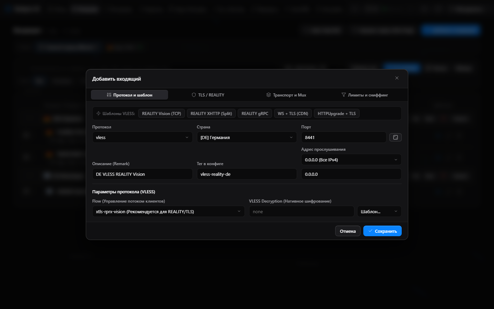

# 02. VLESS

| Параметр | Значение |
| :--- | :--- |
| **Роль в панели `tachyon-ui`** | `Inbound` + `Outbound` |
| **L4-транспорт** | `TCP` (`tcp`, `ws`, `grpc`, `httpupgrade`, `xhttp`, `http`); `UDP` (`quic`) только на Outbound при TLS |
| **TLS / REALITY / ACME** | Поддерживает `none`, `tls`, `reality` (+ PQ `X25519MLKEM768` в REALITY); ACME управляется панелью `tachyon-ui` |
| **Свой домен** | Не нужен при `REALITY`; нужен при обычном `tls` или проксировании через CDN |

---

## Зачем нужен и как устроен в `tachyon-core`

Если представить туннель как курьерскую службу, то **VLESS** — это лёгкий конверт без лишней сургучной печати внутри: аутентификация проходит по 16-байтному UUID, а всё шифрование и маскировку берут на себя внешний слой (**TLS 1.3**, **REALITY**) и выбранный транспорт (**TCP Vision**, **XHTTP**, **gRPC**, **WebSocket**, **HTTPUpgrade**).

Особенности реализации в `tachyon-core 0.6.9`:
- **Управление потоком `xtls-rprx-vision`**: снимает эффект «TLS-внутри-TLS», добавляя случайный паддинг на первые пакеты рукопожатия. Работает **строго поверх `transport: "tcp"`**.
- **Постквантовый обмен ключами**: в REALITY поддерживается гибридный обмен `X25519MLKEM768` (параметр `pq_key` / `support_x25519mlkem768`), а также нативное шифрование полезной нагрузки `decryption` / `encryption` формата `mlkem768x25519plus`.
- **Обработка UDP**: инкапсулирует UDP внутри сессии через `xudp` (по умолчанию), `packetaddr` или сырое обрамление.
- **Защита от зондирования на Inbound**: поддерживает `fallback`, `fallback_for_alpn` и `tarpit` (захват первых 4096 байт).

---

## Скриншот формы в панели



---

## Пошаговая настройка в `tachyon-ui`

### Встроенные пресеты панели
| Пресет | Порт | TLS и SNI | Транспорт и параметры |
| :--- | :---: | :--- | :--- |
| **REALITY Vision (TCP)** | `8441` | `reality`, `www.microsoft.com`, ALPN `h2,http/1.1` | `tcp`, `flow: xtls-rprx-vision` |
| **REALITY XHTTP (Split)** | `8448` | `reality`, `www.cloudflare.com`, ALPN `h2,http/1.1` | `xhttp`, path `/xhttp`, `mode: auto`, `x_padding_bytes: 100-1000` |
| **REALITY gRPC** | `8449` | `reality`, `dl.google.com`, ALPN `h2` | `grpc`, `service_name: grpc-vless` |
| **WS + TLS (CDN)** | `8452` | `tls`, `www.cloudflare.com`, ALPN `http/1.1` | `ws`, path `/vless-ws` |
| **HTTPUpgrade + TLS** | `8453` | `tls`, `www.microsoft.com`, ALPN `http/1.1` | `httpupgrade`, path `/upgrade` |

### Порядок действий
1. Откройте **Входящие (`Inbounds`) → `+ Добавить Inbound`** и выберите **`vless`**.
2. Кликните подходящий пресет — например, **`REALITY Vision (TCP)`** для прямого подключения или **`REALITY XHTTP (Split)`** для раздельного HTTP/2-потока.
3. На вкладке **Основные / VLESS** выберите `Flow` (`xtls-rprx-vision` доступен только при транспорте `tcp`).
4. На вкладке **TLS / REALITY** сгенерируйте ключи REALITY (включая опциональный постквантовый ключ) или укажите сертификат домена для режима `tls`.
5. При необходимости откройте вкладку **Транспорт и Mux** (для `ws`, `grpc`, `xhttp`, `httpupgrade`) и задайте путь/хост. Сохраните, привяжите к подписке и перезапустите ядро.

---

## Разбор всех полей, переключателей и параметров

### Inbound: параметры VLESS и клиенты

| Поле в панели `tachyon-ui` | Ключ `tachyon-core` JSON | Допустимые значения и дефолт | Зачем нужно и как настраивать |
| :--- | :--- | :--- | :--- |
| **Flow** | `users[].flow` | `""` или `xtls-rprx-vision` | Включает режим Vision. Панель блокирует и сбрасывает это поле, если выбран транспорт, отличный от `tcp`. |
| **Нативное дешифрование (`Decryption`)** | `decryption` | `"none"` (дефолт) или строка `mlkem768x25519plus.<native\|xorpub\|random>.<0rtt\|1rtt\|<N>s>...` | Дополнительное постквантовое шифрование полезной нагрузки поверх VLESS. |
| **Клиенты** | `users[].{name, uuid}` | Имя и UUID | Каждый клиент из привязанных подписок получает собственный UUID. |

### Inbound: вкладки «TLS / REALITY» и «Транспорт и Mux»

| Поле в панели `tachyon-ui` | Ключ `tachyon-core` JSON | Допустимые значения и дефолт | Зачем нужно и как настраивать |
| :--- | :--- | :--- | :--- |
| **Режим TLS** | `tls.mode` | `none`, `tls`, `reality` | `reality` не требует домена; `tls` требует сертификата; `none` подходит только за внешним прокси. |
| **SNI / ALPN / Сертификаты** | `tls.server_name`, `tls.alpn`, `tls.certificate_path`, `tls.key_path` | По умолчанию `data/certs/server.crt` / `.key` | Для `ws`/`httpupgrade` используйте ALPN `http/1.1`; для `grpc` и `xhttp` — `h2`. |
| **REALITY (`Server`, `Port`, `Keys`, `Short IDs`, `PQ Key`)** | `tls.reality.{handshake, private_key, short_id}` (+ `pq_key`) | `www.microsoft.com:443`, X25519 + опц. PQ | Маскировочный хост и криптоключи. Наличие PQ-ключа включает `support_x25519mlkem768: true` и параметр `pqv` в подписке. |
| **Внешний порт / Внешний TLS** | `external_port`, `external_tls` | Переопределение для клиента | Применяется, когда инбаунд стоит за NGINX/Caddy на порту `443`. |
| **Тип транспорта** | `transport.type` | `tcp`, `ws`, `grpc`, `httpupgrade`, `xhttp`, `http` | L7-транспорт поверх TCP. |
| **Path / Host / Service Name** | `transport.path`, `transport.headers.Host`, `transport.service_name` | Строки | Путь для `ws`/`httpupgrade`/`xhttp`/`http` или имя gRPC-сервиса. |
| **XHTTP Mode / X-Padding** | `transport.mode`, `transport.x_padding_bytes` | `auto`, `packet-up`, `stream-up`, `stream-one`; `100-1000` | Режим разделения восходящего/нисходящего потоков XHTTP и диапазон байтового паддинга. |
| **Multiplex (`h2mux` + `Brutal`)** | `multiplex.{enabled, padding, brutal.{enabled, up_mbps, down_mbps}}` | Вкл/Выкл | Сливает несколько TCP-соединений в один поток. **Автоматически отключается** панелью, если у хотя бы одного клиента задан `xtls-rprx-vision`. |

### Outbound (`type: "vless"`)

| Поле в панели `tachyon-ui` | Ключ `tachyon-core` JSON | Назначение |
| :--- | :--- | :--- |
| **Сервер / Порт / UUID** | `server`, `server_port`, `uuid` | Координаты и идентификатор подключения |
| **Flow** | `flow` | `""` или `xtls-rprx-vision` (только при `tcp`) |
| **TLS / REALITY и Транспорт** | `tls`, `transport` | Включая `transport.type: "quic"` при `tls.enabled: true` (на outbound) |
| **Доп. JSON-настройки (`out-settings`)** | `encryption`, `packet_encoding`, `network`, `multiplex` | `packet_encoding` (`xudp` / `packetaddr`), нативное шифрование, настройки `h2mux` |

---

## Требования к сети, TLS и файрволу

- **Файрвол**: `tachyon-ui` открывает **TCP** на `inb.port` (правило `UDP` добавляется только при выборе `transport_type == "quic"` на outbound-сценариях; на серверном inbound транспорт V2Ray `quic` запрещён валидатором `tachyon-core 0.6.9`).
- **Ограничения `tachyon-core 0.6.9`**:
  - `xtls-rprx-vision` несовместим с `ws`, `grpc`, `xhttp`, `httpupgrade` и с `multiplex`.
  - Для `ws` и `httpupgrade` недопустим ALPN `h2` — при сохранении outbound панель автоматически оставляет только `http/1.1`.
  - Встроенный серверный ACME в рантайме ядра не поддерживается: используйте выпуск сертификатов через менеджер `tachyon-ui` (`certificate_path` / `key_path`).

---

## Экспорт подписок, клиенты и рабочий пример JSON для `tachyon-core`

- **URI**: `vless://<uuid>@<host>:<port>?encryption=none&flow=xtls-rprx-vision&security=reality&sni=www.microsoft.com&fp=chrome&pbk=<PUBKEY>&sid=0123abcd&type=tcp#label`
- **JSON (`?format=json`, `?format=tachyon`, `?format=outbounds`)**: полная поддержка всех транспортов (включая `xhttp`, `httpupgrade`, `pqv`, `multiplex`).
- **Clash Meta YAML (`?format=clash`)**: экспортирует `type: vless` с `reality-opts`, `ws-opts`, `grpc-opts`, `h2-opts`. Обратите внимание: транспорты **`xhttp` и `httpupgrade` в YAML не поддерживаются** и при экспорте в Clash Meta пропускаются — для них используйте JSON-профиль или URI.
- **Клиенты**: `tachyon-core`, а также любые современные VLESS-клиенты с поддержкой REALITY / Vision / XHTTP.

### Пример конфигурации `tachyon-core 0.6.9` (REALITY Vision)

```json
{
  "inbounds": [
    {
      "type": "vless",
      "tag": "vless-reality-in",
      "listen": "::",
      "listen_port": 8441,
      "users": [
        {
          "name": "alice",
          "uuid": "11111111-2222-4333-8444-555555555555",
          "flow": "xtls-rprx-vision"
        }
      ],
      "tls": {
        "enabled": true,
        "server_name": "www.microsoft.com",
        "alpn": ["h2", "http/1.1"],
        "reality": {
          "enabled": true,
          "handshake": { "server": "www.microsoft.com", "server_port": 443 },
          "private_key": "<REALITY_PRIVATE_KEY>",
          "short_id": ["0123abcd"]
        }
      }
    }
  ],
  "outbounds": [
    {
      "type": "vless",
      "tag": "vless-reality-out",
      "server": "198.51.100.10",
      "server_port": 8441,
      "uuid": "11111111-2222-4333-8444-555555555555",
      "flow": "xtls-rprx-vision",
      "packet_encoding": "xudp",
      "tls": {
        "enabled": true,
        "server_name": "www.microsoft.com",
        "utls": { "enabled": true, "fingerprint": "chrome" },
        "reality": {
          "enabled": true,
          "public_key": "<REALITY_PUBLIC_KEY>",
          "short_id": "0123abcd"
        }
      }
    }
  ]
}
```

---

## Диагностика и частые ошибки

| Симптом | Вероятная причина | Решение |
| :--- | :--- | :--- |
| Ошибка валидации или запуска при включении `Vision` | Выбран транспорт `ws`/`xhttp`/`grpc` или включён `multiplex` | Используйте `xtls-rprx-vision` только с `transport: "tcp"` и выключенным `multiplex` |
| Клиент Clash Meta не видит узел с `XHTTP` / `HTTPUpgrade` | Формат Clash YAML пропускает эти транспорты | Переведите клиента на формат подписки `?format=json` / `?format=tachyon` или URI |
| Зависание `WS` / `HTTPUpgrade` при подключении | Указан ALPN `h2` вместо `http/1.1` | Выставьте `ALPN: http/1.1` на инбаунде и в профиле клиента |
| REALITY не проходит handshake | Целевой `handshake.server` не поддерживает TLS 1.3 + H2 или заблокирован с сервера | Проверьте доступность decoy-домена с самого VPS и смените на `www.microsoft.com` / `dl.google.com` |

---

## См. также
- [Каталог протоколов](README.md)
- [Энциклопедия протоколов](../09-protocols-encyclopedia.md)
- Предыдущий гайд: [01. TewFai](01-tewfai.md) | Следующий гайд: [03. Hysteria2](03-hysteria2.md)
