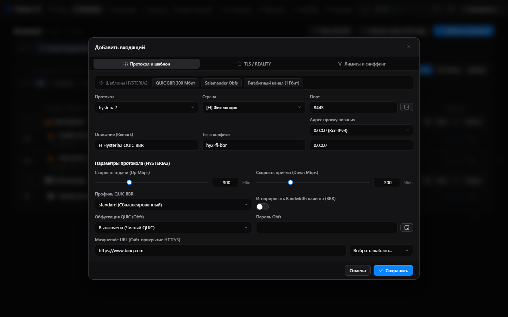

# 03. Hysteria2

| Параметр | Значение |
| :--- | :--- |
| **Роль в панели `tachyon-ui`** | `Inbound` + `Outbound` |
| **L4-транспорт** | `UDP` (QUIC / HTTP/3 с обязательным ALPN `h3`) |
| **TLS / REALITY / ACME** | **Только сертификатный TLS** (`tls` строго обязателен; REALITY не поддерживается; ACME управляется панелью `tachyon-ui`) |
| **Свой домен** | Желателен (с сертификатом от панели); допускается самоподписанный сертификат с `insecure: true` на клиенте |

---

## Зачем нужен и как устроен в `tachyon-core`

Представьте широкую многополосную автостраду без светофоров: вместо того чтобы останавливать всю колонну при потере одной машины (как это делает TCP), **Hysteria2** едет по UDP (QUIC HTTP/3) и настраивает скорость потока агрессивным алгоритмом **Brutal** (держит заданную вами полосу `up_mbps`/`down_mbps` даже при 5–15% потерь пакетов) или **BBR** (`standard`, `conservative`, `aggressive`).

Как протокол работает в `tachyon-core 0.6.9`:
- **Контроль перегрузок**: если задано `up_mbps > 0` и не включён `ignore_client_bandwidth`, активируется Brutal; при `up_mbps == 0` или `ignore_client_bandwidth: true` движок переключается на BBR с выбранным профилем (`bbr_profile`).
- **Обфускация QUIC (`obfs`)**: поддерживает `"salamander"` (быстрое XOR-маскирование на базе BLAKE2b, скрывает QUIC-заголовки) и `"gecko"` (дополнительно выравнивает размеры пакетов в диапазоне `512..=1200` байт).
- **HTTP/3 Маскировка (`masquerade`)**: неаутентифицированные запросы получают корректный HTTP/3-ответ (проксирование URL, строка, файл или редирект), имитируя обычный веб-сервер.

---

## Скриншот формы в панели



---

## Пошаговая настройка в `tachyon-ui`

### Встроенные пресеты панели
| Пресет | Порт (UDP) | TLS и SNI | Параметры скорости и маскировки |
| :--- | :---: | :--- | :--- |
| **QUIC BBR 300 Мбит** | `8443` | `tls`, `www.bing.com`, ALPN `h3` | `300 / 300` Мбит/с, `bbr: standard`, `masquerade: https://www.bing.com` |
| **Salamander Obfs** | `8456` | `tls`, `www.cloudflare.com`, ALPN `h3` | `300 / 300` Мбит/с, `bbr: aggressive`, `obfs: salamander` |
| **Гигабитный канал (1 Гбит)** | `8443` | `tls`, `www.apple.com`, ALPN `h3` | `1000 / 1000` Мбит/с, `bbr: aggressive` |

### Порядок действий
1. Перейдите в **Входящие (`Inbounds`) → `+ Добавить Inbound`** и выберите **`hysteria2`**.
2. Выберите один из пресетов (например, **`Salamander Obfs`** для сетей с фильтрацией QUIC).
3. На вкладке **Основные / Hysteria2** задайте реальную пропускную способность канала сервера (`Up/Down Mbps`), профиль BBR, `ignore_client_bandwidth` и при необходимости обфускацию (`salamander` или `gecko` + пароль).
4. На вкладке **TLS** проверьте `ALPN: h3`, укажите ваш домен в `SNI` и пути к сертификату (`data/certs/server.crt` / `.key`), либо оставьте `Allow Insecure` для самоподписанного сертификата.
5. Убедитесь, что к подписке привязан хотя бы один клиент с непустым паролем, сохраните Inbound и перезапустите ядро.

---

## Разбор всех полей, переключателей и параметров

### Inbound: параметры Hysteria2 и вкладка TLS

| Поле в панели `tachyon-ui` | Ключ `tachyon-core` JSON | Допустимые значения и дефолт | Зачем нужно и как настраивать |
| :--- | :--- | :--- | :--- |
| **Up / Down Mbps** | `up_mbps`, `down_mbps` | `10–1000` (дефолт `300`) | Лимит скорости в Мбит/с. При `0` или `ignore_client_bandwidth: true` используется BBR вместо Brutal. |
| **Профиль BBR** | `bbr_profile` | `standard`, `conservative`, `aggressive` | Агрессивность набора скорости BBR при отключённом Brutal. |
| **Игнорировать полосу клиента** | `ignore_client_bandwidth` | `true` / `false` | Заставляет сервер использовать BBR независимо от настроек скорости на клиенте. |
| **Обфускация: тип / пароль** | `obfs.{type, password}` | `""`, `salamander`, `gecko` + строка пароля | Шифрует QUIC Initial и заголовки пакетов. При задании `obfs` на inbound обязателен непустой пароль у пользователей `users[]`. |
| **Маскировка (`Masquerade`)** | `masquerade` | URL (напр. `https://www.bing.com`) или объект `file`/`proxy`/`string` | Что отвечает сервер на обычные HTTP/3-запросы без пароля Hysteria2. |
| **Клиенты** | `users[].{name, password}` | Имя и непустой пароль | Аутентификация клиентов. |
| **Вкладка TLS (`SNI`, `ALPN`, `Cert`, `Key`, `Allow Insecure`)** | `tls.{enabled, server_name, alpn, certificate_path, key_path}` | `tls.enabled: true` всегда; ALPN `["h3"]` | В `hysteria2` REALITY отключён; при самоподписанном сертификате укажите `Allow Insecure: true` для клиентского экспорта. |
| **Внешний порт / TLS** | `external_port`, `external_tls` | Переопределение для подписок | Для схем с переадресацией UDP-портов. |

### Outbound (`type: "hysteria2"`)

| Поле в панели `tachyon-ui` | Ключ `tachyon-core` JSON | Назначение |
| :--- | :--- | :--- |
| **Сервер / Порт / Пароль** | `server`, `server_port`, `password` | Адрес узла и пароль доступа |
| **Блок TLS** | `tls.{enabled, server_name, insecure, alpn}` | `tls.enabled: true` обязателен; требуется `server_name` или `server`, если `insecure` не `true` |
| **Доп. JSON-поля (`out-settings`)** | `server_ports`, `hop_interval`, `hop_interval_max`, `up_mbps`, `down_mbps`, `obfs`, `bbr_profile` | Port hopping (ротация UDP-портов), лимиты Brutal и настройки `obfs` |

---

## Требования к сети, TLS и файрволу

- **Файрвол**: открывается только **UDP** на порту Inbound (например, `8443/udp` или `8456/udp`). Если на клиенте используется `server_ports` (port hopping), настройте на сервере NAT-редирект диапазона UDP-портов на основной порт инбаунда.
- **Ограничения `tachyon-core 0.6.9`**:
  - `tls.enabled: true` строго обязателен на обоих концах (`REALITY` недоступен).
  - При включении `obfs` в `users[]` должен быть хотя бы один клиент с непустым `password`.
  - Встроенный ACME в рантайме ядра не поддерживается: сертификаты для `hysteria2` готовит панель `tachyon-ui` и передаёт их через `certificate_path`/`key_path`.

---

## Экспорт подписок, клиенты и рабочий пример JSON для `tachyon-core`

- **URI**: `hy2://<password>@<host>:<port>?sni=www.bing.com&obfs=salamander&obfs-password=demo-obfs-pass&insecure=1#label`
- **JSON (`?format=json`, `?format=tachyon`, `?format=outbounds`)**: `type: "hysteria2"`.
- **Clash Meta YAML (`?format=clash`)**: `type: hysteria2`, `up`/`down` (`"300 Mbps"`), `obfs`, `obfs-password`, `skip-cert-verify`.
- **Клиенты**: `tachyon-core` и все стандартные Hysteria2 / HTTP/3 клиенты.

### Пример конфигурации `tachyon-core 0.6.9`

```json
{
  "inbounds": [
    {
      "type": "hysteria2",
      "tag": "hy2-in",
      "listen": "::",
      "listen_port": 8456,
      "up_mbps": 300,
      "down_mbps": 300,
      "bbr_profile": "aggressive",
      "ignore_client_bandwidth": false,
      "obfs": {
        "type": "salamander",
        "password": "demo-obfs-password"
      },
      "masquerade": "https://www.cloudflare.com",
      "users": [
        { "name": "alice", "password": "demo-user-password" }
      ],
      "tls": {
        "enabled": true,
        "server_name": "panel.example.com",
        "alpn": ["h3"],
        "certificate_path": "data/certs/server.crt",
        "key_path": "data/certs/server.key"
      }
    }
  ],
  "outbounds": [
    {
      "type": "hysteria2",
      "tag": "hy2-out",
      "server": "198.51.100.10",
      "server_port": 8456,
      "password": "demo-user-password",
      "up_mbps": 100,
      "down_mbps": 300,
      "obfs": {
        "type": "salamander",
        "password": "demo-obfs-password"
      },
      "tls": {
        "enabled": true,
        "server_name": "panel.example.com",
        "alpn": ["h3"],
        "insecure": false
      }
    }
  ]
}
```

---

## Диагностика и частые ошибки

| Симптом | Вероятная причина | Решение |
| :--- | :--- | :--- |
| Соединение обрывается на уровне QUIC Initial без ответа сервера | Несовпадение `obfs.type` или `obfs.password` на клиенте и сервере | Сверьте тип (`salamander` / `gecko`) и пароль обфускации; они должны совпадать посимвольно |
| Клиент не подключается, UDP-пакеты не доходят | Провайдер режет UDP на этом порту или закрыт порт в файрволе | Откройте `UDP` на порт инбаунда, включите `salamander` или смените порт на `443/udp` |
| Ошибка проверки сертификата у клиента | Самоподписанный сертификат без `insecure: true` или неверный SNI | Выпустите реальный сертификат на домен через `tachyon-ui` или включите `Allow Insecure: true` |
| Ошибка валидации при запуске с `obfs` | Пустой пароль у клиента в `users[]` | Привяжите подписку с непустым паролем клиента |

---

## См. также
- [Каталог протоколов](README.md)
- [Энциклопедия протоколов](../09-protocols-encyclopedia.md)
- Предыдущий гайд: [02. VLESS](02-vless.md) | Следующий гайд: [04. TUIC v5](04-tuic.md)
