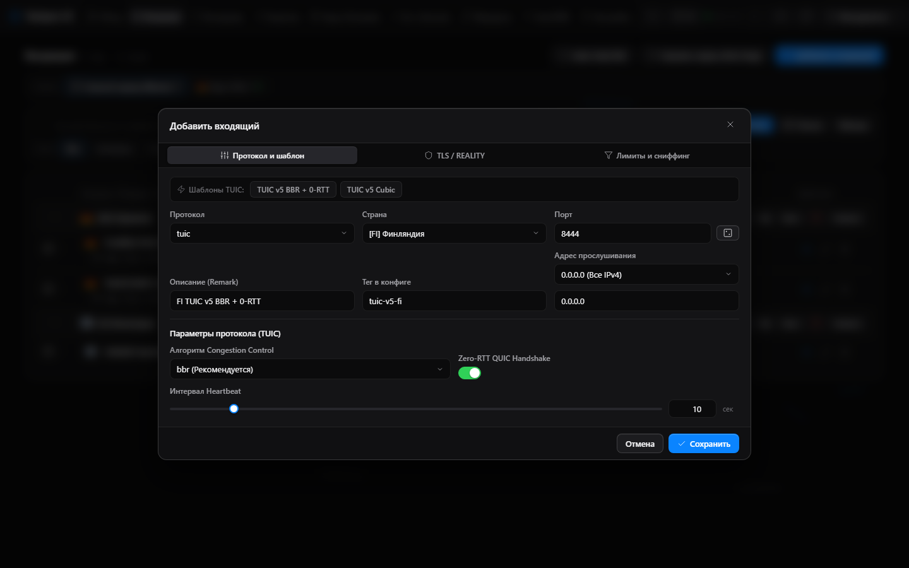

# 04. TUIC v5

| Параметр | Значение |
| :--- | :--- |
| **Роль в панели `tachyon-ui`** | `Inbound` + `Outbound` |
| **L4-транспорт** | `UDP` (QUIC с ALPN `h3`; нативные QUIC-дейтаграммы RFC 9221, QUIC uni-streams или `udp_over_stream` на outbound) |
| **TLS / REALITY / ACME** | **Только сертификатный TLS** (`tls` строго обязателен; REALITY не поддерживается; ACME управляется панелью `tachyon-ui`) |
| **Свой домен** | Желателен (с сертификатом от панели); допускается самоподписанный сертификат с `insecure: true` у клиента |

---

## Зачем нужен и как устроен в `tachyon-core`

Если **Hysteria2** рассчитана на «продавливание» пропускной способности на плохом канале, то **TUIC v5** создан ради **минимальной задержки (low latency)** и полноценного проксирования UDP-дейтаграмм: игр, голосовых звонков, WebRTC и DNS поверх QUIC без лишней перепаковки.

Механика работы в `tachyon-core 0.6.9`:
- **QUIC-мультиплексирование + 0-RTT**: при включённом `zero_rtt_handshake` повторные подключения отправляют данные одновременно с первым пакетом рукопожатия, экономя целый RTT.
- **Два режима UDP (`native` и `quic`)**: нативный режим отправляет пакеты как QUIC Datagrams (RFC 9221) без задержек повторной доставки; режим `quic` (uni-streams) гарантирует доставку при фильтрации QUIC-дейтаграмм провайдером.
- **Аутентификация**: каждый клиент использует **строго валидный UUID** (формата 8-4-4-4-12) и пароль; таймаут аутентификации на сервере по умолчанию равен `10s`.

---

## Скриншот формы в панели



---

## Пошаговая настройка в `tachyon-ui`

### Встроенные пресеты панели
| Пресет | Порт (UDP) | TLS и SNI | Параметры QUIC |
| :--- | :---: | :--- | :--- |
| **TUIC v5 BBR + 0-RTT** | `8444` | `tls`, `www.apple.com`, ALPN `h3` | `congestion_control: bbr`, `zero_rtt_handshake: true`, `heartbeat: 10s` |
| **TUIC v5 Cubic** | `8444` | `tls`, `www.cloudflare.com`, ALPN `h3` | `congestion_control: cubic`, `zero_rtt_handshake: false`, `heartbeat: 15s` |

### Порядок действий
1. Откройте **Входящие (`Inbounds`) → `+ Добавить Inbound`** и выберите **`tuic`**.
2. Выберите пресет **`TUIC v5 BBR + 0-RTT`** для лучшей отзывчивости или **`TUIC v5 Cubic`** для максимальной совместимости со старыми сетями.
3. На вкладке **Основные / TUIC** выберите алгоритм перегрузок (`bbr`, `cubic`, `new_reno`), включите `0-RTT Handshake` и интервал `Heartbeat` (по умолчанию `10` секунд).
4. На вкладке **TLS** проверьте `ALPN: h3`, укажите SNI домена и сертификат/ключ (`data/certs/server.crt`, `data/certs/server.key`), либо `Allow Insecure: true` при самоподписанном сертификате.
5. Убедитесь, что у привязанных клиентов валидный UUID и пароль, сохраните Inbound и перезапустите ядро.

---

## Разбор всех полей, переключателей и параметров

### Inbound: параметры TUIC и вкладка TLS

| Поле в панели `tachyon-ui` | Ключ `tachyon-core` JSON | Допустимые значения и дефолт | Зачем нужно и как настраивать |
| :--- | :--- | :--- | :--- |
| **Контроль перегрузок** | `congestion_control` | `bbr`, `cubic`, `new_reno`; дефолт `bbr` | `bbr` лучше переносит потери и джиттер; `cubic` даёт предсказуемый классический профиль. |
| **0-RTT Handshake** | `zero_rtt_handshake` | `true` / `false` | Разрешает отправку полезных данных в первом пакете повторного QUIC-соединения. |
| **Heartbeat (сек)** | `heartbeat` | `3–60` сек, дефолт `10` (`"10s"`) | Интервал проверки активности QUIC-соединения, чтобы NAT не закрывал UDP-сессию. |
| **Клиенты** | `users[].{name, uuid, password}` | Строго валидный UUID + пароль | В `tachyon-core 0.6.9` невалидный UUID на `tuic` сразу отклоняется валидатором. |
| **Вкладка TLS (`SNI`, `ALPN`, `Cert`, `Key`, `Allow Insecure`)** | `tls.{enabled, server_name, alpn, certificate_path, key_path}` | `tls.enabled: true` всегда; ALPN `["h3"]` | REALITY не поддерживается; сертификаты ACME обслуживает панель `tachyon-ui`. |
| **Внешний порт / TLS** | `external_port`, `external_tls` | Переопределение для подписок | Для проброса UDP через внешний шлюз. |

### Outbound (`type: "tuic"`)

| Поле в панели `tachyon-ui` | Ключ `tachyon-core` JSON | Назначение |
| :--- | :--- | :--- |
| **Сервер / Порт** | `server`, `server_port` | Адрес и UDP-порт удалённого сервера |
| **UUID / Пароль** | `uuid`, `password` | Учётные данные клиента (строго валидный UUID) |
| **Контроль перегрузок** | `congestion_control` | `bbr` / `cubic` / `new_reno` |
| **Блок TLS** | `tls.{enabled, server_name, alpn, insecure}` | Обязательный TLS для QUIC (`alpn: ["h3"]`) |
| **Доп. JSON-поля (`out-settings`)** | `udp_relay_mode` (`native` / `quic`), `udp_over_stream`, `zero_rtt_handshake`, `heartbeat` | Режим доставки UDP (`udp_over_stream: true` нельзя совмещать с непустым `udp_relay_mode`) |

---

## Требования к сети, TLS и файрволу

- **Файрвол**: открывается **UDP** на порту Inbound (например, `8444/udp`).
- **Ограничения `tachyon-core 0.6.9`**:
  - Валидатор строго проверяет синтаксис **UUID** на inbound и outbound (в отличие от VLESS/VMess, автогенерация UUIDv5 из произвольной строки не применяется).
  - На outbound параметр `udp_over_stream: true` **конфликтует** с непустым `udp_relay_mode`.
  - Если UDP-трафик режется провайдером, сервер рвёт незавершённые сессии по `auth_timeout` (`10s`).
  - Серверный TLS строго обязателен (`tls.enabled: true`), а ACME-выпуск сертификатов выполняет `tachyon-ui`.

---

## Экспорт подписок, клиенты и рабочий пример JSON для `tachyon-core`

- **URI**: `tuic://<uuid>:<password>@<host>:<port>?congestion_control=bbr&alpn=h3&sni=www.apple.com&insecure=1&allow_insecure=1#label`
- **JSON (`?format=json`, `?format=tachyon`, `?format=outbounds`)**: `type: "tuic"`.
- **Clash Meta YAML (`?format=clash`)**: `type: tuic`, `congestion-controller`, `alpn`, `skip-cert-verify`.
- **Клиенты**: `tachyon-core` и стандартные TUIC v5 клиенты.

### Пример конфигурации `tachyon-core 0.6.9`

```json
{
  "inbounds": [
    {
      "type": "tuic",
      "tag": "tuic-in",
      "listen": "::",
      "listen_port": 8444,
      "congestion_control": "bbr",
      "zero_rtt_handshake": true,
      "heartbeat": "10s",
      "users": [
        {
          "name": "alice",
          "uuid": "11111111-2222-4333-8444-555555555555",
          "password": "demo-user-password"
        }
      ],
      "tls": {
        "enabled": true,
        "server_name": "panel.example.com",
        "alpn": ["h3"],
        "certificate_path": "data/certs/server.crt",
        "key_path": "data/certs/server.key"
      }
    }
  ],
  "outbounds": [
    {
      "type": "tuic",
      "tag": "tuic-out",
      "server": "198.51.100.10",
      "server_port": 8444,
      "uuid": "11111111-2222-4333-8444-555555555555",
      "password": "demo-user-password",
      "congestion_control": "bbr",
      "udp_relay_mode": "native",
      "zero_rtt_handshake": true,
      "heartbeat": "10s",
      "tls": {
        "enabled": true,
        "server_name": "panel.example.com",
        "alpn": ["h3"],
        "insecure": false
      }
    }
  ]
}
```

---

## Диагностика и частые ошибки

| Симптом | Вероятная причина | Решение |
| :--- | :--- | :--- |
| Ядро не запускается / ошибка декодирования `tuic` | Некорректный формат `uuid` в `users[]` или outbound | Укажите стандартный 36-символьный UUIDv4 |
| Ошибка валидации outbound `udp_over_stream` | Заданы одновременно `udp_over_stream: true` и `udp_relay_mode` | Оставьте только один из параметров |
| Истекает `auth_timeout` (10s) при подключении | Заблокирован входящий UDP-порт или неверные `uuid`/`password` | Проверьте правила файрвола на `UDP` и сверьте учётные данные |
| Обрывы голосовых/игровых сессий в простое | Промежуточный NAT сбрасывает UDP-маппинг быстрее `heartbeat` | Уменьшите `heartbeat` до `5s–8s` |

---

## См. также
- [Каталог протоколов](README.md)
- [Энциклопедия протоколов](../09-protocols-encyclopedia.md)
- Предыдущий гайд: [03. Hysteria2](03-hysteria2.md) | Следующий гайд: [05. Trojan](05-trojan.md)
