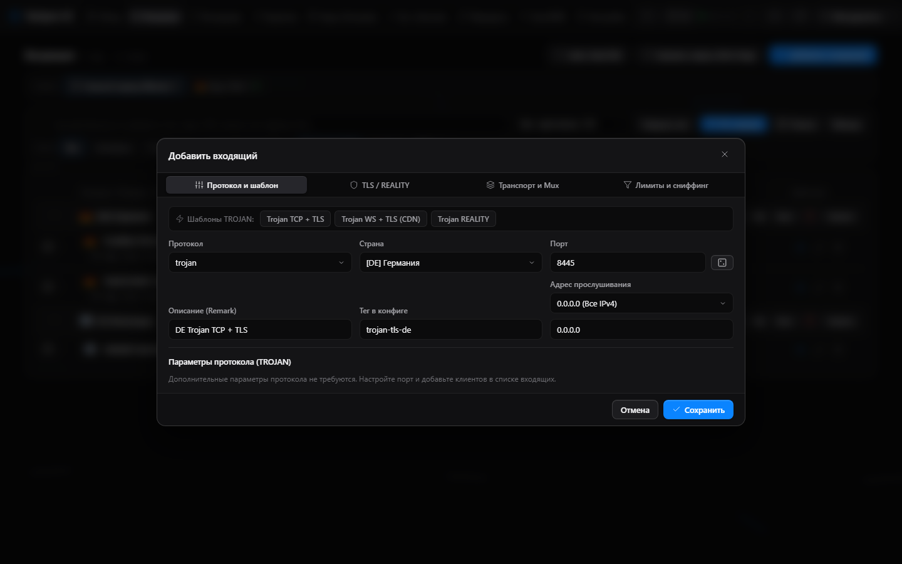

# 05. Trojan

| Параметр | Значение |
| :--- | :--- |
| **Роль в панели `tachyon-ui`** | `Inbound` + `Outbound` |
| **L4-транспорт** | `TCP` (плюс V2Ray-транспорты `ws`, `grpc`, `httpupgrade`, `xhttp`, `http`; `quic` допустим только на Outbound с TLS; UDP передаётся внутри сессии) |
| **TLS / REALITY / ACME** | Поддерживает `none`, `tls`, `reality` (`tls` — классический режим; `none` — только за внешним TLS-прокси или `detour`) |
| **Свой домен** | Нужен для классического `Trojan TCP + TLS` или `WS + TLS`; не нужен для `Trojan REALITY` |

---

## Зачем нужен и как устроен в `tachyon-core`

Представьте закрытый клуб с обычной витриной кафе: все гости заходят через стандартный **HTTPS (TLS 1.3)** и в первом же сообщении предъявляют SHA-224-хеш своего пароля. Если пароль верный — открывается прокси-туннель; если же зашёл случайный сканер или обычный браузер без пароля, сервер спокойно перенаправляет запрос на реальный веб-сайт (`fallback`).

Особенности реализации в `tachyon-core 0.6.9`:
- **Аутентификация по уникальным паролям**: все клиенты одного Trojan Inbound обязаны иметь **уникальные пароли** (дубликаты отклоняются при старте ядра).
- **Полная поддержка UDP и Mux**: внутри сессии сервер принимает UDP-кадры (`0x02`, `0x03`), а также поддерживает `h2mux` и UoT v1/v2.
- **Защита от активного зондирования**: поддержка `fallback`, `fallback_for_alpn` и `tarpit` на Inbound.
- **Гибкость транспортов и TLS**: помимо классического `TCP + TLS`, работает с `REALITY`, `WebSocket`, `gRPC`, `XHTTP` и `HTTPUpgrade`.

---

## Скриншот формы в панели



---

## Пошаговая настройка в `tachyon-ui`

### Встроенные пресеты панели
| Пресет | Порт | TLS и SNI | Транспорт |
| :--- | :---: | :--- | :--- |
| **Trojan TCP + TLS** | `8445` | `tls`, `www.microsoft.com` (замените на ваш домен), ALPN `h2,http/1.1` | `tcp` |
| **Trojan WS + TLS (CDN)** | `8454` | `tls`, `www.cloudflare.com`, ALPN `http/1.1` | `ws`, path `/trojan-ws` |
| **Trojan REALITY** | `8445` | `reality`, `www.microsoft.com`, ALPN `h2,http/1.1` | `tcp` |

### Порядок действий
1. Откройте **Входящие (`Inbounds`) → `+ Добавить Inbound`** и выберите **`trojan`**.
2. Выберите один из пресетов: **`Trojan TCP + TLS`** (при наличии своего домена) или **`Trojan REALITY`** (без домена).
3. Убедитесь, что у привязанных подписок нет клиентов с одинаковыми паролями.
4. На вкладке **TLS / REALITY** задайте сертификат и домен (для `tls`) либо сгенерируйте ключи REALITY (для `reality`).
5. При работе через CDN откройте вкладку **Транспорт и Mux** и проверьте `ws` + путь (`/trojan-ws`) и ALPN `http/1.1`. Сохраните и перезапустите ядро.

---

## Разбор всех полей, переключателей и параметров

Отдельных специфических полей у `trojan` нет — вся настройка строится на списке клиентов и общих вкладках **TLS / REALITY** и **Транспорт и Mux**.

### Inbound: клиенты, TLS / REALITY, Транспорт и Mux

| Поле в панели `tachyon-ui` | Ключ `tachyon-core` JSON | Допустимые значения и дефолт | Зачем нужно и как настраивать |
| :--- | :--- | :--- | :--- |
| **Клиенты** | `users[].{name, password}` | Уникальные пароли без дубликатов | По паролю строится SHA-224-идентификатор сессии. Дублирующиеся пароли внутри одного инбаунда запрещены. |
| **Режим TLS** | `tls.mode` | `none`, `tls`, `reality` | `tls` — классический режим с сертификатом; `reality` — без своего домена; `none` — только за терминирующим прокси (`NGINX`/`Caddy`/`detour`). |
| **SNI / ALPN / Сертификат и ключ** | `tls.server_name`, `tls.alpn`, `tls.certificate_path`, `tls.key_path` | По умолчанию `data/certs/server.crt` / `.key` | Для `ws`/`httpupgrade` используйте `http/1.1`; для `tcp`/`grpc` — `h2,http/1.1`. |
| **Параметры REALITY** | `tls.reality.{handshake, private_key, short_id}` (+ `pq_key`) | `www.microsoft.com:443`, X25519 + опц. PQ | Применяются, если выбран режим `reality`. |
| **Внешний порт / Внешний TLS** | `external_port`, `external_tls` | Переопределение для клиента | Используйте при терминировании TLS на внешнем порту `443`. |
| **Тип транспорта и параметры** | `transport.{type, path, headers, service_name, mode, x_padding_bytes}` | `tcp`, `ws`, `grpc`, `httpupgrade`, `xhttp`, `http` | Позволяет пробрасывать Trojan через CDN (`ws`/`grpc`/`httpupgrade`). |
| **Multiplex (`h2mux` + `Brutal`)** | `multiplex.{enabled, padding, brutal.{enabled, up_mbps, down_mbps}}` | Вкл/Выкл | Снижает задержку при множестве коротких запросов. |

### Outbound (`type: "trojan"`)

| Поле в панели `tachyon-ui` | Ключ `tachyon-core` JSON | Назначение |
| :--- | :--- | :--- |
| **Сервер / Порт / Пароль** | `server`, `server_port`, `password` | Адрес удалённого сервера и пароль пользователя |
| **Блок TLS / REALITY** | `tls` | Настройки TLS/uTLS или REALITY |
| **Транспорт** | `transport` | `tcp`, `ws`, `grpc`, `httpupgrade`, `xhttp`, `http` (+ `quic` при `tls.enabled: true`) |
| **Multiplex (`out-settings`)** | `multiplex` | Клиентский мультиплексор `h2mux` |

---

## Требования к сети, TLS и файрволу

- **Файрвол**: `tachyon-ui` открывает **TCP** на `inb.port` (правило `UDP` добавляется только при использовании `transport == "quic"` на outbound).
- **Ограничения `tachyon-core 0.6.9`**:
  - Уникальность паролей в `users[]` обязательна: если два клиента имеют одинаковый пароль, запуск завершится ошибкой.
  - Для `ws` и `httpupgrade` ALPN должен включать `http/1.1` (без `h2`).
  - Серверный ACME внутри рантайма ядра не запускается — сертификаты готовит `tachyon-ui`.

---

## Экспорт подписок, клиенты и рабочий пример JSON для `tachyon-core`

- **URI**: `trojan://<password>@<host>:<port>?security=tls&sni=panel.example.com&alpn=h2,http/1.1&type=tcp#label`
- **JSON (`?format=json`, `?format=tachyon`, `?format=outbounds`)**: `type: "trojan"`.
- **Clash Meta YAML (`?format=clash`)**: `type: trojan` (с поддержкой `ws-opts`, `grpc-opts`, `reality-opts`; `xhttp`/`httpupgrade` в YAML пропускаются).
- **Клиенты**: `tachyon-core` и практически все популярные прокси-клиенты на ПК, мобильных ОС и роутерах.

### Пример конфигурации `tachyon-core 0.6.9`

```json
{
  "inbounds": [
    {
      "type": "trojan",
      "tag": "trojan-tls-in",
      "listen": "::",
      "listen_port": 8445,
      "users": [
        { "name": "alice", "password": "demo-unique-password-01" }
      ],
      "fallback": {
        "server": "127.0.0.1",
        "server_port": 18080
      },
      "tls": {
        "enabled": true,
        "server_name": "panel.example.com",
        "alpn": ["h2", "http/1.1"],
        "certificate_path": "data/certs/server.crt",
        "key_path": "data/certs/server.key"
      }
    }
  ],
  "outbounds": [
    {
      "type": "trojan",
      "tag": "trojan-tls-out",
      "server": "198.51.100.10",
      "server_port": 8445,
      "password": "demo-unique-password-01",
      "tls": {
        "enabled": true,
        "server_name": "panel.example.com",
        "alpn": ["h2", "http/1.1"],
        "utls": { "enabled": true, "fingerprint": "chrome" }
      }
    }
  ]
}
```

---

## Диагностика и частые ошибки

| Симптом | Вероятная причина | Решение |
| :--- | :--- | :--- |
| Ядро не стартует после добавления клиента | Дублирующиеся пароли у разных пользователей в `users[]` | Выдайте каждому клиенту уникальный пароль |
| Запросы проходят как обычный сайт без проксирования | Неверный пароль клиента — сервер сбрасывает соединение на `fallback` | Сверьте пароль в клиенте и подписке |
| Не работает `Trojan WS + TLS` через CDN | Неверный путь (`path`) или в ALPN указан `h2` | Выставьте `ALPN: http/1.1` и сверьте `path` на CDN и в инбаунде |

---

## См. также
- [Каталог протоколов](README.md)
- [Энциклопедия протоколов](../09-protocols-encyclopedia.md)
- Предыдущий гайд: [04. TUIC v5](04-tuic.md) | Следующий гайд: [06. VMess](06-vmess.md)
