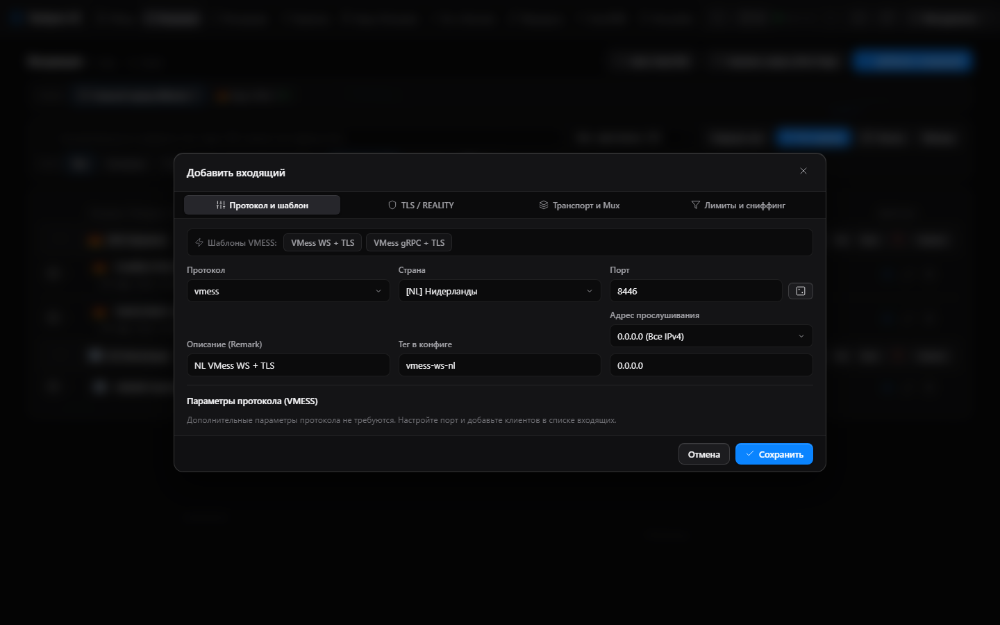

# 06. VMess

| Параметр | Значение |
| :--- | :--- |
| **Роль в панели `tachyon-ui`** | `Inbound` + `Outbound` |
| **L4-транспорт** | `TCP` (плюс V2Ray-транспорты `ws`, `grpc`, `httpupgrade`, `xhttp`, `http`; `quic` только на Outbound с TLS; UDP и `h2mux`/UoT поддерживаются внутри сессии) |
| **TLS / REALITY / ACME** | Поддерживает `none`, `tls`, `reality`; для WebSocket/gRPC через CDN рекомендуется `tls`; ACME управляется панелью `tachyon-ui` |
| **Свой домен** | Нужен при использовании `tls` (особенно с CDN); не нужен при `reality` или внешнем терминировании TLS |

---

## Зачем нужен и как устроен в `tachyon-core`

**VMess** — классический проверенный протокол экосистемы V2Ray с аутентификацией по UUID и встроенным AEAD-шифрованием заголовков и полезной нагрузки. В современном стеке чаще всего применяется для совместимости со старыми клиентами или для проксирования через CDN (`WebSocket + TLS`, `gRPC + TLS`).

Ключевые особенности в `tachyon-core 0.6.9`:
- **Только AEAD на Inbound (`alterId: 0`)**: в `tachyon-core` серверный VMess принимает **исключительно AEAD-режим** (`alterId: 0`). Конфигурации с `alterId > 0` на inbound отклоняются при проверке. На Outbound поддерживаются и `alter_id: 0` (рекомендуется), и устаревший `alter_id > 0` для подключения к старым серверам.
- **Строгая привязка к времени (`±120` секунд)**: Auth ID в AEAD зависит от метки времени и защищён от повторного воспроизведения (anti-replay), поэтому часы сервера и клиента должны расходиться не более чем на 2 минуты.
- **Совместимость с L7-транспортами и Mux**: поддерживает `ws`, `grpc`, `xhttp`, `httpupgrade`, `http`, а также `h2mux` / `UoT`.

---

## Скриншот формы в панели



---

## Пошаговая настройка в `tachyon-ui`

### Встроенные пресеты панели
| Пресет | Порт | TLS и SNI | Транспорт |
| :--- | :---: | :--- | :--- |
| **VMess WS + TLS** | `8446` | `tls`, `www.cloudflare.com` (замените на ваш домен), ALPN `http/1.1` | `ws`, path `/vmess-ws` |
| **VMess gRPC + TLS** | `8446` | `tls`, `dl.google.com` (замените на ваш домен), ALPN `h2` | `grpc`, `service_name: vmess-grpc` |

### Порядок действий
1. Откройте **Входящие (`Inbounds`) → `+ Добавить Inbound`** и выберите **`vmess`**.
2. Выберите пресет **`VMess WS + TLS`** (для CDN или обратного прокси) или **`VMess gRPC + TLS`**.
3. На вкладке **TLS / REALITY** задайте режим `tls` и ваш домен (или `none`, если Inbound слушает локально за NGINX/Caddy на `127.0.0.1` и использует `external_port: 443`, `external_tls: tls`).
4. На вкладке **Транспорт и Mux** при необходимости измените `path` или `service_name` и включите `Multiplex`.
5. Сохраните Inbound, привяжите подписку и примените изменения.

---

## Разбор всех полей, переключателей и параметров

На серверном Inbound у `vmess` нет отдельных protocol-extras — используются общие вкладки клиентов, **TLS / REALITY** и **Транспорт и Mux**. На Outbound дополнительно выбирается шифр.

### Inbound: клиенты, TLS / REALITY, Транспорт и Mux

| Поле в панели `tachyon-ui` | Ключ `tachyon-core` JSON | Допустимые значения и дефолт | Зачем нужно и как настраивать |
| :--- | :--- | :--- | :--- |
| **Клиенты** | `users[].{name, uuid}` | Имя и UUID (`alterId` всегда `0` AEAD) | Идентификация клиентов по UUID. |
| **Режим TLS** | `tls.mode` | `none`, `tls`, `reality` | `tls` обязателен при прямом выходе с доменом; `none` используют только за обратным прокси или в доверенном канале. |
| **SNI / ALPN / Сертификат и ключ** | `tls.server_name`, `tls.alpn`, `tls.certificate_path`, `tls.key_path` | По умолчанию `data/certs/server.crt` / `.key` | Для `ws`/`httpupgrade` — `http/1.1`; для `grpc` — `h2`. |
| **Параметры REALITY** | `tls.reality.{handshake, private_key, short_id}` (+ `pq_key`) | `www.microsoft.com:443`, X25519 + опц. PQ | При использовании VMess в режиме `reality`. |
| **Внешний порт / Внешний TLS** | `external_port`, `external_tls` | Переопределение для подписок | Полезно при выносе WebSocket/gRPC за Unified 443 Front. |
| **Транспорт (`Type`, `Path`, `Host`, `Service`, `XHTTP`)** | `transport.{type, path, headers, service_name, mode, x_padding_bytes}` | `tcp`, `ws`, `grpc`, `httpupgrade`, `xhttp`, `http` | L7-обёртка для прохождения прокси-шлюзов и CDN. |
| **Multiplex (`h2mux` + `Brutal`)** | `multiplex.{enabled, padding, brutal.{enabled, up_mbps, down_mbps}}` | Вкл/Выкл | Мультиплексирование потоков поверх одного транспортного соединения. |

### Outbound (`type: "vmess"`)

| Поле в панели `tachyon-ui` | Ключ `tachyon-core` JSON | Допустимые значения и дефолт | Назначение |
| :--- | :--- | :--- | :--- |
| **Сервер / Порт / UUID** | `server`, `server_port`, `uuid` | Хост, порт, UUID | Координаты и идентификатор подключения |
| **Шифр безопасности (`Security`)** | `security` | `auto` (дефолт), `chacha20-poly1305`, `aes-128-gcm`, `none` | Выбор шифра полезной нагрузки; `auto` подбирает `aes-128-gcm` на x86_64/ARMv8 с AES-NI и `chacha20-poly1305` на остальных CPU |
| **Alter ID** | `alter_id` *(через JSON)* | `0` (AEAD, рекомендуется) или `> 0` (legacy) | Оставьте `0` для современных серверов |
| **TLS и Транспорт** | `tls`, `transport` | Включая `quic` при `tls.enabled: true` | Параметры TLS/uTLS и L7-транспорта |

---

## Требования к сети, TLS и файрволу

- **Файрвол**: открывается **TCP** на `inb.port` (правило `UDP` добавляется только для outbound с `transport == "quic"`).
- **Ограничения `tachyon-core 0.6.9`**:
  - **Синхронизация времени (`NTP`)**: разница времени между сервером и клиентом более чем на `120` секунд приводит к отбрасыванию пакетов AEAD Auth ID.
  - На Inbound `alterId > 0` не поддерживается (только `alterId: 0` AEAD).
  - Внутренний серверный ACME в рантайме ядра не запускается — сертификаты подготавливает `tachyon-ui`.

---

## Экспорт подписок, клиенты и рабочий пример JSON для `tachyon-core`

- **URI**: `vmess://<base64_json>` в стандартном формате V2RayN JSON (`v: "2"`, `aid: "0"`, `scy: "auto"`, `net`, `host`, `path`, `tls`, `sni`).
- **JSON (`?format=json`, `?format=tachyon`, `?format=outbounds`)**: `type: "vmess"`.
- **Clash Meta YAML (`?format=clash`)**: `type: vmess`, `alterId: 0`, `cipher: auto` (для `xhttp`/`httpupgrade` используйте JSON-подписку).
- **Клиенты**: `tachyon-core` и практически все клиенты с поддержкой V2Ray/VMess.

### Пример конфигурации `tachyon-core 0.6.9`

```json
{
  "inbounds": [
    {
      "type": "vmess",
      "tag": "vmess-ws-in",
      "listen": "::",
      "listen_port": 8446,
      "users": [
        {
          "name": "alice",
          "uuid": "11111111-2222-4333-8444-555555555555"
        }
      ],
      "transport": {
        "type": "ws",
        "path": "/vmess-ws"
      },
      "tls": {
        "enabled": true,
        "server_name": "panel.example.com",
        "alpn": ["http/1.1"],
        "certificate_path": "data/certs/server.crt",
        "key_path": "data/certs/server.key"
      }
    }
  ],
  "outbounds": [
    {
      "type": "vmess",
      "tag": "vmess-ws-out",
      "server": "198.51.100.10",
      "server_port": 8446,
      "uuid": "11111111-2222-4333-8444-555555555555",
      "security": "auto",
      "alter_id": 0,
      "transport": {
        "type": "ws",
        "path": "/vmess-ws",
        "headers": {
          "Host": "panel.example.com"
        }
      },
      "tls": {
        "enabled": true,
        "server_name": "panel.example.com",
        "alpn": ["http/1.1"],
        "utls": { "enabled": true, "fingerprint": "chrome" }
      }
    }
  ]
}
```

---

## Диагностика и частые ошибки

| Симптом | Вероятная причина | Решение |
| :--- | :--- | :--- |
| Соединение рвётся с ошибкой AEAD Auth ID / invalid user | Часы на сервере или клиенте сбиты больше чем на 120 секунд | Включите синхронизацию времени (`chrony` / `systemd-timesyncd` / NTP) на VPS и устройстве |
| Inbound не запускается с внешним конфигом | В `users[]` задан `alterId > 0` | Удалите `alterId` или установите `0` |
| Клиент не подключается по `WS + TLS` | Указан ALPN `h2` или не совпадает `path` / `Host` | Оставьте `ALPN: http/1.1` и проверьте совпадение `path` и `Host` |

---

## См. также
- [Каталог протоколов](README.md)
- [Энциклопедия протоколов](../09-protocols-encyclopedia.md)
- Предыдущий гайд: [05. Trojan](05-trojan.md) | Следующий гайд: [07. Shadowsocks](07-shadowsocks.md)
