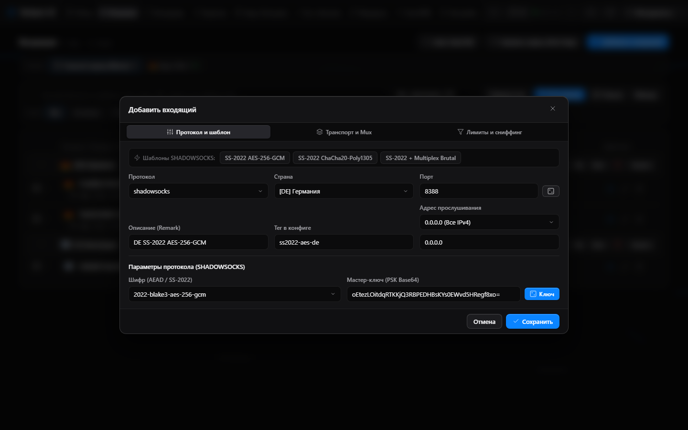

# 07. Shadowsocks (AEAD и Shadowsocks-2022)

> **Сводная карточка**
> - **Роль в `tachyon-core`**: `Inbound` (сервер) и `Outbound` (клиент / каскадный узел)
> - **L4-транспорт**: `TCP` и `UDP` (нативный UDP, UDP-over-TCP v1/v2, опционально мультиплексирование `h2mux` + `Brutal` на TCP)
> - **TLS / REALITY / ACME**: в UI панель скрывает вкладку TLS (`tlsModes: []`); на уровне схемы `tachyon-core` допускается опциональный `tls` поверх TCP (для классических сценариев обычно используется с `ShadowTLS v3` через `detour` или в чистом виде)
> - **Нужен ли домен**: нет, достаточно IP-адреса (`198.51.100.10`); домен опционален для удобства подписок и при каскадировании через `ShadowTLS`

---

## Зачем нужен и как работает в `tachyon-core`

**Простая аналогия.** Если `VLESS + TLS` притворяется обычным посетителем HTTPS-сайта со стандартным паспортом и рукопожатием, то **Shadowsocks** (и его современное поколение **Shadowsocks-2022**) похож на зашифрованный дипломатический пакет без обложки: с первого байта потока идёт случайный шум (соль + зашифрованная полезная нагрузка), и отличить этот трафик можно только зная общий секретный ключ (PSK).

**Механика в `tachyon-core`:**
- В классическом AEAD-варианте (`aes-128-gcm`, `aes-256-gcm`, `chacha20-ietf-poly1305`) каждый TCP-поток и каждый UDP-пакет шифруется с помощью случайной соли и сеансового ключа, выведенного из пароля.
- В **Shadowsocks-2022** (`2022-blake3-aes-128-gcm`, `2022-blake3-aes-256-gcm`, `2022-blake3-chacha20-poly1305`) используется функция вывода ключей BLAKE3, строгая бинарная длина Base64-ключа (16 байт для 128-бит и 32 байта для 256-бит / ChaCha20) и встроенный **контроль метки времени в окне ±30 секунд**, что полностью закрывает атаки повторного воспроизведения (replay attacks) и активное зондирование, характерные для старого AEAD.
- В ядре поддерживается 18 вариантов шифров (включая legacy-режимы и `none` для отладки за внешним шифрованием), однако в UI панели оставлены только 6 актуальных AEAD и SS-2022 методов.
- UDP-дейтаграммы работают как напрямую через нативные UDP-сокеты, так и инкапсулируются поверх TCP по стандарту **UoT v1/v2** (`udp_over_tcp`), а поверх TCP можно включить мультиплексирование **`h2mux`** (включая `Brutal` congestion control).
- Панель на `Inbound` формирует однопользовательскую точку входа с общим мастер-ключом (`ss_method` + `ss_password`). Если поле мастер-ключа оставлено пустым, панель автоматически подставляет пароль первого активного клиента, а при отсутствии активных клиентов — детерминированный sentinel-ключ нужной байтовой длины для `2022-blake3-*`, чтобы конфигурация `tachyon-core` оставалась синтаксически валидной.
- Внешние бинарные SIP003-плагины на `Outbound` принимаются валидатором `tachyon-core` для совместимости импорта чужих конфигураций, но в рантайме ядра не запускаются — для маскировки TLS в `tachyon-core` используйте связку с [09. ShadowTLS v3](09-shadowtls.md).

---

## Скриншот формы в панели



---

## Пошаговая настройка в `tachyon-ui`

### Настройка входящего подключения (`Inbound`)

1. Откройте раздел **Inbounds** и нажмите **Добавить Inbound**.
2. В поле протокола выберите **Shadowsocks (`shadowsocks`)**.
3. При необходимости выберите один из встроенных пресетов панели (`PROTOCOL_PRESETS.shadowsocks`):
   - **SS-2022 AES-256-GCM** — порт `8388`, TLS `none`, метод `2022-blake3-aes-256-gcm`.
   - **SS-2022 ChaCha20-Poly1305** — порт `8388`, TLS `none`, метод `2022-blake3-chacha20-poly1305`.
   - **SS-2022 + Multiplex Brutal** — порт `8388`, TLS `none`, метод `2022-blake3-aes-256-gcm`, включены `Mux` и `Brutal`.
   При выборе любого пресета панель автоматически вызывает генератор ключа `GET /api/generate/ss-key` и заполняет поле мастер-ключа валидным 256-битным Base64-ключом.
4. Выберите шифр в списке **Шифр (AEAD / SS-2022)** и при необходимости сгенерируйте новый ключ кнопкой **Ключ** (иконка кубика, вызывает `/api/generate/ss-key`, возвращающий 32 случайных байта в Base64).
5. Если нужен мультиплекс поверх TCP, перейдите во вкладку **Транспорт и Mux** и включите **Multiplex (`h2mux`)** (опционально `padding` и `Brutal` с указанием `up_mbps` / `down_mbps`).
6. Привяжите клиентов во вкладке клиентов (для подписки используется общий мастер-ключ инбаунда, либо пароль первого активного клиента, если мастер-ключ не задан).
7. Сохраните Inbound и примените конфигурацию ядра.

### Настройка исходящего подключения (`Outbound`)

1. Откройте раздел **Outbounds** и нажмите **Добавить Outbound**.
2. Выберите тип **`shadowsocks`**.
3. Задайте адрес сервера (`198.51.100.10`), порт (`8388`), выберите **Метод шифрования** (`out-ss-method`) и вставьте ключ/пароль в `out-ss-pass` (кнопка кубика также доступна для генерации SS-2022 ключа).
4. При необходимости включения `udp_over_tcp` или `multiplex` на исходящем узле передайте дополнительные параметры через JSON-поле `out-settings`.

---

## Разбор всех полей, переключателей и параметров

### Входящий узел (`Inbound`)

| Поле в панели (`ID`) | Ключ в `tachyon-core` JSON | Допустимые значения / дефолт | Зачем нужен и как настраивать |
|---|---|---|---|
| **Адрес прослушивания** (`inb-listen`) | `listen` | `"::"` или `"0.0.0.0"` (дефолт панели `"::"`) | Интерфейс, на котором ядро принимает TCP и UDP пакеты. Для публичного сервера оставляйте `"::"`, для работы только за локальным `ShadowTLS` (`detour`) можно указать `"127.0.0.1"`. |
| **Порт** (`inb-port`) | `listen_port` | `1..65535` (дефолт пресетов `8388`) | Порт прослушивания TCP и UDP. |
| **Шифр (AEAD / SS-2022)** (`inb-ss-method`) | `method` | `2022-blake3-aes-256-gcm` (дефолт), `2022-blake3-aes-128-gcm`, `2022-blake3-chacha20-poly1305`, `aes-256-gcm`, `aes-128-gcm`, `chacha20-ietf-poly1305` | На современных серверах с AES-NI выбирайте `2022-blake3-aes-256-gcm`, на ARM-роутерах без аппаратного AES — `2022-blake3-chacha20-poly1305`. Старые AEAD-методы оставляйте только для legacy-клиентов. |
| **Мастер-ключ (PSK Base64)** (`inb-ss-password`) | `password` | Строка Base64 (16 байт для `2022-*-128-*`, 32 байта для `2022-*-256-*` и `chacha20-poly1305`; произвольный пароль для legacy AEAD) | Для SS-2022 строго обязательна точная длина декодированного Base64-ключа! Удобнее всего генерировать кнопкой **Ключ** (`/api/generate/ss-key`). Если используете `2022-blake3-aes-128-gcm`, ключ должен декодироваться ровно в 16 байт (`openssl rand -base64 16`). |
| **Вкладка «Транспорт и Mux»** (`inb-mux-enabled`, `inb-mux-padding`, `inb-mux-brutal`, `inb-brutal-up`, `inb-brutal-down`) | `multiplex` (`enabled`, `protocol: "h2mux"`, `padding`, `brutal`) | `enabled: false` (кроме пресета *SS-2022 + Multiplex Brutal*) | Включает серверную поддержку `h2mux` (мультиплексирование нескольких TCP-потоков в одном соединении с опциональным паддингом и контролем перегрузки Brutal). |

### Исходящий узел (`Outbound`)

| Поле в панели (`ID`) | Ключ в `tachyon-core` JSON | Допустимые значения / дефолт | Зачем нужен и как настраивать |
|---|---|---|---|
| **Сервер** (`out-server`) | `server` | IP или домен (`198.51.100.10`) | Адрес удалённого сервера Shadowsocks. |
| **Порт** (`out-port`) | `server_port` | `1..65535` | Порт удалённого сервера. |
| **Метод шифрования** (`out-ss-method`) | `method` | Те же 6 методов в UI (дефолт `2022-blake3-aes-256-gcm`) | Должен точно совпадать с `method` на сервере. |
| **Пароль / Ключ** (`out-ss-pass`) | `password` | Строка ключа/пароля | Должен совпадать с мастер-ключом сервера. |
| **Доп. JSON** (`out-settings`) | `udp_over_tcp`, `multiplex`, `network`, `detour` | Опциональные JSON-поля | Позволяет включить `udp_over_tcp: true`, настроить `multiplex` или привязать к `ShadowTLS` outbound. |

---

## Сеть, TLS и файрвол

- **Порты файрвола (`inbound_firewall_rules`)**: панель автоматически открывает на `inb.port` оба протокола — **`TCP` и `UDP`**, так как классический Shadowsocks и SS-2022 передают UDP-дейтаграммы напрямую по UDP (если клиент не переключён в UoT).
- **TLS и обратный прокси**: стандартный обратный прокси (NGINX/Caddy) на уровне HTTP не работает с бинарным потоком Shadowsocks. Для маскировки под HTTPS/TLS на порт `443` ставьте перед локальным Shadowsocks входной узел [09. ShadowTLS v3](09-shadowtls.md) и связывайте их через `detour` (либо используйте `inb-ext-port` при пробросе портов).
- **Обязательная синхронизация времени**: для методов `2022-blake3-*` время на сервере, роутере и клиентских устройствах не должно расходиться более чем на **30 секунд** — включите `chrony` или `systemd-timesyncd` (NTP).

---

## Экспорт подписок, клиенты и пример JSON `tachyon-core`

- **SIP002 URI** (`?format=raw` или Base64 по умолчанию):
  `ss://<base64(method:password)>@198.51.100.10:8388#SS-2022`
- **SIP008 JSON** (`GET /sub/{sub_id}?format=sip008`): поддерживается **только** протоколом Shadowsocks! Возвращает стандартный массив `servers[]` с `version: 1`, `server`, `server_port`, `password`, `method`.
- **Клиентский JSON** (`?format=singbox`, `?format=tachyon`, `?format=outbounds`): экспортируется как `"type": "shadowsocks"` с полями `server`, `server_port`, `method`, `password` (и `multiplex`, если включён на инбаунде).
- **Clash Meta YAML** (`?format=clash` / `mihomo`): экспортируется с `"type": ss`, `cipher`, `password`, `udp: true`.
- **Совместимые клиенты**: `tachyon-core` (в том числе на роутерах OpenWrt), любые клиенты с поддержкой Shadowsocks-2022 (`2022-blake3-*`) и SIP008/SIP002.

### Пример валидного JSON для `tachyon-core`

```json
{
  "inbounds": [
    {
      "type": "shadowsocks",
      "tag": "ss-in",
      "listen": "::",
      "listen_port": 8388,
      "method": "2022-blake3-aes-256-gcm",
      "password": "AAAAAAAAAAAAAAAAAAAAAAAAAAAAAAAAAAAAAAAAAAA=",
      "multiplex": {
        "enabled": true,
        "padding": true,
        "brutal": {
          "enabled": true,
          "up_mbps": 100,
          "down_mbps": 100
        }
      }
    }
  ],
  "outbounds": [
    {
      "type": "shadowsocks",
      "tag": "ss-out",
      "server": "198.51.100.10",
      "server_port": 8388,
      "method": "2022-blake3-aes-256-gcm",
      "password": "AAAAAAAAAAAAAAAAAAAAAAAAAAAAAAAAAAAAAAAAAAA="
    }
  ]
}
```
*(В примере указан демонстрационный ключ — обязательно сгенерируйте свой через кнопку **Ключ** в панели.)*

---

## Диагностика и частые ошибки

| Симптом | Причина | Решение |
|---|---|---|
| Ядро не запускается или отклоняет конфиг с ошибкой длины ключа (`invalid psk length`) | Для метода `2022-blake3-aes-256-gcm` или `2022-blake3-chacha20-poly1305` указан обычный текстовый пароль или 16-байтный ключ вместо 32-байтного Base64 | Нажмите кнопку **Ключ** в форме Shadowsocks (генерирует ровно 32 байта в Base64). Для `2022-blake3-aes-128-gcm` используйте строго 16-байтный Base64-ключ (`openssl rand -base64 16`). |
| Подключение устанавливается, но пакеты отклоняются сервером (таймаут на старте сессии) | Расхождение системных часов клиента и сервера превышает допустимое окно **±30 секунд** для SS-2022 | Проверьте `date -u` на сервере и клиенте/роутере, настройте NTP-синхронизацию. |
| TCP-сайты открываются, а DNS/голос/игры по UDP не проходят | На хостинге или промежуточном NAT заблокирован UDP на порту `8388`, либо не открыт UDP в файрволе | Откройте UDP на порту инбаунда или включите `udp_over_tcp: true` на клиентском outbound. |
| Заданы `plugin` / `plugin_opts` в ручном outbound, но маскировка не работает | Внешние бинарные SIP003-плагины не запускаются в рантайме `tachyon-core` (принимаются только парсером для совместимости) | Для TLS-маскировки используйте связку `ShadowTLS v3` + `Shadowsocks` или нативные протоколы с TLS/REALITY (`VLESS`, `AnyTLS`, `TewfAI`). |

---

## См. также

- [Каталог протоколов](README.md)
- [Энциклопедия протоколов](../09-protocols-encyclopedia.md)
- [06. VMess](06-vmess.md)
- [08. AnyTLS](08-anytls.md)
- [09. ShadowTLS v3](09-shadowtls.md)
