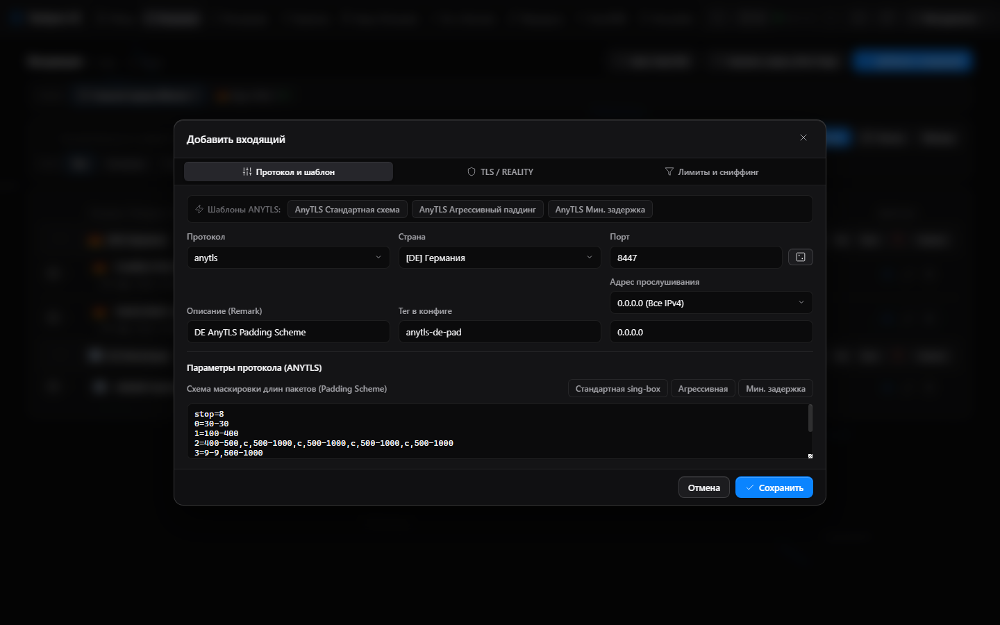

# 08. AnyTLS

> **Сводная карточка**
> - **Роль в `tachyon-core`**: `Inbound` (сервер) и `Outbound` (клиент / балансируемый узел)
> - **L4-транспорт**: `TCP` (поверх TLS или REALITY; встроенное мультиплексирование до 1024 потоков на сессию; UDP передаётся через встроенный UoT v1/v2)
> - **TLS / REALITY / ACME**: обязателен `tls` или `reality` (`tlsModes: ['tls', 'reality']`; при выборе `none` панель принудительно переводит режим в `tls`). На `Outbound` `tls.enabled: true` строго обязательно
> - **Нужен ли домен**: для режима `tls` — желателен домен со своим сертификатом (через панель или ACME) либо корректный `server_name`; для `reality` — домен на сервере не нужен, используется SNI маскировочного сайта

---

## Зачем нужен и как работает в `tachyon-core`

**Простая аналогия.** Обычные TLS-туннели часто выдают себя характером первых пакетов после рукопожатия: например, когда клиент отправляет маленький запрос и получает серию строго одинаковых блоков (TLS-in-TLS fingerprint). **AnyTLS** похож на курьера, который перед выходом из здания упаковывает и обычные письма, и коробки в пакеты переменной, заранее оговорённой толщины и ритма — наблюдатель снаружи видит естественный веб-трафик вместо ровных «лесенок» прокси.

**Механика в `tachyon-core`:**
- **AnyTLS** работает поверх стандартного `TLS` или `REALITY` по `TCP`, объединяя в одном соединении собственное лёгкое мультиплексирование потоков (до 1024 логических потоков в одной сессии) и механизм **динамического паддинга (`padding_scheme`)**.
- Сервер после аутентификации клиента отправляет ему актуальную схему паддинга или использует согласованный профиль, выравнивая размеры первых пакетов соединения в соответствии со строками `0=...`, `1=...`, ..., до индекса `stop=N`. Ключ `,c,` внутри строки означает проверку/условие применения на границе записи.
- Поддерживается встроенная инкапсуляция UDP-трафика через **UDP-over-TCP (UoT v1/v2)** без необходимости отдельного UDP-сокета.
- **Критическое ограничение ядра**: на `Outbound` протокола `anytls` **категорически запрещено** включать `dialer.tcp_fast_open: true` — и валидатор, и рантайм `tachyon-core` отклоняют такой узел с ошибкой.

---

## Скриншот формы в панели



---

## Пошаговая настройка в `tachyon-ui`

### Настройка входящего подключения (`Inbound`)

1. Откройте раздел **Inbounds** и нажмите **Добавить Inbound**.
2. Выберите протокол **AnyTLS (`anytls`)**.
3. Выберите один из готовых пресетов панели (`PROTOCOL_PRESETS.anytls`):
   - **AnyTLS Стандартная схема** — порт `8447`, TLS `tls`, SNI `www.microsoft.com`, ALPN `h2,http/1.1`, схема паддинга `default`.
   - **AnyTLS Агрессивный паддинг** — порт `8447`, TLS `tls`, SNI `www.apple.com`, ALPN `h2,http/1.1`, схема `aggressive`.
   - **AnyTLS Мин. задержка** — порт `8447`, TLS `tls`, SNI `www.cloudflare.com`, ALPN `h2,http/1.1`, схема `lowlatency`.
4. В блоке **Схема маскировки длин пакетов (Padding Scheme)** (`inb-anytls-padding`) при необходимости переключите шаблон одной из трёх кнопок:
   - **Стандартная** (`default`): сбалансированный профиль (`stop=8`).
   - **Агрессивная** (`aggressive`): крупные интервалы паддинга (`stop=10`, до `700-1300` байт) для жёсткого анализатора трафика.
   - **Мин. задержка** (`lowlatency`): короткая серия (`stop=4`) для игр и интерактивного трафика.
   Поле также можно оставить пустым — тогда `tachyon-core` применит встроенную схему по умолчанию.
5. Перейдите во вкладку **TLS**:
   - Выберите `tls` (с реальным сертификатом панели в `data/certs/server.crt` / `server.key`) или `reality` (сгенерируйте пару ключей и `short_id` для маскировки под внешний сайт без покупки домена).
   - Режим `none` для `anytls` недоступен.
6. Добавьте клиентов (используются `name` и `password`), сохраните Inbound и примените конфиг.

### Настройка исходящего подключения (`Outbound`)

1. В разделе **Outbounds** выберите тип **`anytls`**.
2. Укажите адрес сервера (`198.51.100.10`), порт (`8447`) и пароль клиента (`out-password`).
3. В разделе **TLS и Транспорт** оставьте **Включить TLS** активным (`out-tls` = `true`), задайте **Server Name (SNI)**, **ALPN** (`h2,http/1.1`) и при использовании REALITY — включите **REALITY** с `public_key` и `short_id`.
4. Убедитесь, что в расширенном JSON `out-settings` не передаётся `tcp_fast_open: true`.

---

## Разбор всех полей, переключателей и параметров

### Встроенные схемы паддинга (`ANYTLS_SCHEMES`)

| Шаблон в UI (`applyAnytlsScheme`) | Правила (`padding_scheme`) | Когда выбирать |
|---|---|---|
| `default` (Стандартная) | `stop=8`, `0=30-30`, `1=100-400`, `2=400-500,c,500-1000,c,500-1000,c,500-1000,c,500-1000`, `3=9-9,500-1000`, `4=500-1000`..`7=500-1000` | Рекомендуется по умолчанию для большинства сетей: хорошо размывает сигнатуру TLS-in-TLS при умеренном накладном трафике. |
| `aggressive` (Агрессивная) | `stop=10`, `0=64-128`, `1=256-600`, `2=600-1200,c,600-1200,c,600-1200`, `3=300-900`, `4=700-1300`, `5=700-1300` | При агрессивной фильтрации по размерам первых TLS-записей. Повышает расход трафика на открытие каждой новой сессии. |
| `lowlatency` (Мин. задержка) | `stop=4`, `0=16-32`, `1=64-180`, `2=200-400`, `3=200-400` | Для мобильных каналов, игр и VoIP, где важен минимальный оверхед на старте соединения. |

### Параметры формы и JSON

| Поле в панели (`ID`) | Ключ в `tachyon-core` JSON | Допустимые значения / дефолт | Зачем нужен и как настраивать |
|---|---|---|---|
| **Схема маскировки длин пакетов** (`inb-anytls-padding`) | `padding_scheme` | Массив строк (`Vec<String>`), например `["stop=8", "0=30-30", ...]` | В UI вводится построчно в `<textarea>`, панель автоматически разбивает строки и отбрасывает пустые. Если оставить пустым, поле опускается и ядро берёт встроенную схему. |
| **Клиенты** (вкладка клиентов) | `users[].{name, password}` | Непустые `name` и `password` | Список авторизованных пользователей. При 0 активных клиентов панель подставляет заглушку `__disabled__`. |
| **Режим TLS** (`inb-tls-mode`) | `tls.mode` / `tls.enabled` | `tls` или `reality` | `none` запрещён (`requires_tls = true`). Для `tls` используйте реальный сертификат или установите `allow_insecure` только в тестовой среде; для `reality` `allow_insecure` сбрасывается. |
| **SNI / ALPN** (`inb-tls-sni`, `inb-tls-alpn`) | `tls.server_name`, `tls.alpn` | `www.microsoft.com`, `["h2", "http/1.1"]` | Должны соответствовать выбранному сертификату (в `tls`) или целевому домену `handshake.server` (в `reality`). |
| **REALITY параметры** (`inb-reality-*`) | `tls.reality.{handshake, private_key, short_id}` | X25519 ключ, 1–16 hex символов `short_id` | Позволяет развернуть AnyTLS без собственного домена и сертификата. |
| **Outbound поля** (`out-server`, `out-port`, `out-password`, `out-tls*`) | `server`, `server_port`, `password`, `tls` | `tls.enabled: true` строго обязательно | На `Outbound` можно опционально задать `client_metadata` и параметры времени жизни сессии (`idle_session_check_interval`, `idle_session_timeout`, `min_idle_session`) через `out-settings`. |

---

## Сеть, TLS и файрвол

- **Порты файрвола (`inbound_firewall_rules`)**: открывается только **`TCP`** на `inb.port` (по умолчанию в пресетах — `8447`). Отдельный UDP-порт не требуется, так как UDP идёт через UoT внутри TLS-туннеля.
- **Использование за обратным прокси**: при терминации TLS на NGINX/Caddy обратите внимание, что `anytls` использует собственный бинарный протокол сразу после TLS-рукопожатия (не HTTP/2 и не WebSocket), поэтому обычный L7 HTTP-прокси его не пропустит — нужен только L4 SNI-маршрутизатор (`stream` / `ssl_preread`) без снятия TLS. В этом случае укажите `external_port: 443` для корректного экспорта подписок.
- **ACME**: сам рантайм `tachyon-core` не запускает встроенный ACME-клиент; выпуск и продление сертификатов выполняет `tachyon-ui`, передавая ядру готовые `certificate_path` / `key_path`.

---

## Экспорт подписок, клиенты и пример JSON `tachyon-core`

- **URI** (`?format=raw` или Base64):
  `anytls://<password>@panel.example.com:8447?security=tls&sni=panel.example.com&alpn=h2%2Chttp%2F1.1#AnyTLS`
  *(или с `security=reality&pbk=...&sid=...&fp=chrome` при активном REALITY).*
- **Клиентский JSON** (`?format=singbox`, `?format=tachyon`, `?format=outbounds`): `type: "anytls"`, `password`, `tls` (включая `reality` и `utls` при необходимости).
- **Clash Meta YAML** (`?format=clash` / `mihomo`): экспортируется как `type: anytls` с `password`, `sni`, `alpn`, `skip-cert-verify` (или `reality-opts`), `client-fingerprint`.
- **SIP008**: не поддерживается (формат только для Shadowsocks).
- **Совместимые клиенты**: `tachyon-core` (включая роутеры OpenWrt), современные клиенты с поддержкой `AnyTLS` и `Mihomo / Clash Meta`.

### Пример валидного JSON для `tachyon-core`

```json
{
  "inbounds": [
    {
      "type": "anytls",
      "tag": "anytls-in",
      "listen": "::",
      "listen_port": 8447,
      "users": [
        {
          "name": "alice",
          "password": "example-strong-password"
        }
      ],
      "padding_scheme": [
        "stop=8",
        "0=30-30",
        "1=100-400",
        "2=400-500,c,500-1000,c,500-1000,c,500-1000,c,500-1000",
        "3=9-9,500-1000",
        "4=500-1000",
        "5=500-1000",
        "6=500-1000",
        "7=500-1000"
      ],
      "tls": {
        "enabled": true,
        "server_name": "panel.example.com",
        "alpn": ["h2", "http/1.1"],
        "certificate_path": "data/certs/server.crt",
        "key_path": "data/certs/server.key"
      }
    }
  ],
  "outbounds": [
    {
      "type": "anytls",
      "tag": "anytls-out",
      "server": "198.51.100.10",
      "server_port": 8447,
      "password": "example-strong-password",
      "tls": {
        "enabled": true,
        "server_name": "panel.example.com",
        "alpn": ["h2", "http/1.1"]
      }
    }
  ]
}
```

---

## Диагностика и частые ошибки

| Симптом | Причина | Решение |
|---|---|---|
| Ошибка валидации `Outbound` в `tachyon-core`: запрещён TFO или отсутствует TLS | В `outbounds[]` указано `dialer.tcp_fast_open: true` либо `tls.enabled` не равен `true` | Удалите `tcp_fast_open` из настроек `dialer` этого аутбаунда и убедитесь, что `tls.enabled: true`. |
| Обрыв соединения сразу после TLS-рукопожатия при использовании REALITY | Неверный `short_id` / `public_key` либо недоступен `handshake.server` с сервера | Проверьте совпадение `public_key` и `short_id` в подписке и доступность выбранного SNI-домена по порту 443 с самого VPS. |
| Высокая задержка при открытии первых вкладок на мобильном интернете | Выбрана схема `aggressive` (`stop=10`, длинные блоки паддинга) на медленном канале | Переключите `padding_scheme` на `default` или `lowlatency` (`stop=4`). |
| Ошибка проверки сертификата у клиента в режиме `tls` | Установлен самоподписанный сертификат без включения `allow_insecure` или несовпадающий SNI | Выпустите доверенный сертификат для домена в панели (ACME) либо переключите `anytls` в режим `REALITY`. |

---

## См. также

- [Каталог протоколов](README.md)
- [Энциклопедия протоколов](../09-protocols-encyclopedia.md)
- [07. Shadowsocks](07-shadowsocks.md)
- [09. ShadowTLS v3](09-shadowtls.md)
