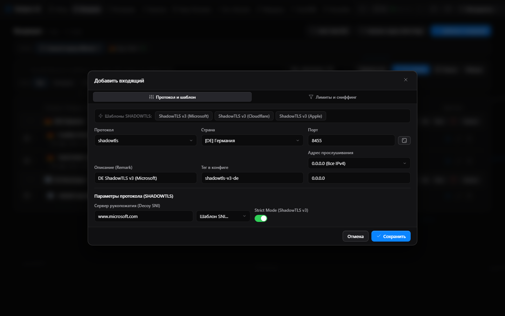

# 09. ShadowTLS v3

> **Сводная карточка**
> - **Роль в `tachyon-core`**: `Inbound` (сервер-обёртка) и `Outbound` (клиент-транспорт); обычно работает как транспортная прослойка перед внутренним прокси через `detour` (чаще всего с `Shadowsocks`)
> - **L4-транспорт**: только `TCP`
> - **TLS / REALITY / ACME**: в UI панель скрывает вкладку TLS для `Inbound` (`tlsModes: []`), так как сертификат серверу не нужен — он использует чужое рукопожатие `handshake.server`. На `Outbound` объект `tls` (`tls.enabled: true`, `server_name`, опционально `utls`) **обязателен**
> - **Нужен ли домен**: собственный домен и сертификат на сервере не нужны; требуется только доступный внешний домен прикрытия (`www.microsoft.com`, `www.cloudflare.com`, `www.apple.com`)

---

## Зачем нужен и как работает в `tachyon-core`

**Простая аналогия.** Представьте, что вы хотите войти в закрытый клуб через парадный вход банка. Охранник на входе проверяет только, что вы действительно прошли официальную процедуру приветствия банка (TLS-рукопожатие с настоящим сервером, например `www.microsoft.com`). Как только охрана убедилась, что приветствие подлинное, внутри уже установленного защищённого канала вы с помощью секретного пароля (HMAC) переключаете разговор на внутреннего оператора (например, локальный `Shadowsocks`). Постороннему наблюдателю и активному сканеру виден лишь подлинный TLS 1.3 handshake к легитимному сайту — даже без наличия собственного домена и сертификата у сервера.

**Механика в `tachyon-core`:**
- **ShadowTLS v3** не расшифровывает сертификат чужого сайта. Вместо этого на этапе TLS handshake сервер пересылает `ClientHello` реальному узлу `handshake.server:handshake.server_port` (или сопоставленному по SNI через `handshake_for_server_name`), пропуская его подлинную цепочку сертификатов обратно клиенту.
- В поле `SessionID` / служебных полях клиентской части **v3** встраивается криптографическая метка **HMAC-SHA1**, вычисленная по общему паролю пользователя (`users[].password`).
- Если клиент предъявил корректный HMAC (авторизованный пользователь), сервер после завершения рукопожатия начинает прозрачно передавать данные внутреннему прокси (указанному через `detour`, например локальному инбаунду `shadowsocks` или `socks`) с использованием ключей TLS 1.3 для защиты от подмены и обрезания.
- Если подключение пришло от обычного браузера или активного зонда DPI без пароля, ShadowTLS продолжает работать как прозрачный TCP-ретранслятор к `handshake.server`, не выдавая наличия прокси.
- В `tachyon-core` **версия `1` не поддерживается** и отклоняется рантаймом. Панель `tachyon-ui` всегда генерирует **`version: 3`**.

---

## Скриншот формы в панели



---

## Пошаговая настройка в `tachyon-ui`

### Настройка входящего подключения (`Inbound`)

1. Откройте раздел **Inbounds** и создайте (или убедитесь, что уже существует) внутренний транспортный прокси — чаще всего **Shadowsocks** на `127.0.0.1` (или стандартный порт).
2. Нажмите **Добавить Inbound** и выберите протокол **ShadowTLS (`shadowtls`)**.
3. Выберите один из встроенных пресетов панели (`PROTOCOL_PRESETS.shadowtls`):
   - **ShadowTLS v3 (Microsoft)** — порт `8455`, `tls: none`, `handshake.server`: `www.microsoft.com`, `strict_mode: true`.
   - **ShadowTLS v3 (Cloudflare)** — порт `8455`, `tls: none`, `handshake.server`: `www.cloudflare.com`, `strict_mode: true`.
   - **ShadowTLS v3 (Apple)** — порт `8455`, `tls: none`, `handshake.server`: `www.apple.com`, `strict_mode: true`.
4. В поле **Сервер рукопожатия (Decoy SNI)** (`inb-stls-server`) оставьте выбранный домен или выберите другой из выпадающего списка `Шаблон SNI...` (поддерживается также указание нестандартного порта через двоеточие, например `example.com:443`).
5. Переключатель **Strict Mode (ShadowTLS v3)** (`inb-stls-strict`) рекомендуется оставить **включённым** (`true`).
6. Добавьте клиентов (`name` и `password`) во вкладке клиентов.
7. В секции маршрутизации / цепочки (`detour`) свяжите `ShadowTLS` с целевым внутренним инбаундом (например, `ss-in`). Сохраните и примените конфигурацию.

### Настройка исходящего подключения (`Outbound`)

1. В разделе **Outbounds** выберите тип **`shadowtls`**.
2. Задайте адрес сервера (`198.51.100.10`), порт (`8455`) и пароль пользователя (`out-password`).
3. В JSON-полях `out-settings` укажите `"version": 3` и объект `"tls": { "enabled": true, "server_name": "www.microsoft.com", "utls": { "enabled": true, "fingerprint": "chrome" } }`.
4. У внутреннего прокси-аутбаунда (например, `shadowsocks`) задайте `"detour": "<tag_вашего_shadowtls_outbound>"`, чтобы трафик шёл внутрь установленного ShadowTLS-туннеля.

---

## Разбор всех полей, переключателей и параметров

### Входящий узел (`Inbound`)

| Поле в панели (`ID`) | Ключ в `tachyon-core` JSON | Допустимые значения / дефолт | Зачем нужен и как настраивать |
|---|---|---|---|
| **Версия протокола** (фиксирована панелью) | `version` | `3` (панель всегда ставит `3`; `1` отклоняется ядром) | Включает протокол ShadowTLS v3 с защитой на базе TLS 1.3 и HMAC-SHA1. |
| **Сервер рукопожатия (Decoy SNI)** (`inb-stls-server`) | `handshake.server`, `handshake.server_port` | Домен или `host:port` (дефолт `www.microsoft.com`, порт `443`) | Внешний TLS 1.3 сервер, с которым будет выполняться реальное рукопожатие. Выбирайте узел, близкий к VPS по географии и не заблокированный на самом сервере, с поддержкой TLS 1.3. |
| **Strict Mode (ShadowTLS v3)** (`inb-stls-strict`) | `strict_mode` | `true` (дефолт) / `false` | Включает строгую проверку последовательности TLS 1.3 записей и запрещает откат поведения к слабому режиму, защищая от активного пробирования и атак подмены. Отключайте только при несовместимости со специфическим клиентом. |
| **Клиенты** (вкладка клиентов) | `users[].{name, password}` | Список `{ name, password }` | Пароли пользователей для вычисления HMAC-SHA1 в v3. При 0 активных клиентов панель подставляет заглушку `__disabled__`. |
| **Внутренний маршрут (`detour`)** | `detour` | Тег локального inbound (`shadowsocks`, `socks` и т.д.) | Указывает, куда ShadowTLS v3 передаёт расшифрованный поток после проверки HMAC клиента. |

### Исходящий узел (`Outbound`)

| Поле в панели (`ID`) | Ключ в `tachyon-core` JSON | Допустимые значения / дефолт | Зачем нужен и как настраивать |
|---|---|---|---|
| **Сервер / Порт / Пароль** (`out-server`, `out-port`, `out-password`) | `server`, `server_port`, `password` | Хост, порт, пароль пользователя | Должны совпадать с параметрами ShadowTLS Inbound и одним из паролей в `users[]`. |
| **Версия и TLS** (через `out-settings`) | `version`, `tls` (`enabled: true`, `server_name`, `utls`) | `version: 3`, `tls.enabled: true` | **Обязателен** на outbound: `server_name` должен совпадать с доменом `handshake.server` на сервере; рекомендуется включать `utls` (`chrome` / `firefox`) для правдоподобного ClientHello. |

---

## Сеть, TLS и файрвол

- **Порты файрвола (`inbound_firewall_rules`)**: открывается только **`TCP`** на `inb.port` (в пресетах `8455`, на продакшене часто используют `443`).
- **Исходящий доступ с сервера**: сервер должен иметь свободный исходящий TCP-доступ к `handshake.server:443`. Если домен прикрытия недоступен с VPS или не поддерживает TLS 1.3, клиент не сможет завершить рукопожатие.
- **Использование за обратным прокси**: `ShadowTLS` нельзя ставить за HTTP-терминирующим NGINX/Caddy — сервер сам должен видеть сырой `ClientHello`. Допустим лишь прозрачный TCP L4-проброс (например, по SNI через NGINX `stream`), и в этом случае задавайте `external_port` для подписок.

---

## Экспорт подписок, клиенты и пример JSON `tachyon-core`

- **URI** (`?format=raw` или Base64):
  `shadowtls://<password>@198.51.100.10:8455?version=3&sni=www.microsoft.com#ShadowTLS`
  *(При использовании в паре с `Shadowsocks` клиенты часто используют связку через `detour` в JSON-профиле.)*
- **Клиентский JSON** (`?format=singbox`, `?format=tachyon`, `?format=outbounds`): экспортируется как `"type": "shadowtls"`, `"version": 3`, `"password"`, `"tls": { "enabled": true, "server_name": "www.microsoft.com" }`.
- **Clash Meta YAML** (`?format=clash` / `mihomo`): **не экспортируется** отдельным объектом `shadowtls` (в Clash для этого используется опция `shadow-tls-opts` внутри узла `ss`, поэтому для полной связки в `tachyon-ui` используйте формат `singbox` или `tachyon`).
- **SIP008**: не поддерживается.
- **Совместимые клиенты**: `tachyon-core` (включая OpenWrt), клиенты с поддержкой `ShadowTLS v3` + `detour` (например, `Shadowsocks` поверх `ShadowTLS v3`).

### Пример валидного JSON для `tachyon-core` (связка ShadowTLS v3 + Shadowsocks)

```json
{
  "inbounds": [
    {
      "type": "shadowtls",
      "tag": "stls-in",
      "listen": "::",
      "listen_port": 8455,
      "version": 3,
      "users": [
        {
          "name": "alice",
          "password": "example-stls-password"
        }
      ],
      "handshake": {
        "server": "www.microsoft.com",
        "server_port": 443
      },
      "strict_mode": true,
      "detour": "ss-inner"
    },
    {
      "type": "shadowsocks",
      "tag": "ss-inner",
      "listen": "127.0.0.1",
      "listen_port": 18388,
      "method": "2022-blake3-aes-256-gcm",
      "password": "AAAAAAAAAAAAAAAAAAAAAAAAAAAAAAAAAAAAAAAAAAA="
    }
  ],
  "outbounds": [
    {
      "type": "shadowsocks",
      "tag": "ss-via-stls",
      "method": "2022-blake3-aes-256-gcm",
      "password": "AAAAAAAAAAAAAAAAAAAAAAAAAAAAAAAAAAAAAAAAAAA=",
      "detour": "stls-out"
    },
    {
      "type": "shadowtls",
      "tag": "stls-out",
      "server": "198.51.100.10",
      "server_port": 8455,
      "version": 3,
      "password": "example-stls-password",
      "tls": {
        "enabled": true,
        "server_name": "www.microsoft.com",
        "utls": {
          "enabled": true,
          "fingerprint": "chrome"
        }
      }
    }
  ]
}
```

---

## Диагностика и частые ошибки

| Симптом | Причина | Решение |
|---|---|---|
| Ошибка инициализации или отказ клиента с `version: 1` | Указана устаревшая версия 1 в ручном конфиге или на клиенте | В `tachyon-core` поддерживается **v3** (панель всегда ставит `version: 3`); обновите конфигурацию клиента. |
| Рукопожатие зависает по таймауту у всех клиентов | Выбранный `handshake.server` недоступен с сервера по TCP:443, заблокирован или не поддерживает TLS 1.3 | Проверьте с сервера `openssl s_client -connect www.microsoft.com:443 -tls1_3` или смените Decoy SNI на `www.cloudflare.com` / `www.apple.com`. |
| Подключение устанавливается, но трафик внутрь не идёт (или сбрасывается после handshake) | Забыт `detour` на внутренний прокси (`shadowsocks`) или внутренний outbound не ссылается на `shadowtls` через `detour` | Проверьте совпадение тегов `detour` на сервере (Inbound) и клиенте (Outbound). |
| В подписке Clash Meta отсутствует ShadowTLS-прокси | Экспорт в формат Clash YAML пропускает standalone-инбаунды `shadowtls` | Используйте клиентские профили `?format=singbox` или `?format=tachyon`. |

---

## См. также

- [Каталог протоколов](README.md)
- [Энциклопедия протоколов](../09-protocols-encyclopedia.md)
- [07. Shadowsocks](07-shadowsocks.md)
- [08. AnyTLS](08-anytls.md)
- [10. NaiveProxy](10-naive.md)
