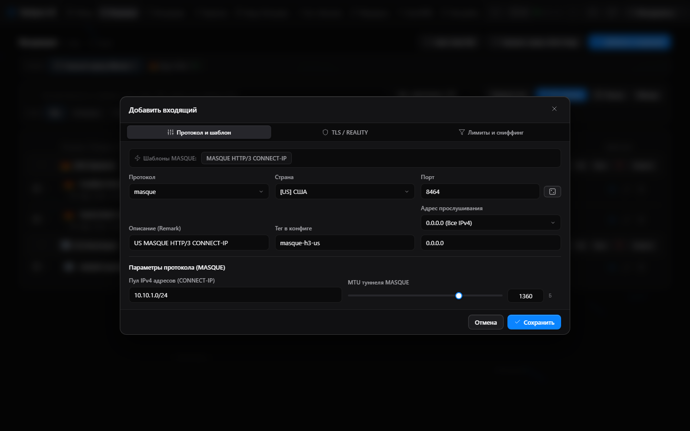

# 11. MASQUE (HTTP/3 CONNECT-IP / Cloudflare)

> **Сводная карточка**
> - **Роль в `tachyon-core`**: `Inbound` (сервер RFC 9484 CONNECT-IP) и `Outbound` (клиентский профиль `standard` для своего сервера и профиль `cloudflare` для WARP-совместимых эндпоинтов)
> - **L4-транспорт**: `UDP` (HTTP/3 QUIC с ALPN `h3`); `Outbound` с профилем `cloudflare` при `vhttp: "auto"` или `"h2"` умеет также работать по `TCP` HTTP/2. Внутри инкапсулирует L3 IP-пакеты (TCP/UDP/ICMP через userspace-стек `smoltcp`)
> - **TLS / REALITY / ACME**: сертификатный `TLS` (`tls.enabled: true`) **строго обязателен** (`tlsModes: ['tls']`). Для профиля `standard` требуется валидный доверенный сертификат с совпадением `sni` и SAN; для `cloudflare` используется пиннинг публичного ECDSA P-256 ключа
> - **Нужен ли домен**: **да, рекомендуется** для своего `Inbound` (`profile: "standard"`) с доверенным сертификатом CA, чтобы клиенты проходили проверку SAN без ослабления безопасности

---

## Зачем нужен и как работает в `tachyon-core`

**Простая аналогия.** Если классический прокси (`VLESS` или `SOCKS5`) передаёт отдельные TCP- и UDP-соединения приложений, то **MASQUE (RFC 9484 `CONNECT-IP`)** превращает стандартное HTTP/3-подключение в полноценный **L3 VPN-туннель** (как WireGuard, но замаскированный под обычный браузерный HTTP/3-трафик к веб-серверу). Снаружи DPI видит легитимный QUIC / HTTP/3 поток на базе стандартных веб-капсул (HTTP Datagrams / Capsules), а внутри маршрутизируются целые IP-пакеты, включая ICMP (`ping`), DNS и любые протоколы.

**Механика в `tachyon-core`:**
- **На `Inbound`** ядро поднимает HTTP/3 QUIC сервер, принимающий запросы `CONNECT-IP` по стандартному маршруту `/.well-known/masque/ip/*/*/`. Внутренний userspace-стек `smoltcp` выделяет клиентам IPv4-адреса из заданного пула `ipv4_pool` (по умолчанию `10.10.1.0/24`) и переводит L3-пакеты в исходящие соединения ядра с учётом настроенного `mtu`.
- **На `Outbound`** поддерживаются два профиля:
  1. **`standard`** — подключение к собственному MASQUE-серверу (`tachyon-core` или совместимому RFC 9484 шлюзу). Здесь используется стандартная TLS PKI-проверка: экспорт подписок `tachyon-ui` подставляет в `sni` домен из SAN активного доверенного CA-сертификата сервера (`resolve_cert_sni_for_export`), а при наличии валидного сертификата не добавляет `insecure`.
  2. **`cloudflare`** — подключение к инфраструктуре с аутентификацией по паре **ECDSA P-256** ключей (`private_key` и `public_key` с пиннингом публичного ключа сервера).
- **Строгая проверка ECDSA P-256 ключей в `tachyon-ui`**: при генерации конфигурации ядра панель валидирует `private_key` (строго PKCS#8 DER или SEC1 DER с явным OID кривой `prime256v1` в Base64) и `public_key` (SPKI DER с 65-байтным несжатым ключом `0x04 || X || Y` в Base64). Если в `Outbound` указаны невалидные ключи (или для `profile != "standard"` не задан `private_key`), панель отбрасывает такой outbound с предупреждением в лог, чтобы не сломать запуск ядра.
- **Таймауты для роутеров**: при экспорте клиентских JSON-подписок (`singbox` / `tachyon`) `tachyon-ui` автоматически прописывает **`keep_alive_period: "20s"`** и **`idle_timeout: "50s"`**, что критически важно для удержания NAT-трансляций UDP на домашних роутерах (OpenWrt) и мобильных сетях без обрыва туннеля в простое.

---

## Скриншот формы в панели



---

## Пошаговая настройка в `tachyon-ui`

### Настройка входящего подключения (`Inbound`)

1. Убедитесь, что у сервера настроен реальный домен (`panel.example.com`) и доверенный TLS-сертификат в `data/certs/server.crt` / `server.key`.
2. Откройте раздел **Inbounds** и нажмите **Добавить Inbound**.
3. Выберите протокол **MASQUE (`masque`)**.
4. Примените встроенный пресет панели (`PROTOCOL_PRESETS.masque`):
   - **MASQUE HTTP/3 CONNECT-IP** — UDP-порт `8464`, TLS `tls`, SNI `www.cloudflare.com` (заменяется на `web_domain`, если он настроен), ALPN `h3`, `mtu: 1360`, `pool: 10.10.1.0/24`.
5. Проверьте **Пул IPv4 адресов (CONNECT-IP)** (`inb-masque-pool`, по умолчанию `10.10.1.0/24`) — убедитесь, что он не пересекается с локальной сетью сервера или пулами WireGuard/AmneziaWG/FPTN.
6. Настройте ползунок **MTU туннеля MASQUE** (`inb-masque-mtu`, от `1200` до `1420` с шагом `10`, по умолчанию `1360`). Для мобильных сетей LTE/5G или PPPoE можно снизить до `1280`–`1320`.
7. Во вкладке **TLS** проверьте **Server Name (SNI)** (должен совпадать с SAN сертификата) и ALPN `h3`.
8. Добавьте клиентов во вкладке клиентов (каждому клиенту панель детерминированно назначит уникальный IP из пула `masque_ipv4_pool` при экспорте подписки). Сохраните и примените конфиг.

### Настройка исходящего подключения (`Outbound`)

1. Откройте раздел **Outbounds** и выберите тип **`masque`**.
2. В базовых полях укажите сервер, порт и параметры **TLS** (`tls.enabled: true`, `server_name`, `alpn: ["h3"]`).
3. Специфические поля задайте в JSON-блоке расширенных настроек (`out-settings`):
   - Для собственного сервера: `"profile": "standard"`, `"uri": "https://panel.example.com:8464/.well-known/masque/ip/*/*/"`, `"ip": "10.10.1.2"`, `"mtu": 1360`, `"keep_alive_period": "20s"`, `"idle_timeout": "50s"`.
   - Для профиля `cloudflare`: `"profile": "cloudflare"`, `"vhttp": "auto"` (`"h3"` или `"h2"`), `"private_key": "<Base64 PKCS#8 P-256>"`, `"public_key": "<Base64 SPKI P-256>"`, `"ip"`, `"ipv6"`, `"mtu"`.

### Генерация корректных P-256 EC ключей для `MASQUE` (`cloudflare`)

Если вам нужно сформировать пару ключей ECDSA `prime256v1` в формате, который гарантированно пройдёт строгую проверку `tachyon-ui` и `tachyon-core`:

```bash
# 1. Приватный ключ P-256 в формате PKCS#8 DER -> Base64 (одной строкой)
openssl genpkey -algorithm EC -pkeyopt ec_paramgen_curve:prime256v1 -outform DER | base64 -w0

# Или из существующего PEM-файла ec_priv.pem в PKCS#8 DER Base64:
openssl pkcs8 -topk8 -nocrypt -in ec_priv.pem -outform DER | base64 -w0

# 2. Публичный ключ P-256 в формате SPKI DER (65-байтный uncompressed ключ) -> Base64
openssl pkey -in ec_priv.pem -pubout -outform DER | base64 -w0
```

---

## Разбор всех полей, переключателей и параметров

### Входящий узел (`Inbound`)

| Поле в панели (`ID`) | Ключ в `tachyon-core` JSON | Допустимые значения / дефолт | Зачем нужен и как настраивать |
|---|---|---|---|
| **Пул IPv4 адресов (CONNECT-IP)** (`inb-masque-pool`) | `ipv4_pool` | CIDR-подсеть, дефолт `"10.10.1.0/24"` | Виртуальная подсеть L3-туннеля. Панель выделяет клиентам IP внутри этой подсети при формировании подписок. |
| **MTU туннеля MASQUE** (`inb-masque-mtu`) | `mtu` | `1200..1420` в UI (дефолт `1360`; в ядре минимум `1200`, иначе fallback `1280`) | Максимальный размер IP-пакета внутри HTTP/3-капсулы. Значение `1360` хорошо подходит для обычных каналов, `1280` — для проблемных мобильных сетей. |
| **TLS режим** (`inb-tls-mode`) | `tls.enabled: true` | Только `tls` | Обязательный сертификатный TLS 1.3 для HTTP/3 QUIC. |
| **SNI / ALPN** (`inb-tls-sni`, `inb-tls-alpn`) | `tls.server_name`, `tls.alpn` | Домен из SAN, `["h3"]` | Для `profile: "standard"` `server_name` должен соответствовать SAN сертификата, чтобы клиент не отклонил TLS-соединение. |

### Исходящий узел (`Outbound`)

| Параметр (`out-settings` / форма) | Ключ в `tachyon-core` JSON | Допустимые значения / дефолт | Зачем нужен и как настраивать |
|---|---|---|---|
| **Профиль** | `profile` | `"standard"` \| `"cloudflare"` | Выбирает стандартный RFC 9484 CONNECT-IP или Cloudflare-совместимый режим с пиннингом P-256. |
| **Версия HTTP** | `vhttp` | `"auto"` \| `"h3"` \| `"h2"` | Транспорт для профиля `cloudflare`: по умолчанию `auto` (H3 с откатом/выбором H2). |
| **URL эндпоинта** | `uri` | `"https://panel.example.com:8464/.well-known/masque/ip/*/*/"` | Целевой URI CONNECT-IP ресурса на сервере. |
| **Внутренний IP клиента** | `ip`, `ipv6` | `"10.10.1.2"`, опц. IPv6 | Виртуальный адрес интерфейса клиента в L3-туннеле. |
| **Ключи P-256** | `private_key`, `public_key` | Base64 DER (PKCS#8 или SEC1 с OID `prime256v1`; SPKI 65-байтный `0x04...`) | Обязателен `private_key` для `profile != "standard"`; `public_key` используется для пиннинга ключа сервера. Невалидные ключи отфильтровываются панелью. |
| **Таймауты удержания NAT** | `keep_alive_period`, `idle_timeout` | В подписках панель ставит `"20s"` и `"50s"` | Предотвращают закрытие UDP-маппинга на роутерах OpenWrt и мобильных NAT-шлюзах во время простоя. |
| **MTU** | `mtu` | `>= 1200` (обычно `1360` или `1280`) | Должен не превышать MTU сервера, чтобы избежать фрагментации QUIC-пакетов. |

---

## Сеть, TLS и файрвол

- **Порты файрвола (`inbound_firewall_rules`)**: открывается **`UDP`** на `inb.port` (в пресете `8464`).
- **Доверенный PKI-сертификат**: для `MASQUE` в режиме `standard` наличие доверенного сертификата CA с корректным SAN критично — при наличии активного доверенного сертификата `tachyon-ui` не экспортирует флаг `insecure` и подставляет SAN сертификата в `sni`.
- **Обратный прокси**: стандартный L7 HTTP/2 reverse proxy не подходит для `HTTP/3 CONNECT-IP` с IP-дейтаграммами. Используйте прямой UDP-порт (например `443/udp` или `8464/udp`) либо L4 UDP-проброс (и `external_port` при пробросе портов).

---

## Экспорт подписок, клиенты и пример JSON `tachyon-core`

- **URI** (`?format=raw` или Base64):
  `masque://panel.example.com:8464?profile=standard&uri=https%3A%2F%2Fpanel.example.com%3A8464%2F.well-known%2Fmasque%2Fip%2F*%2F*%2F&ip=10.10.1.2&mtu=1360&sni=panel.example.com#MASQUE`
- **Клиентский JSON** (`?format=singbox`, `?format=tachyon`, `?format=outbounds`): экспортируется с `"type": "masque"`, `"profile": "standard"`, `"uri"`, `"ip"`, `"keep_alive_period": "20s"`, `"idle_timeout": "50s"`, `"mtu"`, `"tls"`.
- **Clash Meta YAML** и **SIP008**: **не экспортируется** — используйте форматы `singbox` / `tachyon` или URI.
- **Совместимые клиенты**: `tachyon-core` (включая роутеры OpenWrt с поддержкой `keep_alive_period` / `idle_timeout`).

### Пример валидного JSON для `tachyon-core`

```json
{
  "inbounds": [
    {
      "type": "masque",
      "tag": "masque-in",
      "listen": "::",
      "listen_port": 8464,
      "mtu": 1360,
      "ipv4_pool": "10.10.1.0/24",
      "tls": {
        "enabled": true,
        "server_name": "panel.example.com",
        "alpn": ["h3"],
        "certificate_path": "data/certs/server.crt",
        "key_path": "data/certs/server.key"
      }
    }
  ],
  "outbounds": [
    {
      "type": "masque",
      "tag": "masque-out",
      "profile": "standard",
      "uri": "https://panel.example.com:8464/.well-known/masque/ip/*/*/",
      "ip": "10.10.1.2",
      "mtu": 1360,
      "keep_alive_period": "20s",
      "idle_timeout": "50s",
      "tls": {
        "enabled": true,
        "server_name": "panel.example.com",
        "alpn": ["h3"]
      }
    }
  ]
}
```

---

## Диагностика и частые ошибки

| Симптом | Причина | Решение |
|---|---|---|
| Outbound `masque` отсутствует в сгенерированном конфиге ядра (и в группах балансировки) | Некорректный формат `private_key` или `public_key` P-256 (например, PEM с заголовками вместо голого Base64 DER, либо SEC1 без OID `prime256v1`, либо отсутствует `private_key` для профиля `cloudflare`) | Сгенерируйте ключи в Base64 DER через `openssl` (PKCS#8 + SPKI без заголовков `-----BEGIN...-----`) или перепроверьте значения в `out-settings`. |
| Подключение в режиме `standard` падает с ошибкой проверки сертификата | `sni` не совпадает с SAN сертификата или на сервере используется самоподписанный сертификат | Выпустите валидный сертификат CA (через ACME в панели) на ваш домен и укажите тот же домен в `tls.server_name` и в хосте `uri`. |
| Туннель на роутере OpenWrt «засыпает» через 30–60 секунд простоя | NAT провайдера или домашнего шлюза сбрасывает неактивную UDP-сессию | Убедитесь, что в клиентском JSON присутствуют `"keep_alive_period": "20s"` и `"idle_timeout": "50s"` (подставляются панелью автоматически при экспорте). |
| Не удаётся подключиться к MASQUE по UDP/8464 | Провайдер режет QUIC/UDP или порт не открыт в файрволе | Проверьте разрешение UDP на порту инбаунда. Если UDP заблокирован, используйте `MASQUE` с профилем `cloudflare` и `vhttp: "h2"` (для WARP) либо протоколы на базе TCP/HTTP2 (`TrustTunnel`, `NaiveProxy`, `AnyTLS`). |

---

## См. также

- [Каталог протоколов](README.md)
- [Энциклопедия протоколов](../09-protocols-encyclopedia.md)
- [10. NaiveProxy](10-naive.md)
- [12. TrustTunnel](12-trusttunnel.md)
