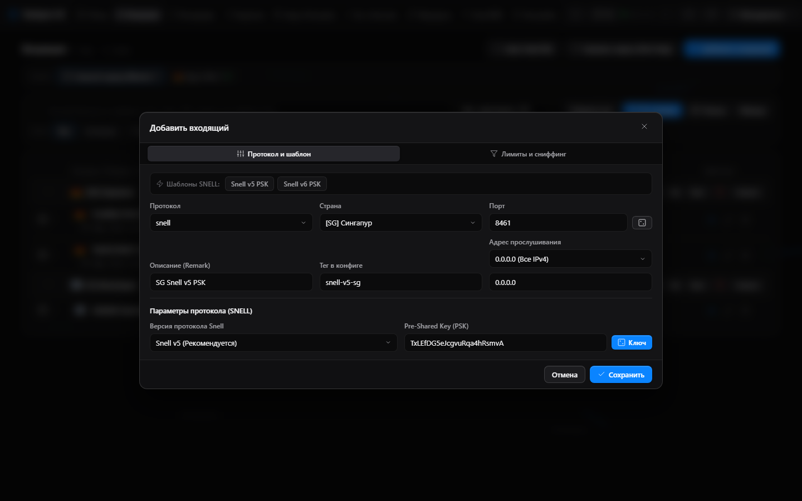

# 14. Snell (v4 / v5 / v6)

| Параметр | Значение |
| :--- | :--- |
| **Роль в `tachyon-ui`** | `Inbound` + `Outbound` |
| **L4-транспорт** | `TCP` (переносит TCP, нативный UDP и `UDP-over-TCP` v1/v2) |
| **TLS / REALITY / ACME** | Не поддерживается (`none`); вкладка TLS в панели скрыта. Для TLS-маскировки оборачивают в `ShadowTLS v3` |
| **Статус в `tachyon-core 0.6.9`** | Полная поддержка в схеме (`check`) и рантайме (`run`) с учётом ограничений версий |

---

## Зачем нужен и как работает в `tachyon-core`

**Snell** — лёгкий бинарный прокси-протокол с аутентификацией по общему предварительному ключу (**PSK**, *Pre-Shared Key*), созданный для экосистемы Surge и отличающийся минимальным расходом CPU, оперативной памяти и заряда батареи.

Как устроена работа в `tachyon-core`:

1. Клиент устанавливает TCP-соединение с сервером и проходит быстрое бинарное рукопожатие на общем ключе `psk` без накладных расходов полноценного TLS handshake.
2. Поверх одной сессии поддерживается переиспользование TCP-соединения (`CMD_CONNECT_V2`), передача UDP-пакетов (`CMD_UDP`, нативный UDP или `udp_over_tcp`) и проверка доступности канала (`CMD_PING`).
3. **Важные отличия версий в `tachyon-core 0.6.9`:**
   - **Inbound** принимает **только `version: 5` или `6`** (`version: 4` на сервере отклоняется валидатором).
   - **Outbound** поддерживает `version: 4`, `5` и `6`.
   - Для **v6** на сервере длина `psk` должна быть строго **от 12 до 255 байт**, а вместо старой обфускации `obfs_mode` используется параметр режима работы `mode` (`default`, `unshaped`, `unsafe-raw`).
   - Для **v5** (и **v4** на outbound) наоборот допускается `obfs_mode` / `obfs` (`none`, `http`, `tls`), но запрещено поле `mode`.

> [!TIP]
> Поскольку собственный поток Snell зашифрован без внешнего TLS-рукопожатия, на жёстких сетевых фильтрах его часто комбинируют со слоем `ShadowTLS v3` (через `detour` / каскад), получая реальный TLS 1.3 handshake стороннего домена.

---

## Скриншот формы в панели



---

## Пошаговая настройка в `tachyon-ui`

### Настройка входящего подключения (`Inbound`)

1. Перейдите во вкладку **Входящие (`Inbounds`)** и нажмите **Добавить**.
2. Выберите тип протокола **`snell`**. Вкладка TLS автоматически скроется, так как протокол не использует собственный TLS.
3. При необходимости выберите готовый пресет в верхней части формы:
   - **`Snell v5 PSK`** — TCP-порт `8461`, `version: 5` (максимальная совместимость со сторонними клиентами v5).
   - **`Snell v6 PSK`** — TCP-порт `8461`, `version: 6` (современный вариант с поддержкой режимов `mode`).
4. Укажите `Порт` (по умолчанию `8461`), проверьте версию `5` или `6` (не выбирайте `4` для сервера) и задайте надёжный `PSK` (для `v6` — не короче 12 символов; можно оставить пустым, если привязываете клиента, но явный PSK надёжнее).
5. Сохраните правило и примените конфигурацию (`Применить` / перезапуск `tachyon-core`).

### Настройка исходящего подключения (`Outbound`)

1. Откройте вкладку **Исходящие (`Outbounds`)** и выберите тип **`snell`**.
2. Заполните адрес сервера (`198.51.100.10` или `panel.example.com`), порт и общий ключ в поле пароля (`PSK`).
3. Если удалённый сервер работает на `v4`, `v6` или использует HTTP/TLS-обфускацию (`obfs`), раскройте дополнительные JSON-настройки исходящего и укажите `version`, `obfs` / `obfs_host` (для v4/v5) или `mode` (для v6).

---

## Разбор всех полей, переключателей и параметров

### Входящее подключение (`Inbound`)

| Поле в панели | Ключ `tachyon-core` JSON | Допустимые значения / дефолт | Назначение |
| :--- | :--- | :--- | :--- |
| **Адрес прослушивания** (`inb-listen`) | `listen` | IPv4/IPv6; дефолт `0.0.0.0` (или `::`) | Интерфейс, на котором сервер слушает TCP-соединения |
| **Порт** (`inb-port`) | `listen_port` | `1..65535`; пресет `8461` | Входящий TCP-порт сервера Snell |
| **Версия Snell** (`inb-snell-ver`) | `version` | `5`, `6` (в UI есть `4`, но ядро для inbound допускает только `5` или `6`) | Версия протокола; выбирайте `5` для совместимости или `6` для новейших клиентов |
| **PSK-ключ** (`inb-snell-psk`) | `psk` | Строка (для `v6` строго `12..255` байт) | Общий секретный ключ; если пусто, панель подставит пароль первого активного клиента (или служебный маркер) |
| **Режим обфускации** *(JSON)* | `obfs_mode` | `none`, `http`, `tls` (только для `v5`) | Лёгкая маскировка заголовков; запрещено в `version: 6` |
| **Режим работы** *(JSON)* | `mode` | `default`, `unshaped`, `unsafe-raw` (только для `v6`) | Профиль обработки потока Snell v6; запрещено в `version: 5` |

### Исходящее подключение (`Outbound`)

| Поле в панели | Ключ `tachyon-core` JSON | Допустимые значения / дефолт | Назначение |
| :--- | :--- | :--- | :--- |
| **Сервер** (`out-server`) | `server` | IP или домен (`198.51.100.10`, `panel.example.com`) | Адрес удалённого сервера Snell |
| **Порт** (`out-port`) | `server_port` | `1..65535` | Порт удалённого сервера |
| **Пароль / PSK** (`out-password`) | `psk` | Строка (`12..255` байт для `v6`) | Общий ключ аутентификации; также может задаваться в `out-settings` |
| **Версия** *(в `out-settings`)* | `version` | `4`, `5`, `6` | Версия протокола на стороне сервера |
| **Обфускация** *(в `out-settings`, v4/v5)* | `obfs` / `obfs_mode`, `obfs_host` | `none`, `http`, `tls`; домен для HTTP/TLS | Включает обфускацию заголовков (запрещено для `v6`) |
| **UDP over TCP** *(в `out-settings`, v4/v5)* | `udp_over_tcp` | `true` / `false` (или объект версии) | Инкапсуляция UDP-пакетов поверх TCP (запрещено для `v6`) |
| **Режим v6** *(в `out-settings`, v6)* | `mode` | `default`, `unshaped`, `unsafe-raw` | Специфичный режим Snell v6 (запрещено для `v4`/`v5`) |

---

## Сеть, TLS и файрвол

- **TLS / REALITY / ACME:** протокол Snell не использует сертификаты TLS, домен с ACME или REALITY. Внешнюю маскировку при необходимости организуют через `ShadowTLS v3` (связка `detour`).
- **Правила файрвола:** панель `tachyon-ui` автоматически открывает **`TCP`** на указанном `listen_port` (например, `8461/tcp`). Отдельный UDP-порт не требуется — UDP-трафик клиентов переносится в рамках протокола.
- **Пропуск за NAT / обратным прокси:** за обычными HTTP-прокси (Nginx/Caddy L7) Snell не работает, так как использует собственный бинарный протокол поверх чистого TCP (или `stream`/L4-проброс).

---

## Экспорт подписок, совместимые клиенты и пример валидного JSON `tachyon-core`

- **Форматы экспорта подписок (`GET /sub/{sub_id}?format=...`):**
  - **URI (`raw` / Base64):** `snell://<psk>@198.51.100.10:8461?version=5#Snell-v5`
  - **Клиентский JSON (`singbox` / `tachyon` / `outbounds`):** полная генерация объекта `type: "snell"`.
  - **Clash Meta / Mihomo YAML (`clash` / `mihomo` / `yaml`):** поддерживается (`type: snell`, `psk`, `version`).
  - **SIP008:** не поддерживается (формат только для Shadowsocks).
- **Совместимые клиенты:** `tachyon-core` (OpenWrt, Linux, Windows, macOS), Surge, Clash Meta / Mihomo.

### Пример валидного JSON `tachyon-core`

#### Inbound (`inbounds[]`, версия 5)

```json
{
  "type": "snell",
  "tag": "snell-in-8461",
  "listen": "::",
  "listen_port": 8461,
  "version": 5,
  "psk": "v5-example-secret-key-2026"
}
```

#### Outbound (`outbounds[]`, версия 6)

```json
{
  "type": "snell",
  "tag": "snell-out-v6",
  "server": "198.51.100.10",
  "server_port": 8461,
  "version": 6,
  "psk": "v6-strong-secret-min12chars"
}
```

---

## Диагностика и частые ошибки

| Симптом / ошибка | Причина | Решение |
| :--- | :--- | :--- |
| Ошибка `tachyon-core check` при старте inbound | В панели выбрана версия **`4`** для входящего подключения | Переключите версию inbound на **`5`** или **`6`** (`v4` поддерживается только на `outbound`) |
| Ошибка валидации длины `psk` в `version: 6` | Ключ короче 12 байт или длиннее 255 байт | Задайте `psk` длиной `12..255` символов (например, сгенерируйте случайную строку 24–32 символа) |
| Ошибка конфликта полей `mode` и `obfs_mode` | В `v6` передано `obfs_mode`/`udp_over_tcp`, либо в `v5` передано `mode` | Оставьте `obfs_mode` только для `v4`/`v5`, а `mode` — только для `v6` |
| Клиент не подключается по UDP или падает скорость | Закрыт порт или клиент ожидает другую версию (`v5` vs `v6`) | Сверьте `version` и `psk` на сервере и в подписке, проверьте доступность `TCP` порта `8461` |

---

## См. также

- [Каталог протоколов](README.md)
- [Энциклопедия протоколов](../09-protocols-encyclopedia.md)
- [13. Mieru](13-mieru.md)
- [15. MTProto](15-mtproto.md)
- [09. ShadowTLS v3](09-shadowtls.md)
