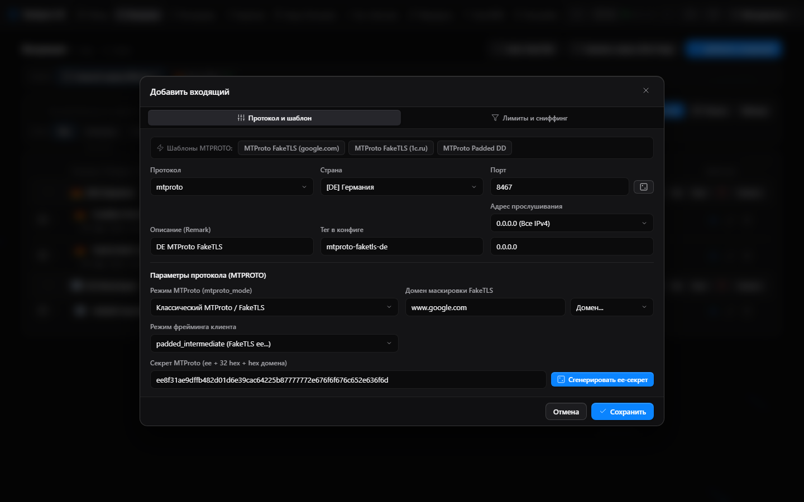

# 15. MTProto (FakeTLS / Padded DD / telegram-ws)

| Параметр | Значение |
| :--- | :--- |
| **Роль в `tachyon-ui`** | `Inbound` + `Outbound` |
| **L4-транспорт** | Только `TCP` (UDP не поддерживается). На outbound дополнительно режим `telegram-ws` / `kws` (`wss://` с откатом на TCP) |
| **TLS / REALITY / ACME** | Вкладка TLS для классического `inbound` скрыта (`none`; маскировка FakeTLS встроена в секрет). Для outbound `telegram-ws` / `kws` автоматически включается `tls: { enabled: true }` |
| **Статус в `tachyon-core 0.6.9`** | Полная поддержка в схеме (`check`) и рантайме (`run`) |

---

## Зачем нужен и как работает в `tachyon-core`

**MTProto** — специализированный прокси-протокол исключительно для мессенджера Telegram. В отличие от общих VPN и прокси-туннелей, он не требует установки отдельного VPN-клиента на телефон или компьютер: пользователь открывает ссылку `tg://proxy?...` прямо в приложении Telegram.

В `tachyon-core 0.6.9` протокол работает в двух сценариях:

1. **Inbound (сервер для клиентов Telegram):** принимает TCP-подключения от Telegram по секрету, обфусцированному заголовком `obfuscated2` в выбранном транспортном режиме (`padded_intermediate`, `intermediate`, `abridged`, `full`).
2. **Outbound (исходящий мост):** может проксировать трафик в удалённый MTProto-сервер или работать в нативном режиме **`telegram-ws` / `kws`** — перехватывать 64-байтовый заголовок `obfuscated2`, определять целевой дата-центр Telegram (`DC1..DC5`) и туннелировать трафик через стандартный защищённый WebSocket `wss://kws{dc}[-1].web.telegram.org/apiws` с автоматическим откатом на прямой TCP при сбое WebSocket.

> [!IMPORTANT]
> **Ключевой инвариант `tachyon-core 0.6.9`:** парсер секрета в ядре принимает **строго 32 шестнадцатеричных символа** (16 байт) **без** префиксов `ee`/`dd` и доменного hex-суффикса.
> В интерфейсе `tachyon-ui` кнопка генерации FakeTLS-секрета формирует удобную строку вида `ee + <32 hex> + <hex домена>`, однако при сохранении, генерации JSON ядра и экспорте подписок панель автоматически извлекает ровно 32 чистых hex-символа (отбрасывая `ee`/`dd` и доменный хвост).

---

## Скриншот формы в панели



---

## Пошаговая настройка в `tachyon-ui`

### Настройка входящего подключения (`Inbound`)

1. Откройте **Входящие (`Inbounds`) → Добавить** и выберите протокол **`mtproto`**.
2. Выберите один из готовых пресетов панели:
   - **`MTProto FakeTLS (google.com)`** — TCP-порт `8467`, домен FakeTLS `www.google.com`, транспорт `padded_intermediate`.
   - **`MTProto FakeTLS (1c.ru)`** — TCP-порт `8467`, домен FakeTLS `1c.ru`, транспорт `padded_intermediate`.
   - **`MTProto Padded DD`** — TCP-порт `8467`, домен `www.cloudflare.com`, транспорт `abridged`.
3. При необходимости введите свой `Домен FakeTLS` (например, `www.microsoft.com` или `panel.example.com`) и нажмите кнопку генерации секрета в форме: панель создаст валидный секрет, а при сохранении автоматически нормализует его до 32 hex-символов для `tachyon-core`.
4. Для экспорта клиентского режима через WebSocket можно выбрать режим **`telegram-ws`** или **`kws`** (при обычном входе Telegram оставьте режим по умолчанию пустым).
5. Сохраните правило и примените конфигурацию.

### Настройка исходящего подключения (`Outbound`)

1. Перейдите во вкладку **Исходящие (`Outbounds`) → Добавить** и выберите **`mtproto`**.
2. Укажите `Сервер`, `Порт`, `Секрет` (32 hex-символа; если вставите `ee...`, панель нормализует его при генерации), `Транспорт` (`padded_intermediate`, `intermediate`, `abridged`, `full`) и при необходимости `Режим` (`telegram-ws` или `kws`).
3. Для `telegram-ws` / `kws` панель сама добавит `tls: { "enabled": true }` в итоговую конфигурацию.

---

## Разбор всех полей, переключателей и параметров

### Входящее подключение (`Inbound`)

| Поле в панели | Ключ `tachyon-core` JSON | Допустимые значения / дефолт | Назначение |
| :--- | :--- | :--- | :--- |
| **Адрес прослушивания** (`inb-listen`) | `listen` | IPv4/IPv6; дефолт `0.0.0.0` (или `::`) | Сетевой интерфейс прослушивания TCP |
| **Порт** (`inb-port`) | `listen_port` | `1..65535`; пресет `8467` | Входящий TCP-порт MTProto-сервера |
| **Режим** (`inb-mtp-mode`) | *(только экспорт клиента)* `mode` | `""` (классический), `telegram-ws`, `kws` | Режим, подставляемый при экспорте клиентских конфигураций |
| **Домен FakeTLS** (`inb-mtp-domain`) | *(помощник UI)* | Доменное имя (напр. `www.google.com`, `1c.ru`) | Используется генератором UI для формирования строки `ee<32hex><hex_domain>` |
| **Транспорт** (`inb-mtp-trans`) | `transport` | `padded_intermediate` (дефолт), `intermediate`, `abridged`, `full` | Тип кадрирования MTProto внутри `obfuscated2` |
| **Секрет** (`inb-mtp-secret`) | `users[].secret` | Строго 32 hex-символа (`[0-9a-f]{32}`) | Секретный ключ доступа; префиксы `ee`/`dd` и хвост домена панель автоматически срезает до 32 hex перед записью в конфиг |

### Исходящее подключение (`Outbound`)

| Поле в панели | Ключ `tachyon-core` JSON | Допустимые значения / дефолт | Назначение |
| :--- | :--- | :--- | :--- |
| **Сервер** (`out-server`) | `server` | IP или домен (`198.51.100.10`, `panel.example.com`) | Адрес удалённого MTProto-прокси (или целевой узел) |
| **Порт** (`out-port`) | `server_port` | `1..65535` | TCP-порт удалённого сервера |
| **Режим** (`out-mtp-mode`) | `mode` | `""`, `telegram-ws`, `kws` | При `telegram-ws`/`kws` открывает WebSocket поверх TLS к `wss://kws{dc}[-1].web.telegram.org/apiws` |
| **Секрет** (`out-mtp-secret`) | `secret` | Строго 32 hex-символа | Секрет для подключения (при вводе `ee...`/`dd...` панель вырезает 32 hex) |
| **Транспорт** (`out-mtp-trans`) | `transport` | `padded_intermediate`, `intermediate`, `abridged`, `full` | Вариант транспорта MTProto |
| **TLS** *(авто)* | `tls` | `{ "enabled": true }` (добавляется автоматически) | Активируется панелью для режимов `telegram-ws` и `kws` |

---

## Сеть, TLS и файрвол

- **TLS / REALITY / ACME:** собственные сертификаты и домен с ACME для `inbound` MTProto не нужны. Маскировка FakeTLS строится на симметричном секрете и имени домена-приманки, а для `telegram-ws`/`kws` TLS устанавливается в сторону серверов Telegram.
- **Файрвол:** панель открывает **только `TCP`** на порту `listen_port` (например, `8467/tcp`). UDP для MTProto не используется.
- **Трафик приложений:** MTProto обслуживает исключительно протокол Telegram; браузер, системные обновления и другие приложения через него не маршрутизируются.

---

## Экспорт подписок, совместимые клиенты и пример валидного JSON `tachyon-core`

- **Форматы экспорта подписок (`GET /sub/{sub_id}?format=...`):**
  - **URI (`raw` / Base64):** `tg://proxy?server=198.51.100.10&port=8467&secret=0123456789abcdef0123456789abcdef&transport=padded_intermediate#MTProto`
  - **Клиентский JSON (`singbox` / `tachyon` / `outbounds`):** генерируется объект `type: "mtproto"` с 32-символьным `secret`, `transport` и (при `telegram-ws`/`kws`) блоком `mode` + `tls`.
  - **Clash Meta YAML и SIP008:** не экспортируется.
- **Совместимые клиенты:** официальные клиенты Telegram (Desktop, iOS, Android, macOS), `tachyon-core`.

### Пример валидного JSON `tachyon-core`

#### Inbound (`inbounds[]`)

```json
{
  "type": "mtproto",
  "tag": "mtproto-in-8467",
  "listen": "::",
  "listen_port": 8467,
  "transport": "padded_intermediate",
  "users": [
    {
      "secret": "0123456789abcdef0123456789abcdef"
    }
  ]
}
```

#### Outbound (`outbounds[]`, режим `telegram-ws`)

```json
{
  "type": "mtproto",
  "tag": "mtproto-out-kws",
  "server": "198.51.100.10",
  "server_port": 8467,
  "secret": "0123456789abcdef0123456789abcdef",
  "transport": "padded_intermediate",
  "mode": "telegram-ws",
  "tls": {
    "enabled": true
  }
}
```

---

## Диагностика и частые ошибки

| Симптом / ошибка | Причина | Решение |
| :--- | :--- | :--- |
| Ошибка `secret must be 32 hex characters` при ручном редактировании JSON | В конфигурацию `tachyon-core` напрямую вставлен секрет формата `ee...` или `dd...` длиной > 32 символов | Оставьте ровно 32 hex-символа (убрав первые `ee`/`dd` и доменный суффикс) или сохраните правило через UI `tachyon-ui` |
| Клиент Telegram не подключается, хотя порт открыт | Выбран несовместимый `transport` или секрет обрезан вручную не с той позиции | Для FakeTLS используйте `padded_intermediate`; первые 2 символа (`ee`/`dd`) нужно пропустить, взяв следующие 32 hex-символа |
| Ошибка при запуске `telegram-ws` / `kws` в ручном JSON | Отсутствует блок `tls: { "enabled": true }` на outbound | Добавьте `"tls": { "enabled": true }` или создайте outbound через форму `tachyon-ui` |

---

## См. также

- [Каталог протоколов](README.md)
- [Энциклопедия протоколов](../09-protocols-encyclopedia.md)
- [14. Snell](14-snell.md)
- [16. FPTN](16-fptn.md)
