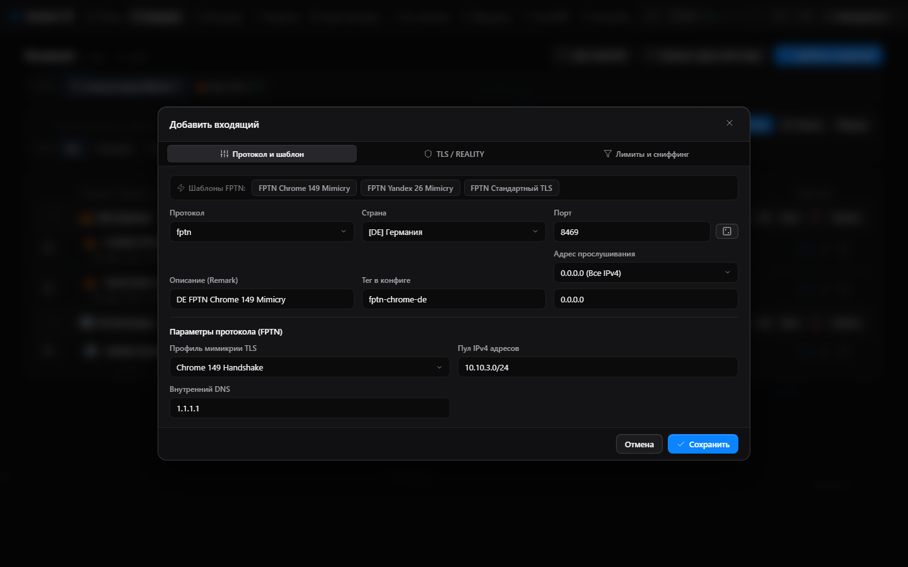

# 16. FPTN

| Параметр | Значение |
| :--- | :--- |
| **Роль в `tachyon-ui`** | `Inbound` + `Outbound` (HTTPS + WebSocket L3 VPN со стеком `smoltcp`) |
| **L4-транспорт** | `TCP` (HTTPS/TLS + WebSocket `/api/v1/fptn`, внутри переносит L3 IPv4/IPv6-пакеты: TCP, UDP, ICMP) |
| **TLS / REALITY / ACME** | Поддерживаются **`tls`** и **`reality`** (внешняя защита обязательна; префиксы имитации браузера используют `RealityMode2`) |
| **Статус в `tachyon-core 0.6.9`** | Полная поддержка в схеме (`check`) и рантайме (`run`) |

---

## Зачем нужен и как работает в `tachyon-core`

**FPTN** — L3 VPN-протокол, полностью замаскированный под стандартное веб-приложение (HTTPS + REST + WebSocket) с имитацией TLS-отпечатков реальных браузеров.

Принцип работы в `tachyon-core 0.6.9`:

1. Клиент устанавливает внешнее соединение поверх **TLS** или **REALITY** с одним из профилей браузерной мимикрии (`reality_chrome149`, `reality_firefox151`, `reality_yandex26_4`, `reality_safari26_5` и др.). На одном порту сервер с включённым `tls` автоматически распознаёт обычный TLS, обфусцированный TLS (записи `0x17`) и `RealityMode2` (decoy ClientHello с 32-байтным SessionID).
2. Клиент авторизуется через HTTP-запрос `POST /api/v1/login`, получает JWT-токен (и при необходимости настройки DNS через `/api/v1/dns`), а затем открывает WebSocket-канал `/api/v1/fptn` с упаковкой `YaFF` / `Protobuf`.
3. Сервер выдаёт клиенту виртуальный IP-адрес из заданной подсети `ipv4_pool` (по умолчанию `10.10.3.0/24`) и DNS (`dns`, по умолчанию `1.1.1.1`), обрабатывая все IP-пакеты (TCP, UDP, ICMP) через встроенный userspace-стек `smoltcp`.
4. На outbound `tachyon-core` также умеет принимать готовую токен-подписку вида `fptn:...` или `fptnb://...` (поле `token`), автоматически разворачивая её в группу узлов с балансировщиком.

> [!NOTE]
> Устаревший режим маскировки `RealityMode1` (значения `"2"`, `"kSniRealityMode"`) в `tachyon-core 0.6.9` отклонён — используйте `reality` или современные профили `reality_chrome149` и аналогичные.

---

## Скриншот формы в панели



---

## Пошаговая настройка в `tachyon-ui`

### Настройка входящего подключения (`Inbound`)

1. Откройте **Входящие (`Inbounds`) → Добавить** и выберите протокол **`fptn`**.
2. Выберите один из встроенных пресетов панели:
   - **`FPTN Chrome 149 Mimicry`** — TCP-порт `8469`, TLS, SNI `www.microsoft.com`, подсеть `10.10.3.0/24`, DNS `1.1.1.1`, профиль `reality_chrome149`.
   - **`FPTN Yandex 26 Mimicry`** — TCP-порт `8469`, TLS, SNI `www.cloudflare.com`, подсеть `10.10.3.0/24`, DNS `1.1.1.1`, профиль `reality_yandex26_4`.
   - **`FPTN Стандартный TLS`** — TCP-порт `8469`, TLS, SNI `www.apple.com`, подсеть `10.10.3.0/24`, DNS `8.8.8.8`, профиль `tls`.
3. В разделе настроек протокола проверьте профиль **`Обфускация`**, **`IPv4-пул (TUN-подсеть)`** (`10.10.3.0/24`) и **`DNS-сервер`** (`1.1.1.1`).
4. На вкладке **TLS** выберите режим `tls` (укажите путь к сертификату/ключу, либо используйте выпущенный панелью ACME-сертификат для `panel.example.com`) или `reality` (с ключами REALITY и SNI длиной `4..64` байта).
5. Добавьте хотя бы одного клиента (`Имя` и `Пароль`) и сохраните inbound.

### Настройка исходящего подключения (`Outbound`)

1. Во вкладке **Исходящие (`Outbounds`) → Добавить** выберите **`fptn`**.
2. Задайте `Сервер`, `Порт`, `Пароль` и настройки `TLS`.
3. При необходимости передайте в дополнительных параметрах (`out-settings`) имя пользователя (`username`), профиль `obfuscation`, `sni` (обязателен длиной `4..64` байт при `reality*`), `md5_fingerprint` сертификата или токен подписки `token` (`fptn:...` / `fptnb://...`).

---

## Разбор всех полей, переключателей и параметров

### Входящее подключение (`Inbound`)

| Поле в панели | Ключ `tachyon-core` JSON | Допустимые значения / дефолт | Назначение |
| :--- | :--- | :--- | :--- |
| **Адрес прослушивания** (`inb-listen`) | `listen` | IPv4/IPv6; дефолт `0.0.0.0` (или `::`) | Интерфейс, на котором сервер принимает HTTPS/WebSocket |
| **Порт** (`inb-port`) | `listen_port` | `1..65535`; пресет `8469` | Входящий TCP-порт сервера FPTN |
| **Профиль обфускации** (`inb-fptn-obfs`) | `obfuscation` | `reality_chrome149`, `reality_firefox151`, `reality_yandex26_4`, `reality_safari26_5`, `tls`, `none` (также версии `chrome145..149`, `firefox149..151`, `yandex24..26_4`, `safari26_4..5`) | Режим имитации TLS ClientHello / браузерного отпечатка |
| **TUN-подсеть / IPv4 пул** (`inb-fptn-pool`) | `ipv4_pool` | CIDR IPv4; дефолт `10.10.3.0/24` | Адресная подсеть виртуального L3-интерфейса для клиентов |
| **DNS-сервер** (`inb-fptn-dns`) | `dns` | IP-адрес DNS; дефолт `1.1.1.1` | DNS-сервер, передаваемый клиентам в параметрах туннеля |
| **Клиенты** (`clients[]`) | `users[].{username, password}` | Непустой список пар логин/пароль | Учётные записи для авторизации через `/api/v1/login` |
| **Вкладка TLS** (`inb-tls-*`) | `tls` | `tls` или `reality` | Параметры внешнего шифрования и сертификата / REALITY-ключей |

### Исходящее подключение (`Outbound`)

| Поле в панели | Ключ `tachyon-core` JSON | Допустимые значения / дефолт | Назначение |
| :--- | :--- | :--- | :--- |
| **Сервер** (`out-server`) | `server` | IP или домен (`198.51.100.10`, `panel.example.com`) | Адрес удалённого сервера FPTN |
| **Порт** (`out-port`) | `server_port` | `1..65535` | TCP-порт удалённого сервера |
| **Пароль** (`out-password`) | `password` | Строка | Пароль учётной записи FPTN |
| **Имя пользователя** *(в `out-settings`)* | `username` | Строка | Логин учётной записи FPTN |
| **Обфускация** *(в `out-settings`)* | `obfuscation` | `reality`, `reality_chrome149`, `reality_firefox151`, `reality_yandex26_4`, `reality_safari26_5`, `tls`, `none` | Профиль обфускации клиентского рукопожатия |
| **SNI маскировки** *(в `out-settings`)* | `sni` | Строка `4..64` байта | Обязателен при включённом режиме `reality` / `reality_*` |
| **Отпечаток / токен** *(в `out-settings`)* | `md5_fingerprint`, `token` | MD5-хеш сертификата; строка `fptn:...` / `fptnb://...` | Пиннинг сертификата официального сервера или загрузка кластера серверов по токену |

---

## Сеть, TLS и файрвол

- **TLS / REALITY / ACME:** для режима `tls` используйте действительный домен (`panel.example.com`) и сертификат, выпущенный панелью `tachyon-ui` через ACME (встроенный ACME внутри `tachyon-core` не запускается — панель передаёт готовые `certificate_path`/`key_path`). Для профилей `reality_*` на outbound обязательно задавайте `sni` длиной `4..64` байта, даже если подключение идёт по IP `198.51.100.10`.
- **Файрвол:** панель открывает **`TCP`** на порту `listen_port` (например, `8469/tcp`).
- **MTU и потери пакетов:** поскольку L3 IP-пакеты передаются поверх TCP WebSocket, на каналах с высокой потерей пакетов возможен эффект TCP-внутри-TCP; для нестабильных мобильных сетей лучше предусмотреть запасной UDP-канал (`tewfai` или `wdtt`).

---

## Экспорт подписок, совместимые клиенты и пример валидного JSON `tachyon-core`

- **Форматы экспорта подписок (`GET /sub/{sub_id}?format=...`):**
  - **URI (`raw` / Base64):** генерируется токен вида `fptn:<base64(json)>` со структурой `{ "version": 1, "service_name": "...", "username": "...", "password": "...", "servers": [{ "name": "...", "host": "198.51.100.10", "port": 8469, "md5_fingerprint": "" }] }`.
  - **Токены подписки (`fptn:` / `fptnb://`):** поддерживаются при импорте и в клиентском `outbound.token`.
  - **Клиентский JSON (`singbox` / `tachyon` / `outbounds`):** генерируется объект `type: "fptn"`.
  - **Clash Meta YAML и SIP008:** не экспортируется.
- **Совместимые клиенты:** официальные клиенты FPTN (Windows, macOS, Linux, Android, iOS) и `tachyon-core`.

### Пример валидного JSON `tachyon-core`

#### Inbound (`inbounds[]`)

```json
{
  "type": "fptn",
  "tag": "fptn-in-8469",
  "listen": "::",
  "listen_port": 8469,
  "obfuscation": "reality_chrome149",
  "ipv4_pool": "10.10.3.0/24",
  "dns": "1.1.1.1",
  "users": [
    {
      "username": "alice",
      "password": "fptn-strong-password"
    }
  ],
  "tls": {
    "enabled": true,
    "server_name": "panel.example.com",
    "certificate_path": "data/certs/server.crt",
    "key_path": "data/certs/server.key"
  }
}
```

#### Outbound (`outbounds[]`)

```json
{
  "type": "fptn",
  "tag": "fptn-out",
  "server": "198.51.100.10",
  "server_port": 8469,
  "username": "alice",
  "password": "fptn-strong-password",
  "obfuscation": "reality_chrome149",
  "sni": "www.microsoft.com",
  "tls": {
    "enabled": true,
    "server_name": "www.microsoft.com",
    "insecure": true
  }
}
```

---

## Диагностика и частые ошибки

| Симптом / ошибка | Причина | Решение |
| :--- | :--- | :--- |
| Ошибка валидации на outbound при подключении по IP | Включён профиль `reality` / `reality_*`, но не задан `sni` длиной `4..64` байт | Явно укажите `sni` (например, `www.microsoft.com`) в параметрах подключения |
| Отказ при использовании старого значения `obfuscation` | Указан устаревший `RealityMode1` (`"2"` или `"kSniRealityMode"`) | Выберите `reality` или современный профиль `reality_chrome149` / `reality_yandex26_4` |
| Клиент авторизуется, но нет интернета внутри туннеля | Конфликт подсети `ipv4_pool` с локальной сетью или недоступный `dns` | Смените подсеть на непересекающуюся (например, `10.10.3.0/24`) и укажите рабочий DNS (`1.1.1.1` или `8.8.8.8`) |

---

## См. также

- [Каталог протоколов](README.md)
- [Энциклопедия протоколов](../09-protocols-encyclopedia.md)
- [15. MTProto](15-mtproto.md)
- [17. WDTT](17-wdtt.md)
