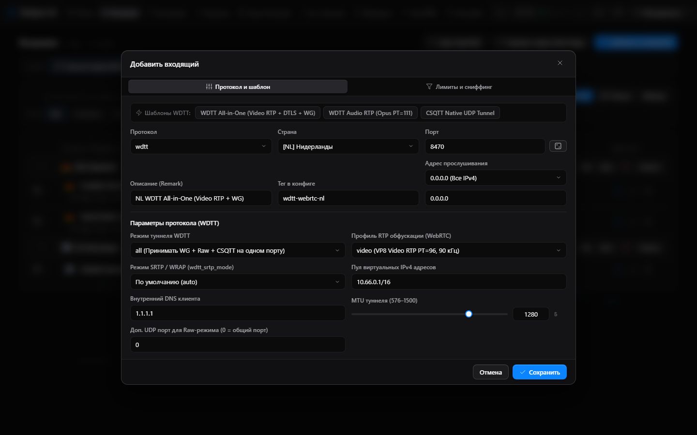

# 17. WDTT (WG / Raw / CSQTT)

| Параметр | Значение |
| :--- | :--- |
| **Роль в `tachyon-ui`** | `Inbound` + `Outbound` (L3 UDP-туннель со стеком `smoltcp`) |
| **L4-транспорт** | `UDP` (основной `listen_port` + опциональный дополнительный `raw_port`) |
| **TLS / REALITY / ACME** | Не используется (`none`); шифрование обеспечивают `DTLS 1.2` (RFC 9146 CID), `Noise_IKpsk2` или `ChaCha20-Poly1305` |
| **Статус в `tachyon-core 0.6.9`** | Полная поддержка в схеме (`check`) и рантайме (`run`) |

---

## Зачем нужен и как работает в `tachyon-core`

**WDTT** (включая варианты **qWDTT** и **CSQTT**) — скоростной userspace L3 VPN-туннель поверх UDP, маскирующий сетевой обмен под стандартные мультимедийные потоки реального времени (**RTP** видео/аудио и **DTLS 1.2**).

Как работает протокол в `tachyon-core 0.6.9`:

1. Внешняя оболочка оформляет UDP-датаграммы в виде RTP-потока (`video`, аудио Opus `PT=111` или `unified`) в контейнере `WDTT-WRAP-v1` / `CSQTT-WRAP-v1` и/или `DTLS 1.2` с расширением Connection ID (RFC 9146).
2. Внутри поддерживаются следующие режимы туннеля (`mode`):
   - **`all`** *(только inbound)*: комбинированный сервер, одновременно обслуживающий клиенты `wg` и `raw`; при `raw_port == 0` и `listen_port <= 65532` ядро автоматически пробует открыть дополнительный UDP-порт `listen_port + 3` для fast-path режима `raw`.
   - **`wg`**: обмен параметрами (`GETCONF`/`READY`) и зашифрованный L3-канал WireGuard (`Noise_IKpsk2`).
   - **`raw`**: облегчённый высокоскоростной канал с защитой от переупорядочивания пакетов (`RA`-фреймы).
   - **`csqtt` / `csqtt_v1`**: нативный UDP-туннель с компактной конфигурацией `GETCONF`/`TUNCONF`.
3. Виртуальный L3-стек `smoltcp` выделяет клиентам адреса из пула `ipv4_pool` (по умолчанию `10.66.0.1/16`) и переносит TCP, UDP и ICMP.

---

## Скриншот формы в панели



---

## Пошаговая настройка в `tachyon-ui`

### Настройка входящего подключения (`Inbound`)

1. Откройте **Входящие (`Inbounds`) → Добавить** и выберите протокол **`wdtt`**.
2. Выберите один из трёх пресетов в верхней части формы:
   - **`WDTT All-in-One (Video RTP + DTLS + WG)`** — UDP-порт `8470`, `mode: all`, `obfs: video`, `mtu: 1280`, пул `10.66.0.1/16`, DNS `1.1.1.1`.
   - **`WDTT Audio RTP (Opus PT=111)`** — UDP-порт `8470`, `mode: wg`, `obfs: audio`, `mtu: 1280`.
   - **`CSQTT Native UDP Tunnel`** — UDP-порт `8470`, `mode: csqtt`, `obfs: video`, `mtu: 1280`.
3. Настройте профиль обфускации (`video` / `audio` / `unified`), режим SRTP/DTLS (`srtp_mode`), `MTU` в диапазоне `576..1500` (рекомендуется `1280`) и при необходимости явный `Raw-порт` (`raw_port`).
4. Добавьте хотя бы одного клиента с паролем (при необходимости с ограничением устройств `max_devices`) и сохраните inbound.

### Настройка исходящего подключения (`Outbound`)

1. Перейдите во вкладку **Исходящие (`Outbounds`) → Добавить** и выберите **`wdtt`**.
2. Введите `Сервер`, `Порт`, `Пароль`, выберите `Режим` (`wg`, `raw`, `csqtt`, `csqtt_v1` — обратите внимание, что `all` используется только на сервере), `Профиль RTP` (`video`, `audio`, `unified`), `SRTP-режим` и `MTU` (`576..1500`).
3. Панель автоматически добавит `workers: 8` в конфигурацию клиента `tachyon-core`.

---

## Разбор всех полей, переключателей и параметров

### Входящее подключение (`Inbound`)

| Поле в панели | Ключ `tachyon-core` JSON | Допустимые значения / дефолт | Назначение |
| :--- | :--- | :--- | :--- |
| **Адрес прослушивания** (`inb-listen`) | `listen` | IPv4/IPv6; дефолт `0.0.0.0` (или `::`) | Интерфейс для приёма UDP-пакетов |
| **Порт** (`inb-port`) | `listen_port` | `1..65535`; пресет `8470` (дефолт ядра `56000` или `46000` для `csqtt*`) | Основной входящий UDP-порт |
| **Режим туннеля** (`inb-wdtt-mode`) | `mode` | `all`, `wg`, `raw`, `csqtt`, `csqtt_v1` | Тип принимаемого инкапсулированного L3-туннеля |
| **Профиль RTP** (`inb-wdtt-obfs`) | `obfs` | `video`, `audio`, `unified` | Маскировка UDP-пакетов под RTP видео, аудио Opus (`PT=111`) или смешанный профиль |
| **Режим SRTP / DTLS** (`inb-wdtt-srtp`) | *(экспорт клиента)* `srtp_mode` | `""` (авто), `auto`, `dtls`, `wrap`, `dtls-srtp`, `wrap-srtp` | Определяет режим обёртки DTLS/WRAP в клиентском экспорте |
| **IPv4 пул** (`inb-wdtt-pool`) | `ipv4_pool` | CIDR IPv4; дефолт `10.66.0.1/16` | Адресная подсеть виртуальных IP клиентов |
| **Клиентский DNS** (`inb-wdtt-dns`) | `client_dns` | IP-адрес; дефолт `1.1.1.1` | DNS-сервер, выдаваемый подключившимся клиентам |
| **MTU** (`inb-wdtt-mtu`) | `mtu` | `576..1500`; дефолт `1280` | Максимальный размер передаваемого пакета в туннеле |
| **Raw-порт** (`inb-wdtt-rawport`) | `raw_port` | `0..65535`; дефолт `0` | Дополнительный UDP-порт для fast-path режима `raw` (`0` = выкл., либо авто `listen_port + 3` в режиме `all`) |
| **Клиенты и пароль** | `password`, `users[].{name, password, max_devices}` | Обязателен непустой `password` или `users[]` | Авторизация клиентов; `max_devices` задаёт лимит одновременных устройств |

### Исходящее подключение (`Outbound`)

| Поле в панели | Ключ `tachyon-core` JSON | Допустимые значения / дефолт | Назначение |
| :--- | :--- | :--- | :--- |
| **Сервер** (`out-server`) | `server` | IP или домен (`198.51.100.10`, `panel.example.com`) | Адрес сервера WDTT |
| **Порт** (`out-port`) | `server_port` | `1..65535` | Основной UDP-порт сервера |
| **Пароль** (`out-password`) | `password` | Непустая строка | Ключ/пароль доступа |
| **Режим** (`out-wdtt-mode`) | `mode` | `wg`, `raw`, `csqtt`, `csqtt_v1` | Режим клиентского туннеля |
| **Профиль RTP** (`out-wdtt-obfs`) | `obfs` | `video`, `audio`, `unified` | Должен совпадать с профилем сервера |
| **Режим SRTP** (`out-wdtt-srtp`) | `srtp_mode` | `""`, `auto`, `dtls`, `wrap` | Способ инкапсуляции DTLS/WRAP |
| **MTU** (`out-wdtt-mtu`) | `mtu` | `576..1500`; дефолт `1280` | MTU туннельного интерфейса |
| **Потоки обработки** *(авто)* | `workers` | `8` (подставляется панелью) | Количество рабочих потоков UDP-туннеля на клиенте |

---

## Сеть, TLS и файрвол

- **TLS / REALITY / ACME:** внешний TLS не применяется, домен и сертификаты не требуются.
- **Файрвол:** панель `tachyon-ui` открывает **`UDP`** на `listen_port` (например, `8470/udp`) и дополнительно **`UDP`** на `raw_port`, если `raw_port > 0`.
- **Важный нюанс режима `mode: "all"`:** если вы оставили `raw_port: 0` и используете `mode: "all"` (порт `8470`), ядро пытается также задействовать `listen_port + 3` (`8473/udp`). Если вы используете клиентов в режиме `raw`, откройте `8473/udp` вручную или задайте `raw_port` явно в настройках inbound, чтобы панель добавила правило файрвола автоматически.

---

## Экспорт подписок, совместимые клиенты и пример валидного JSON `tachyon-core`

- **Форматы экспорта подписок (`GET /sub/{sub_id}?format=...`):**
  - **URI (`raw` / Base64):** `wdtt://wdtt-secret-pass@198.51.100.10:8470?mode=wg&obfs=video&mtu=1280#WDTT-Video`
  - **Клиентский JSON (`singbox` / `tachyon` / `outbounds`):** генерируется `type: "wdtt"` с `workers: 8`, `mode`, `obfs`, `mtu`, и при наличии `srtp_mode` / `raw_port`.
  - **Clash Meta YAML и SIP008:** не экспортируется.
- **Совместимые клиенты:** `tachyon-core` (включая роутеры OpenWrt и клиентские профили панели) и нативные WDTT/CSQTT-клиенты.

### Пример валидного JSON `tachyon-core`

#### Inbound (`inbounds[]`)

```json
{
  "type": "wdtt",
  "tag": "wdtt-in-8470",
  "listen": "::",
  "listen_port": 8470,
  "mode": "all",
  "obfs": "video",
  "ipv4_pool": "10.66.0.1/16",
  "client_dns": "1.1.1.1",
  "mtu": 1280,
  "raw_port": 8473,
  "password": "wdtt-master-password",
  "users": [
    {
      "name": "router-home",
      "password": "wdtt-client-password",
      "max_devices": 3
    }
  ]
}
```

#### Outbound (`outbounds[]`)

```json
{
  "type": "wdtt",
  "tag": "wdtt-out",
  "server": "198.51.100.10",
  "server_port": 8470,
  "password": "wdtt-client-password",
  "mode": "wg",
  "obfs": "video",
  "srtp_mode": "auto",
  "mtu": 1280,
  "workers": 8
}
```

---

## Диагностика и частые ошибки

| Симптом / ошибка | Причина | Решение |
| :--- | :--- | :--- |
| Ошибка валидации `mtu` при `tachyon-core check` | Значение `mtu` меньше `576` или больше `1500` | Установите `mtu` в пределах `576..1500` (оптимально `1280`) |
| Ошибка `password` пустой | На inbound не задан ни верхнеуровневый `password`, ни пользователь в `users[]` | Добавьте хотя бы одного клиента с паролем или задайте общий `password` |
| Клиент в режиме `raw` не устанавливает соединение | В файрволе не открыт дополнительный UDP-порт `raw_port` (или `listen_port + 3`) | Укажите `raw_port` явно в inbound и перепримените правила файрвола (либо откройте порт `listen_port + 3/udp`) |
| Рукопожатие не проходит при работе `wg` | Несовпадение `obfs` (`video` / `audio` / `unified`) или `mode` между сервером и клиентом | Сверьте `mode` и `obfs` в конфигурации клиента и сервера |

---

## См. также

- [Каталог протоколов](README.md)
- [Энциклопедия протоколов](../09-protocols-encyclopedia.md)
- [16. FPTN](16-fptn.md)
- [18. Sudoku](18-sudoku.md)
