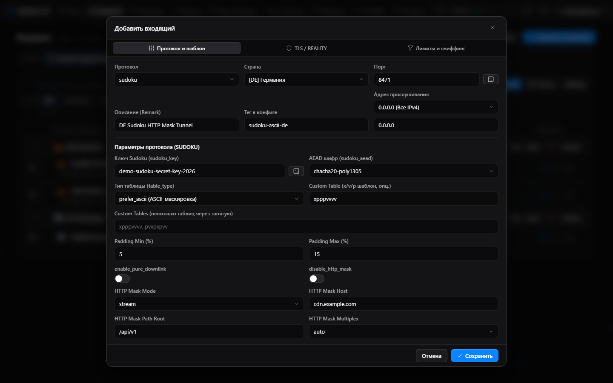

# 18. Sudoku

| Параметр | Значение |
| :--- | :--- |
| **Роль в `tachyon-ui`** | `Inbound` + `Outbound` (конструктор, парсер подписок и проверка схемы) |
| **L4-транспорт** | `TCP` (опционально с HTTP-маской `http_mask`) |
| **TLS / REALITY / ACME** | `none` или сертификатный `tls` (REALITY не поддерживается) |
| **Статус в `tachyon-core 0.6.9`** | **Только проверка схемы (`tachyon-core check`)** — в стандартной сборке рантайма `0.6.9` протокол **не реализован** |

---

## Зачем нужен и как работает в `tachyon-core`

**Sudoku** — специализированный транспорт с управляемой энтропией потока. Вместо передачи шифротекста в виде «белого шума» со случайными байтами, он пропускает зашифрованный поток (AEAD: `chacha20-poly1305` / `aes-128-gcm`) через математическую таблицу подстановки (`prefer_ascii`, `prefer_entropy` или пользовательские таблицы), дополняет его случайным выравниванием (`padding_min..padding_max`) и может оборачивать в гибкую HTTP-маску (`http_mask`), чтобы трафик выглядел как читаемый ASCII/HTTP-обмен. Для ускорения входящего канала предусмотрен режим `enable_pure_downlink`.

> [!WARNING]
> **Фактический статус в `tachyon-core 0.6.9`:**
> Тип `sudoku` зарегистрирован в списке известных типов входящих и исходящих соединений (конфигурация с ним успешно проходит проверку схемы `tachyon-core check`), а `tachyon-ui` полностью поддерживает его форму, импорт и экспорт подписок `sudoku://`.
> Однако **обработчик `sudoku` в рантайме `tachyon-core 0.6.9` не реализован** — при попытке запуска сервера (`run`) с активным inbound или outbound типа `sudoku` ядро вернёт ошибку инициализации.
> Используйте `sudoku` в `tachyon-ui` **только** для тестирования схем или генерации подписок внешним совместимым клиентам/серверам Sudoku; для рабочих узлов на `tachyon-core` выбирайте `tewfai`, `vless`, `anytls` или `shadowsocks`.

---

## Скриншот формы в панели



---

## Пошаговая настройка в `tachyon-ui`

Встроенные пресеты в панели для `sudoku` отсутствуют, форма настраивается вручную.

### Подготовка конфигурации Inbound / Outbound для экспорта и проверки схемы

1. Откройте **Входящие (`Inbounds`)** или **Исходящие (`Outbounds`) → Добавить** и выберите **`sudoku`**.
2. Задайте общий ключ (`Ключ / Key`) и выберите метод шифрования `AEAD` (`chacha20-poly1305`, `aes-128-gcm` или `none`).
3. Выберите тип таблицы подстановки (`prefer_ascii` или `prefer_entropy`); при необходимости задайте шаблон в `custom_table` / `custom_tables` и границы паддинга (`padding_min`, дефолт `5`; `padding_max`, дефолт `15`).
4. При необходимости включите **`Pure Downlink`** (`enable_pure_downlink`) или настройте параметры HTTP-маски (`mode`, `host`, `path_root`, `multiplex`), либо отключите её переключателем `disable_http_mask`.
5. На вкладке **TLS** выберите `none` или сертификатный `tls`.
6. После сохранения используйте профиль для экспорта подписок внешним клиентам. Не включайте этот inbound/outbound в активный запуск `tachyon-core 0.6.9`, иначе ядро остановится с ошибкой неподдерживаемого рантайма.

---

## Разбор всех полей, переключателей и параметров

### Входящее подключение (`Inbound`)

| Поле в панели | Ключ `tachyon-core` JSON | Допустимые значения / дефолт | Назначение |
| :--- | :--- | :--- | :--- |
| **Адрес прослушивания** (`inb-listen`) | `listen` | IPv4/IPv6; дефолт `0.0.0.0` (или `::`) | Интерфейс прослушивания TCP |
| **Порт** (`inb-port`) | `listen_port` | `1..65535` | Входящий TCP-порт |
| **Ключ** (`inb-sudoku-key`) | `key` | Строка | Общий ключ аутентификации и шифрования |
| **AEAD-шифр** (`inb-sudoku-aead`) | `aead` | `chacha20-poly1305`, `aes-128-gcm`, `none` | Внутренний алгоритм шифрования полезной нагрузки |
| **Тип таблицы** (`inb-sudoku-table-type`) | `table_type` | `prefer_ascii`, `prefer_entropy` | Профиль таблицы перекодирования байтов |
| **Своя таблица** (`inb-sudoku-custom-table`) | `custom_table` | Строка (опционально) | Пользовательская таблица подстановки |
| **Список таблиц** (`inb-sudoku-custom-tables`) | `custom_tables` | Массив строк `string[]` | Набор пользовательских таблиц для ротации |
| **Мин. / макс. паддинг** (`inb-sudoku-pmin` / `pmax`) | `padding_min`, `padding_max` | Целые числа; дефолт `5` / `15` | Диапазон случайного выравнивания пакетов |
| **Pure Downlink** (`inb-sudoku-pure-dl`) | `enable_pure_downlink` | `true` / `false` | Облегчённый формат обратного канала от сервера к клиенту |
| **Отключить HTTP-маску** (`inb-sudoku-no-mask`) | `disable_http_mask` | `true` / `false` | Полное отключение HTTP-маскировки |
| **Режим / хост / путь / mux маски** (`inb-sudoku-mask-*`) | `http_mask.{mode, host, path_root, multiplex}` | `mode`: `stream`, `poll`, `auto`, `ws`; `multiplex`: `off`, `on`, `auto` | Параметры HTTP-обёртки на сервере |
| **Вкладка TLS** (`inb-tls-*`) | `tls` | `none` или `tls` | Опциональный внешний TLS поверх TCP |

### Исходящее подключение (`Outbound`)

| Поле в панели | Ключ `tachyon-core` JSON | Допустимые значения / дефолт | Назначение |
| :--- | :--- | :--- | :--- |
| **Сервер** (`out-server`) | `server` | IP или домен (`198.51.100.10`, `panel.example.com`) | Адрес сервера Sudoku |
| **Порт** (`out-port`) | `server_port` | `1..65535` | TCP-порт сервера |
| **Поля Sudoku** (`out-sudoku-*`) | `key`, `aead`, `table_type`, `custom_table`, `custom_tables`, `padding_min`, `padding_max`, `enable_pure_downlink`, `disable_http_mask` | Аналогично Inbound | Параметры шифрования и таблиц подстановки |
| **HTTP-маска клиента** (`out-sudoku-mask-*`) | `http_mask_mode`, `http_mask_host`, `http_mask_path`, `http_mask_multiplex` | Плоские поля `http_mask_*` в клиентском JSON | Параметры HTTP-маски в клиентском формате outbound |

---

## Сеть, TLS и файрвол

- **TLS / REALITY / ACME:** поддерживается только `none` или классический сертификатный `tls` (через готовые сертификаты, управляемые панелью). REALITY не поддерживается.
- **Файрвол:** при наличии активного inbound панель открывает **`TCP`** на указанном `listen_port`.

---

## Экспорт подписок, совместимые клиенты и пример валидного JSON `tachyon-core`

- **Форматы экспорта подписок (`GET /sub/{sub_id}?format=...`):**
  - **URI (`raw` / Base64):** `sudoku://<key>@198.51.100.10:8480?table_type=prefer_ascii&...#Sudoku`
  - **Клиентский JSON (`singbox` / `tachyon` / `outbounds`):** генерируется объект `type: "sudoku"` с плоскими полями `http_mask_*`.
  - **Clash Meta YAML и SIP008:** не экспортируется.
- **Совместимые клиенты:** специализированные клиенты Sudoku (в `tachyon-core 0.6.9` запуск нативного рантайма недоступен).

### Пример валидного JSON (проходит `tachyon-core check`, но не запускается в runtime `0.6.9`)

```json
{
  "type": "sudoku",
  "tag": "sudoku-out-draft",
  "server": "198.51.100.10",
  "server_port": 8480,
  "key": "sudoku-example-key",
  "aead": "chacha20-poly1305",
  "table_type": "prefer_ascii",
  "padding_min": 5,
  "padding_max": 15,
  "enable_pure_downlink": true,
  "disable_http_mask": false,
  "http_mask_mode": "auto",
  "http_mask_host": "www.example.com",
  "http_mask_path": "/api",
  "http_mask_multiplex": "auto"
}
```

---

## Диагностика и частые ошибки

| Симптом / ошибка | Причина | Решение |
| :--- | :--- | :--- |
| `tachyon-core check` успешен, но при запуске `tachyon-core run` ядро падает с ошибкой инициализации | В `tachyon-core 0.6.9` протокол `sudoku` присутствует только на уровне парсера и проверки схемы, а его runtime-обработчик ещё не реализован | Отключите/удалите активный inbound и outbound `sudoku` перед запуском ядра и используйте `tewfai`, `vless` или `anytls` |
| На внешнем клиенте не совпадает формат маски | Перепутаны вложенный объект `http_mask` (для inbound) и плоские ключи `http_mask_*` (для outbound) | Используйте генератор подписок `tachyon-ui` вместо ручной сборки JSON |

---

## См. также

- [Каталог протоколов](README.md)
- [Энциклопедия протоколов](../09-protocols-encyclopedia.md)
- [17. WDTT](17-wdtt.md)
- [19. OpenConnect](19-openconnect.md)
