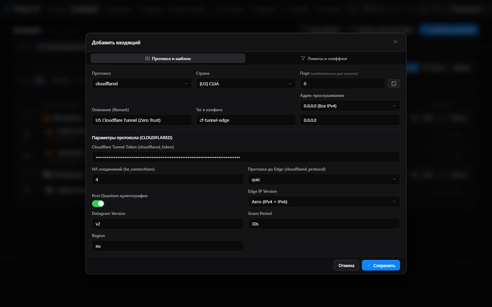

# 20. Cloudflared (Cloudflare Tunnel)

| Параметр | Значение |
| :--- | :--- |
| **Роль в `tachyon-ui`** | **Только `Inbound`** (входящий коннектор туннеля; в `Outbound` отсутствует) |
| **L4-транспорт** | Исходящие подключения от сервера к Cloudflare Edge по `QUIC` (`UDP`) или `HTTP/2` (`TCP`). **Локальный порт не открывается** |
| **TLS / REALITY / ACME** | Не используется в настройках панели (`none`); аутентификация по токену Zero Trust, TLS терминируется на Cloudflare Edge |
| **Статус в `tachyon-core 0.6.9`** | **Проверка схемы в `tachyon-core check`**, но в стандартной сборке рантайма `0.6.9` **не скомпилирован** (требуется пересборка ядра с флагом `with_cloudflared` либо внешний демон `cloudflared`) |

---

## Зачем нужен и как работает в `tachyon-core`

**Cloudflared** — входящий коннектор для **Cloudflare Tunnel** (Zero Trust). Он решает задачу приёма входящего трафика на сервере, который находится за «серым» NAT или строгим файрволом без белого IP-адреса и открытых портов: вместо ожидания входящих соединений сам сервер устанавливает несколько исходящих защищённых соединений (`ha_connections`) к ближайшим узлам Cloudflare Edge, а клиенты обращаются к вашему домену в сети Cloudflare.

> [!WARNING]
> **Фактический статус в `tachyon-core 0.6.9`:**
> Панель `tachyon-ui` предоставляет форму настройки `cloudflared`, а валидатор `tachyon-core check` проверяет все её поля.
> Однако в стандартную релизную сборку `tachyon-core 0.6.9` встроенный коннектор **не включён**: при попытке активации ядро возвращает сообщение `Cloudflared is not included in this build, rebuild with -tags with_cloudflared`.
> На практике в текущей сборке есть два рабочих сценария:
> 1. Запустить официальный внешний демон `cloudflared` на хосте (`cloudflared tunnel run --token ...`) и направить его в локальный прокси-инбаунд `tachyon-core` (например, `VLESS WS` или `HTTP/Mixed` на `127.0.0.1`).
> 2. Пересобрать `tachyon-core` с тегом сборки `with_cloudflared`, если требуется нативный запуск коннектора внутри одного процесса ядра.

---

## Скриншот формы в панели



---

## Пошаговая настройка в `tachyon-ui`

Встроенные пресеты для `cloudflared` в панели отсутствуют; настройка выполняется по токену из панели Cloudflare Zero Trust.

1. Создайте туннель в панели Cloudflare Zero Trust (`Networks → Tunnels`) и скопируйте выданный **токен туннеля (`token`)**.
2. В `tachyon-ui` откройте **Входящие (`Inbounds`) → Добавить** и выберите **`cloudflared`**. Обратите внимание, что поля `Адрес прослушивания` (`listen`) отключены, а `Порт` (`listen_port`) необязателен (`0`) — коннектор не открывает входящий сокет.
3. Вставьте полученный токен в поле **`Токен туннеля`**.
4. Укажите количество резервных соединений к Edge (`ha_connections`, по умолчанию `4`), транспортный протокол (`auto`, `quic` или `http2`), при необходимости включите постквантовый обмен ключами (`post_quantum`), версию IP Edge (`edge_ip_version`) и таймаут корректного завершения в формате строки длительности (например, `"30s"`).
5. Если используется стандартный бинарник `tachyon-core 0.6.9` без флага `with_cloudflared`, запускайте официальный сервис `cloudflared` отдельно на хосте с тем же токеном, направляя трафик в обычный локальный inbound (`vless` WS/gRPC и т. д.).

---

## Разбор всех полей, переключателей и параметров

### Входящее подключение (`Inbound`)

| Поле в панели | Ключ `tachyon-core` JSON | Допустимые значения / дефолт | Назначение |
| :--- | :--- | :--- | :--- |
| **Адрес / порт** (`inb-listen`, `inb-port`) | *(не используются)* | Отключены; порт `0` | Локальный порт не открывается |
| **Токен туннеля** (`inb-cf-tun-token`) | `token` | Строка (JWT/Base64 токен Cloudflare Zero Trust) | Секретный токен привязки к вашему туннелю в Cloudflare |
| **HA-соединения** (`inb-cf-tun-ha`) | `ha_connections` | `1..16`; дефолт `4` | Количество параллельных отказоустойчивых соединений к Edge |
| **Протокол** (`inb-cf-tun-proto`) | `protocol` | `auto`, `quic`, `http2` | Транспорт подключения к Cloudflare Edge |
| **Постквантовый KEX** (`inb-cf-tun-pq`) | `post_quantum` | `true` / `false` | Включает постквантовый обмен ключами при соединении с Edge |
| **Версия IP Edge** (`inb-cf-tun-edge-ip`) | `edge_ip_version` | `"0"` (авто), `"4"`, `"6"` | Принудительный выбор IPv4 или IPv6 для узлов Cloudflare |
| **Версия датаграмм** (`inb-cf-tun-dgram`) | `datagram_version` | Строка (напр. `v2` / `v3`, опционально) | Версия протокола передачи UDP-датаграмм поверх туннеля |
| **Grace period** (`inb-cf-tun-grace`) | `grace_period` | Строка длительности (напр. `"30s"`) | Время ожидания закрытия активных соединений при остановке (**строго строка, не число**) |
| **Регион** (`inb-cf-tun-region`) | `region` | Строка (напр. `"us"` или пусто) | Привязка к географическому региону Edge Cloudflare |

---

## Сеть, TLS и файрвол

- **TLS / REALITY / ACME:** вкладка TLS в панели для `cloudflared` скрыта. Пользовательский HTTPS-сертификат на входе обслуживает сама инфраструктура Cloudflare для вашего домена (`panel.example.com`).
- **Файрвол:** `tachyon-ui` **не создаёт входящих правил файрвола** для `cloudflared`. Необходимо только, чтобы сам сервер мог устанавливать **исходящие** соединения к сети Cloudflare (в том числе на порт `7844` TCP/UDP для `quic`/`http2`).

---

## Экспорт подписок, совместимые клиенты и пример валидного JSON `tachyon-core`

- **Экспорт подписок:** как клиентский outbound `cloudflared` **не экспортируется** — он не попадает в клиентский JSON (`singbox` / `tachyon` / `outbounds`) и Clash Meta YAML (генерируемый fallback-URI `cloudflared://...` носит справочный характер). Конечные клиенты подключаются к домену Cloudflare через обычный прокси-инбаунд (например, `VLESS WS + TLS`), который принимает трафик из туннеля.
- **Совместимые клиенты:** любой браузер или прокси-клиент, подключающийся к публичному маршруту Cloudflare Tunnel (в зависимости от сервиса за туннелем).

### Пример валидного JSON (проходит проверку полей, требует сборки `with_cloudflared` в `tachyon-core 0.6.9`)

```json
{
  "type": "cloudflared",
  "tag": "cloudflared-in",
  "token": "eyJhIjoiZXhhbXBsZSIsInQiOiJ0dW5uZWwtaWQiLCJzIjoic2VjcmV0In0=",
  "ha_connections": 4,
  "protocol": "quic",
  "post_quantum": true,
  "edge_ip_version": "4",
  "grace_period": "30s"
}
```

---

## Диагностика и частые ошибки

| Симптом / ошибка | Причина | Решение |
| :--- | :--- | :--- |
| Ошибка `Cloudflared is not included in this build, rebuild with -tags with_cloudflared` | Стандартный бинарник `tachyon-core 0.6.9` собран без встроенного коннектора `cloudflared` | Используйте внешний системный демон `cloudflared` с проксированием в локальный inbound `tachyon-core` (напр. `vless` WS или `mixed`), либо пересоберите ядро с тегом `with_cloudflared` |
| Ошибка разбора `grace_period` при проверке конфигурации | В `grace_period` передано число (`30`) вместо строки длительности | Задавайте значение строкой с единицей времени, например `"30s"` |
| Нет связи с Cloudflare Edge из контейнера/VPS | Исходящий фаервол блокирует `7844/udp` для режима `quic` | Переключите `protocol` на `"http2"` (работает по TCP) или разрешите исходящий трафик на `7844/udp` и `7844/tcp` |

---

## См. также

- [Каталог протоколов](README.md)
- [Энциклопедия протоколов](../09-protocols-encyclopedia.md)
- [19. OpenConnect](19-openconnect.md)
- [21. WireGuard](21-wireguard.md)
