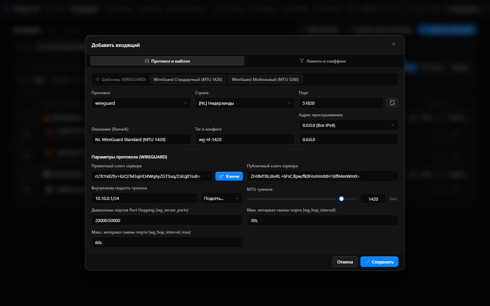

# 21. WireGuard

| Параметр | Значение |
| :--- | :--- |
| **Роль в `tachyon-ui`** | Endpoint-сервер (`#inbounds`) и Endpoint-клиент (`#outbounds`) |
| **Секция `tachyon-core`** | Строго `endpoints[]` с `"type": "wireguard"` (не `inbounds[]` и не `outbounds[]`) |
| **L4-транспорт** | UDP (`listen_port`, опциональный Port Hopping: `server_ports`, `hop_interval`, `hop_interval_max`) |
| **TLS / REALITY** | Не используется (криптография Noise_IKpsk2: X25519 + ChaCha20-Poly1305 + BLAKE2s) |
| **Статус в `tachyon-core 0.6.9`** | Полная поддержка runtime (userspace-стек `smoltcp` + `UdpHub` и системный режим Linux) |

---

## 1. Зачем нужен и как работает в `tachyon-core`

**WireGuard** — это современный, сверхлёгкий L3 VPN-туннель, работающий поверх протокола UDP с минимальными накладными расходами и современной криптографией (Noise_IKpsk2, обмен ключами X25519, шифрование ChaCha20-Poly1305). В отличие от L4/L7-прокси (VLESS, Trojan, SOCKS5), WireGuard переносит чистые IP-пакеты (TCP, UDP, ICMP) внутри виртуального сетевого интерфейса, что делает его идеальным для роутеров (OpenWrt, Keenetic, MikroTik), мобильных клиентов и межузловых туннелей.

В архитектуре **`tachyon-core`** WireGuard реализован не как обычный входящий или исходящий прокси, а как **двунаправленная конечная точка (`endpoints[]`)** с типом `"wireguard"`. На одном пространстве тегов с `outbounds[]` он способен как принимать подключения пиров-клиентов, так и выступать исходящим шлюзом маршрутизации для правил в `route.rules[]`. При этом `tachyon-ui` сохраняет привычный рабочий процесс: сервер-концентратор создаётся во вкладке **Входящие (`#inbounds`)**, а подключение к внешнему WireGuard-серверу — во вкладке **Исходящие (`#outbounds`)**, после чего генератор конфигурации автоматически выгружает оба варианта в секцию `endpoints[]`.

> [!IMPORTANT]
> В конфигурации `tachyon-core` объекты WireGuard **всегда** располагаются в массиве `endpoints[]`. Попытка поместить `"type": "wireguard"` в `outbounds[]` или `inbounds[]` при ручном редактировании JSON будет отклонена валидатором схемы ядра.

---

## 2. Скриншот формы в панели



---

## 3. Пошаговая настройка в `tachyon-ui`

### Создание серверной точки (концентратора) во вкладке «Входящие»

1. Откройте раздел **Входящие (`#inbounds`)** и нажмите **+ Добавить входящее**.
2. В списке протоколов выберите **WireGuard**.
3. Выберите один из встроенных пресетов:
   - **`WireGuard Стандартный (MTU 1420)`** — UDP-порт `51820`, подсеть `10.10.0.1/24`, `mtu: 1420` (подходит для большинства проводных и домашних каналов).
   - **`WireGuard Мобильный (MTU 1280)`** — UDP-порт `51820`, подсеть `10.10.0.1/24`, `mtu: 1280` (безопасный размер пакета для LTE/5G и сетей с PPPoE/инкапсуляцией).
4. Нажмите кнопку **Ключи** рядом с полем приватного ключа сервера — панель сгенерирует криптографически стойкую пару ключей X25519 (приватный и публичный ключ сервера заполнятся автоматически).
5. Проверьте **Внутреннюю подсеть туннеля** (по умолчанию `10.10.0.1/24`; выпадающий список предлагает также `10.10.10.1/24` и `172.16.0.1/24`). В кластерных каскадах каждому управляемому узлу автоматически выделяется изолированная подсеть туннеля.
6. При необходимости задайте диапазоны портов и интервалы для **Port Hopping** (`server_ports`, `hop_interval`, `hop_interval_max`).
7. Сохраните входящее и добавьте клиентов в списке или через подписку — каждому клиенту панель выдаст собственную пару ключей X25519 и уникальный адрес в подсети (например, `10.10.0.2/32`).

### Создание клиентского исходящего подключения во вкладке «Исходящие»

1. Откройте раздел **Исходящие (`#outbounds`)** и нажмите **+ Добавить исходящее**.
2. Выберите тип **`wireguard`**, задайте уникальный `tag` (не пересекающийся с тегами других `outbounds` и `endpoints`).
3. Укажите `Адрес сервера` (например, `198.51.100.10` или `vpn.example.com`) и `Порт сервера` (`51820`).
4. Нажмите кнопку генерации ключей рядом с `Приватный ключ клиента` (либо вставьте выданный клиентский ключ), в поле `Публичный ключ пира` вставьте публичный ключ удалённого сервера.
5. Укажите `Локальный адрес` клиента в CIDR-формате (например, `10.10.0.2/32`), подберите `MTU` и при использовании Port Hopping заполните `server_ports`, `hop_interval` и `hop_interval_max`.

---

## 4. Разбор всех полей, переключателей и параметров

### Входящий Endpoint (`#inbounds` → `endpoints[]`)

| Поле в панели | Ключ `tachyon-core` JSON | Допустимые значения / дефолт | Назначение |
| :--- | :--- | :--- | :--- |
| **Тег** | `tag` | Строка, уникальная среди `endpoints` и `outbounds` | Идентификатор WireGuard-эндпоинта. |
| **Адрес прослушивания** | `listen` | `0.0.0.0` / `::` / IP | Интерфейс сервера для приёма UDP-пакетов. |
| **Порт** | `listen_port` | `1..65535` (пресет `51820`) | Основной UDP-порт сервера WireGuard. |
| **Приватный ключ сервера** | `private_key` | Base64 (32 байта X25519) | Секретный ключ сервера. Генерируется кнопкой **Ключи**. |
| **Публичный ключ сервера** | *(в экспорте клиентов)* | Base64 (32 байта X25519) | Хранится в панели и подставляется клиентам как `peer.public_key`. |
| **Внутренняя подсеть туннеля** | `address` | Массив CIDR, дефолт `["10.10.0.1/24"]` | Виртуальный адрес сервера внутри L3-туннеля (используется и для NAT). |
| **MTU туннеля** | `mtu` | `1280..1440` (шаг `10`, дефолт `1400`) | Максимальный размер пакета туннеля. При IPv6 обязан быть `>= 1280`. |
| **Диапазоны портов Port Hopping** | `server_ports` | Массив строк (`"20000:50000"`, `"51820:51830"`) | Набор UDP-портов/диапазонов для динамической ротации порта. |
| **Мин. интервал смены порта** | `hop_interval` | Строка длительности (напр. `"30s"`) | Минимальный период переключения порта при Port Hopping. |
| **Макс. интервал смены порта** | `hop_interval_max` | Строка длительности (напр. `"60s"`) | Верхняя граница случайного интервала смены порта. |
| **Клиенты** (`wg_public_key`, `wg_client_ip`) | `peers[].public_key`, `peers[].allowed_ips` | Массив объектов пиров (`"10.10.0.2/32"`) | Публичный ключ клиента и закреплённый за ним внутренний IP. |

### Исходящий Endpoint (`#outbounds` → `endpoints[]`)

| Поле в панели | Ключ `tachyon-core` JSON | Допустимые значения / дефолт | Назначение |
| :--- | :--- | :--- | :--- |
| **Адрес сервера** | `peers[0].address` | IPv4/IPv6 или домен (`198.51.100.10`) | Внешний адрес удалённого сервера WireGuard. |
| **Порт сервера** | `peers[0].port` | `1..65535` | UDP-порт удалённого сервера. |
| **Приватный ключ клиента** | `private_key` | Base64 (32 байта X25519) | Приватный ключ локального пира. |
| **Публичный ключ пира** | `peers[0].public_key` | Base64 (32 байта X25519) | Публичный ключ удалённого сервера. |
| **Локальный адрес** | `address` | Массив CIDR (напр. `["10.10.0.2/32"]`) | Локальный IP-адрес туннельного интерфейса. |
| **MTU** | `mtu` | `1280..1440` (дефолт `1400`) | MTU клиентского интерфейса. |
| **Диапазоны портов Port Hopping** | `server_ports` | Массив диапазонов (`"20000:50000"`) | Список портов сервера для прыжков клиента. |
| **Интервал смены порта** | `hop_interval` | Строка длительности (напр. `"30s"`) | Нижний порог интервала смены порта. |
| **Макс. интервал смены порта** | `hop_interval_max` | Строка длительности (напр. `"60s"`) | Верхний порог интервала смены порта. |

---

## 5. Сеть и файрвол

- **Правила входящего файрвола**: `tachyon-ui` автоматически формирует правило **UDP** на `listen_port` (например, `51820/udp`).
- **Port Hopping**: если вы используете `server_ports` (например, `20000:50000`) на стороне сервера, необходимо разрешить входящий UDP-трафик для всего указанного диапазона портов (через DNAT/REDIRECT в файрволе на основной `listen_port` либо открыв диапазон в правилах узла).
- **NAT и IPv6**: в подсети WireGuard (по умолчанию `10.10.0.1/24`) для исходящего интернета используется NAT на внешнем интерфейсе сервера. При добавлении IPv6-адресов в `address` или `allowed_ips` минимальный `mtu` не должен опускаться ниже `1280` байт (требование IPv6 и валидатора `tachyon-core`).

---

## 6. Экспорт подписок, клиенты и пример валидного JSON `tachyon-core`

- **URI-формат**:
  ```text
  wireguard://<client_privkey>@198.51.100.10:51820?publickey=<server_pubkey>&address=10.10.0.2/32&mtu=1420#wg-main
  ```
  При включённом Port Hopping в URI добавляются query-параметры `server_ports`, `hop_interval` и `hop_interval_max`.
- **JSON-профиль (`singbox`, `tachyon`, `outbounds`)**: выгружается в верхнеуровневую секцию `endpoints[]` с `"type": "wireguard"`.
- **Clash Meta YAML (`?format=clashmeta`)**: экспортируется с `type: wireguard`, `ip`, `private-key`, `public-key`, `udp: true`.
- **Совместимые клиенты**: `tachyon-core`, роутерные сборки OpenWrt с поддержкой Port Hopping, а также любые стандартные клиенты WireGuard (без расширенных параметров Port Hopping).

### Пример валидного JSON `tachyon-core` (серверный и клиентский узлы в `endpoints[]`)

```json
{
  "endpoints": [
    {
      "type": "wireguard",
      "tag": "wg-in",
      "listen": "0.0.0.0",
      "listen_port": 51820,
      "private_key": "<SERVER_X25519_PRIVATE_KEY_BASE64>",
      "address": ["10.10.0.1/24"],
      "mtu": 1420,
      "peers": [
        {
          "public_key": "<CLIENT_X25519_PUBLIC_KEY_BASE64>",
          "allowed_ips": ["10.10.0.2/32"]
        }
      ]
    },
    {
      "type": "wireguard",
      "tag": "wg-out",
      "address": ["10.10.0.2/32"],
      "private_key": "<CLIENT_X25519_PRIVATE_KEY_BASE64>",
      "mtu": 1420,
      "server_ports": ["20000:50000"],
      "hop_interval": "30s",
      "hop_interval_max": "60s",
      "peers": [
        {
          "address": "198.51.100.10",
          "port": 51820,
          "public_key": "<SERVER_X25519_PUBLIC_KEY_BASE64>",
          "allowed_ips": ["0.0.0.0/0", "::/0"]
        }
      ]
    }
  ]
}
```

---

## 7. Диагностика и частые ошибки

- **Ошибка размещения в `outbounds[]`**: при ручной правке конфигурации объект WireGuard добавлен в `outbounds[]` вместо `endpoints[]` — ядро отклоняет такой конфиг при проверке.
- **Конфликт тегов (`duplicate tag`)**: секции `endpoints[]` и `outbounds[]` разделяют общее пространство имён тегов. Не называйте WireGuard-точку тем же `tag`, что и существующий outbound или балансировщик.
- **Пересечение `allowed_ips` у пиров**: если двум клиентам на одном инбаунде назначен одинаковый `wg_client_ip` (например, оба `10.10.0.2/32`), маршрутизация обратных пакетов нарушится и трафик перестанет доходить.
- **Фрагментация UDP и потери в мобильных сетях**: при зависании HTTPS-сайтов внутри туннеля снизьте `mtu` с `1420` до `1280` (или используйте пресет **WireGuard Мобильный**).
- **Блокировка WireGuard по сигнатуре рукопожатия**: если провайдер режет чистые UDP-пакеты WireGuard `Noise_IKpsk2`, перейдите на [22. AmneziaWG](22-amneziawg.md).

---

## 8. См. также

- [Каталог протоколов](README.md)
- [Энциклопедия протоколов Tachyon](../09-protocols-encyclopedia.md)
- [20. Cloudflared](20-cloudflared.md)
- [22. AmneziaWG](22-amneziawg.md)
- [23. Mixed / SOCKS / HTTP](23-mixed-socks-http.md)
