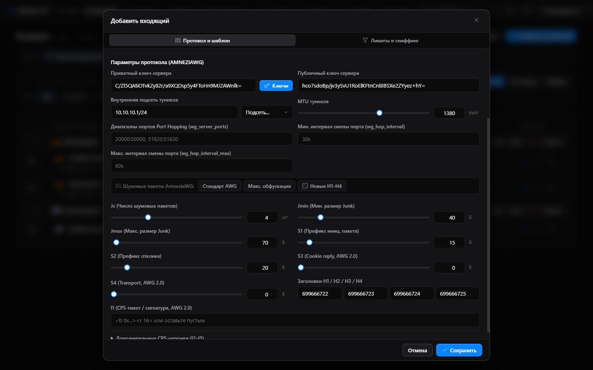

# 22. AmneziaWG

| Параметр | Значение |
| :--- | :--- |
| **Роль в `tachyon-ui`** | Endpoint-сервер (`#inbounds`) и Endpoint-клиент (`#outbounds`) |
| **Секция `tachyon-core`** | Строго `endpoints[]` с `"type": "wireguard"` и AWG-полями (`jc`, `jmin`, `jmax`, `s1..s4`, `h1..h4`, `i1..i5`) |
| **L4-транспорт** | UDP (включая Port Hopping: `server_ports`, `hop_interval`, `hop_interval_max`) |
| **TLS / REALITY** | Не используется (модифицированный Noise_IKpsk2 + мусорные пакеты и подмена заголовков) |
| **Статус в `tachyon-core 0.6.9`** | Полная поддержка runtime (AWG 1.0 / 2.0 / 3.x) |

---

## 1. Зачем нужен и как работает в `tachyon-core`

**AmneziaWG (AWG)** — это расширение классического WireGuard, устраняющее его главную уязвимость перед DPI-анализом: фиксированный размер пакетов рукопожатия (148 и 92 байта) и постоянные 4-байтовые идентификаторы типов сообщений (`1`, `2`, `3`, `4`).

В `tachyon-core` AmneziaWG работает поверх той же архитектуры `endpoints[]` (`"type": "wireguard"`), что и обычный WireGuard, и автоматически активируется при наличии хотя бы одного параметра обфускации (`jc`, `jmin`, `jmax`, `s1..s4`, `h1..h4`, `i1..i5` или `header_protection_key`). В панели `tachyon-ui` он вынесен в отдельный протокол **`amneziawg`**, чтобы отделить настройки шумовых пакетов, префиксов и CPS-сигнатур AWG 2.0 от стандартного WireGuard:

1. **Junk-пакеты (`Jc`, `Jmin`, `Jmax`)** — перед каждым рукопожатием отправляется `Jc` случайных UDP-пакетов произвольной длины в диапазоне `[Jmin..Jmax]`.
2. **Случайные префиксы (`S1`, `S2`, а в AWG 2.0 также `S3`, `S4`)** — к каждому служебному и транспортному пакету добавляется случайный префикс заданной длины, ломающий проверку по точному размеру.
3. **Замена заголовков (`H1..H4`)** — стандартные типы сообщений WireGuard (`1..4`) заменяются на случайные 32-битные числа (или диапазоны).
4. **CPS-цепочки (`I1..I5`, AWG 2.0)** — программируемые имитационные пакеты перед рукопожатием с поддержкой тегов `<b 0x...>`, `<c>`, `<t>`, `<r N>`, `<rc N>`, `<rd N>`, `<d>`, `<ds>`, `<dz N>` для мимикрии под QUIC, STUN или игровой UDP-трафик.
5. **Port Hopping** — периодическая смена UDP-порта по списку `server_ports`.

> [!WARNING]
> Для успешного установления сессии значения **`jc`, `jmin`, `jmax`, `s1..s4`, `h1..h4` и `i1..i5`** на сервере и клиенте **обязаны совпадать полностью**. При малейшем расхождении параметров сервер молча отбрасывает входящее рукопожатие.

---

## 2. Скриншот формы в панели



---

## 3. Пошаговая настройка в `tachyon-ui`

### Настройка сервера во вкладке «Входящие»

1. Откройте **Входящие (`#inbounds`)** → **+ Добавить входящее** и выберите протокол **AmneziaWG**.
2. Примените один из трёх встроенных пресетов протокола:
   - **`AmneziaWG Стандартный`** — порт `51821`, подсеть `10.10.10.1/24`, `mtu: 1380`, `jc: 4`, `jmin: 40`, `jmax: 70`, `s1: 15`, `s2: 20`. Оптимальный баланс скорости и обхода типовых сигнатурных фильтров.
   - **`AmneziaWG Усиленный Junk`** — порт `51821`, подсеть `10.10.10.1/24`, `mtu: 1360`, `jc: 7`, `jmin: 60`, `jmax: 250`, `s1: 35`, `s2: 50`. Увеличенное число и размер шумовых пакетов для агрессивного DPI.
   - **`AmneziaWG Мобильный Лайт`** — порт `51821`, подсеть `10.10.10.1/24`, `mtu: 1280`, `jc: 3`, `jmin: 20`, `jmax: 50`, `s1: 12`, `s2: 18`. Минимальный оверхед и безопасный MTU для сотовых сетей.
3. Нажмите **Ключи** для генерации пары ключей X25519 сервера.
4. В блоке **Шумовые пакеты AmneziaWG** можно дополнительно переключиться между быстрыми кнопками: **`Стандарт AWG`**, **`Макс. обфускация`** и **`Новые H1–H4`** (генератор случайных 32-битных заголовков `H1..H4`).
5. При необходимости раскройте **Дополнительные CPS-цепочки (I2–I5)** и задайте `I1..I5` для режима AWG 2.0, а также поля Port Hopping (`server_ports`, `hop_interval`, `hop_interval_max`).
6. Сохраните входящее и добавьте клиентов в подписку — `tachyon-ui` автоматически перенесёт все параметры AWG в клиентские профили.

### Настройка клиентского подключения во вкладке «Исходящие»

1. В разделе **Исходящие (`#outbounds`)** выберите тип **`amneziawg`**.
2. Заполните адрес/порт удалённого сервера, `Приватный ключ клиента`, `Публичный ключ пира`, `Локальный адрес` (например, `10.10.10.2/32`) и `MTU`.
3. Перенесите точные значения `Jc`, `Jmin`, `Jmax`, `S1`, `S2` и `H1..H4` с сервера (плюс диапазоны Port Hopping, если они включены).

---

## 4. Разбор всех полей, переключателей и параметров

Помимо общих полей WireGuard (`private_key`, `address`, `mtu`, `peers[]`, `server_ports`, `hop_interval`, `hop_interval_max`), AmneziaWG использует следующие параметры:

| Поле в панели | Ключ `tachyon-core` JSON | Допустимые значения / дефолт | Назначение |
| :--- | :--- | :--- | :--- |
| **Jc (Число шумовых пакетов)** | `jc` | `1..12` (дефолт `4`) | Количество UDP-пакетов со случайным содержимым перед рукопожатием. |
| **Jmin (Мин. размер Junk)** | `jmin` | `10..200` байт (дефолт `40`) | Минимальная длина шумового пакета; обязана удовлетворять `jmin <= jmax`. |
| **Jmax (Макс. размер Junk)** | `jmax` | `50..1000` байт (дефолт `70`) | Максимальная длина шумового пакета. |
| **S1 (Префикс иниц. пакета)** | `s1` | `5..150` байт (дефолт `15`) | Случайное дополнение перед Handshake Initiation (сообщение типа `1`). |
| **S2 (Префикс отклика)** | `s2` | `5..150` байт (дефолт `20`) | Случайное дополнение перед Handshake Response (сообщение типа `2`). |
| **S3 (Cookie reply, AWG 2.0)** | `s3` | `0..150` байт (дефолт `0`) | Случайный префикс для Cookie Reply (AWG 2.0). |
| **S4 (Transport, AWG 2.0)** | `s4` | `0..150` байт (дефолт `0`) | Случайный префикс для транспортных пакетов с данными (AWG 2.0). |
| **Заголовки H1 / H2 / H3 / H4** | `h1`, `h2`, `h3`, `h4` | Целые 32-битные числа (дефолт `102030401..102030404`) | Заменители стандартных типов пакетов WireGuard (`1..4`). Должны быть уникальными между собой. |
| **I1 (CPS-пакет / сигнатура, AWG 2.0)** | `i1` | Строка CPS-шаблона (по умолчанию пусто) | Первичный имитационный пакет перед handshake (напр. `<b 0x...><r 16>`). |
| **I2–I5 (CPS, AWG 2.0)** | `i2`, `i3`, `i4`, `i5` | Строки CPS-шаблона (напр. `<r 32>`) | Цепочка дополнительных имитационных пакетов AWG 2.0. |

### Ограничения валидатора `tachyon-core 0.6.9`

- `jmin` обязан быть меньше или равен `jmax`.
- При использовании ключа защиты заголовков `header_protection_key` (в ручном JSON) все ненулевые значения `s1..s4` должны быть `>= 12`.
- Декларативные поля генерации первого пакета (`id`, `ip`, `ib`) конфликтуют с явным `i1`.
- Параметры AmneziaWG несовместимы с обфускатором Phobos (`obfuscator_*`) на одном и том же эндпоинте.

---

## 5. Сеть и файрвол

- Открывается входящий **UDP**-порт `listen_port` (по умолчанию `51821/udp`).
- При активном `server_ports` требуется разрешить UDP для всех портов Port Hopping и маршрутизировать их на локальный порт сервиса (или открывать весь диапазон на узле).
- Учитывайте накладные расходы: префикс `S4` уменьшает полезный размер транспортного пакета, поэтому для AWG 2.0 с ненулевым `S4` рекомендуется снижать `mtu` (например, до `1360` или `1280`).

---

## 6. Экспорт подписок, клиенты и пример валидного JSON `tachyon-core`

- **URI-формат**:
  ```text
  amneziawg://<privkey>@198.51.100.10:51821?publickey=<srv_pub>&address=10.10.10.2/32&mtu=1380&jc=4&jmin=40&jmax=70&s1=15&s2=20&h1=102030401&h2=102030402&h3=102030403&h4=102030404#awg-main
  ```
  Если заданы `s3`, `s4`, `i1..i5` или параметры Port Hopping, они также добавляются в query-строку.
- **JSON-профиль (`singbox`, `tachyon`, `outbounds`)**: выгружается в `endpoints[]` с `"type": "wireguard"` и всеми заданными параметрами AWG.
- **Clash Meta YAML (`?format=clashmeta`)**: экспортируется как базовый `type: wireguard` без специфичных AWG-полей. Для полноценной работы AWG используйте формат `tachyon`, `singbox` или URI `amneziawg://`.
- **Клиенты**: `tachyon-core`, роутерные клиенты на базе `tachyon-core`, официальные приложения AmneziaWG / AmneziaVPN.

### Пример валидного JSON `tachyon-core`

```json
{
  "endpoints": [
    {
      "type": "wireguard",
      "tag": "awg-in",
      "listen": "0.0.0.0",
      "listen_port": 51821,
      "private_key": "<SERVER_X25519_PRIVATE_KEY_BASE64>",
      "address": ["10.10.10.1/24"],
      "mtu": 1380,
      "jc": 4,
      "jmin": 40,
      "jmax": 70,
      "s1": 15,
      "s2": 20,
      "h1": 102030401,
      "h2": 102030402,
      "h3": 102030403,
      "h4": 102030404,
      "peers": [
        {
          "public_key": "<CLIENT_X25519_PUBLIC_KEY_BASE64>",
          "allowed_ips": ["10.10.10.2/32"]
        }
      ]
    }
  ]
}
```

---

## 7. Диагностика и частые ошибки

- **Handshake не проходит (пакеты уходят, ответа нет)**: проверьте полное совпадение `jc`, `jmin`, `jmax`, `s1..s4`, `h1..h4` и `i1..i5` между сервером и клиентом.
- **Одинаковые значения `H1..H4`**: если два заголовка совпадают, ядро не сможет однозначно различать типы сообщений WireGuard. Используйте кнопку **Новые H1–H4**.
- **Ошибка валидации `jmin > jmax`**: проверьте, что нижняя граница `Jmin` не превышает `Jmax`.
- **Совместимость с внешними клиентами AWG 1.0**: для старых клиентов AmneziaWG оставляйте `s3 = 0`, `s4 = 0` и поля `i1..i5` пустыми.

---

## 8. См. также

- [Каталог протоколов](README.md)
- [Энциклопедия протоколов Tachyon](../09-protocols-encyclopedia.md)
- [21. WireGuard](21-wireguard.md)
- [23. Mixed / SOCKS / HTTP](23-mixed-socks-http.md)
