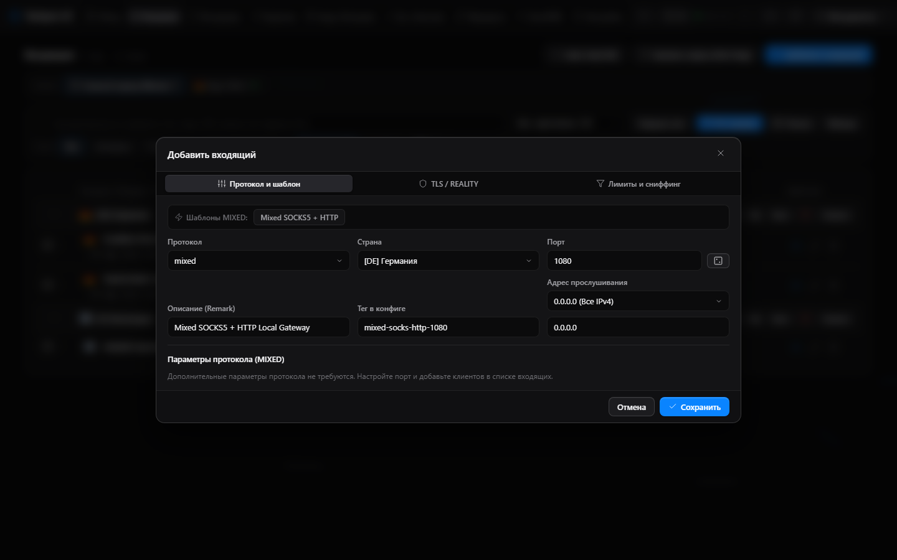

# 23. Mixed / SOCKS / HTTP

| Параметр | Значение |
| :--- | :--- |
| **Роль в `tachyon-ui`** | `mixed` — Inbound; `socks` и `http` — Inbound + Outbound |
| **L4-транспорт** | `mixed` и `socks`: TCP + UDP (`SOCKS5 UDP ASSOCIATE`); `http`: только TCP |
| **TLS / REALITY** | `mixed` и `http`: `none` или сертификатный `tls`; `socks`: без TLS (`[]`) |
| **Статус в `tachyon-core 0.6.9`** | Полная поддержка runtime |

---

## 1. Зачем нужны и как работают в `tachyon-core`

Группа локальных и транзитных прокси **`mixed`**, **`socks`** и **`http`** закрывает базовые задачи интеграции приложений, браузеров, роутеров и внешних сервисов с `tachyon-core`:

- **`mixed` (Inbound)** — универсальная точка входа, принимающая на одном порту подключения по протоколам **SOCKS4 / SOCKS4a / SOCKS5** (TCP и `UDP ASSOCIATE`) и **HTTP/1.1** (`CONNECT` для HTTPS и обычные абсолютные URI). В режиме TLS превращается в защищённый HTTPS-прокси (при включённом TLS клиентский UDP `SOCKS5 UDP ASSOCIATE` не используется).
- **`socks` (Inbound + Outbound)** — классический прокси SOCKS5 (на входящих также поддерживает SOCKS4/4a) с полноценной передачей TCP и UDP (`UDP ASSOCIATE`; на исходящем поддерживается `udp_over_tcp`). Внешний TLS не поддерживается ни на входе, ни на выходе.
- **`http` (Inbound + Outbound)** — стандартный HTTP-прокси (`CONNECT` и прямые HTTP-методы). Работает **только по TCP** (UDP не передаёт). Поддерживает как открытый режим (`none`), так и шифрование сертификатным TLS (`tls`, то есть HTTPS-прокси).

> [!NOTE]
> В ядре `tachyon-core` к категории системных локальных инбаундов также относятся `tun`, `tproxy`, `redirect` и `direct`, которые формируются панелью автоматически для перехвата трафика или роутинга.

---

## 2. Скриншот формы в панели



---

## 3. Пошаговая настройка в `tachyon-ui`

### Входящие подключения (`#inbounds`)

1. Откройте **Входящие (`#inbounds`)** → **+ Добавить входящее**.
2. Выберите тип `mixed`, `socks` или `http`. Панель предложит базовый пресет:
   - **`Mixed SOCKS5 + HTTP`** — порт `1080`, TLS `none`.
   - **`SOCKS5 Прокси`** — порт `1081`, TLS `none`.
   - **`HTTP CONNECT Прокси`** — порт `8080`, TLS `none`.
3. **Критически важный выбор адреса прослушивания (`listen`) и авторизации**:
   - Для локального использования на этом же сервере установите `listen = 127.0.0.1` (или `::1`).
   - Если порт доступен из внешней сети (`0.0.0.0`), **обязательно добавьте хотя бы одного клиента** с логином и паролем! Если список клиентов пуст, в конфиг ядра не попадает секция `users[]`, и прокси работает **без пароля (анонимно)**.
   - При наличии клиентов в списке панель включает авторизацию по логину/паролю; если все добавленные клиенты отключены или у них истёк срок, генератор подставляет защитную заглушку `__disabled__`, чтобы прокси не открылся случайно для всех.
4. Для `mixed` и `http` при выводе в интернет дополнительно рекомендуется включить вкладку **TLS** (`tls` + сертификат сервера). Для `socks` вкладка TLS скрыта намеренно — протокол её не поддерживает.

### Исходящие подключения (`#outbounds`)

1. Выберите тип `socks` или `http`.
2. Задайте `Адрес сервера`, `Порт сервера`, при необходимости `Имя пользователя` и `Пароль`.
3. Для `http` в секции **TLS и Транспорт** можно включить TLS (подключение к HTTPS-прокси), указав SNI и `insecure` при необходимости. Для `socks` блок TLS в исходящий JSON не записывается.

---

## 4. Разбор всех полей, переключателей и параметров

| Поле в панели | Ключ `tachyon-core` JSON | Допустимые значения / дефолт | Назначение |
| :--- | :--- | :--- | :--- |
| **Адрес прослушивания** (`#inbounds`) | `listen` | `0.0.0.0`, `127.0.0.1`, `::` | Сетевой интерфейс входящего прокси. Для локальных служб используйте `127.0.0.1`. |
| **Порт** (`#inbounds`) | `listen_port` | `1..65535` (пресеты `1080`, `1081`, `8080`) | Входящий порт сервиса. |
| **Клиенты** (`username`, `password`) | `users[].username`, `users[].password` | Массив пар (опционально) | Авторизация клиентов. При пустом списке на входе прокси работает без пароля. |
| **TLS режим** (`mixed`, `http`) | `tls.enabled`, `tls.certificate_path`, `tls.key_path` | `none` / `tls` | Шифрование клиентского соединения (HTTPS-прокси). Недоступно для `socks`. |
| **Адрес сервера** (`#outbounds`) | `server` | IP или домен (`198.51.100.10`) | Хост вышестоящего SOCKS5 или HTTP прокси. |
| **Порт сервера** (`#outbounds`) | `server_port` | `1..65535` | Порт удалённого прокси. |
| **Имя пользователя** (`#outbounds`) | `username` | Строка (опц.) | Логин для авторизации на удалённом SOCKS5/HTTP прокси. |
| **Пароль** (`#outbounds`) | `password` | Строка (опц.) | Пароль для авторизации на удалённом SOCKS5/HTTP прокси. |
| **TLS исходящего** (только `http`) | `tls.*` | `{ enabled, server_name, insecure, ... }` | Включает TLS при подключении к внешнему HTTPS-прокси. |

---

## 5. Сеть, файрвол и безопасность открытого прокси

> [!CAUTION]
> **Никогда не оставляйте `mixed`, `socks` или `http` на `0.0.0.0` без авторизации (`users[]`) и/или ограничений файрвола!**
> Открытый анонимный SOCKS/HTTP-прокси в публичном интернете обнаруживается сканерами за минуты и превращает сервер в источник спама, сканирования и DDoS, что приводит к блокировке VPS провайдером.

- **Правила файрвола панели**:
  - Для **`mixed`** и **`socks`**: открываются **TCP + UDP** на `listen_port` (UDP нужен для `SOCKS5 UDP ASSOCIATE`).
  - Для **`http`**: открывается только **TCP** на `listen_port`.
- **Рекомендуемая схема защиты**:
  1. Если прокси нужен только на самом сервере или через SSH-туннель — слушайте на `127.0.0.1`.
  2. Если нужен внешний доступ — используйте `http` или `mixed` с обязательным **TLS**, длинными паролями клиентов или оборачивайте трафик внутрь зашифрованных протоколов (VLESS / TewFai / WireGuard).

---

## 6. Экспорт подписок, клиенты и пример валидного JSON `tachyon-core`

- **URI-формат**:
  - `socks` и `mixed`: `socks5://<user>:<pass>@198.51.100.10:1081#label` (при отсутствии пароля часть `<user>:<pass>@` опускается).
  - `http`: `http://<user>:<pass>@198.51.100.10:8080#label`.
- **JSON (`singbox`, `tachyon`, `outbounds`)**:
  - Входящий `mixed` в клиентском экспорте преобразуется в `"type": "socks"` (так как клиент подключается как SOCKS5).
  - `socks` → `"type": "socks"`; `http` → `"type": "http"`.
- **Clash Meta YAML (`?format=clashmeta`)**:
  - `mixed` и `socks` → `type: socks5`.
  - `http` → `type: http`.
- **Клиенты**: любые браузеры, системные настройки ОС, `curl`, `tachyon-core`, Clash/Mihomo, клиенты с поддержкой SOCKS5/HTTP.

### Пример валидного JSON `tachyon-core`

```json
{
  "inbounds": [
    {
      "type": "mixed",
      "tag": "mixed-local",
      "listen": "127.0.0.1",
      "listen_port": 1080,
      "users": [
        {
          "username": "router-client",
          "password": "<STRONG_PASSWORD>"
        }
      ]
    }
  ],
  "outbounds": [
    {
      "type": "http",
      "tag": "upstream-https",
      "server": "198.51.100.10",
      "server_port": 8443,
      "username": "proxy-user",
      "password": "<STRONG_PASSWORD>",
      "tls": {
        "enabled": true,
        "server_name": "panel.example.com"
      }
    }
  ]
}
```

---

## 7. Диагностика и частые ошибки

- **Не работают игры, звонки или QUIC через исходящий `http`**: протокол `http` работает строго по TCP. Для передачи UDP-дейтаграмм используйте `socks` (или `mixed` на входе без TLS).
- **Попытка включить TLS для `socks`**: в `tachyon-core` прокси `socks` не поддерживает TLS-обёртку; при необходимости шифрования используйте `http` + TLS, `mixed` + TLS либо туннель `shadowtls` / `vless`.
- **Ошибка авторизации у клиента при «пустой» настройке**: если в `tachyon-ui` у инбаунда были созданы клиенты, но все они выключены или просрочены, ядро включает sentinel-пользователя `__disabled__` и отклоняет анонимный вход.

---

## 8. См. также

- [Каталог протоколов](README.md)
- [Энциклопедия протоколов Tachyon](../09-protocols-encyclopedia.md)
- [22. AmneziaWG](22-amneziawg.md)
- [24. Desync](24-desync.md)
