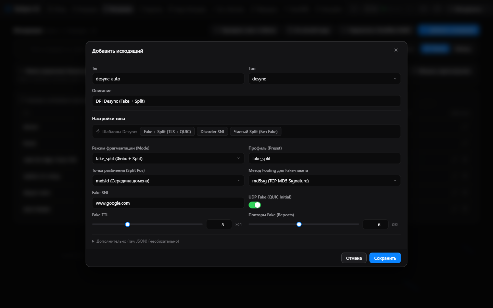

# 24. Desync

| Параметр | Значение |
| :--- | :--- |
| **Роль в `tachyon-ui`** | Outbound only (только `#outbounds`, локальный обработчик прямых соединений) |
| **L4-транспорт** | TCP (TLS ClientHello / HTTP) и UDP (включая QUIC Initial) |
| **TLS / REALITY** | Не используется (работает на уровне L3/L4-пакетов без промежуточного прокси-сервера) |
| **Статус в `tachyon-core 0.6.9`** | Полная поддержка runtime (сырые сокеты для `fake*`/`disorder` и userspace `tlsrec` без root) |

---

## 1. Зачем нужен и как работает в `tachyon-core`

**Desync** — это исходящий модуль локальной десинхронизации TCP-сегментов и UDP/QUIC-пакетов. В отличие от классических VPN и прокси, `desync` **не отправляет трафик через удалённый сервер**: он модифицирует самые первые пакеты прямого исходящего соединения (TCP SYN/PSH с TLS `ClientHello` или HTTP-запросом и стартовые QUIC Initial UDP-пакеты) так, чтобы промежуточный DPI-анализатор потерял состояние или не смог прочитать имя домена (`SNI` / `Host`), тогда как целевой сервер корректно собрал поток.

### Как устроен движок `desync` в `tachyon-core 0.6.9`

- **Сегментация (`split`, `disorder`, `multi_split`, `multi_disorder`, `tlsrec`, `oob`, `disoob`)**: разрезает `ClientHello` на несколько TCP-сегментов по позиции `split_pos` (например, посередине SLD домена `midsld` или у начала расширения SNI `sniext`), меняет порядок отправки сегментов (`disorder`) или дробит на уровне самой TLS-записи (`tlsrec`).
- **Ложные пакеты (`fake`, `fake_split`, `fake_disorder`) + Fooling**: отправляет перед реальным `ClientHello` пакет-приманку с подменённым доменом (`fake_sni`), который DPI принимает за настоящий запрос, а целевой сервер отбрасывает благодаря методу порчи (`md5sig`, `badsum`, `badseq`, `badack`, `ts`, `autottl`) или малому `fake_ttl`.
- **Защита QUIC (`udp_fake` / `quic_desync`)**: отправляет серию поддельных или фрагментированных UDP-пакетов перед реальным QUIC Initial.
- **Адаптивный режим (`auto` / `auto_tune: true`)**: автоматически подбирает рабочую стратегию и сохраняет её в 3-уровневую память (точный хост → `eTLD+1`/подсеть → глобальный рейтинг) с персистентностью в `cache.db`.

> [!IMPORTANT]
> В **`tachyon-ui v0.4.12`** и **`tachyon-core 0.6.9`** устаревшее поле **`udp_fake_packets` полностью удалено** и отклоняется строгим валидатором схемы (`reject_unknown_fields`). Для настройки UDP/QUIC-десинхронизации используются поля **`udp_fake`**, **`quic_desync`** и **`udp_repeats`**. Панель автоматически мигрирует `udp_fake_packets` при сохранении и генерации конфига.

---

## 2. Скриншот формы в панели



---

## 3. Пошаговая настройка в `tachyon-ui`

1. Откройте раздел **Исходящие (`#outbounds`)** и нажмите **+ Добавить исходящее**.
2. В списке типов выберите **`desync`** и задайте тег (например, `desync-direct`). Поля адреса и порта удалённого сервера для `desync` не требуются и скрываются.
3. В верхней части формы выберите один из **трёх встроенных шаблонов Desync**:
   - **`Fake + Split (TLS + QUIC)`**: устанавливает `mode: "fake_split"`, `preset: "fake_split"`, `split_pos: "midsld"`, `fooling: "md5sig"`, `fake_sni: "www.google.com"`, `fake_ttl: 5`, `repeats: 6`, `udp_fake: true`.
   - **`Disorder SNI`**: устанавливает `mode: "fake_disorder"`, `preset: "fake_disorder"` (вместо устаревшего алиаса `disorder_tls`), `split_pos: "sniext"`, `fooling: "badseq"`, `fake_sni: "www.microsoft.com"`, `fake_ttl: 4`, `repeats: 4`, `udp_fake: true`.
   - **`Чистый Split (Без Fake)`**: устанавливает `mode: "split"`, `preset: "split"`, `split_pos: "midsld"`, `fooling: ""`, `fake_ttl: 0` (удаляется из JSON), `repeats: 1`, `udp_fake: false`.
4. При необходимости выберите режим **`auto (Авто-подбор)`** для включения встроенного адаптивного перебора стратегий (`auto_tune: true`).
5. Привяжите созданный тег `desync` к нужным доменам или наборам `.trs` в разделе **Маршруты (`#routes`)**.

---

## 4. Разбор всех полей, переключателей и параметров

| Поле в панели | Ключ `tachyon-core` JSON | Допустимые значения / дефолт | Назначение |
| :--- | :--- | :--- | :--- |
| **Режим фрагментации (Mode)** | `mode` | `auto`, `fake_split`, `fake_disorder`, `fake`, `disorder`, `split`, `multi_split`, `multi_disorder`, `tlsrec`, `oob`, `disoob` | Основной алгоритм модификации TCP-потока. |
| **Профиль (Preset)** | `preset` | Строка (напр. `fake_split`, `fake_disorder`, `split`, `auto`, `multi_disorder`, `tlsrec`, ...) | Именованный профиль стратегии в ядре. Устаревший `disorder_tls` приводится к `fake_disorder`. |
| *(Автоматически при `auto`)* | `auto_tune` | `true` / `false` | Включает адаптивный подбор с сохранением в `cache.db`, когда `mode` или `preset` равен `auto`/`adaptive`. |
| **Точка разбиения (Split Pos)** | `split_pos` | В UI: `midsld`, `sniext`, `1`, `2` (в ядре также `sni`, `sniext+1`, `host+1`, `midsld-2`, `midsld+2`, `endhost-1`, `extlen` или массив) | Позиция разрезания TCP-сегмента относительно SNI/Host. |
| **Метод Fooling для Fake-пакета** | `fooling` | `""` (без Fake), `md5sig`, `badsum`, `badseq`, `badack`, `ts`, `autottl`, `md5_badack` (в ядре также `hopbyhop`, `badseq_badack_badsum`, `datanoack`) | Механизм отбрасывания фейкового пакета целевым сервером. Значение `"none"` в JSON не пишется. |
| **Fake SNI** | `fake_sni` | Доменная строка (дефолт `www.google.com`) | Подменное доменное имя в фальшивом TLS `ClientHello`. |
| **Fake TTL** | `fake_ttl` | В UI `0..16` (дефолт `5`; в ядре `1..128`, значение `0` удаляется) | Ограничение времени жизни (хопов) фейкового пакета, чтобы он не доходил до сервера назначения. |
| **Повторы Fake (Repeats)** | `repeats` | В UI `1..12` (дефолт `6`; в ядре `1..100`) | Количество повторений фейковых/сегментированных отправок на поток. |
| **UDP Fake (QUIC Initial)** | `udp_fake`, `quic_desync`, `udp_repeats` | Переключатель `bool` (при `true` панель также задаёт `udp_repeats: 6`) | Активирует десинхронизацию UDP/QUIC-пакетов. Вручную через JSON также доступны `udp_fake_ttl`, `udp_fake_payload` (hex <= 1472 Б), `udp_out_range`, `udp_keep_socket`, `quic_repeats`. |

---

## 5. Сеть, права и файрвол

- Входящих портов `desync` не открывает.
- Методы, формирующие сырые TCP/IP-заголовки и опции (`fake`, `fake_split`, `fake_disorder`, `disorder`, `multi_disorder`, `oob`, `disoob`), на Linux требуют привилегий `CAP_NET_RAW` (или запуск от `root`, что стандартно для роутеров OpenWrt и системного сервиса).
- Если сервис запущен в непривилегированном контейнере без `CAP_NET_RAW`, используйте **`mode: "tlsrec"`** или **`split`**, работающие на уровне обычного userspace-сокета.

---

## 6. Экспорт подписок, клиенты и пример валидного JSON `tachyon-core`

- **Подписки**: `desync` предназначен для работы внутри конфигурации ядра `tachyon-core` (на роутере, шлюзе или в профиле локального клиента `tachyon-core`). В сторонние URI-подписки и Clash Meta YAML как удалённый сервер не экспортируется.
- **Клиенты**: `tachyon-core` (десктоп, шлюз, роутер OpenWrt).

### Пример валидного JSON `tachyon-core`

```json
{
  "outbounds": [
    {
      "type": "desync",
      "tag": "desync-direct",
      "mode": "fake_split",
      "preset": "fake_split",
      "auto_tune": false,
      "split_pos": "midsld",
      "fooling": "md5sig",
      "fake_sni": "www.google.com",
      "fake_ttl": 5,
      "repeats": 6,
      "udp_fake": true,
      "quic_desync": true,
      "udp_repeats": 6
    }
  ]
}
```

---

## 7. Диагностика и частые ошибки

- **Ошибка `unknown field 'udp_fake_packets'` при проверке конфига**: в старых конфигах использовался ключ `udp_fake_packets`. Откройте и пересохраните outbound в `tachyon-ui v0.4.12` или замените вручную на `udp_fake: true`, `quic_desync: true`, `udp_repeats: 6`.
- **Ошибка из-за `fooling: "none"` или `fake_ttl: 0`**: в валидном JSON ядра для отключения фейков эти поля должны отсутствовать, а не содержать `"none"` или `0`.
- **Отказ отправки fake-пакетов без прав root**: проверьте наличие `CAP_NET_RAW` у процесса `tachyon-core` либо переключитесь на `mode: "tlsrec"`.
- **Сайты не открываются при слишком большом `fake_ttl`**: если `fake_ttl` больше реального числа хопов до сервера назначения, фейковый пакет доходит до целевого сервера и может сорвать handshake (при пустом `fooling`). Снизьте `fake_ttl` до `3..5` или включите `fooling: "md5sig"` / `"badseq"`.

---

## 8. См. также

- [Каталог протоколов](README.md)
- [Энциклопедия протоколов Tachyon](../09-protocols-encyclopedia.md)
- [23. Mixed / SOCKS / HTTP](23-mixed-socks-http.md)
- [27. Балансировщики и цепочки (urltest / selector / chain)](27-balancers-and-chain.md)
