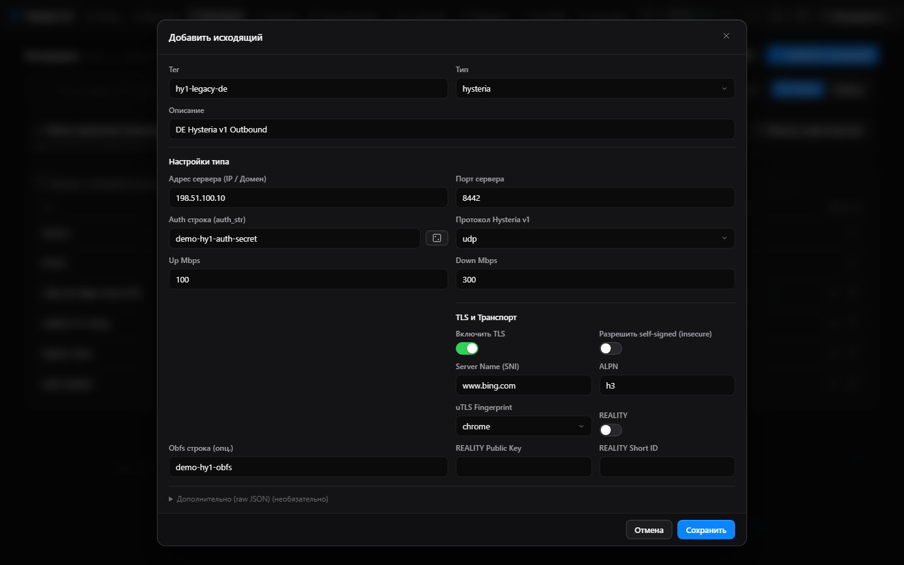

# 25. Hysteria v1

| Параметр | Значение |
| :--- | :--- |
| **Роль в `tachyon-ui`** | Outbound only (`#outbounds`, тип `hysteria`) |
| **L4-транспорт** | UDP (`udp`, `wechat-video`, `faketcp`) |
| **TLS / REALITY** | Сертификатный TLS (`tls.enabled: true`) обязателен на уровне схемы |
| **Статус в `tachyon-core 0.6.9`** | **Схема и UI поддерживаются, но runtime в `tachyon-core 0.6.9` не реализован** (`not implemented yet` при запуске) |

---

## 1. Зачем нужен и как работает в `tachyon-core`

**Hysteria v1** — первое поколение высокоскоростного UDP-протокола на базе модифицированного QUIC с агрессивным управлением перегрузкой Brutal и несколькими режимами маскировки транспортного уровня (`udp`, `wechat-video`, `faketcp`).

> [!WARNING]
> **Честный статус в `tachyon-core 0.6.9`**:
> Тип `hysteria` присутствует в интерфейсе `tachyon-ui`, парсере импорта подписок (`hysteria://` / `hy://`) и проходит синтаксическую проверку схемы `tachyon-core check`, однако **обработчик runtime в `tachyon-core 0.6.9` не реализован**. Попытка запустить ядро с активным исходящим `hysteria` завершится ошибкой инициализации `not implemented yet`.
>
> Для реальной эксплуатации используйте современный и полностью поддерживаемый протокол **[03. Hysteria2](03-hysteria2.md)**.

Форму `hysteria` в `tachyon-ui` имеет смысл использовать только для:
- импорта и хранения старых ссылок `hysteria://` до их миграции на `hysteria2`;
- тестирования и валидации конфигурационной схемы через `tachyon-core check`.

---

## 2. Скриншот формы в панели



---

## 3. Пошаговая настройка в `tachyon-ui`

1. Откройте раздел **Исходящие (`#outbounds`)** → **+ Добавить исходящее**.
2. Выберите тип **`hysteria`** (встроенных пресетов в панели нет).
3. Заполните `Адрес сервера` (например, `198.51.100.10`), `Порт сервера` (`443` или порт сервера Hysteria v1).
4. Укажите строку авторизации **`auth_str`** (или сгенерируйте случайную строку кнопкой с кубиком).
5. Выберите транспортный диалект `Протокол Hysteria v1` (`udp`, `wechat-video`, `faketcp`), задайте `Up Mbps`, `Down Mbps` и при необходимости `Obfs строка`.
6. В секции **TLS и Транспорт** оставьте включённым TLS и задайте `SNI` (при отсутствии явного блока TLS генератор конфига подставляет `{ "enabled": true, "insecure": true, "server_name": <server> }`).

---

## 4. Разбор всех полей, переключателей и параметров

| Поле в панели | Ключ `tachyon-core` JSON | Допустимые значения / дефолт | Назначение |
| :--- | :--- | :--- | :--- |
| **Адрес сервера** | `server` | IP или домен (`198.51.100.10`) | Хост сервера Hysteria v1. |
| **Порт сервера** | `server_port` | `1..65535` | UDP-порт (или TCP для `faketcp`) удалённого сервера. |
| **Auth строка (`auth_str`)** | `auth_str` | Строка (также читается алиас `auth` / `password`) | Секретная строка аутентификации клиента Hysteria v1. |
| **Протокол Hysteria v1** | `protocol` | `udp`, `wechat-video`, `faketcp` | Режим транспорта *(см. примечание ниже о строгой проверке `check`)*. |
| **Up Mbps** | `up_mbps` | Целое `>= 1` (дефолт `100`) | Заявленная исходящая скорость канала в Мбит/с. |
| **Down Mbps** | `down_mbps` | Целое `>= 1` (дефолт `200`) | Заявленная входящая скорость канала в Мбит/с. |
| **Obfs строка (опц.)** | `obfs` | Строка (по умолчанию пусто) | Пароль простой XOR-обфускации пакетов Hysteria v1. |
| **Включить TLS** | `tls.enabled` | `true` (обязательно) | Активирует TLS; без объекта `tls` схема не проходит проверку. |
| **Server Name (SNI)** | `tls.server_name` | Доменная строка | Ожидаемый SNI сертификата сервера. |
| **Разрешить self-signed** | `tls.insecure` | `bool` | Пропуск проверки цепочки сертификата для самоподписанных ключей. |

> [!NOTE]
> При строгой проверке через `tachyon-core check` белый список допустимых полей outbound `hysteria` включает `up`, `up_mbps`, `down`, `down_mbps`, `obfs`, `auth`, `auth_str`, `server_ports`, `hop_interval`, `network`, `tls` (без поля `protocol`). Учитывайте это, если вручную проверяете конфигурацию строгим валидатором.

---

## 5. Сеть и файрвол

- Как исходящий outbound, Hysteria v1 не открывает входящих серверных портов в панели.
- Для исходящих соединений от сервера к внешнему узлу Hysteria v1 требуется разрешение исходящего UDP (или TCP для `faketcp`).

---

## 6. Экспорт подписок, клиенты и пример валидного JSON `tachyon-core`

- **Входящий парсер подписок**: панель распознаёт ссылки формата `hysteria://` и `hy://` при импорте в пул `#outbounds`.
- **Экспорт клиентам**: в связи с отсутствием runtime-реализации в `tachyon-core 0.6.9` для рабочих клиентских профилей рекомендуется мигрировать на `hysteria2`.

### Пример JSON схемы для проверки `tachyon-core check`

```json
{
  "outbounds": [
    {
      "type": "hysteria",
      "tag": "hy1-legacy",
      "server": "198.51.100.10",
      "server_port": 36712,
      "auth_str": "<AUTH_SECRET>",
      "up_mbps": 100,
      "down_mbps": 200,
      "obfs": "<OBFS_SECRET>",
      "tls": {
        "enabled": true,
        "server_name": "panel.example.com",
        "insecure": true
      }
    }
  ]
}
```

---

## 7. Диагностика и частые ошибки

- **Ошибка `not implemented yet` при запуске ядра**: ожидаемое поведение в `tachyon-core 0.6.9` — Hysteria v1 не реализована в runtime. Удалите или замените outbound на `hysteria2` (или `tuic` / `tewfai`).
- **Ошибка валидации из-за поля `protocol` в строгом режиме `check`**: удалите ключ `protocol` в расширенных настройках JSON, если проверяете конфиг на совместимость с минимальной схемой.
- **Отсутствует объект `tls`**: схема Hysteria v1 требует `tls.enabled: true`.

---

## 8. См. также

- [Каталог протоколов](README.md)
- [Энциклопедия протоколов Tachyon](../09-protocols-encyclopedia.md)
- [03. Hysteria2](03-hysteria2.md)
- [26. SSH / Tor / Bridge](26-ssh-tor-bridge.md)
