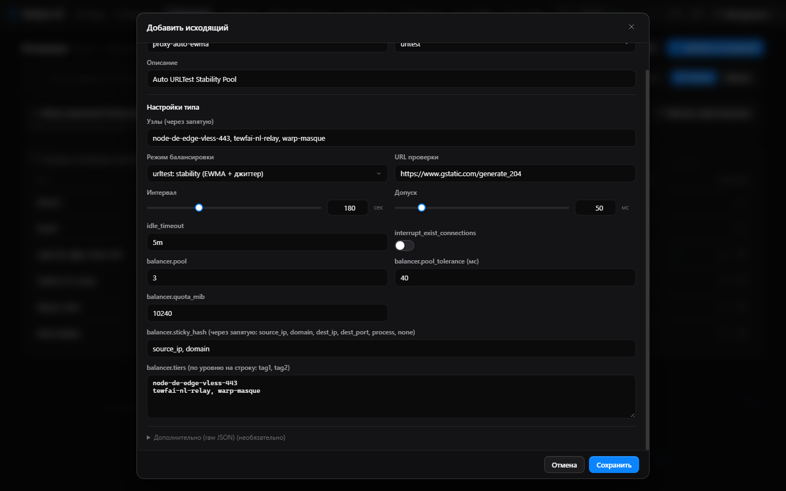
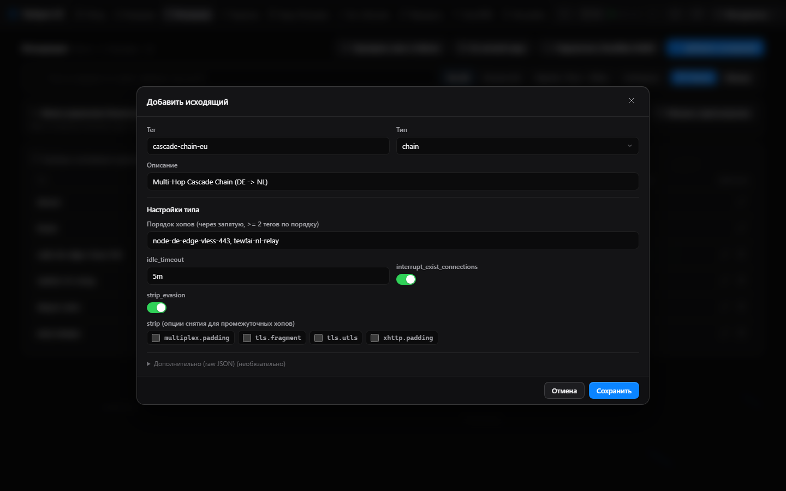

# 27. Балансировщики и цепочки (`urltest`, `selector`, `chain`, `direct`, `block`)

| Параметр | Значение |
| :--- | :--- |
| **Роль в `tachyon-ui`** | Групповые и системные `outbounds[]` (`#outbounds` и вкладка **Балансировщики** в `#subs`) |
| **L4-транспорт** | TCP и UDP (наследуются от узлов-участников `outbounds[]`) |
| **TLS / REALITY** | Собственных TLS-полей не имеют; применяются к конечным узлам |
| **Статус в `tachyon-core 0.6.9`** | Полная поддержка runtime (12 режимов `urltest`, `selector`, `chain`, встроенные `direct` и `block`) |

---

## 1. Зачем нужны и как работают в `tachyon-core`

Вместо привязки маршрутов к одному серверу **`tachyon-core`** и **`tachyon-ui`** позволяют объединять узлы (и эндпоинты `wireguard`/`amneziawg`) в интеллектуальные группы и каскады:

1. **`urltest`** — автоматический балансировщик с **12 алгоритмами выбора узла**, периодическими проверками доступности (`url`), защитой от лишних переключений (`tolerance`), перебором до 8 резервных узлов при ошибке подключения и пассивным Circuit-Breaker.
2. **`selector`** — ручной переключатель активного узла в реальном времени (через Clash API или клиентское приложение) с опциональным `auto_failover` при отказе выбранного узла.
3. **`chain`** — последовательный многохоповый каскад из **2 и более узлов** (`Хоп 1 → Хоп 2 → ... → Цель`), где каждый промежуточный узел выступает транспортом для следующего. Поддерживает снятие флагов маскировки (`strip_evasion` и гранулярные опции `strip`) на внутренних звеньях.
4. **`direct` и `block`** — встроенные мета-исходящие ядра: `direct` выпускает трафик напрямую без проксирования (автоматически добавляется, если пул исходящих пуст или используется в правилах), а `block` сбрасывает нежелательные соединения (например, BitTorrent или рекламу).

> [!TIP]
> Балансировщики можно создавать как глобально в разделе **Исходящие (`#outbounds`)** для серверной маршрутизации и каскадов, так и внутри конкретной подписки (**`#subs` → Балансировщики**, включая автогруппировку по странам `auto-fi`, `auto-de` и т. д.).

---

## 2. Скриншоты форм в панели

### Балансировщик `urltest`



### Цепочка `chain`



---

## 3. Пошаговая настройка в `tachyon-ui`

### Настройка `urltest`

1. Откройте **Исходящие (`#outbounds`)** → **+ Добавить исходящее** и выберите тип **`urltest`**.
2. В поле `Узлы (через запятую)` перечислите теги существующих исходящих узлов или эндпоинтов.
3. Выберите один из **12 режимов балансировки** (`mode`).
4. Проверьте URL пробы (по умолчанию `https://www.gstatic.com/generate_204`), интервал (`10..600` с, дефолт `180s` в форме) и допуск (`10..300` мс, дефолт `50` мс в слайдере).
5. Для режимов с поддержкой расширенных опций (все, кроме `least_test` и `failover`) при необходимости задайте `balancer.pool`, `balancer.pool_tolerance`, `balancer.quota_mib`, `balancer.sticky_hash` или уровни `balancer.tiers`.

### Настройка `selector` и `chain`

- Для **`selector`**: укажите список тегов в `Узлы`, задайте `Узел по умолчанию` (`default`), при желании включите `auto_failover` и `interrupt_exist_connections`.
- Для **`chain`**: укажите **минимум 2 тега** в строгом порядке прохождения (`входной_узел, выходной_узел`), при необходимости включите `strip_evasion` или отметьте чипы `strip` (`multiplex.padding`, `tls.fragment`, `tls.utls`, `xhttp.padding`) для снятия лишней обфускации на промежуточных хопах.

---

## 4. Все 12 режимов `urltest` и параметры полей

### Все 12 режимов `urltest` в `tachyon-ui v0.4.12` + `tachyon-core 0.6.9`

| Режим (`mode`) | Объект `balancer` | Алгоритм выбора узла | Когда применять |
| :--- | :--- | :--- | :--- |
| **`least_test`** *(дефолт)* | **Запрещён** | Активная проба `url`, выбор минимального RTT с гистерезисом `tolerance` и EWMA при активных потоках. | Универсальный базовый выбор самого быстрого узла. |
| **`failover`** | **Запрещён** | Строгий приоритет по списку `outbounds`: проверяет только активный узел, переключается лишь при сбое. | Основной сервер + резервный канал. |
| **`stability`** | Разрешён | Композитная оценка: RTT + EWMA + джиттер (RFC 3550) + штраф за потери пакетов. | Звонки, стриминг, SSH, удалённый рабочий стол. |
| **`sticky`** | Разрешён | Детерминированное Rendezvous/HRW-хеширование по ключам `sticky_hash`. | Банки, личные кабинеты и сервисы, не терпящие смены IP. |
| **`least_load`** | Разрешён | Выбор узла с минимальной метрикой `(active_conns + 1) * RTT`. | Равномерная разгрузка пула при множестве клиентов. |
| **`weighted`** | Разрешён | Smooth Weighted Round-Robin (SWRR) с весом пропорциональным `(best_rtt / rtt)^2`. | Распределение нагрузки с перекосом в сторону ближайших узлов. |
| **`round_robin`** | Разрешён | Циклическая ротация новых потоков по здоровым узлам пула (`balancer.pool`). | Большое количество коротких HTTP/API-запросов. |
| **`passive`** | Разрешён | Пассивный Circuit-Breaker по реальной телеметрии потоков (TTFB, отказы, zero-RX stall). | Экономия трафика и CPU на роутерах и мобильных сетях. |
| **`priority`** | Разрешён | Многоуровневый каскад по `balancer.tiers` (Tier 1 → Tier 2 → ...) с автовозвратом на верхний уровень. | Строгая иерархия «основные быстрые → резервные». |
| **`hedged`** | Разрешён | Параллельная гонка TCP, если первичный узел превышает `1.5 * EWMA RTT` в окне `80..600` мс. | Минимальная задержка открытия страниц на нестабильном Wi-Fi/LTE. |
| **`throughput`** | Разрешён | Отбор узла с максимальной подтверждённой пропускной способностью (EWMA KiB/s на живых потоках). | Загрузка больших файлов, видео 4K, резервные копии. |
| **`quota`** | Разрешён | Распределение трафика с контролем лимита `balancer.quota_mib` на узел. | Пул недорогих VPS с жёстким месячным лимитом трафика. |

> [!IMPORTANT]
> В режимах **`least_test`** и **`failover`** наличие непустого объекта `balancer` запрещено валидатором `tachyon-core`. Панель `tachyon-ui` автоматически очищает блок `balancer` при генерации конфига для этих режимов.

### Таблица параметров `urltest`, `selector` и `chain`

| Тип | Поле в панели | Ключ `tachyon-core` JSON | Допустимые значения / дефолт | Назначение |
| :--- | :--- | :--- | :--- | :--- |
| `urltest` | **Узлы** | `outbounds` | Массив тегов (не пустой) | Список участников балансировки. |
| `urltest` | **Режим балансировки** | `mode` | Один из 12 режимов (дефолт `least_test`) | Алгоритм выбора узла. |
| `urltest` | **URL проверки** | `url` | URL (дефолт `https://www.gstatic.com/generate_204`) | Адрес HTTP 204 пробы доступности. |
| `urltest` | **Интервал** | `interval` | `10..600` с (дефолт `180s` в UI, `300s` в ядре/подписках) | Период фоновых проверок узлов. |
| `urltest` | **Допуск** | `tolerance` | `10..300` мс (дефолт `50` / fallback `40`) | Порог разницы RTT, предотвращающий флаппинг. |
| `urltest` | **idle_timeout** | `idle_timeout` | Строка длительности (напр. `"5m"`) | Время простоя перед остановкой фоновых проб. |
| `urltest` | **interrupt_exist_connections** | `interrupt_exist_connections` | `bool` | Разрывать ли старые сессии при смене активного узла. |
| `urltest` | **balancer.pool** | `balancer.pool` | Целое `> 0` | Размер активного пула лучших узлов. |
| `urltest` | **balancer.pool_tolerance** | `balancer.pool_tolerance` | `0..=15000` мс | Допустимый разброс RTT внутри активного пула. |
| `urltest` | **balancer.quota_mib** | `balancer.quota_mib` | Целое `> 0` (МиБ) | Квота трафика на узел для режима `quota`. |
| `urltest` | **balancer.sticky_hash** | `balancer.sticky_hash` | Массив из `source_ip`, `domain`, `dest_ip`, `dest_port`, `process` — **или** `["none"]` в одиночку | Ключи хеширования для режима `sticky`. |
| `urltest` | **balancer.tiers** | `balancer.tiers` | `string[][]` (по уровню на строку) | Уровни приоритетов для режима `priority`. |
| `selector` | **Узлы** | `outbounds` | Массив тегов | Список доступных вариантов переключения. |
| `selector` | **Узел по умолчанию** | `default` | Тег из `outbounds` | Стартовый активный узел. |
| `selector` | **auto_failover** | `auto_failover` | `bool` | Автоматический временный переход при отказе выбранного узла. |
| `selector` | **interrupt_exist_connections** | `interrupt_exist_connections` | `bool` | Сброс открытых потоков при переключении узла. |
| `chain` | **Порядок хопов** | `outbounds` | Массив `>= 2` тегов | Последовательный маршрут `Хоп 1 → ... → Выходной хоп`. |
| `chain` | **idle_timeout** | `idle_timeout` | Строка длительности (напр. `"5m"`) | Тайм-аут простоя каскадных соединений. |
| `chain` | **interrupt_exist_connections** | `interrupt_exist_connections` | `bool` | Сброс соединений при изменении состояния цепочки. |
| `chain` | **strip_evasion** | `strip_evasion` | `bool` | Снятие флагов маскировки между промежуточными хопами. |
| `chain` | **strip** | `strip` | Объект `{ "multiplex.padding": true, "tls.fragment": true, "tls.utls": true, "xhttp.padding": true }` | Точечное отключение параметров обхода на внутренних звеньях. |

---

## 5. Сеть и файрвол

- Группы `urltest`, `selector`, `chain`, `direct` и `block` не открывают входящих портов и правил файрвола не создают.
- Балансировщики и каскады могут ссылаться как на объекты `outbounds[]`, так и на `endpoints[]` (WireGuard / AmneziaWG), так как теги находятся в едином пространстве имён.

---

## 6. Экспорт подписок, клиенты и пример валидного JSON `tachyon-core`

- **JSON (`singbox` / `json`)**: полная генерация `selector`, `urltest` (включая вложенный `balancer` и автогенерируемые страновые группы `country-<cc>`), `chain`, `direct`, `block`. Нерабочие или удалённые теги автоматически вычищаются (`prune_dangling_outbound_refs`).
- **JSON (`tachyon`)**: добавляются `urltest`-балансировщики, включая страновые группы.
- **Clash Meta YAML (`?format=clashmeta`)**:
  - `selector` → `select`
  - `failover` / `priority` → `fallback`
  - `sticky` → `load-balance` (`strategy: consistent-hashing`)
  - `round_robin` / `weighted` / `least_load` → `load-balance` (`strategy: round-robin`)
  - остальные режимы `urltest` → `url-test`
  - Тип **`chain` в Clash Meta YAML не экспортируется** — для многохоповых цепочек используйте нативный JSON (`tachyon` / `singbox`).

### Пример валидного JSON `tachyon-core`

```json
{
  "outbounds": [
    {
      "type": "urltest",
      "tag": "auto-eu",
      "outbounds": ["de-tewfai", "nl-vless", "fi-wg"],
      "mode": "stability",
      "url": "https://www.gstatic.com/generate_204",
      "interval": "180s",
      "tolerance": 50,
      "idle_timeout": "5m",
      "interrupt_exist_connections": false,
      "balancer": {
        "pool": 2,
        "pool_tolerance": 80
      }
    },
    {
      "type": "selector",
      "tag": "manual-main",
      "outbounds": ["auto-eu", "de-tewfai", "nl-vless", "direct"],
      "default": "auto-eu",
      "auto_failover": true,
      "interrupt_exist_connections": true
    },
    {
      "type": "chain",
      "tag": "double-hop",
      "outbounds": ["entry-relay", "exit-nl"],
      "idle_timeout": "5m",
      "strip_evasion": true,
      "strip": {
        "tls.fragment": true,
        "xhttp.padding": true
      }
    },
    {
      "type": "direct",
      "tag": "direct"
    },
    {
      "type": "block",
      "tag": "block"
    }
  ]
}
```

---

## 7. Диагностика и частые ошибки

- **Объект `balancer` в `least_test` или `failover`**: при ручной правке JSON наличие непустого `balancer` в этих двух режимах отклоняется при инициализации `urltest`.
- **Менее 2 тегов в `chain`**: каскад обязан содержать минимум 2 тега в порядке прохождения трафика; при удалении одного из участников цепочка автоматически снимается очисткой висячих ссылок.
- **Комбинирование `"none"` с другими ключами в `sticky_hash`**: ключ `"none"` допустим только в одиночку (`["none"]`).
- **Висячие ссылки после удаления узла**: если один из участников был удалён или отброшен (например, невалидный `masque`), `tachyon-ui` автоматически вычищает ссылку и каскадно снимает опустевшую группу, чтобы ядро не упало при старте.
- **Живое управление и сброс Circuit-Breaker**: для ручной проверки задержек, переключения узла в `selector` или сброса сработавшего Circuit-Breaker используйте пул `#outbounds` или консоль диагностики ядра (подробнее — в [Глава 4. Балансировщики, chain и маршрутизация](../04-balancers-chain-and-routes.md)).

---

## 8. См. также

- [Каталог протоколов](README.md)
- [Энциклопедия протоколов Tachyon](../09-protocols-encyclopedia.md)
- [Глава 4. Балансировщики, chain и маршрутизация](../04-balancers-chain-and-routes.md)
- [24. Desync](24-desync.md)
- [26. SSH / Tor / Bridge](26-ssh-tor-bridge.md)
